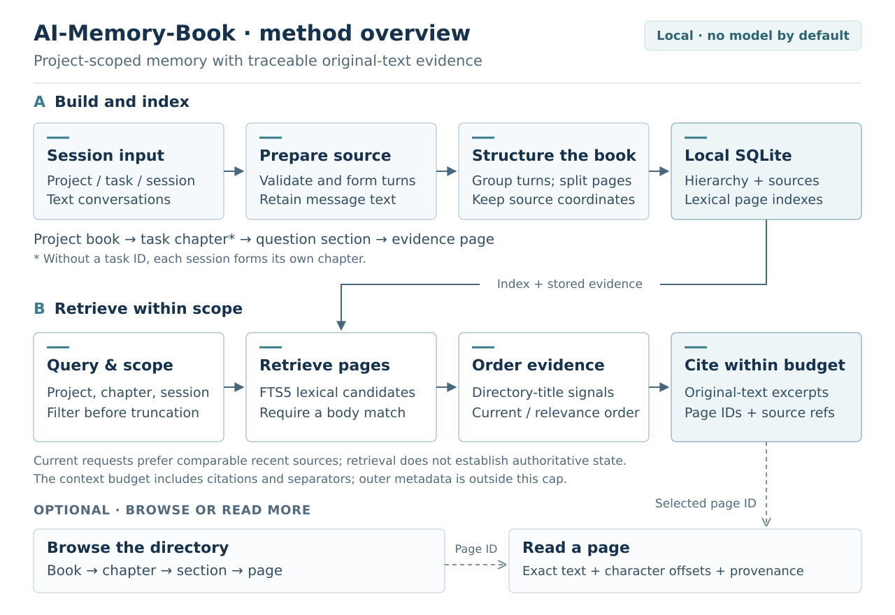

# AI-Memory-Book

**Give AI an addressable book of engineering memory, with a separate book for each project.**

Preserve conversations as project books, task chapters, question sections and original evidence pages. Find a chapter from its title or question, then follow its addresses to the source. Similar codebases can reuse task names and parameters while keeping their records in explicit project namespaces. Recover decisions, corrections, constraints and failed attempts when a session ends or a client changes.

**v0.13.0 release preparation · MIT · Python 3.10+ · SQLite / FTS5 · Optional native C acceleration**

**v0.13.0 is being prepared for publication.** The independently audited long-history replay reaches **100,000 pages across 788 projects**. At every one of seven checkpoints, the v0.13 source returns complete evidence for **56/56 answerable recall cases**, compared with **48/56** for the v0.12 baseline. Directory navigation has lower pooled p50 in all 14 measured query-stage groups; recall has both improvements and slower cases. The source experiment is verified; release registration, final release-source CI, native wheels and public installation remain separate gates. [Results and limits](docs/current-results.md) · [Published v0.12 installation proof](benchmarks/reports/v0.12-publication/README.md).

[简体中文](README.zh-CN.md) · [Results](#evidence-coverage) · [Performance](#performance) · [Quick start](#quick-start) · [How it works](#how-it-works) · [Documentation](#documentation)

## At a glance

| Complete evidence | Directory contracts | Current-declaration diagnosis | Targeted safeguards |
|:---:|:---:|:---:|:---:|
| **72 / 72** answerable cases | **119 / 119** checks per backend | **38 / 38** answerable cases | **37 / 37** controls per backend |
| Original 80-question engineering fixture; two budgets and two packing tracks | Navigation, pagination, exact scope and original-page reads | Separate 62-question diagnostic; four auto-mode budget/limit settings | Quotation, revocation, field/scope identity and independent report facts |

These are authored development-fixture results with distinct denominators. They measure retrieved evidence and API contracts, not coding-model answer accuracy, independent holdout quality or production task success. [Exact measured sources, raw records and limits](docs/current-results.md).

| What you need | What the source implementation provides |
|---|---|
| Resume an engineering task | Original decisions, later corrections, constraints and failed attempts with source references |
| Keep similar projects separate | Exact project IDs and project-bound MCP connections, including follow-up page reads |
| Locate a task from its heading | Indexed title/question/directory search, unique chapter results and scoped follow-up addresses |
| Recover a later decision | Check complete source-local declarations, field identity and environment before current-state ordering; retain historical/event evidence when requested |
| Recognize uncertainty | Surface bounded comparable-declaration and potential-conflict diagnostics, with original page IDs for inspection |
| Search code and conversations | Chinese/English lexical retrieval plus acronym, camel-case and snake-case aliases |
| Control the returned context | A default 2,400-character budget and up to five results; optional exact token caps |
| Switch clients | One archive shared across supported Claude Code, Codex, Gemini and other integrations |
| Operate locally | SQLite / FTS5; default ingestion and lexical recall make no model calls |
| Recover safely | Verified online backups, transactional source replacement and snapshot-based export |

## Quick start

**These commands target v0.13.0. Use them after its [release workflow](https://github.com/Afloat16/AI-Memory-Book/actions/workflows/release.yml) and public-installation checks complete.** Until then, the existing published release is [v0.12.0](https://github.com/Afloat16/AI-Memory-Book/releases/tag/v0.12.0).

Requires **Python 3.10+ with SQLite FTS5**. The installer selects a compatible prebuilt native wheel or the portable Python fallback and creates an isolated environment with MCP/client dependencies.

**macOS / Linux**

```bash
curl -fsSLo install-memory-book.sh https://raw.githubusercontent.com/Afloat16/AI-Memory-Book/v0.13.0/scripts/install.sh
bash install-memory-book.sh
```

**Windows PowerShell**

```powershell
Invoke-WebRequest https://raw.githubusercontent.com/Afloat16/AI-Memory-Book/v0.13.0/scripts/install.py -OutFile install-memory-book.py
py -3 -I -X utf8 .\install-memory-book.py
```

**Connect and check**

```bash
memory-book setup --client claude-code
memory-book --version
memory-book doctor
```

Choose your [supported client profile](docs/integrations.md#supported-profiles). Use the full launcher path printed by the installer if it is not on PATH, then restart the client.

| Optional setup | Meaning |
|---|---|
| `--mcp-project YOUR_PROJECT_ID` | Bind that MCP connection to an exact stored project ID |
| `--capture` | Opt in to existing and future supported text transcripts |
| `--capture --background` | Also install and start background capture for a supported profile |

MCP configuration and native capture have separate support matrices. Tool invocation remains controlled by the host/model. Existing schema-4 archives need no new migration; preserve custom installation paths, refresh setup and restart existing processes when upgrading. [Upgrade guide](docs/deployment.md#upgrading).

## Evidence coverage

### Long histories across similar projects

The same frozen protocol compares v0.12 and v0.13 across seven stages: a 1,024-page reference, a timestamp-only age shift, foreign-project growth to 10,016 and 50,016 pages, target-history growth to 100,000 pages, interleaved insertion of the same logical sources, and source replacement. The run completed **13,608 API measurements**; a separate offline audit verified the saved responses and 66,136 source references. These are authored development cases, including cases that informed the fixes. [Original artifact and restoration](benchmarks/reports/v0.13-scale-run2/README.md) · [Independent audit](benchmarks/reports/v0.13-development/scale-run2-review/scale-run2-saved-response-review.json).

| Quality outcome across seven stages | v0.12 baseline | v0.13 source |
|---|---:|---:|
| Complete answerable recall configurations | 336 / 392 | **392 / 392** |
| Required source spans recovered | 392 / 448 | **448 / 448** |
| Current source first, where evaluated | 80 / 168 | **112 / 168** |
| Stale source ahead of current source | 32 | **0** |
| Complete directory evidence | 56 / 56 | **56 / 56** |
| Missing-evidence queries still returning context | 56 / 56 | **56 / 56** |
| Source errors / cross-project output | 0 | **0** |

The same 56 answerable queries repeat across stages; 392 is not an independent-question count. Every stage now includes both required sources for all eight multi-source questions, with the boundary constraint first and current policy second. That preserves the original scoring: **complete evidence does not mean the current source always ranks first**. Missing-evidence queries still receive related context, so reliable abstention remains unproven. The original failed run and all intermediate regressions remain recorded. [Full interpretation and costs](docs/v0.13.0-validation.md).

### Original fixed engineering workload

**Fixed workload:** 8 projects · 4 algorithm families · 6 chronological checkpoints · 80 questions, including 72 answerable cases and 8 missing-evidence queries. The v0.12 baseline and final v0.13 source each completed **800 scored response configurations**: 320 Book configurations and 480 repository-strategy controls. Independent source, budget and score checks found **zero score changes** between these two versions. At both 1,200 and 2,400 characters, Book retains **80/80 required spans, 72/72 complete cases and 48/48 fixed-policy checks** in both its native-excerpt and shared whole-block tracks. These are source results on an authored development fixture. [Exact source identities, every score and limits](docs/current-results.md).

### Compared with practical retrieval strategies

At 2,400 characters, using each strategy's native context assembly:

| Strategy | Required spans | Complete evidence | Fixed-policy checks | Mean context characters |
|---|---:|---:|---:|---:|
| **AI-Memory-Book** | **80 / 80** | **72 / 72** | **48 / 48** | **1,798.9** |
| Scoped flat FTS | 60 / 80 | 52 / 72 | 28 / 48 | 1,801.3 |
| Recent history within budget | 64 / 80 | 56 / 72 | 32 / 48 | 2,260.9 |
| No memory | 0 / 80 | 0 / 72 | 0 / 48 | 0 |

**20 more complete-evidence cases than flat FTS; 16 more than recent history, using 20.4% fewer context characters.** Recent history uses shorter citation headings and has no top-five candidate limit. These are repository strategies, not additional external products. [Protocol and current results](docs/current-results.md).

### Compared with pinned open-source components

Same 80 questions, six chronological checkpoints, original supplied-page hashes, exact project scope, at most five candidates and a shared **2,400-character whole-block packer**. Book is replayed on final v0.13 source `91412b43`. The external rows retain their original pinned executions, with matching workload and supplied-page digests. **None of these external components was rerun in the v0.13 100,000-page experiment.**

| Component / tested mode | Required spans | Complete evidence | Fixed-policy checks | Stale-only cases | Mean packed characters |
|---|---:|---:|---:|---:|---:|
| **AI-Memory-Book** | **80 / 80** | **72 / 72 · 100%** | **48 / 48** | **0** | **1,798.9** |
| BM25S 0.3.16 · retrieval library, native defaults | 80 / 80 | 72 / 72 · 100% | 48 / 48 | 0 | 1,846.7 |
| Whoosh 2.7.4 · BM25F, configured OR parser | 80 / 80 | 72 / 72 · 100% | 48 / 48 | 0 | 1,457.8 |
| Haystack 3.5.0 · InMemoryBM25Retriever | 74 / 80 | 66 / 72 · 91.67% | 42 / 48 | 0 | 1,884.7 |
| LanceDB 0.41.0 · native FTS | 72 / 80 | 64 / 72 · 88.89% | 40 / 48 | 4 | 1,876.7 |
| billion-context · pinned search kernel | 72 / 80 | 64 / 72 · 88.89% | 40 / 48 | 0 | 1,955.0 |
| claude-mem · raw-observation FTS | 72 / 80 | 64 / 72 · 88.89% | 40 / 48 | 0 | 1,488.5 |
| Basic Memory · explicit FTS | 72 / 80 | 64 / 72 · 88.89% | 40 / 48 | 0 | 1,333.1 |
| Mem0 / Chroma / LangGraph · shared MiniLM configurations | 55 / 80 | 47 / 72 · 65.28% | 25 / 48 | 4 | 1,963.1 |

**Book, BM25S and configured Whoosh tie on complete evidence and fixed-policy checks at both budgets. Whoosh uses fewer mean packed characters than Book at both budgets.** At 2,400 characters Book finds six more complete cases than Haystack, eight more than LanceDB and each of the three historical lexical modes, and 25 more than each shared-MiniLM configuration. This does not establish universal superiority.

Mem0 uses `infer=False`; claude-mem's observer and Basic Memory's full default hybrid workflow are not run. The three MiniLM interfaces execute separately but share a representation and have correlated scores. Whoosh uses an explicitly configured **OR** parser, not its default AND parser. Haystack, BM25S, LanceDB and Whoosh are framework/store/retrieval components. These are configured component comparisons, not full-product rankings. [Modes, pins and source audit](docs/current-results.md) · [LanceDB/Whoosh execution and original records](benchmarks/reports/v0.12-search-components/README.md).

**Memvid SDK 2.0.160, lexical mode, was also executed:** every original natural-language question returned an empty native hit list. A separate 14-call diagnosis recovered indexed pages for original-text keyword controls, while the full question still returned no hits with or without project scope. The formal responses are retained as a configured-query limitation, not a zero-score product victory or an abstention result. No rewritten query replaces a scored question. [Complete extension, audit and diagnosis](docs/v0.11.0-validation.md#additional-real-upstream-components).

The architecture review covers **26 external project families**, including six store/retrieval libraries or frameworks. **Eleven external configurations have been executed:** ten are represented in the scored table, while Memvid's query limitation is separate. The remaining families, including Hindsight, MemSearch, MCP Memory Service, Letta, Graphiti, MemOS, Memori, Cognee, OpenViking, Serena, EverOS, SimpleMem, Supermemory, LongMemory and the official MCP memory server, receive official-source feature coverage without invented numerical results. [Architecture, deployment and upstream references](docs/open-source-memory-comparison.md).

### At the 1,200-character budget

| Book v0.13 source / packing | Required spans | Complete evidence | Fixed-policy checks | Stale-only cases | Mean characters |
|---|---:|---:|---:|---:|---:|
| Native excerpts | 80 / 80 | 72 / 72 | 48 / 48 | 0 | 1,196.6 |
| Shared whole-block packer | 80 / 80 | 72 / 72 | 48 / 48 | 0 | 1,041.5 |

These scores are unchanged from the v0.12 baseline. At the same 1,200-character common-block boundary, **BM25S and configured Whoosh also have 80/80 spans, 72/72 complete cases, 48/48 policy checks and zero stale-only cases**; their original mean lengths are 1,045.3 and 884.5 characters. The earlier v0.11 → v0.12 improvement remains in the [historical v0.12 results](docs/v0.12.0-readme-results.md#what-changed-at-1200-characters).

The two packing tracks remain separate. Zero stale-only means that no case contains a registered stale span while lacking every required span; old and current text can coexist. Book and all ten scored external configurations return related context for the eight missing-evidence queries. Repeated maintenance text, no independent holdout and no coding LLM limit the conclusions. These scores do not establish calibrated abstention or general factual authority. [All scores and boundaries](docs/current-results.md).

## Performance

The same long-history replay measures seven recall queries and two complete directory chains per stage, using six balanced rounds and a separately restored baseline-built database for each arm. Each query-stage/version has 30 cold-result-cache calls and 90 warm-result-cache calls; directory chains have 30 calls. “Cold” clears the recall-result cache, **not** SQLite or operating-system caches. The single hosted Linux runner uses Python 3.12, SQLite 3.45.1 and an AMD EPYC 7763 CPU. [Protocol, full timings and resource observations](benchmarks/reports/v0.13-development/scale-run2-review/scale-run2-summary.md).

| Measured query-stage groups | Lower v0.13 pooled p50 | Higher v0.13 pooled p50 |
|---|---:|---:|
| Cold-result-cache recall | 12 / 49 | **37 / 49** |
| Warm-result-cache recall | 42 / 49 | **7 / 49** |
| Complete directory navigation and page reads | **14 / 14** | 0 / 14 |

At the 100,000-page interleaved checkpoint, archived-project current recall changes from **166.898 → 102.478 ms**, historical recall from **133.222 → 67.912 ms**, and the archived-project directory chain from **159.154 → 26.707 ms** (pooled p50). These measured gains coexist with costs: the worst cold p50 increase is **56.4%** for a 1,024-page multi-source query; a small archived-project current query is also **56.3% slower**. All seven warm slowdowns are multi-source queries, whose previously missing evidence is now included; their extra latency remains reported.

The directory and chronology routes reuse matching work while preserving ownership checks, source IDs and result order. Small project membership can avoid an unhelpful row-ID span, with fallbacks for other scopes and SQLite constraints. **Cold recall still depends on archive size.** Bounded returned candidates and exact project filters do not bound every database scan or [global BM25 statistic](https://www.sqlite.org/fts5.html#the_bm25_function). Snapshot restoration, opening the database, scoring and journaling are outside the query timer; these are API measurements, not coding-LLM or end-to-end task latency.

The optional C backend retains a complete Python reference fallback. Earlier [v0.10 semantic/directory experiments](docs/comprehensive-v010-validation.md) and [native-core experiments](docs/native-core-validation.md) keep their original timings, costs and slower cases. Those historical speedups are not assigned to v0.13 or added to this experiment.

## How it works



| Step | Behavior | Agent interface |
|---|---|---|
| Archive | Keep original turns and coordinates; group by project/task/session | Import, capture, `remember_session` when enabled |
| Locate | Search indexed headings and questions, group by chapter, and retain project scope | `search_directory` |
| Find evidence | Apply project scope before candidate truncation; search original pages and identifier aliases | `recall_memory` |
| Inspect | Browse only when helpful; follow citations to original pages | `browse_book`, `browse_chapter`, `browse_section`, `read_page` |
| Continue | Verify constraints, corrections and failed attempts before editing | Your existing coding client |

The default budget includes citation headings and separators inside `context`; it does not cap the complete JSON response or model tokens. `temporal=auto/current/relevance` controls evidence ordering; source inspection remains necessary when judging authority.

### Find the chapter, then inspect the evidence

```bash
# Use an exact stored project ID and a phrase from a task or question heading.
memory-book locate "gradient accumulation" --project service-alpha --limit 10
```

The locator searches metadata even when the original body does not repeat the heading. It returns unique chapters, each with at most five matching section previews, and explicit `result_type="directory", evidence=false`. Follow returned IDs with `browse_chapter`, `browse_section` or `read_page`; titles and summaries are navigation hints, not answer citations. Any analyzed metadata term can match, so a partial heading match may be returned.

The authored eight-project directory workload was rerun on each of the Python and native backends. Each passed **119 contracts**, with **130 locator calls** and **161 original-page reads** covering **80 distinct pages**. The original protocol correction and all attempts remain recorded. This is a navigation/scope result, not answer accuracy or a speed benchmark. [Final v0.13 replay and independent source audit](benchmarks/reports/v0.13-development/legacy-gates-integrated/91412b43-attempt1/summary.json).

### Current evidence, history and uncertainty

`temporal=auto` uses explicit current/history cues; `current` requests current-state ordering and `relevance` keeps relevance ordering. Mixed current/history questions retain relevance ordering in auto mode. Occurrence questions preserve events instead of treating repeated evidence as a single fact. This is not an arbitrary-date state resolver.

Current-state comparison authenticates the source and checks the declaration's own field and environment. A heading, another field or a staging sentence cannot supply a missing production qualifier. Repeated identical declarations qualify only under conservative whole-source checks. Explicit no-change reports can yield to a comparable decision; a report's independently requested inspection or checklist fact remains evidence in its own right. Unknown prose, quotes and withdrawal language receive conservative treatment.

On the **62-question development diagnostic**, each backend returns the expected first source and complete evidence for **38/38 answerable questions** in each of four auto-mode settings (1,200/2,400 characters × one/five results). The separate **38-question diagnostic** reaches **32/32** in those same settings. The recorded source is `4e4a8eb2`; these are 496 and 304 response configurations per backend, not that many independent questions. **37 additional controls per backend** check quotation, revocation, exact fields/scopes and preservation of independent report facts. Original failed attempts remain available. [Responses and independent audit](benchmarks/reports/v0.13-development/scale-correctness-review/development-review.json).

For assessed current requests, MCP compact output retains `evidence_assessment`, including potential-conflict page IDs. `potential_conflict` means comparable latest declarations in the inspected pool disagree; inspect their original pages. `no_comparable_declaration` means this bounded inspection established none. Neither status proves truth, authority or absence across the archive. Relevance/history, occurrence and skipped retrieval paths can remain `not_assessed`. Some pure-prose fields and unrecognized phrasing remain unsupported. [Status semantics and measured limits](docs/current-results.md#current-declarations-and-bounded-assessment).

Character and exact-token assembly preserve authenticated current evidence under the existing short-page rules. The final v0.13 source repeats **482 configurations per backend**, preserving all **434** recorded current-evidence presences; the other 48 retain their original insufficient-budget outcomes. This is a correctness check, not 482 complete answers or a speed measurement. [Final replay](benchmarks/reports/v0.13-development/legacy-gates-integrated/91412b43-attempt1/summary.json).

### One project per MCP connection

```bash
memory-book projects
# Replace service-alpha with an exact ID returned above.
memory-book setup --client codex --mcp-project service-alpha
memory-book recall "current gradient accumulation steps" --project service-alpha --budget 2400 --limit 5
```

| Scope rule | Behavior |
|---|---|
| Bound connection, omitted project | Inherits the configured project |
| Conflicting project or foreign page ID | Rejected; cannot silently switch books |
| Ordinary client setup | Preserves an existing managed binding |
| `--mcp-project` / `--clear-mcp-project` | Explicitly change / remove the connection binding |
| `setup --project` | Capture mapping; requires `--capture` |

Unbound requests may search across books. A binding follows the configured connection, not the terminal's current directory; it protects against scope mistakes and is not multi-user authentication. [Scope and source semantics](docs/agent-guide.md#bound-project-connections).

## Source validation and delivery status

The frozen v0.13 source `e0e2515f6e16404cfb9b676cd2eab01ce84b81cc` passed **11/11 jobs** in [CI run 44331775791, attempt 1](https://github.com/Afloat16/AI-Memory-Book/actions/runs/44331775791). Its full Git tree equals the locally measured `91412b43` source; their [identity receipt](benchmarks/reports/v0.13-development/postscale-sources/run2-source-equivalence.json) preserves both commit IDs. The MCP job discovered 1,719 tests: 1,705 passed, 14 skipped and zero failures/errors. These are source checks; release-wheel and public-installation evidence remains separate. [Original CI metadata and full MCP log](benchmarks/reports/v0.13-development/final-source-ci/review.json).

The quick start targets **v0.13.0 after publication**. Its native release matrix and public-installation results are not yet claimed here. The currently published **v0.12.0** retains its independent [publication proof](benchmarks/reports/v0.12-publication/README.md), which records 11 successful CI jobs, 30 native build/installation cells for CPython 3.10–3.15 across five platforms, 4,245 native passes plus 75 permitted skips, 67 independently downloaded assets and a successful real public-URL installer. These are v0.12 delivery results. [Published release](https://github.com/Afloat16/AI-Memory-Book/releases/tag/v0.12.0) · [Historical v0.11 delivery](benchmarks/reports/v0.11-publication/README.md).

Schema **4**, source/page IDs and Unicode coordinates remain unchanged. Use the Python interpreter printed by the installer in place of `python` to inspect the installed backend:

```bash
python -I -X utf8 -c "import memory_book; from memory_book._text_backend import BACKEND_NAME; print(memory_book.__version__, BACKEND_NAME)"
```

After v0.13 publication, a compatible native installation should print `0.13.0 native`; the actual release workflow and public-installer proof must verify that outcome. `MEMORY_BOOK_TEXT_BACKEND=auto` is the default; `python` selects the reference, and `native` requires the extension. [Backend and source-build options](docs/deployment.md#native-backend-and-source-builds).

## Documentation

| Task | Guide |
|---|---|
| Install, upgrade or run a service | [Deployment](docs/deployment.md) |
| Connect a client or enable capture | [Integration support matrix](docs/integrations.md#supported-profiles) |
| Use citations, budgets and project scope | [Agent guide](docs/agent-guide.md) |
| Try engineering retrieval and backup | [Engineering workflow](docs/engineering-workflows.md) · [Runnable example](examples/engineering-workflow.json) |
| Inspect every score and measurement boundary | [Current results](docs/current-results.md) · [v0.13 validation](docs/v0.13.0-validation.md) · [Historical v0.12 results](docs/v0.12.0-readme-results.md) · [Validation index](docs/validation.md) |
| Compare architectures and deployment needs | [Open-source comparison](docs/open-source-memory-comparison.md) |
| Develop or release the project | [Contributing](CONTRIBUTING.md) · [Release runbook](docs/releasing.md) |

Run `memory-book serve` to browse the archive at [127.0.0.1:8765](http://127.0.0.1:8765). Archives are local and unencrypted; recalled evidence enters the selected client's model context. [Data locations and maintenance](docs/deployment.md#data-and-configuration-paths).

Independently implemented under the [MIT License](LICENSE).
