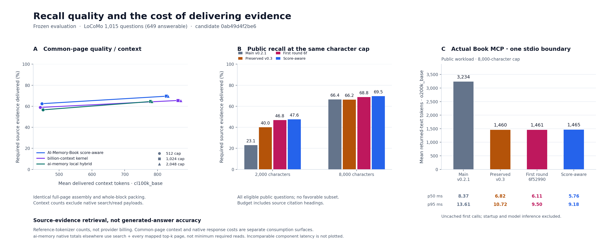

# AI-Memory-Book

**Background memory for AI agents. Projects become books, tasks become chapters, and agents retrieve the cited evidence they need to continue working.**

[简体中文](README.zh-CN.md) · [Agent guide](docs/agent-guide.md) · [Installation & background mode](docs/deployment.md) · [Client compatibility](docs/integrations.md) · [Measured results](benchmarks/RESULTS-recall-score-quality.md) · [Releases](https://github.com/Afloat16/AI-Memory-Book/releases)

AI-Memory-Book gives AI agents a shared, local memory of earlier work. After you connect a client and opt in to capture, a background worker indexes supported conversations. When a task depends on a previous decision, constraint, or unfinished step, the agent can call MCP once, receive bounded original evidence with source references, and continue the task. It does not need to read a directory or an entire conversation first.

The primary interface is **MCP for the agent**. Background capture runs headlessly by default; the optional web reader is for inspecting and debugging the archive. The server supplies guidance for conditional recall, while the host and model control tool invocation and permissions. Automatic use in every client or on every question is not guaranteed.

**v0.3 development · Experimental · MIT · Local storage · No memory-service API key**

## Why use AI-Memory-Book?

AI-Memory-Book is built for continuing project work with a small, inspectable memory service:

| Advantage | What you get |
|---|---|
| **No model call to create or search memory** | Local Python + SQLite indexing and lexical retrieval; no per-turn summarization bill, embedding download, or separate database service in the core. Your answering model remains your choice. |
| **Original evidence with citations** | Recall returns source text and project/session/turn references. Exact character spans and full pages remain available when you need to verify a decision. |
| **Useful context in one MCP call** | `recall_memory` assembles bounded evidence directly. Project, chapter and session filters help the agent focus on the work at hand. |
| **Exact context limits when you need them** | An optional named-tokenizer cap includes citations and separators, alongside the character cap. Fitting original evidence blocks stay intact; remaining capacity can carry additional source sentences. |
| **One archive across clients** | Supported clients point to the same local database. Opt-in background capture keeps supported text transcripts available for later tasks. |
| **A small operational footprint** | The default worker and MCP server run without an HTTP listener; the optional reader, export tools, and source-preserving migrations make the archive inspectable. |

See the [agent workflow](docs/agent-guide.md), [capture and deployment guide](docs/deployment.md), and [source/migration checks](benchmarks/RESULTS-recall-score-quality.md#8-source-preserving-schema-migration).

### Measured retrieval advantage

The frozen development runtime [`0ab49d4`](https://github.com/Afloat16/AI-Memory-Book/commit/0ab49d4f2be6aabe5e51c3314bb9369041af5369) delivers more complete evidence than both tested native retrieval components under the same **1,024-token `cl100k_base` context cap**:

| Native retrieval component | Evidence recall ↑ | Complete evidence ↑ | Mean context tokens ↓ |
|---|---:|---:|---:|
| **AI-Memory-Book** | **69.54%** | **72.88%** | 827.2 |
| [billion-context](https://github.com/ranxianglei/billion-context/tree/dc041dd1ab1a014efa352ba47a6f31fc47f55284) search kernel | 65.48% | 68.72% | 862.6 |
| [ai-memory](https://github.com/akitaonrails/ai-memory/tree/ee73c04c542fa41ca629b046deb4ac108518f407) v3.4.5 local hybrid | 64.47% | 66.72% | **779.3** |

That is **+4.16 percentage points of complete evidence versus billion-context** and **+6.16 points versus ai-memory**; mean context is also **4.1% smaller than billion-context** at this setting. Across both reference tokenizers and all three caps (512 / 1,024 / 2,048), Book leads both evidence metrics in **12/12 comparisons** and uses fewer mean context tokens in **6/12**.

**What this measures:** all 1,015 eligible text-only LoCoMo questions (649 answerable), identical supplied source pages, project scope, top-five candidates, and a shared citation/whole-page packer. Evidence recall counts intact required source utterances; complete evidence requires every required utterance for an answerable question. These are source-delivery results from regression data, with different native indexes and transport boundaries. They do not measure generated-answer accuracy or each product's complete memory workflow. Billion's measured search boundary is faster; ai-memory uses fewer common-context tokens at 1,024 and 2,048 tokens. [Full curves, version pins, native costs and per-query results](benchmarks/RESULTS-recall-score-quality.md#6-native-components-common-context-and-their-cost-boundaries).

The same frozen Book version also returns **54.7% fewer actual MCP response tokens** than main v0.2.1 on the public workload (3,233.5 → 1,465.1, `o200k_base`), with observed first-call p50 **8.371 → 5.764 ms**. This is a comparison with our older version under the same real stdio boundary. [Measurement details and retained regressions](#evidence-costs-and-limitations).

The current source keeps score-aware recall as its default. It also offers an explicit [experimental coverage option](#optional-coverage-for-multi-fact-questions) for questions asking for several facts; that experiment has its own results and tradeoffs.

## Get started

You need **Python 3.10+ with SQLite FTS5**. The installer creates an isolated environment and includes MCP and client-configuration dependencies. This route does not require a Git checkout, Node.js, an embedding server, or a database server.

### Choose a version

| Version | What you get | How to use it |
|---|---|---|
| **Published experimental release v0.2.1** | Agent-first MCP, shared local memory and optional headless background capture | Use the pinned installers below. |
| **Available v0.3 development source** | Score-aware retrieval, compact cited evidence, optional exact token budgets, multi-fact coverage and the paired-answer evaluation runner | Use the [source checkout](#try-it-without-connecting-a-client) on `main`. |
| **Frozen comparison runtime `0ab49d4`** | The exact source used for the retrieval and MCP cost figures above | Follow the [reproduction guide](benchmarks/RESULTS-recall-score-quality.md#11-reproduction-and-artifact-index). |

The validated continuation, including exact token budgets, was merged into `main` through [PR #1](https://github.com/Afloat16/AI-Memory-Book/pull/1) at [`ce7837f`](https://github.com/Afloat16/AI-Memory-Book/commit/ce7837fb8db7c221f39e27a531f2383385782eb1). The installers below still use the published **v0.2.1**; there is no `v0.3.0` release tag yet. Use the `main` source checkout to try the additional capabilities.

### macOS / Linux

```bash
curl -fsSLo install-memory-book.sh https://raw.githubusercontent.com/Afloat16/AI-Memory-Book/v0.2.1/scripts/install.sh
bash install-memory-book.sh
```

The installer prints the exact launcher path and any PATH instructions. Use that path if `memory-book` is not yet on your PATH.

### Windows PowerShell

```powershell
Invoke-WebRequest https://raw.githubusercontent.com/Afloat16/AI-Memory-Book/v0.2.1/scripts/install.py -OutFile install-memory-book.py
py -3 .\install-memory-book.py
```

The shared Python installer also works on macOS/Linux. A [v0.2.1 PowerShell wrapper](https://github.com/Afloat16/AI-Memory-Book/blob/v0.2.1/scripts/install.ps1) is also available. Installation does not change your shell profile or execution policy.

### Connect your agent and enable background memory

```bash
# Configure MCP and opt in to supported transcript capture at login
# The background service has no HTTP listener by default
memory-book setup --client claude-code --capture --background

memory-book doctor
memory-book service status
```

Restart the client or refresh its MCP servers. The client may still ask you to approve its connection or tools. Continue working in that client: the intended agent workflow is to recall relevant history when the current task needs it, use its sources, and proceed. To check the connection explicitly, ask: **“Use memory-book to find the cache decision from our earlier work, cite the source, and continue the implementation.”**

`--capture` explicitly enables reading existing and future supported text transcripts from the paths displayed by setup. `memory-book setup --client claude-code` configures MCP alone, for an archive populated by another source or explicit imports. Use `--dry-run` to inspect changes first. Configure several clients with repeated `--client`, or use `--all` for detected clients.

```bash
memory-book setup --client claude-code --client codex --capture --background
memory-book setup --all --dry-run
```

For one workspace only:

```bash
memory-book setup --client codex --capture --workspace /absolute/path/to/project \
  --project my-project --background
```

Setup preserves existing settings, backs up changed files, and updates an owned entry without duplicating it. It leaves malformed/JSONC files untouched and prints a manual snippet. See [configuration behavior and host checks](docs/integrations.md).

## How an agent uses memory

The normal path is **client setup → background capture → conditional MCP recall → bounded cited evidence → continue the task**. Capture updates the archive independently of the agent's retrieval call. A self-contained question needs no memory lookup; a task that refers to previous work usually does.

For example, an agent continuing the fictional `atlas` project's cache work can call `recall_memory` on the `memory-book` MCP server. These are the parameters of a `tools/call` request; the client's displayed server/tool prefix may differ:

```json
{
  "name": "recall_memory",
  "arguments": {
    "query": "搜索缓存最终保留多久？为什么从300秒调整？",
    "project": "atlas",
    "budget_chars": 2000,
    "limit": 5
  }
}
```

The response contains `context`, page IDs, and compact source references: `project`, `session_id`, and `turn_index`. Request `details: true` or use `read_page` for exact character spans. With the [example archive](examples/conversations.json), the cache review records a change from 300 to 45 seconds while retaining revision invalidation. The agent can cite `atlas / atlas-cache-review / turn 0`, check the source date, and use that decision in the implementation. Historical text remains evidence to assess, including possible outdated or conflicting decisions.

**Choose the context budget:** `budget_chars` in Python/MCP and `--budget` in the CLI cap the assembled context in characters. The development source also supports an **exact optional token cap** with `budget_tokens` / `--budget-tokens` and either `cl100k_base` or `o200k_base`. Both caps include citations and separators in `context`; outer JSON metadata, tool schemas and the rest of the conversation are outside them. Install the `tokens` extra and add these arguments to the recall call:

```bash
python -m pip install -e ".[tokens]"
memory-book recall "cache expiry and retry window" --project atlas \
  --budget 4000 --budget-tokens 512 --tokenizer cl100k_base --json
```

For MCP, add `"budget_tokens": 512` and `"tokenizer": "cl100k_base"` to `arguments`; Python uses the same parameter names. The response reports the exact `context_tokens` and tokenizer version. `estimated_tokens` remains a character-based estimate. Without the optional token cap, the dependency-free character path is unchanged. First-time vocabulary initialization may require a public download; offline deployments should preload it. [API, offline setup, source-preservation contract and costs](docs/token-budget.md).

The historical competitor tables use a shared **whole-page benchmark packer**. The new API assembles **native excerpts and intact source units**; its results have a separate baseline and do not retroactively change those tables. See [budget measurements and remaining gaps](#what-remains-to-improve).

The agent can navigate the hierarchy when a direct recall leaves a concrete gap:

| Address level | Meaning | MCP tool |
|---|---|---|
| Bookshelf | Discover project IDs when the project is unknown | `browse_projects` |
| Book | One project namespace and its chapters | `browse_book(project)` |
| Chapter | Sessions sharing an explicit task ID | `browse_chapter(chapter_id)` |
| Section | Related consecutive questions within a session | `browse_section(section_id)` |
| Page | Bounded original text with exact source references | `read_page(page_id)` |

These are optional navigation tools for the agent, not a mandatory sequence before recall. Pass IDs returned by the server to open a chapter, section, or page. Known project/chapter/session filters narrow retrieval directly. Short follow-ups can stay together; long answers receive continuation pages. The default adaptive page cap is 900 characters, and cross-session chapters use explicit task IDs.

The [agent guide](docs/agent-guide.md) covers when to recall, how to use citations and budgets, what to do when evidence is missing or contradictory, and how to treat imported instructions as untrusted historical text. No vendor lifecycle hooks or forced context injection are installed.

## Client compatibility

MCP access and automatic transcript capture are separate capabilities. Profiles follow linked official schemas and are tested with fixtures; this is **not a claim of an interactive end-to-end test in every vendor application**.

| Client / profile | MCP configuration | Background text capture |
|---|---|---|
| Claude Code — `claude-code` | Automatic JSON merge | Native JSONL |
| Claude Desktop — `claude-desktop` | Automatic JSON merge | Explicit import / MCP writing |
| Codex CLI, desktop and IDE — `codex` | Automatic TOML merge | Local rollout JSONL |
| Gemini CLI — `gemini` | Automatic JSON merge | Current JSONL and legacy JSON |
| Kimi Code, current — `kimi` | Automatic JSON merge | Explicit import / MCP writing |
| Kimi CLI, legacy Python — `kimi-legacy` | Automatic JSON merge | Active `context.jsonl` |
| Cursor — `cursor` | Automatic JSON merge | Explicit import / MCP writing |
| OpenCode v2 — `opencode` | Automatic strict-JSON merge | Explicit import / MCP writing |
| GitHub Copilot CLI — `copilot-cli` | Automatic JSON merge | Explicit import / MCP writing |
| Qwen Code — `qwen-code` | Automatic JSON merge | Explicit import / MCP writing |
| LM Studio — `lm-studio` | Automatic JSON merge | Explicit import / MCP writing |
| Other MCP hosts — `generic-json` | Export a snippet | Canonical imports / MCP writing |

**DeepSeek and other providers:** configure the MCP-capable host in which you use the model, such as OpenCode, instead of assuming every model provider has the same local configuration. AI-Memory-Book does not change your model provider, credentials, or API routing. A standalone DeepSeek host configuration is not verified here. [Exact paths, sources, and version boundaries](docs/integrations.md).

## What runs in the background?

The MCP client starts its own stdio server when it needs tools. A separate, optional user service polls configured transcript directories and imports changed conversations. **New background configurations are headless by default**: no web reader or HTTP listener is required for capture or agent recall. The worker does not call an LLM to summarize every turn.

- Linux: `systemd --user`.
- macOS: a per-user LaunchAgent.
- Windows: a current-user Scheduled Task at logon, with limited privileges and no stored password.

```bash
memory-book service status
memory-book service stop
memory-book service start
memory-book service uninstall
```

Uninstalling the service keeps your database and client settings. Removing a watched source keeps its archived memory. A running daemon reloads changes to its configuration, including reduced capture scope. On machines without a usable user service manager, run `memory-book daemon` under your existing supervisor, or run `memory-book sync --once` when convenient.

Unchanged, successfully imported files are skipped. The worker skips symlinks and known credential/config files, retries incomplete active logs, isolates malformed files, and never deletes memory just because a source file disappears. Source text is stored locally; when a model calls a memory tool, the returned evidence becomes part of that client's model context. [Capture scope and operations](docs/deployment.md).

A reproducible **v0.2.0** local sample with 300 synthetic files measured unchanged scans at a **36.95 ms median** across eight cycles, with zero reimports; changing one file updated one session and skipped 299. Scans still write state/heartbeat data. This is a small warm-cache measurement, not a CPU, battery, or large-archive guarantee, and has not been relabeled as a v0.2.1 measurement. [Method and raw results](docs/validation.md#v020-capture-overhead-sample).

## Try it without connecting a client

From the current **development branch** (the branch can advance beyond the frozen benchmark commit):

```bash
git clone --branch main https://github.com/Afloat16/AI-Memory-Book.git
cd AI-Memory-Book
python -m venv .venv
source .venv/bin/activate
python -m pip install -e ".[mcp,clients,benchmark]"

memory-book import examples/conversations.json
memory-book recall "搜索缓存为什么改成45秒？" --project atlas
```

On Windows, activate `.venv\Scripts\Activate.ps1`, or call `.venv\Scripts\python.exe` directly. To reproduce the frozen measurements, check out `0ab49d4f2be6aabe5e51c3314bb9369041af5369` before installing and follow the [benchmark preparation guide](benchmarks/RESULTS-recall-score-quality.md#11-reproduction-and-artifact-index). The dependency-free core remains installable with `pip install -e .`; MCP and TOML configuration are optional extras. This project is not published to PyPI, so an unqualified `pip install ai-memory-book` is not the documented installation method. [uv, pipx, and installer alternatives](docs/deployment.md).

## Bring your own conversations

```json
{
  "project": "atlas",
  "session_id": "cache-review",
  "task_id": "search-cache",
  "messages": [
    {"role": "user", "content": "What cache expiry did we agree on?"},
    {"role": "assistant", "content": "45 seconds, with revision invalidation."}
  ]
}
```

```bash
memory-book import session.json
memory-book watch add /absolute/path/to/exports --format canonical --project atlas
memory-book sync --once
memory-book recall "cache expiry" --project atlas --budget 2000 --json
memory-book export-book atlas --output ./atlas-book
```

Exports contain a Markdown table of contents, original evidence pages, and normalized source JSON. ChatGPT current-branch exports and supported native text logs have dedicated importers. Image/audio content and structured tool blocks are not reconstructed. [Input formats and limits](docs/integrations.md#import-formats).

## Shared data location

All configured clients use the same absolute database path, independent of their working directory.

| Platform | Default data directory |
|---|---|
| Linux | `$XDG_DATA_HOME/ai-memory-book`, or `~/.local/share/ai-memory-book` |
| macOS | `~/Library/Application Support/AI-Memory-Book` |
| Windows | `%LOCALAPPDATA%\AI-Memory-Book` |

Set `MEMORY_BOOK_HOME` for a portable data directory, `MEMORY_BOOK_DB` for a database override, or pass `--db` before the subcommand. **Upgrading from v0.1?** Its `.memory-book/memory.db` is not moved automatically. `doctor` reports it when present in your working directory; use that explicit path or follow [migration instructions](docs/deployment.md#upgrading-from-v010).

## Docker

The image's default command is a headless stdio MCP server. From a source checkout, build it and configure your MCP host to launch the following `docker run` command:

```bash
docker build -t ai-memory-book:local .
docker run --rm -i \
  --mount type=volume,src=ai-memory-book-data,dst=/data \
  ai-memory-book:local mcp
```

The named volume persists the archive across server processes. No HTTP port is published for MCP. Docker does not automatically gain access to host transcripts: capture requires explicit source mounts and configuration. The optional Compose reader shares this volume and publishes only on host loopback. [Docker commands and MCP configuration](docs/deployment.md#docker).

## Evidence, costs, and limitations

**The frozen score-aware continuation improves public source-evidence delivery.** In that full public run, actual MCP response tokens are **54.7% lower** and median first-call latency is **31.1% lower** than main v0.2.1. Against the already optimized preserved v0.3 branch, response tokens are slightly higher (+0.38%) and the observed median is 15.5% lower. These are different baselines; the figures belong to `0ab49d4`, not to every later development revision.



### Paired version measurements

The frozen runtime is [`0ab49d4`](https://github.com/Afloat16/AI-Memory-Book/commit/0ab49d4f2be6aabe5e51c3314bb9369041af5369). The following rows use all **1,015 eligible text-only questions** from eight LoCoMo heldout conversations, including the previously reported 256 and 759 additional questions from those same conversations. Of these, 649 are answerable. All public questions were already measured in the first frozen round and are regression data for this second round.

| Public workload | Main v0.2.1 | Preserved v0.3 | Score-aware continuation |
|---|---:|---:|---:|
| Evidence recall, 2,000-character context cap | 23.10% | 39.97% | **47.59%** |
| Evidence recall, 8,000-character context cap | 66.37% | 66.24% | **69.54%** |
| Complete evidence, 8,000-character context cap | 70.42% | 70.11% | **72.88%** |
| Actual MCP response tokens, mean, 8,000-character cap | 3,233.5 | **1,459.6** | 1,465.1 |
| Actual MCP first-call p50 | 8.371 ms | 6.823 ms | **5.764 ms** |
| Actual MCP first-call p95 | 13.610 ms | 10.722 ms | **9.181 ms** |

Evidence requires complete annotated utterances with the correct source coordinates. These are source-evidence retrieval scores, not generated-answer accuracy. Public conversations come from the independently published, persona-agent-generated [LoCoMo dataset](https://github.com/snap-research/locomo), not private user histories.

MCP tokens count actual returned JSON text and metadata using `o200k_base`, not provider billing. Three repetitions use the official SDK's real subprocess stdio path. Result-cache entries are absent before each first call; OS/SQLite caches are not flushed. Startup and immediate repeats are reported separately. All 1,015 query IDs are retained, including five repeated query/project pairs. Compact and detailed modes preserve identical evidence for all public query rows and the 42-query synthetic MCP workload.

### External components and retained regressions

The full public comparison executes the pinned billion-context search kernel and official ai-memory v3.4.5 binary with native MiniLM hybrid retrieval. It controls supplied pages, project scope, top-five limit, and whole-block packing at 512 / 1,024 / 2,048 tokens. Native search responses and ai-memory page reads are counted separately. The timing boundaries differ across components and transports; shared-context scores do not establish a full-product latency or token advantage. **claude-mem and generated-answer quality remain unmeasured.** [Complete component curves, native costs, pins, and protocol](benchmarks/RESULTS-recall-score-quality.md).

The [comparison near the top of this README](#measured-retrieval-advantage) shows the 1,024-token setting. Token savings vary by setting: Book uses less common-context text than Billion at 1,024/2,048 tokens, and less than ai-memory at 512, for both tokenizers. It uses more than Billion at 512 and more than ai-memory at 1,024/2,048. The common-context counts exclude native metadata; actual MCP counts include it.

For the separately measured policy **one ai-memory search plus full reads of every mapped top-five page**, native returned content averages 2,574.6 `o200k_base` tokens. Book's one actual MCP recall averages 1,465.1, **43.1% fewer returned tokens under those policies**. An agent that stops at a sufficient preview or reads fewer pages can spend less with ai-memory. Billion's 569.2-token native preview excludes unmeasured decompression. These observations preserve each delivery policy; they do not establish the minimum cost or final-answer quality of another product.

The second rule retains exact BM25 score margins while allowing bounded word-form assistance. It passed development gates before the new reserved seeds 883/1297 were measured. At 8,000 characters, their complete-evidence rate improves from the first round's **81.58% to 84.21%**, with lookup coverage restored to 24/24. The previously observed 211/509 regression populations show the same recovery. Source spans, citation-inclusive budgets, and compact/detailed evidence remain checked.

### What remains to improve

The frozen run preserves the failures that guide further work:

| Gap | Recorded result and next validation |
|---|---|
| Low-overlap paraphrases and distant evidence | All eight low-overlap questions per verification seed have zero recall; multi-section partial coverage falls from 34.375% to 25%, with no multi-section question receiving complete evidence. New retrieval routes need separate category and per-query checks. |
| Very small context budgets | At 512 tokens, complete evidence falls from 66.72% to **66.26%** with `cl100k_base`, and 67.03% to **66.72%** with `o200k_base`, versus the first frozen Book round. Budget work must report both gains and losses. |
| Full answer and memory-workflow costs | No fixed generative model or authentic end-to-end competitor capture/summary traces were measured. A paired run must count ingestion, summary generation, retrieval, follow-up reads and answering, with the same answer-scoring procedure. |
| Generalization | The 1,015 public questions are regression data. Newly reserved synthetic seeds share templates. A separate corpus and independently authored question families are still needed. |

Public core retrieval and synthetic MCP p95 also retain regressions against the preserved v0.3 branch. Every public unanswerable question returns some context; this measures nonempty retrieval, not an answering model's abstention or hallucination rate. Current-state ordering remains a conservative heuristic. [Category results, per-query losses and workflow prerequisites](benchmarks/RESULTS-recall-score-quality.md#7-remaining-failures-and-interpretation-limits).

Native exact token-budget assembly is now available as an [explicit API option](docs/token-budget.md). It preserves every original block accepted by the same native whole-block packer and supplements unused space with intact source units. This preservation contract is separate from the historical full-page comparison. The default core uses local lexical FTS without embeddings or an API key. It does not provide cloud sync, public multi-user hosting, or guaranteed automatic context injection. Client permission decisions remain in the client.

### Exact token budgets: saved development result

The native budget implementation is preserved at [`c73b5f8`](https://github.com/Afloat16/AI-Memory-Book/commit/c73b5f8aa086e597a3c921bf6340c385b350e332), with [frozen 128-question development results](benchmarks/results/native-token-dev128-frozen.md) saved in `e70bc3d`. At **8,000 characters and 512 tokens**, compared with the prior native excerpts followed by whole-block packing:

| Development setting | Prior native excerpts | Native token API |
|---|---:|---:|
| Complete evidence, both tokenizers | 71.08% | **73.49%** |
| Newly completed / lost questions, each tokenizer | — | **2 / 0** |
| Missing previously fitting source blocks, every measured setting | — | **0** |
| Total local p95, `cl100k_base` | **4.690 ms** | 11.460 ms |
| Total local p95, `o200k_base` | **4.728 ms** | 17.230 ms |

These are development results, including the added CPU cost. The historical whole-page policy reaches **75.90%** on the same development questions, so this experiment does **not** resolve the separately reported 66.72% → 66.26% regression. The [registered evaluation protocol](docs/native-budget-evaluation.md) requires the full regression matrix, exact caps, source checks and per-query gains/losses. A separately frozen **128-question HotpotQA** transfer cohort contains all 1,272 supplied paragraphs and 306 supporting facts; its [preflight](benchmarks/reports/hotpot-sentence-preflight.json) verifies source attainability, not retrieval performance.

### Optional coverage for multi-fact questions

The development version adds **`coverage=True` / `--coverage`**, disabled by default. It recognizes explicit `and`, `和`, `以及` and `并且` clauses, preserves the original top result, and reserves results for additional clauses within the scoped candidate set. This can help when several pages repeat one subject while another requested fact is missing:

```bash
memory-book recall "cache expiry and retry window" --project atlas --coverage --budget 2000
```

MCP callers set `"coverage": true` on `recall_memory`; Python callers pass `coverage=True` to `MemoryBook.recall`. The option requires book ranking and cannot be combined with CLI `--flat`.

In the [frozen automatic-clause experiment](benchmarks/RESULTS-conjunctive-recall.md), multi-section complete evidence improves **0/16 → 8/16** per synthetic regression seed at 8,000 characters. But public complete evidence stays **72.88%**, and common-full-page completeness at 512 `cl100k_base` tokens declines **66.26% → 65.79%**. The public MCP p95 also rises **9.564 → 13.510 ms**. The new 36-question authored diagnostic has equal complete evidence (**86.67%**) in both versions. These tradeoffs are why coverage is explicit rather than the default. This is a clause-coverage heuristic, with no demonstrated semantic paraphrase gain. Frozen automatic-mode timings are separate from the final opt-in API build.

[Independent mode checks](benchmarks/reports/coverage-mode-equivalence.json) compare **2,774 complete payloads per mode** against the prior default and frozen experiment, with **zero differences** after excluding only latency. The prior 512-token deficit remains a separate improvement target.

### Ready for a real answer evaluation

The new [paired answer-evaluation guide](docs/answer-evaluation.md) provides `prepare` and `run` commands for an explicitly configured real model endpoint. It freezes each version's returned evidence, keeps scoring labels out of the index and model input, records actual provider usage when reported, and retains failed attempts and unknown costs. Model identity and experiment hashes are checked. A real generative endpoint and authentic competitor observer/compression traces are still required to establish generated-answer quality and complete memory-workflow costs; HTTP fixtures are only transport tests.

[Preparation is verified for 128 public development questions](benchmarks/reports/answer-eval-readiness.json), pairing the first round with the final default: **83 answerable, 45 unsupported, zero actual model calls**. Answer quality and provider cost remain unmeasured.

[Coverage experiment and reproducible artifacts](benchmarks/RESULTS-conjunctive-recall.md) · [Score-aware default report](benchmarks/RESULTS-recall-score-quality.md) · [First frozen round](benchmarks/RESULTS-recall-quality.md) · [Historical v0.3.0 measurements](benchmarks/RESULTS-v0.3.0.md) · [Earlier segmentation experiments](benchmarks/EXPERIMENTS.md)

## Optional archive inspection

For human inspection or troubleshooting, start the local reader explicitly:

```bash
memory-book serve
```

It opens an HTTP listener at [http://127.0.0.1:8765](http://127.0.0.1:8765); open that address in your browser. Agent capture and MCP recall work without it. The **EN / 中文** switch changes interface labels while original conversations retain their language. [Desktop screenshot using fictional conversations](docs/assets/reader-desktop-en.png) · [Container reader setup](docs/deployment.md#docker).

## Development and verification

```bash
python -m pip install -e ".[mcp,clients,benchmark]"
python -m unittest discover -s tests -v
python tests/installer_smoke.py --with-extras
```

The runtime at [`b36f044`](https://github.com/Afloat16/AI-Memory-Book/commit/b36f044651553d75485bd26801ef3f1f65e393bb) passed **266 tests**, with no failures or skips, using MCP, client, and benchmark extras. Its [push workflow](https://github.com/Afloat16/AI-Memory-Book/actions/runs/43075055048) and [PR workflow](https://github.com/Afloat16/AI-Memory-Book/actions/runs/43075068353) each passed **9/9 jobs**, covering Python 3.10/3.12/3.13, actual MCP stdio, the browser reader, Linux/macOS/Windows installers, and container persistence. The PR workflow succeeded after its initially cancelled macOS job was retried.

The later native-budget checkpoint [`e70bc3d`](https://github.com/Afloat16/AI-Memory-Book/commit/e70bc3d2581ff96959711509b3eef11ab14f564d) passed **294 tests** in its MCP CI job. Its [push workflow](https://github.com/Afloat16/AI-Memory-Book/actions/runs/43152979344) and [PR workflow](https://github.com/Afloat16/AI-Memory-Book/actions/runs/43152987680) each passed **9/9 jobs**. That checked continuation is now on `main` through [PR #1](https://github.com/Afloat16/AI-Memory-Book/pull/1); test counts and benchmark figures remain attributed to their named commits. [GitHub Actions status](https://github.com/Afloat16/AI-Memory-Book/actions) · [Validation details and historical runs](docs/validation.md). Configuration fixtures do not establish that every vendor application or login manager has been interactively verified.

## Design references

We studied [claude-mem](https://github.com/thedotmack/claude-mem), [billion-context](https://github.com/ranxianglei/billion-context), [ai-memory](https://github.com/akitaonrails/ai-memory), [PageIndex](https://github.com/VectifyAI/PageIndex), and [RAPTOR](https://arxiv.org/abs/2401.18059). The agent-facing design combines hierarchical source addresses, one setup command, an optional capture worker, and budgeted MCP recall. This implementation uses local transcript polling plus on-demand retrieval; it does not claim to reproduce another project's hooks, request proxy, observer model, or session-start injection. See [research notes](docs/research.md).

Independently implemented under the [MIT License](LICENSE). Contributions with a minimal reproduction and measurable validation are welcome: [CONTRIBUTING.md](CONTRIBUTING.md).
