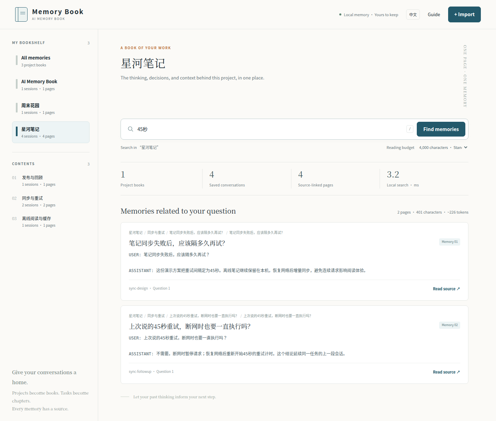

# AI-Memory-Book

**One local memory library for your AI tools. Projects become books, tasks become chapters, and recall jumps straight to cited evidence.**

[简体中文](README.zh-CN.md) · [Installation & background mode](docs/deployment.md) · [Client compatibility](docs/integrations.md) · [Measured results](benchmarks/EXPERIMENTS.md) · [Releases](https://github.com/Afloat16/AI-Memory-Book/releases)

AI-Memory-Book keeps conversation history organized and searchable across local AI clients. Connect a client once, optionally enable background capture, and ask it to recall earlier work when needed. Reading an entire directory or conversation before every question is optional.

**v0.2.0 · Experimental · MIT · Local storage · No memory-service API key**

## Get started

You need **Python 3.10+ with SQLite FTS5**. The installer creates an isolated environment and includes MCP and client-configuration dependencies. This route does not require a Git checkout, Node.js, an embedding server, or a database server.

### macOS / Linux

```bash
curl -fsSLo install-memory-book.sh https://raw.githubusercontent.com/Afloat16/AI-Memory-Book/v0.2.0/scripts/install.sh
bash install-memory-book.sh
```

The installer prints the exact launcher path and any PATH instructions. Use that path if `memory-book` is not yet on your PATH.

### Windows PowerShell

```powershell
Invoke-WebRequest https://raw.githubusercontent.com/Afloat16/AI-Memory-Book/v0.2.0/scripts/install.py -OutFile install-memory-book.py
py -3 .\install-memory-book.py
```

The shared Python installer also works on macOS/Linux. A PowerShell wrapper is available in [`scripts/install.ps1`](scripts/install.ps1). Installation does not change your shell profile or execution policy.

### Connect your client

```bash
# Choose a profile: claude-code, codex, gemini, kimi, cursor, and more
memory-book setup --client claude-code

# For supported transcript formats, add quiet background capture at login
memory-book setup --client claude-code --capture --background

memory-book doctor
```

Restart the client or refresh its MCP servers. The client may still ask you to approve its connection or tools. Ask it: **“Use memory-book to find the cache decision from our earlier work, and cite the source.”**

`--capture` explicitly enables reading existing and future supported text transcripts from the paths displayed by setup. Without it, setup only configures MCP. Use `--dry-run` to inspect changes first. Configure several clients with repeated `--client`, or use `--all` for detected clients.

```bash
memory-book setup --client claude-code --client codex --capture --background
memory-book setup --all --dry-run
```

For one workspace only:

```bash
memory-book setup --client codex --capture --workspace /absolute/path/to/project \
  --project my-project --background
```

Setup preserves existing settings, backs up changed files, and updates an owned entry without duplicating it. It leaves malformed/JSONC files untouched and prints a manual snippet. See [configuration behavior and host checks](docs/integrations.md).

## Client compatibility

MCP access and automatic transcript capture are separate capabilities. Profiles follow linked official schemas and are tested with fixtures; this is **not a claim of an interactive end-to-end test in every vendor application**.

| Client / profile | MCP configuration | Background text capture |
|---|---|---|
| Claude Code — `claude-code` | Automatic JSON merge | Native JSONL |
| Claude Desktop — `claude-desktop` | Automatic JSON merge | Explicit import / MCP writing |
| Codex CLI, desktop and IDE — `codex` | Automatic TOML merge | Local rollout JSONL |
| Gemini CLI — `gemini` | Automatic JSON merge | Current JSONL and legacy JSON |
| Kimi Code, current — `kimi` | Automatic JSON merge | Explicit import / MCP writing |
| Kimi CLI, legacy Python — `kimi-legacy` | Automatic JSON merge | Active `context.jsonl` |
| Cursor — `cursor` | Automatic JSON merge | Explicit import / MCP writing |
| OpenCode v2 — `opencode` | Automatic strict-JSON merge | Explicit import / MCP writing |
| GitHub Copilot CLI — `copilot-cli` | Automatic JSON merge | Explicit import / MCP writing |
| Qwen Code — `qwen-code` | Automatic JSON merge | Explicit import / MCP writing |
| LM Studio — `lm-studio` | Automatic JSON merge | Explicit import / MCP writing |
| Other MCP hosts — `generic-json` | Export a snippet | Canonical imports / MCP writing |

**DeepSeek and other providers:** configure the MCP-capable host in which you use the model, such as OpenCode, instead of assuming every model provider has the same local configuration. AI-Memory-Book does not change your model provider, credentials, or API routing. A standalone DeepSeek host configuration is not verified here. [Exact paths, sources, and version boundaries](docs/integrations.md).

## What runs in the background?

The MCP client starts its own stdio server when it needs tools. A separate, optional user service polls configured transcript directories, imports changed conversations, and serves the local reader. It does not call an LLM to summarize every turn.

- Linux: `systemd --user`.
- macOS: a per-user LaunchAgent.
- Windows: a current-user Scheduled Task at logon, with limited privileges and no stored password.

```bash
memory-book service status
memory-book service stop
memory-book service start
memory-book service uninstall
```

Uninstalling the service keeps your database and client settings. Removing a watched source keeps its archived memory. A running daemon reloads changes to its configuration, including reduced capture scope. On machines without a usable user service manager, run `memory-book daemon` under your existing supervisor, or run `memory-book sync --once` when convenient.

Unchanged, successfully imported files are skipped. The worker skips symlinks and known credential/config files, retries incomplete active logs, isolates malformed files, and never deletes memory just because a source file disappears. Source text is stored locally; when a model calls a memory tool, the returned evidence becomes part of that client's model context. [Capture scope and operations](docs/deployment.md).

A reproducible local sample with 300 synthetic files measured unchanged scans at a **36.95 ms median** across eight cycles, with zero reimports; changing one file updated one session and skipped 299. Scans still write state/heartbeat data. This is a small warm-cache measurement, not a CPU, battery, or large-archive guarantee. [Method and raw results](docs/validation.md#v020-capture-overhead-sample).

## A book you can browse

| Level | Meaning |
|---|---|
| Bookshelf | Your project collection |
| Book | One project namespace |
| Chapter | Sessions sharing an explicit task ID |
| Section | Related consecutive questions in a session |
| Page | A bounded original-text excerpt with source references |

Short follow-ups can stay together; long answers receive continuation pages. The default adaptive page cap is 900 characters. Each hit points back to its original session, user turn, message positions, and character spans. Chapters across sessions use explicit task IDs; unrelated tasks are not silently merged.



The screenshot uses fictional conversations. The interface defaults to English, or Chinese for a Chinese-language browser; the **EN / 中文** switch remembers your choice. Original conversation text, titles, and evidence retain their original language. The reader is available at [http://127.0.0.1:8765](http://127.0.0.1:8765) while the service or `memory-book serve` is running.

## Try it without connecting a client

From a source checkout:

```bash
git clone https://github.com/Afloat16/AI-Memory-Book.git
cd AI-Memory-Book
python -m venv .venv
source .venv/bin/activate
python -m pip install -e ".[mcp,clients]"

memory-book import examples/conversations.json
memory-book recall "搜索缓存为什么改成45秒？" --project atlas
memory-book serve
```

On Windows, activate `.venv\Scripts\Activate.ps1`, or call `.venv\Scripts\python.exe` directly. The dependency-free core remains installable with `pip install -e .`; MCP and TOML configuration are optional extras. This project is not published to PyPI, so an unqualified `pip install ai-memory-book` is not the documented installation method. [uv, pipx, and installer alternatives](docs/deployment.md).

## Bring your own conversations

```json
{
  "project": "atlas",
  "session_id": "cache-review",
  "task_id": "search-cache",
  "messages": [
    {"role": "user", "content": "What cache expiry did we agree on?"},
    {"role": "assistant", "content": "45 seconds, with revision invalidation."}
  ]
}
```

```bash
memory-book import session.json
memory-book watch add /absolute/path/to/exports --format canonical --project atlas
memory-book sync --once
memory-book recall "cache expiry" --project atlas --budget 2000 --json
memory-book export-book atlas --output ./atlas-book
```

Exports contain a Markdown table of contents, original evidence pages, and normalized source JSON. ChatGPT current-branch exports and supported native text logs have dedicated importers. Image/audio content and structured tool blocks are not reconstructed. [Input formats and limits](docs/integrations.md#import-formats).

## Shared data location

All configured clients use the same absolute database path, independent of their working directory.

| Platform | Default data directory |
|---|---|
| Linux | `$XDG_DATA_HOME/ai-memory-book`, or `~/.local/share/ai-memory-book` |
| macOS | `~/Library/Application Support/AI-Memory-Book` |
| Windows | `%LOCALAPPDATA%\AI-Memory-Book` |

Set `MEMORY_BOOK_HOME` for a portable data directory, `MEMORY_BOOK_DB` for a database override, or pass `--db` before the subcommand. **Upgrading from v0.1?** Its `.memory-book/memory.db` is not moved automatically. `doctor` reports it when present in your working directory; use that explicit path or follow [migration instructions](docs/deployment.md#upgrading-from-v010).

## Docker

For a containerized reader with a persistent local volume:

```bash
docker compose up -d --build reader
```

Compose publishes the reader on host loopback only. The image also supports stdio MCP with `docker run --rm -i`; a shared named volume lets clients and the reader use one database. Docker does not automatically gain access to host transcripts. [Docker commands and MCP configuration](docs/deployment.md#docker).

## Evidence, costs, and limitations

The published **v0.1.0 retrieval experiments** compare session, turn, and adaptive segmentation under identical budgets. Two heldout synthetic datasets each contain 112 sessions, 1,408 user turns, 168 queries, and about 1.143 million source characters. At an 8,000-character budget:

| Segmentation | Evidence recall | Complete evidence | Mean context chars | Uncached local p95 |
|---|---:|---:|---:|---:|
| Session | 69.32–69.89% | 73.68–74.34% | 5,411 | 112.87–141.15 ms |
| Turn | 64.77–65.34% | 59.87–60.53% | 3,879–3,881 | 22.41–24.03 ms |
| Adaptive | **77.27%** | **78.95%** | **3,701–3,706** | **7.42–7.46 ms** |

Ranges show two individual seeds, not confidence intervals. Timings disable result caching but retain SQLite/OS page caches; they exclude startup, watcher work, MCP transport, networking, and model inference. Each retrieved unit contributes one relevant window; an unmeasured whole-session multi-window implementation could narrow the gap. These are synthetic retrieval results, not comparisons against other memory products or LLM answer scores. v0.2.0 adds deployment and capture functionality; it does not relabel earlier measurements as new benchmarks.

Measured limits remain: low-overlap paraphrases had zero recall; distant two-fact queries retrieved only 25% of required evidence and completed none; old evidence preceded current evidence in half of current-decision queries. Directory re-ranking did not improve aggregate recall. The 2,000-character budget did not show a universal win. [Full experiments, failures, and raw results](benchmarks/EXPERIMENTS.md).

`--budget` limits the assembled context in **characters**, including citation headings, not transport JSON or exact model tokens. The engine uses lexical FTS rather than embeddings. It has no authoritative conflict resolver, cloud sync, public multi-user server, or guaranteed automatic context injection. Client permission decisions remain in the client.

## Development and verification

```bash
python -m pip install -e ".[mcp,clients]"
python -m unittest discover -s tests -v
python tests/installer_smoke.py --with-extras
```

CI exercises the core on Python 3.10/3.12/3.13, real MCP stdio communication, browser interactions, installers on Linux/macOS/Windows, and container MCP/reader/volume behavior. Native service definitions and configuration merges have focused tests; successful configuration generation does not prove every vendor app or login manager accepted it. [Validation details](docs/validation.md) · [GitHub Actions](https://github.com/Afloat16/AI-Memory-Book/actions).

## Design references

We studied [claude-mem](https://github.com/thedotmack/claude-mem), [billion-context](https://github.com/ranxianglei/billion-context), [ai-memory](https://github.com/akitaonrails/ai-memory), [PageIndex](https://github.com/VectifyAI/PageIndex), and [RAPTOR](https://arxiv.org/abs/2401.18059). v0.2.0 adopts one setup command, client-specific configuration, and an optional background worker. This implementation uses local transcript polling plus on-demand MCP retrieval; it does not claim to reproduce another project's hooks, request proxy, observer model, or session-start injection. See [research notes](docs/research.md).

Independently implemented under the [MIT License](LICENSE). Contributions with a minimal reproduction and measurable validation are welcome: [CONTRIBUTING.md](CONTRIBUTING.md).
