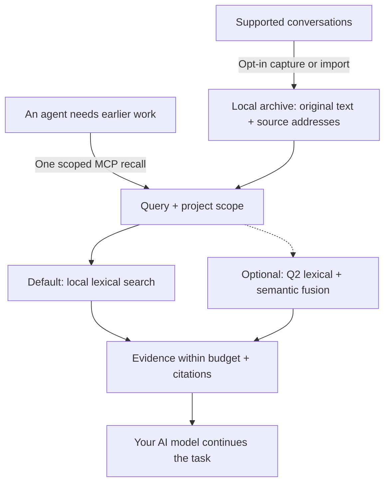

# AI-Memory-Book

**Give your AI agents a shared local memory, with original evidence they can cite.**

Projects become books, tasks become chapters, and earlier decisions stay available across sessions and clients. One MCP call returns relevant evidence within a context budget so the agent can continue your work.

[简体中文](README.zh-CN.md) · [Quick start](#quick-start) · [Measured results](#measured-results) · [Documentation](#documentation) · [v0.3.0 release](https://github.com/Afloat16/AI-Memory-Book/releases/tag/v0.3.0)

**v0.3.0 · Experimental · MIT · Python 3.10+ · Local SQLite**

## How it works



Capture updates the archive independently of retrieval. The agent can recall directly, then open an exact source page when it needs more detail; browsing the book hierarchy is optional. [Agent workflow](docs/agent-guide.md).

## Why use it?

- **Lightweight by default.** Memory writing and lexical retrieval use zero model calls. The core needs Python and SQLite, with no embedding download, database server, or memory-service API key.
- **Evidence you can inspect.** Preserve original text, project/session/turn references and exact source spans. Character limits are built in; optional named-tokenizer limits also count citations and separators.
- **One archive across clients.** MCP configuration profiles cover Claude Code/Desktop, Codex, Gemini, Cursor and more. Explicitly enabled background capture keeps supported transcripts current; the worker is headless by default.
- **Measured efficiency.** The current core returns identical evidence faster; optional indexed references reduce repeated source metadata. The results and their scope are below.

## Quick start

You need **Python 3.10+ with SQLite FTS5**. The installer downloads the release wheel into an isolated environment with MCP/client dependencies. No Git checkout or Node.js is needed.

**macOS / Linux**

```bash
curl -fsSLo install-memory-book.sh https://raw.githubusercontent.com/Afloat16/AI-Memory-Book/v0.3.0/scripts/install.sh
bash install-memory-book.sh
```

**Windows PowerShell**

```powershell
Invoke-WebRequest https://raw.githubusercontent.com/Afloat16/AI-Memory-Book/v0.3.0/scripts/install.py -OutFile install-memory-book.py
py -3 .\install-memory-book.py
```

**Connect your agent**

```bash
memory-book setup --client claude-code --capture --background
memory-book doctor
```

Use the launcher's full path printed by the installer if `memory-book` is not yet on your PATH. Restart the client, then ask: **“Recall our earlier decision about this task, cite the source, and continue.”**

Replace `claude-code` with your [client profile](docs/integrations.md#supported-profiles), or repeat `--client` to share the archive across clients. `--capture` opts in to existing and future supported text transcripts; omit it for MCP access alone. Native capture covers Claude Code, Codex, Gemini and legacy Python Kimi; other profiles use explicit imports or enabled MCP writing. Host permissions and model tool selection still apply.

**Upgrading?** Re-run the installer, then your `setup` command with the same clients and capture options so MCP and any background service use the new environment. Existing memory and the previous environment are retained. [Upgrade details](docs/deployment.md#upgrading).

## Measured results

These results describe the **implementation shipped in v0.3.0**. Full protocols, source hashes, per-question losses and historical experiments remain in the [benchmark index](benchmarks/README.md).

### Efficiency highlights

| Verified improvement | Result | Measurement |
|---|---|---|
| **Faster default recall, identical output** | Actual MCP pooled p95 **1.25%–9.50% lower** | Four balanced rounds; 56,784 paired calls across native/MCP, two old corpora and three character caps. [Report](docs/default-recall-performance.md) |
| **Less ingestion work** | Fresh-ingestion time **−46.45%**; unchanged-session replay time **−61.38%** | Public corpus, same source/index content; paired before/after core optimization. [Report](docs/default-recall-performance.md) |
| **Smaller MCP responses, optional** | Response-text tokens **−19.63%**; first-call reference total **−8.15%** | 1,015 public-conversation questions, 4,000 characters, compact responses, `o200k_base`. [Report](docs/indexed-references.md) |

Indexed references preserve the same context and reconstruct every source field. The first-call count includes the full tool schema, initialization instructions and arguments; these reference-token counts are not provider bills. Sparse references can cost more. This is a size option: displayed p95 is **7.126 ms → 7.131 ms**, with no speedup claim.

### Current open-source component comparison

**Same host, 256 HotpotQA multi-hop questions, identical source pages, top-five limit and common whole-page packing within 1,024 `cl100k_base` tokens.** Higher is better for evidence recall, completeness and MRR; lower is better for latency.

| Retrieval component | Evidence recall ↑ | Complete evidence ↑ | MRR ↑ | Mean context tokens | Search p50 / p95 ms |
|---|---:|---:|---:|---:|---:|
| **Book — default lexical** | 75.41% | 51.95% | 0.8596 | 712.9 | **4.712 / 8.301** |
| **Book — optional Q2 semantics** | 78.66% | 57.81% | **0.8686** | 727.8 | 14.014 / 22.523 |
| [claude-mem 15.18.1](https://github.com/thedotmack/claude-mem) — native FTS | 72.31% | 48.83% | 0.8348 | 704.5 | 16.254 / 29.948 |
| [ai-memory v3.4.5](https://github.com/akitaonrails/ai-memory) — local hybrid | 76.22% | 53.91% | 0.8633 | 704.0 | 25.947 / 33.251 |
| [billion-context 9674cfa](https://github.com/ranxianglei/billion-context) — search kernel | **80.94%** | **61.72%** | 0.8622 | 751.3 | **0.349 / 1.092** |

Book Q2 finds complete evidence **8.98 percentage points more often than claude-mem FTS** and **3.91 points more often than ai-memory**, with the highest packed-context MRR in this view. Book's default path keeps zero-model operation and lower measured p95 than those two components. **billion-context leads recall, completeness and search latency in this setting.**

Quality uses one result per question; latency uses three actual repetitions. Interfaces differ: Book Python/native context assembly, claude-mem Bun/SQLite, ai-memory HTTP/MCP and billion-context's Node kernel. These are **retrieval-component measurements**, not final-answer accuracy or whole-product speed ratios. Preparation and additional reads are separate; ai-memory's first-search-plus-all-reads p95 is **37.613 ms**. The [full comparison](docs/comparison.md#current-frozen-256-question-comparison) includes all budgets/tokenizers, mean and tail latency, response/read tokens, indexing, downloads, RSS and storage.

**Choose optional modes for your workload.** Q2 adds local model/index costs and can lose evidence at small budgets: at 512 `o200k_base` tokens / 8,000 characters, native completeness is **42.19% lexical → 41.02% Q2**. Public/reused questions are regression data; these results do not establish cross-domain generalization. Earlier [generated-answer](benchmarks/RESULTS-local-answers.md) and [full-workflow](benchmarks/RESULTS-full-workflow.md) diagnostics retain their own source/model settings; they are not v0.3.0 answer-quality scores.

The [deployment and architecture comparison](docs/comparison.md#popular-projects-and-the-workload-they-address) also covers **Mem0, Graphiti, PageIndex and Letta**, clearly separated from executed benchmarks. ai-memory also supports a zero-LLM default; claude-mem supports local model providers.

## Documentation

| What you want to do | Guide |
|---|---|
| Connect another client or import conversations | [Client profiles and formats](docs/integrations.md) |
| Install, upgrade, run Docker or manage background capture | [Deployment](docs/deployment.md) |
| Learn when to recall, use citations and resolve missing evidence | [Agent guide](docs/agent-guide.md) |
| Enable exact token caps, Q2 semantics or indexed references | [Token budgets](docs/token-budget.md) · [Semantic retrieval](docs/semantic-retrieval.md) · [Indexed references](docs/indexed-references.md) |
| Inspect the archive in a browser | Run `memory-book serve`, then open [127.0.0.1:8765](http://127.0.0.1:8765) |
| Review full measurements or contribute | [Benchmarks](benchmarks/README.md) · [Validation](docs/validation.md) · [Contributing](CONTRIBUTING.md) · [Changelog](CHANGELOG.md) |

The archive is local, unencrypted data. Evidence returned to an AI client enters that client's model context. The optional reader is for inspection; normal MCP and capture need no HTTP listener. [Data and configuration](docs/deployment.md#data-and-configuration-paths).

[CI](https://github.com/Afloat16/AI-Memory-Book/actions/workflows/ci.yml) covers Python 3.10/3.12/3.13, actual MCP stdio, the browser reader, Linux/macOS/Windows installers and container persistence. Client configuration fixtures do not certify interactive behavior in every vendor app. Independently implemented under the [MIT License](LICENSE).
