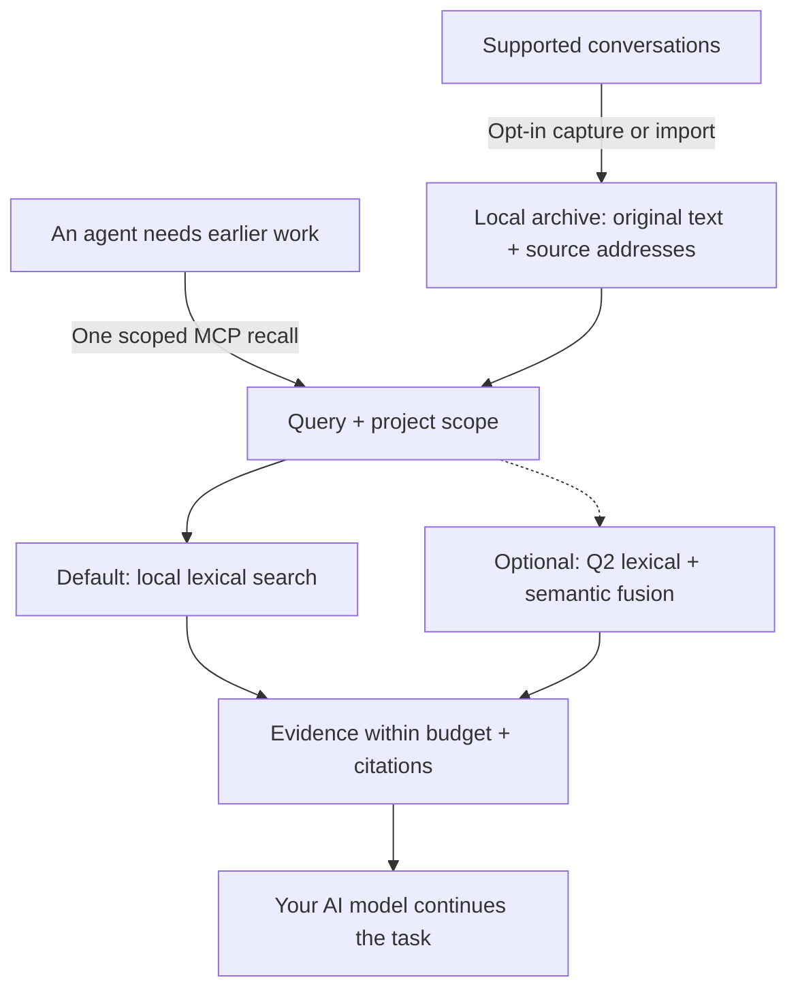
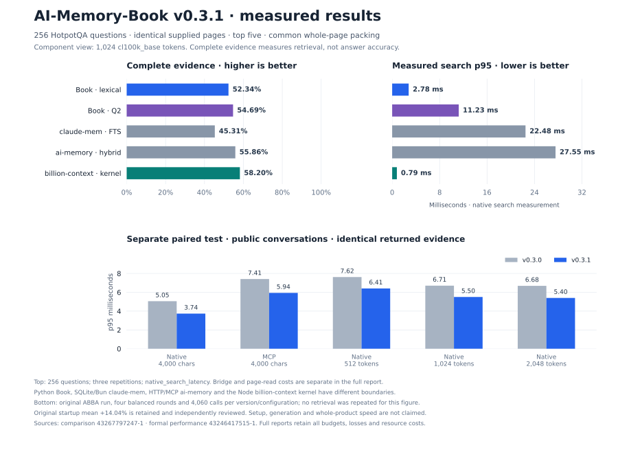

# AI-Memory-Book

**Give your AI agents a shared local memory, with original evidence they can cite.**

Projects become books, tasks become chapters, and earlier decisions stay available across sessions and clients. One MCP call returns relevant evidence within a context budget so the agent can continue your work.

[简体中文](README.zh-CN.md) · [Quick start](#quick-start) · [Measured results](#measured-results) · [Documentation](#documentation) · [v0.3.1 release](https://github.com/Afloat16/AI-Memory-Book/releases/tag/v0.3.1)

**v0.3.1 · Experimental · MIT · Python 3.10+ · Local SQLite**

## How it works



Capture updates the archive independently of retrieval. The agent can recall directly, then open an exact source page when it needs more detail; browsing the book hierarchy is optional. [Agent workflow](docs/agent-guide.md).

## Why use it?

- **Lightweight by default.** Memory writing and lexical retrieval use zero model calls. The core needs Python and SQLite, with no embedding download, database server, or memory-service API key.
- **Evidence you can inspect.** Preserve original text, project/session/turn references and exact source spans. Character limits are built in; optional named-tokenizer limits also count citations and separators.
- **One archive across clients.** MCP configuration profiles cover Claude Code/Desktop, Codex, Gemini, Cursor and more. Explicitly enabled background capture keeps supported transcripts current; the worker is headless by default.
- **Measured efficiency.** The current core returns identical evidence faster; optional indexed references reduce repeated source metadata. The results and their scope are below.

## Quick start

You need **Python 3.10+ with SQLite FTS5**. The installer downloads the release wheel into an isolated environment with MCP/client dependencies. No Git checkout or Node.js is needed.

**macOS / Linux**

```bash
curl -fsSLo install-memory-book.sh https://raw.githubusercontent.com/Afloat16/AI-Memory-Book/v0.3.1/scripts/install.sh
bash install-memory-book.sh
```

**Windows PowerShell**

```powershell
Invoke-WebRequest https://raw.githubusercontent.com/Afloat16/AI-Memory-Book/v0.3.1/scripts/install.py -OutFile install-memory-book.py
py -3 .\install-memory-book.py
```

**Connect your agent**

```bash
memory-book setup --client claude-code --capture --background
memory-book doctor
```

Use the launcher's full path printed by the installer if `memory-book` is not yet on your PATH. Restart the client, then ask: **“Recall our earlier decision about this task, cite the source, and continue.”**

Replace `claude-code` with your [client profile](docs/integrations.md#supported-profiles), or repeat `--client` to share the archive across clients. `--capture` opts in to existing and future supported text transcripts; omit it for MCP access alone. Native capture covers Claude Code, Codex, Gemini and legacy Python Kimi; other profiles use explicit imports or enabled MCP writing. Host permissions and model tool selection still apply.

**Upgrading?** Re-run the installer, then your `setup` command with the same clients and capture options so MCP and any background service use the new environment. Existing memory and the previous environment are retained. [Upgrade details](docs/deployment.md#upgrading).

## Measured results

**v0.3.1 reduces query work while preserving the default retrieval output.** The paired performance baseline is v0.3.0. Source identities, full measurements and unsuccessful experiments remain in the [benchmark index](benchmarks/README.md).

### Efficiency highlights

| Verified improvement | Result | Measurement |
|---|---|---|
| **Identical non-timing output, less tail latency** | Pooled p95 geometric mean **−11.36%** across ten settings | 47,320 calls, two old corpora, native/actual SDK MCP, character/token budgets and four balanced rounds. [Report](docs/round3-performance-review.md) |
| **Faster public-conversation recall** | Native p95 **5.054 → 3.737 ms (−26.05%)**; actual MCP **7.409 → 5.937 ms (−19.87%)** | 1,015 questions, 4,000-character cap, same host, no reuse of recall results. [Original measurements](benchmarks/reports/round3-performance-43246417515-1/report.summary.json) |
| **Optional indexed references, retained** | Response-text tokens **−19.63%**; first-call reference total **−8.15%** | Earlier 1,015-question measurement, 4,000 characters, compact responses, `o200k_base`; this option is unchanged. [Report](docs/indexed-references.md) |

Complete non-timing outputs matched. One synthetic 512-token setting has **0.125% higher p95**. Mean fresh empty-database opening time in the public workers increased **4.838 ms (+14.04%)**; independent review explicitly accepted that tradeoff. All rounds and the original automatic resource flag remain recorded in the [performance report and review](docs/round3-performance-review.md).

Indexed references preserve context and reconstruct every source field. The first-call count includes schema, instructions and arguments; reference-token counts are not provider bills. Sparse references can cost more. The earlier format comparison measured **7.126 → 7.131 ms p95**, with no speedup claim.

### Current open-source component comparison

A frozen **256-question HotpotQA** selection excludes the 384 questions used in earlier rounds. The table uses the same supplied pages, top five results and common whole-block packing at **1,024 `cl100k_base` tokens**. It measures source evidence; the [full report](benchmarks/results/round3-comparison-43267797247-1/report.md) retains every budget, native call, gain and loss.

| Measured component | Evidence recall | Complete evidence | Packed MRR | Mean context tokens | Search adapter p95 |
|---|---:|---:|---:|---:|---:|
| **Book v0.3.1 · default lexical** | 76.28% | 52.34% | 0.8132 | 719.8 | 2.784 ms |
| **Book v0.3.1 · optional Q2** | 76.77% | 54.69% | 0.8239 | 739.0 | 11.226 ms |
| claude-mem 15.18.1 · native FTS | 70.68% | 45.31% | 0.7674 | 715.8 | 22.826 ms |
| ai-memory v3.4.5 · local hybrid | 77.27% | 55.86% | 0.8182 | 716.8 | 27.545 ms |
| billion-context `9674cfa` · search kernel | **78.91%** | **58.20%** | **0.8277** | 762.3 | **1.010 ms** |

Book's default returns complete evidence **7.03 percentage points more often than claude-mem FTS** in this slice. Default Book's measured search-adapter p95 is **87.80% lower than claude-mem's and 89.89% lower than ai-memory's**; Q2 also has lower p95 than both. **ai-memory retains higher recall and completeness; billion-context leads these three quality metrics and search latency.** The adapters use different Python, SQLite/Bun, HTTP/MCP and Node boundaries, so the timings do not establish whole-product speed ratios. ai-memory's first search plus all source reads has p95 **30.532 ms**; read payloads and setup costs are recorded separately.

Q2 raises completeness by **2.34 percentage points** over Book's default at this budget, with model/index setup, memory and query costs. At the native API's 512-token budget it lowers completeness from **35.94% to 33.59%** (`cl100k_base`) and **35.55% to 33.20%** (`o200k_base`). It stays opt-in. All questions are answerable and come from the same public HotpotQA source; this is not a measurement of answer generation, hallucinations or private-conversation transfer.



The figure uses the same saved measurements as the tables. An additional [offline verification](benchmarks/reports/round3-recovery/comparison-cross-verification.json) checks all 32 result files and exactly reproduces the original assessment and report without new retrieval calls. [Audit and release provenance](docs/round3-continuation.md#published-release-and-supplemental-audit).

The [deployment and architecture comparison](docs/comparison.md#popular-projects-and-the-workload-they-address) also covers **Mem0, Graphiti, PageIndex and Letta**, clearly separated from executed benchmarks. ai-memory also supports a zero-LLM default; claude-mem supports local model providers.

## Documentation

| What you want to do | Guide |
|---|---|
| Connect another client or import conversations | [Client profiles and formats](docs/integrations.md) |
| Install, upgrade, run Docker or manage background capture | [Deployment](docs/deployment.md) |
| Learn when to recall, use citations and resolve missing evidence | [Agent guide](docs/agent-guide.md) |
| Enable exact token caps, Q2 semantics or indexed references | [Token budgets](docs/token-budget.md) · [Semantic retrieval](docs/semantic-retrieval.md) · [Indexed references](docs/indexed-references.md) |
| Inspect the archive in a browser | Run `memory-book serve`, then open [127.0.0.1:8765](http://127.0.0.1:8765) |
| Review full measurements or contribute | [Benchmarks](benchmarks/README.md) · [Validation](docs/validation.md) · [Contributing](CONTRIBUTING.md) · [Changelog](CHANGELOG.md) |

The optional Q2 runtime opts out of ONNX Runtime telemetry. The archive is local, unencrypted data. Evidence returned to an AI client enters that client's model context. The optional reader is for inspection; normal MCP and capture need no HTTP listener. [Data and configuration](docs/deployment.md#data-and-configuration-paths).

[CI](https://github.com/Afloat16/AI-Memory-Book/actions/workflows/ci.yml) covers Python 3.10/3.12/3.13, actual MCP stdio, the browser reader, Linux/macOS/Windows installers and container persistence. Client configuration fixtures do not certify interactive behavior in every vendor app. Independently implemented under the [MIT License](LICENSE).
