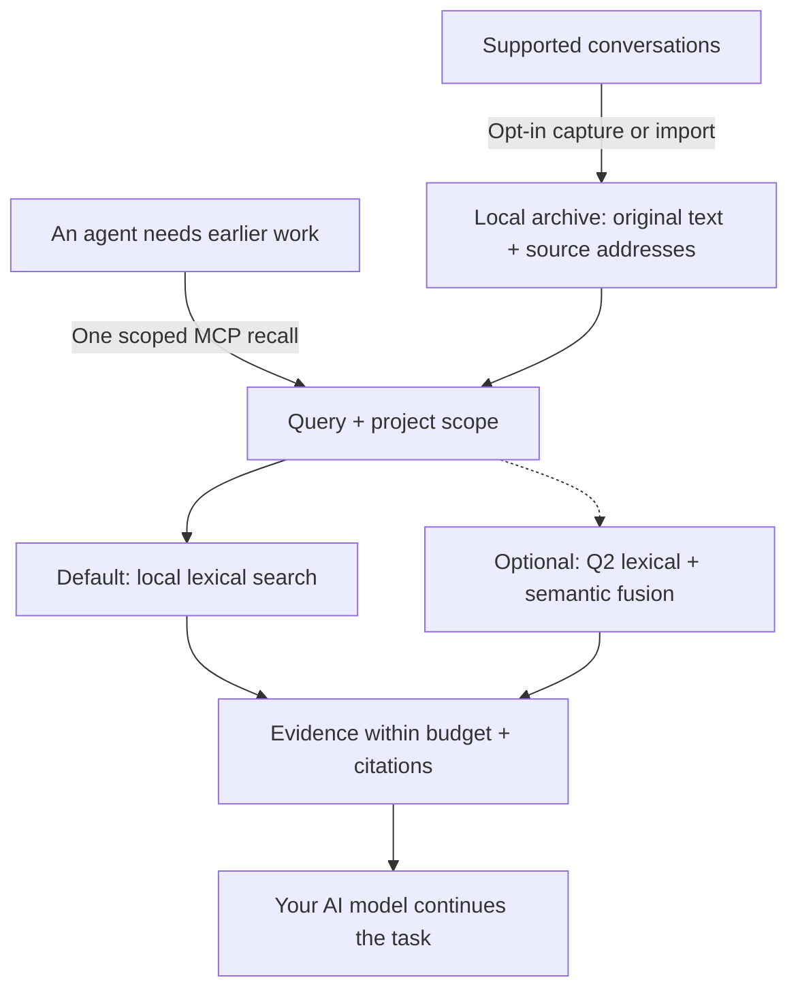

# AI-Memory-Book

**Give your AI agents a shared local memory, with original evidence they can cite.**

Projects become books, tasks become chapters, and earlier decisions stay available across sessions and clients. One MCP call returns relevant evidence within a context budget so the agent can continue your work.

[简体中文](README.zh-CN.md) · [Quick start](#quick-start) · [Measured results](#measured-results) · [Documentation](#documentation) · [v0.3.3 release](https://github.com/Afloat16/AI-Memory-Book/releases/tag/v0.3.3)

**v0.3.3 · Normal release · MIT · Python 3.10+ · Local SQLite**

## How it works



Capture updates the archive independently of retrieval. The agent can recall directly, then open an exact source page when it needs more detail; browsing the book hierarchy is optional. [Agent workflow](docs/agent-guide.md).

## Why use it?

- **Lightweight by default.** Memory writing and lexical retrieval use zero model calls. The core needs Python and SQLite, with no embedding download, database server, or memory-service API key.
- **Evidence you can inspect.** Preserve original text, project/session/turn references and exact source spans. Character limits are built in; optional named-tokenizer limits also count citations and separators.
- **One archive across clients.** MCP configuration profiles cover Claude Code/Desktop, Codex, Gemini, Cursor and more. Explicitly enabled background capture keeps supported transcripts current; the worker is headless by default.
- **Measured efficiency.** The current core returns identical evidence faster; optional indexed references reduce repeated source metadata. The results and their scope are below.

## Quick start

You need **Python 3.10+ with SQLite FTS5**. The installer downloads the release wheel into an isolated environment with MCP/client dependencies. No Git checkout or Node.js is needed.

**macOS / Linux**

```bash
curl -fsSLo install-memory-book.sh https://raw.githubusercontent.com/Afloat16/AI-Memory-Book/v0.3.3/scripts/install.sh
bash install-memory-book.sh
```

**Windows PowerShell**

```powershell
Invoke-WebRequest https://raw.githubusercontent.com/Afloat16/AI-Memory-Book/v0.3.3/scripts/install.py -OutFile install-memory-book.py
py -3 .\install-memory-book.py
```

**Connect your agent**

```bash
memory-book setup --client claude-code --capture --background
memory-book doctor
```

Use the launcher's full path printed by the installer if `memory-book` is not yet on your PATH. Restart the client, then ask: **“Recall our earlier decision about this task, cite the source, and continue.”**

Replace `claude-code` with your [client profile](docs/integrations.md#supported-profiles), or repeat `--client` to share the archive across clients. `--capture` opts in to existing and future supported text transcripts; omit it for MCP access alone. Native capture covers Claude Code, Codex, Gemini and legacy Python Kimi; other profiles use explicit imports or enabled MCP writing. Host permissions and model tool selection still apply.

**Upgrading?** Re-run the installer, then your `setup` command with the same clients and capture options so MCP and any background service use the new environment. Existing memory and the previous environment are retained. [Upgrade details](docs/deployment.md#upgrading).

## Measured results

### v0.3.4 startup confirmation — release checks pending

**The new candidate creates an empty archive much faster and halves CLI help/version startup time against published v0.3.3.** The single prospective confirmation completed **480 fresh samples**, with **40 per version and boundary**, in four balanced AB/BA/BA/AB rounds on Ubuntu 24.04 / Python 3.12. All fixed numerical startup gates pass; the saved automatic result remains `accepted:false` for the separate resource-review item below. v0.3.4 has not yet been published. [Registered plan](benchmarks/experiments/round6-startup-plan.json) · [Original report](benchmarks/reports/round6-startup-43598913606-1/report.json.gz) · [Independent saved-result review](benchmarks/reports/round6-startup-43598913606-1-local-audit/review.md).

All times are milliseconds. Each arrow is **v0.3.3 → v0.3.4 candidate**; negative changes are improvements.

| Measured boundary | Median | Median change | p95 | p95 change |
|---|---:|---:|---:|---:|
| **Construct a new empty archive** | **24.518 → 4.164** | **−83.02%** | **27.374 → 6.358** | **−76.77%** |
| **Actual CLI `--help` process** | **102.903 → 48.750** | **−52.63%** | **104.104 → 49.547** | **−52.41%** |
| **Actual CLI `--version` process** | **101.346 → 47.479** | **−53.15%** | **103.116 → 48.259** | **−53.20%** |
| Complete API import, including `MemoryBook` | 33.506 → 33.920 | **+1.24%** | 33.822 → 34.433 | **+1.81%** |
| Construct a connection to an existing empty archive | 0.640 → 0.632 | −1.23% | 0.668 → 0.666 | −0.30% |
| Official SDK MCP startup through initialization | 627.601 → 620.104 | −1.19% | 632.233 → 624.837 | −1.17% |

New-archive construction saves **20.354 ms** at the median; CLI help and version save **54.153 ms** and **53.867 ms**. The API constructor timers exclude Python/import and helper validation; CLI values include the actual fresh process and captured output. MCP values start before transport/server creation and end at successful initialization. They are different boundaries, not interchangeable whole-product startup times. No first sample or outlier was removed. All **960 intent/completion events** and original source/evaluator identities passed independent offline verification.

The implementation puts **initial schema and FTS setup in one transaction**, with rollback if that setup fails. Subsequent covering-index and connection-setting steps retain their existing boundaries. Command metadata is loaded without importing archive/client machinery; requesting the public `MemoryBook` class still performs the full API import. Existing archives, schema 3, class identity and complete retrieval output are preserved.

**The costs remain visible.** Full API import is slower by **0.414 ms median / 0.611 ms p95**. Existing-archive whole-helper system CPU rises **18.646 → 21.121 ms (+2.474 ms, +13.2703%)**, the sole pooled resource-review trigger; whole-helper wall time rises **138.762 → 139.996 ms (+0.8891%)** even though its constructor interval improves slightly. The increase occurs in all four rounds. Saved data cannot quantify how much belongs to imports, validation, serialization or other phases. Two independent reviews recommend accepting this disclosed cost; the explicit release decision and remaining release checks are separate from the unchanged raw verdict.

<details>
<summary>All pooled resource increases and retained adverse observations</summary>

CPU and wall values below are means in milliseconds; RSS values are mean kernel records in KiB. The review also retains every positive and negative per-round cell.

| Boundary and resource | v0.3.3 → candidate | Increase |
|---|---:|---:|
| API import: whole-helper system CPU | 18.727 → 19.576 ms | +4.5343% |
| API import: kernel maximum-RSS record | 49,221.4 → 49,243.8 KiB | +0.0455% |
| New archive: whole-helper user CPU | 120.770 → 121.288 ms | +0.4289% |
| New archive: kernel maximum-RSS record | 49,460.1 → 49,496.3 KiB | +0.0732% |
| Existing archive: whole-helper wall time | 138.762 → 139.996 ms | +0.8891% |
| Existing archive: whole-helper system CPU | 18.646 → 21.121 ms | **+13.2703%** |
| Existing archive: kernel maximum-RSS record | 52,993.8 → 53,012.9 KiB | +0.0360% |
| MCP helper: system CPU | 101.166 → 102.880 ms | +1.6940% |
| MCP live server: sampled system CPU | 40.500 → 42.750 ms | +5.5556% |

The complete record contains **6 pooled timing increases, 26 round timing increases, 9 pooled resource increases and 27 round resource increases**. Beyond the import median/p95 above, import mean/minimum/maximum rise **1.4785% / 1.3192% / 4.2380%**; the existing-archive constructor maximum rises **0.672010 → 0.703721 ms (+4.7188%)**. Round-level increases include API-import system CPU **+13.8606%** and sampled MCP-server system CPU **+15.00%**. The original review rule applies to pooled resource means; none of these observations was discarded. [Every adverse cell](benchmarks/reports/round6-startup-43598913606-1-local-audit/review.json).

Both sources' new/existing logical archives are **159,744 bytes**. Kernel `wait4` RSS records include the measurement process and can include inherited/reaped-descendant effects; they do not establish equal or lower isolated product memory. MCP RSS/HWM and CPU are live samples after initialization, not unobserved lifetime maxima or totals.

</details>

### Retrieval compatibility and release scope

This is a **startup and initialization-correctness release scope**. Candidate A's two-round development recall gains were approximately **1%**, insufficient to advance to the original **10% aggregate / 15% public native-token / 10% actual-MCP p95** goals. That four-round formal recall matrix was **not run or accepted**. Candidate B's dense-project ranking regressed public native p95 by roughly **19–29%** and actual-MCP p95 by **23.9246%**; it is excluded. The release candidate uses A's exact runtime, and all failed experiments remain available. [Development outcomes and source selection](docs/optimization-round6.md).

A preserves **2,304 / 2,304** complete historical Hotpot256 default outputs against v0.3.3: **1,536 native** calls across two tokenizers and three caps, plus **768 component** calls. Its independent saved-ledger audit checks **4,608 events**. This is compatibility evidence, not a new evidence-quality or recall-speed claim. [Historical compatibility](benchmarks/reports/round6-hotpot-compatibility.summary.json) · [Saved-output audit](benchmarks/reports/round6-hotpot-compatibility.audit.json).

**Historical results remain historical.** v0.3.3's accepted C7 comparison against v0.3.2 recorded **14.80% aggregate p95** and **12.17% actual-MCP token p95** improvements, with separately reviewed startup costs. Those values are not v0.3.4 gains and are not added to the new startup percentages. [Original v0.3.3 performance and costs](docs/round5-c7-performance-review.md) · [Resource decision](benchmarks/experiments/round5-c7-resource-decision.json) · [Earlier rejected candidates](docs/optimization-round5.md). Optional indexed references retain their separate, unremeasured [historical token-format results](docs/indexed-references.md).

### Historical open-source component comparison

**The table below retains its original v0.3.2 measurements.** The v0.3.3 regression check reproduces all 1,536 native and 768 component default-output hashes on these same questions, preserving the old default evidence-quality result. It is not a new competitor timing or Q2 evaluation.

A frozen **256-question HotpotQA** selection excludes all **640 historical question IDs**, with zero overlap. Sources, evaluator, dependencies and models were bound before selection; the manifest was published before scoring. The completed comparison retains **9,216 measured calls: 4,608 native calls and 4,608 component searches**, across **635 required evidence annotations**. The table uses the same supplied pages, top five results and common whole-block packing at **1,024 `cl100k_base` tokens**. It measures source evidence; the [full report](benchmarks/results/round4-comparison-43363060062-1/report.md) retains every budget, native call, gain and loss.

| Measured component | Evidence recall | Complete evidence | Packed MRR | Mean context tokens | Search adapter p95 |
|---|---:|---:|---:|---:|---:|
| **Book v0.3.2 · default lexical** | 75.75% | 53.91% | 0.8578 | 714.8 | 3.488 ms |
| **Book v0.3.2 · optional Q2** | 76.69% | 55.08% | **0.8663** | 730.0 | 20.406 ms |
| claude-mem 15.18.1 · native FTS | 70.39% | 44.53% | 0.8280 | 709.4 | 34.655 ms |
| ai-memory v3.4.5 · local hybrid | 77.48% | 55.86% | 0.8400 | 709.9 | 39.925 ms |
| billion-context `9674cfa` · search kernel | **80.94%** | **60.55%** | 0.8606 | 757.4 | **1.449 ms** |

Book's default returns complete evidence **9.375 percentage points more often than claude-mem FTS** in this slice. Its measured search-adapter p95 is **89.94% lower than claude-mem's and 91.26% lower than ai-memory's**; Q2 also has lower p95 than both and the highest packed MRR among these five components. **ai-memory retains higher evidence recall and completeness than either Book mode; billion-context leads recall, completeness and search latency.** These are scoped component advantages, with no overall winner claimed.

Search p95 pools three searches per question and excludes offline common packing and additional page reads. The adapters use different Python recall/assembly, SQLite/Bun, HTTP/MCP and Node boundaries, so the timings do not establish whole-product speed ratios. ai-memory's first search plus all five source reads has p95 **45.897 ms**; read payloads, native positions and setup costs are recorded separately. Packed MRR measures evidence order after the common packer omits metadata or oversized blocks.

Q2 raises completeness by **1.171875 percentage points** at this budget: **26 questions gain complete evidence and 23 lose it**, a net gain of three. At the native API's 512-token budget, completeness falls from **39.45% to 36.33%** with `cl100k_base` (19 gains, 27 losses), and from **39.45% to 36.72%** with `o200k_base` (19 gains, 26 losses). Its component setup takes **277.60 seconds**, including **275.43 seconds** of index construction; sampled query process-tree peak RSS is **1,247.69 MiB**. Its 20.406 ms search p95 is also higher than default Book's 3.488 ms. Q2 stays opt-in. [Full gains, losses and costs](benchmarks/results/round4-comparison-43363060062-1/report.md)

**The historical round-four comparison also retains a regression against v0.3.1.** With the component ranker's 100,000-character ceiling, default Book's p95 rises **3.304 → 3.488 ms (+5.56%)**, and p50 rises **2.239 → 2.353 ms (+5.12%)**. Sampled setup process-tree peak RSS rises **548.65 → 943.53 MiB**; query-phase peak RSS falls **529.77 → 524.91 MiB**. These are sequential, unbalanced descriptive component observations, separate from the registered ABBA performance gate above. The RSS samples include evaluator/corpus memory and descendants, can count shared mappings twice, and do not establish the cause of the setup increase. [Detailed evidence and limitations](docs/optimization-round4.md)


The figure uses the same saved measurements as the tables. The completed assessment verifies **1,536 native and 768 component complete-output pairs** between Book versions. [Offline audit](benchmarks/reports/round4-comparison-independent-audit.json) · [Complete comparison and raw results](benchmarks/results/round4-comparison-43363060062-1/report.md) · [Archived v0.3.1 comparison and caveats](docs/round3-continuation.md#published-release-and-supplemental-audit).

All questions are answerable and come from the same public HotpotQA source; disjoint IDs do not establish new-domain generalization. These scored IDs are now regression data. This evaluates returned evidence, not answer generation, hallucinations or private-conversation transfer. No generative model is called by this comparison.

The [deployment and architecture comparison](docs/comparison.md#popular-projects-and-the-workload-they-address) also covers **Mem0, Graphiti, PageIndex and Letta**, clearly separated from executed benchmarks. ai-memory also supports a zero-LLM default; claude-mem supports local model providers.

## Documentation

| What you want to do | Guide |
|---|---|
| Connect another client or import conversations | [Client profiles and formats](docs/integrations.md) |
| Install, upgrade, run Docker or manage background capture | [Deployment](docs/deployment.md) |
| Learn when to recall, use citations and resolve missing evidence | [Agent guide](docs/agent-guide.md) |
| Enable exact token caps, Q2 semantics or indexed references | [Token budgets](docs/token-budget.md) · [Semantic retrieval](docs/semantic-retrieval.md) · [Indexed references](docs/indexed-references.md) |
| Inspect the archive in a browser | Run `memory-book serve`, then open [127.0.0.1:8765](http://127.0.0.1:8765) |
| Review full measurements or contribute | [Benchmarks](benchmarks/README.md) · [Validation](docs/validation.md) · [Contributing](CONTRIBUTING.md) · [Changelog](CHANGELOG.md) |

The optional Q2 runtime opts out of ONNX Runtime telemetry. The archive is local, unencrypted data. Evidence returned to an AI client enters that client's model context. The optional reader is for inspection; normal MCP and capture need no HTTP listener. [Data and configuration](docs/deployment.md#data-and-configuration-paths).

[CI](https://github.com/Afloat16/AI-Memory-Book/actions/workflows/ci.yml) covers Python 3.10/3.12/3.13, actual MCP stdio, the browser reader, Linux/macOS/Windows installers and container persistence. Client configuration fixtures do not certify interactive behavior in every vendor app. Independently implemented under the [MIT License](LICENSE).
