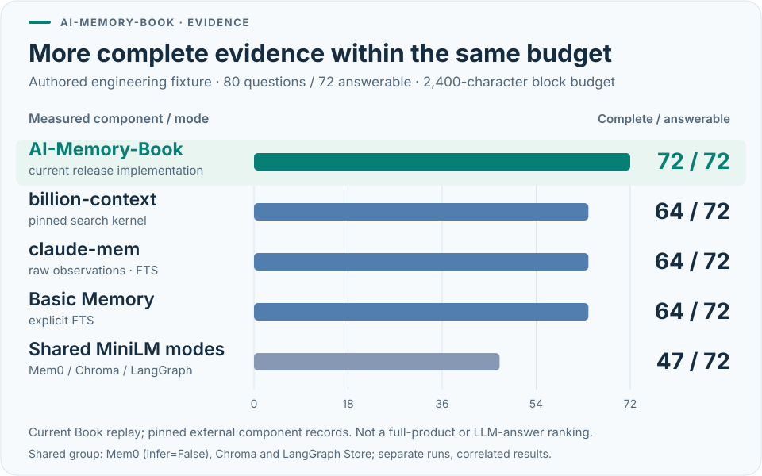
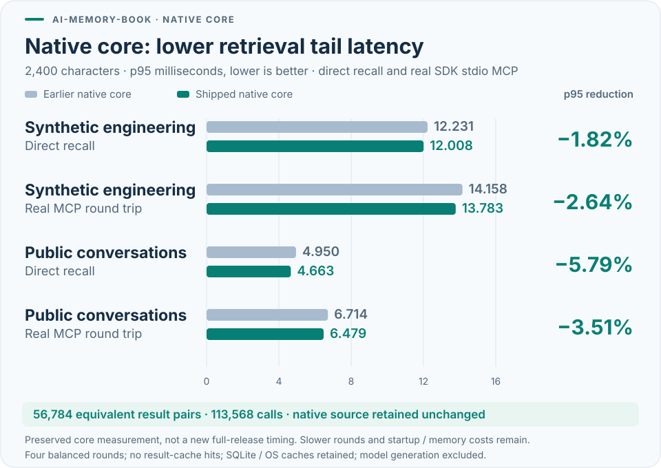

# AI-Memory-Book

**Local engineering memory with project boundaries, original evidence and bounded context.**

Preserve conversations as project books, task chapters and cited evidence pages. Recover decisions, constraints and failed attempts when a session ends or a client changes.

**v0.10.0 · MIT · Python 3.10+ · SQLite / FTS5 · Optional native C acceleration**

[简体中文](README.zh-CN.md) · [Results](#evidence-coverage) · [Performance](#performance) · [Quick start](#quick-start) · [How it works](#how-it-works) · [Documentation](#documentation)

## At a glance

| Complete evidence | Smaller working allocation | Less context than recent history | Verified native delivery |
|:---:|:---:|:---:|:---:|
| **72 / 72** answerable cases | **66.31% lower** tracked peak | **20.4% fewer** characters | **30 / 30** build/install cells |
| Fixed engineering workload, 2,400 characters | 32,768-vector-window fixture | 1,799.2 vs 2,260.9 mean characters | Six Python versions × five targets |

These are measured fixture results. Evidence coverage is not coding-model answer accuracy; tracked allocation is not total process memory. [Results, current-release verification and conditions](docs/current-results.md).

| What you need | What the current release provides |
|---|---|
| Resume an engineering task | Original decisions, later corrections, constraints and failed attempts with source references |
| Keep similar projects separate | Exact project IDs and project-bound MCP connections, including follow-up page reads |
| Search code and conversations | Chinese/English lexical retrieval plus acronym, camel-case and snake-case aliases |
| Control the returned context | A default 2,400-character budget and up to five results; optional exact token caps |
| Switch clients | One archive shared across supported Claude Code, Codex, Gemini and other integrations |
| Operate locally | SQLite / FTS5; default ingestion and lexical recall make no model calls |
| Recover safely | Verified online backups, transactional source replacement and snapshot-based export |

## Quick start

Requires **Python 3.10+ with SQLite FTS5**. The installer selects a compatible prebuilt native wheel or the portable Python fallback and creates an isolated environment with MCP/client dependencies.

**macOS / Linux**

```bash
curl -fsSLo install-memory-book.sh https://raw.githubusercontent.com/Afloat16/AI-Memory-Book/v0.10.0/scripts/install.sh
bash install-memory-book.sh
```

**Windows PowerShell**

```powershell
Invoke-WebRequest https://raw.githubusercontent.com/Afloat16/AI-Memory-Book/v0.10.0/scripts/install.py -OutFile install-memory-book.py
py -3 -I -X utf8 .\install-memory-book.py
```

**Connect and check**

```bash
memory-book setup --client claude-code
memory-book --version
memory-book doctor
```

Choose your [supported client profile](docs/integrations.md#supported-profiles). Use the full launcher path printed by the installer if it is not on PATH, then restart the client.

| Optional setup | Meaning |
|---|---|
| `--mcp-project YOUR_PROJECT_ID` | Bind that MCP connection to an exact stored project ID |
| `--capture` | Opt in to existing and future supported text transcripts |
| `--capture --background` | Also install and start background capture for a supported profile |

MCP configuration and native capture have separate support matrices. Tool invocation remains controlled by the host/model. Existing schema-4 archives need no new migration; preserve custom installation paths, refresh setup and restart existing processes when upgrading. [Upgrade guide](docs/deployment.md#upgrading).

## Evidence coverage



**Fixed workload:** 8 projects · 4 algorithm families · 6 chronological checkpoints · 80 questions, including 72 answerable cases and 8 missing-evidence queries. The current published native package reproduces **800 scored responses**: only native timing/cache diagnostics are excluded; evidence, ordering, sources and budgets match. [Current replay and exact comparison rules](docs/current-results.md).

### Compared with practical retrieval strategies

| Strategy | Required spans | Complete evidence | Fixed-policy checks | Mean context characters |
|---|---:|---:|---:|---:|
| **AI-Memory-Book** | **80 / 80** | **72 / 72** | **48 / 48** | **1,799.2** |
| Scoped flat FTS | 60 / 80 | 52 / 72 | 28 / 48 | 1,801.3 |
| Recent history within budget | 64 / 80 | 56 / 72 | 32 / 48 | 2,260.9 |
| No memory | 0 / 80 | 0 / 72 | 0 / 48 | 0 |

**20 more complete-evidence cases than flat FTS; 16 more than recent history, using 20.4% fewer context characters.** This track uses native excerpts. Recent history has shorter citation headings and no top-five candidate limit. [Protocol and current results](docs/current-results.md).

### Compared with pinned open-source components

Same original pages, project scope, unchanged questions, at most five candidates and a shared **2,400-character whole-block packer**. External rows retain the recorded pinned runs; the Book row is verified with the current published package. The tested modes are shown with the scores.

| Component / tested mode | Required spans | Complete evidence | Fixed-policy checks | Stale-only cases | Mean packed characters |
|---|---:|---:|---:|---:|---:|
| **AI-Memory-Book** | **80 / 80** | **72 / 72 · 100%** | **48 / 48** | **0** | **1,799.2** |
| billion-context · pinned search kernel | 72 / 80 | 64 / 72 · 88.89% | 40 / 48 | 0 | 1,955.0 |
| claude-mem · raw-observation FTS | 72 / 80 | 64 / 72 · 88.89% | 40 / 48 | 0 | 1,488.5 |
| Basic Memory · explicit FTS | 72 / 80 | 64 / 72 · 88.89% | 40 / 48 | 0 | 1,333.1 |
| Mem0 / Chroma / LangGraph · shared MiniLM configurations | 55 / 80 | 47 / 72 · 65.28% | 25 / 48 | 4 | 1,963.0 |

| Measured advantage at this budget | Result |
|---|---|
| Versus each tested lexical component | **8 more** complete cases; **+11.11 percentage points** |
| Fixed-policy checks versus each lexical component | **8 more** passes; **+16.67 percentage points** |
| Versus the shared MiniLM group | **25 more** complete cases |
| Context versus billion-context | **7.97% fewer** packed characters |

Mem0 uses `infer=False`; claude-mem's observer is not run. The three MiniLM interfaces were executed separately but share a representation and have correlated scores. These are configured component comparisons, not full-product rankings. Book returns more text than the two FTS components while recovering additional evidence. [Exact modes, pins and source audit](docs/current-results.md) · [Architecture and deployment comparison](docs/open-source-memory-comparison.md).

### Where the additional evidence appears

Complete-evidence counts, **8 cases per scenario**, under the shared whole-block protocol:

| Scenario | Book | billion-context | claude-mem FTS | Basic Memory FTS | Shared MiniLM group |
|---|---:|---:|---:|---:|---:|
| Later decision correction | **8** | 8 | 8 | 8 | 0 |
| Recovery after a long gap | **8** | 8 | 8 | 8 | 0 |
| Multiple constraints | **8** | 8 | 8 | 8 | 6 |
| Historical decision | **8** | 0 | 8 | 8 | 1 |
| Chinese/English queries | **8** | 8 | 0 | 0 | 8 |
| Initial decisions, identifiers, failed attempts, source replacement | **8 each** | 8 each | 8 each | 8 each | 8 each |

### Smaller-budget boundary

| Book mode, 1,200 characters | Required spans | Complete evidence | Fixed-policy checks | Stale-only cases |
|---|---:|---:|---:|---:|
| Native excerpts | 76 / 80 | 68 / 72 | **48 / 48** | **0** |
| Shared whole-block packer | 76 / 80 | 68 / 72 | 44 / 48 | 4 |

The two packing protocols are distinct. All tested backends return related context for the eight missing-evidence queries. This authored development workload has repeated maintenance text, no independent holdout and no coding LLM; it does not measure task success or abstention. [Limits and per-question records](docs/current-results.md).

## Performance

### Current runtime and resource improvements


| Measured component | Reference → shipped implementation | Paired change |
|---|---:|---:|
| Semantic ranking · 32,768 windows | 188.620 → 176.934 ms | **−6.38% latency** |
| Tracked peak allocation · same fixture | 85,005,064 → 28,637,125 bytes | **−66.31% allocation** |
| Model-artifact reads and content-hash bytes | 255,070,776 → 127,535,388 each | **−50% byte work** |
| Artifact initialization · mocked runtimes | 200.899 → 117.187 ms | **−41.50% latency** |
| Directory · 20 sections × 20 preview pages | 1.858 → 1.757 ms | **−5.31% latency** |
| Directory · 100 sections × 20 preview pages | 9.004 → 8.418 ms | **−6.46% latency** |
| Directory · 20 / 100 sections × 1 preview page | Same original preview/query semantics | **−20.48% / −23.97% latency** |
| Directory · 20 / 100 sections × 100 preview pages | Same returned bounds | **−1.86% / −1.98% latency** |

**All six multi-section configurations improve in every paired round; all 1,440 timed directory calls retain exact outputs.** Query counts fall from 6 / 63 / 303 to 5 / 24 / 104 for 1 / 20 / 100 sections. [Frozen results and acceptance](docs/comprehensive-v010-validation.md).

| Retained small-fixture cost | Observed change |
|---|---|
| Semantic ranking · 4,096 windows | **+1.41%** latency; about **+0.329 ms** between pooled medians |
| Directory · one section, 20 / 100 previews | **+1.07% / +0.42%**; about **+2 / +4 microseconds** |

Percentages use the median of four paired ratios; displayed times are pooled medians. Tracked allocations are not total RSS. Mock initialization excludes real tokenizer parsing, model loading and inference. These component results are not whole-recall or MCP speedups.

### Native core shipped in this release

The **22-entry C backend** handles measured text, scoring, selection, source-mapping and segmentation work, with a complete Python reference fallback. Its source is unchanged from the retained native-core measurement below, which compares it with the preceding native implementation. [Source continuity and benchmark conditions](docs/current-results.md).



| Workload / budget | Direct recall p95 reduction | Real stdio MCP p95 reduction |
|---|---:|---:|
| Synthetic · 2,400 characters | **1.82%** | **2.64%** |
| Public regression data · 2,400 characters | **5.79%** | **3.51%** |
| Synthetic · 1,024-token cap | **8.03%** | **8.23%** |
| Public regression data · 1,024-token cap | **4.80%** | **1.12%** |

| Ingestion workload | Fresh ingestion time | Unchanged reingestion time |
|---|---:|---:|
| Synthetic | **−9.28%** | **−2.97%** |
| Public regression data | **−10.39%** | **−3.94%** |

The frozen native-core experiment checks **113,568 timed calls / 56,784 paired outputs** and retains all rounds. It excludes model generation, has no result-cache hits, and does not clear SQLite/OS caches. It has not been rerun for this README; gains from separate experiments are not added together. [Complete native-core evidence](docs/native-core-validation.md).

<details>
<summary>Startup costs and individual native-core regressions</summary>

| Recorded cost or exception | Result |
|---|---|
| Default-budget paired p95 rounds | 15 / 16 improve; one synthetic direct round is **0.89% slower** |
| Public token-budget MCP, first round | **+0.78% p50 / +3.18% p95** |
| API import | **+2.04–2.20 ms** |
| Ending worker RSS | **+0.02–0.23 MiB** |
| Public default-budget MCP initialization | **+7.35 ms**; other startup observations are mixed |
| Measured host extension size | **+519,480 bytes**; not a wheel download-size claim |

</details>

## How it works


| Step | Behavior | Agent interface |
|---|---|---|
| Archive | Keep original turns and coordinates; group by project/task/session | Import, capture, `remember_session` when enabled |
| Find | Apply project scope before candidate truncation; search pages and identifier aliases | `recall_memory` |
| Inspect | Browse only when helpful; follow citations to original pages | `browse_book`, `browse_chapter`, `browse_section`, `read_page` |
| Continue | Verify constraints, corrections and failed attempts before editing | Your existing coding client |

The default budget includes citation headings and separators inside `context`; it does not cap the complete JSON response or model tokens. `temporal=auto/current/relevance` controls evidence ordering; source inspection remains necessary when judging authority.

### One project per MCP connection

```bash
memory-book projects
# Replace service-alpha with an exact ID returned above.
memory-book setup --client codex --mcp-project service-alpha
memory-book recall "current gradient accumulation steps" --project service-alpha --budget 2400 --limit 5
```

| Scope rule | Behavior |
|---|---|
| Bound connection, omitted project | Inherits the configured project |
| Conflicting project or foreign page ID | Rejected; cannot silently switch books |
| Ordinary client setup | Preserves an existing managed binding |
| `--mcp-project` / `--clear-mcp-project` | Explicitly change / remove the connection binding |
| `setup --project` | Capture mapping; requires `--capture` |

Unbound requests may search across books. A binding follows the configured connection, not the terminal's current directory; it protects against scope mistakes and is not multi-user authentication. [Scope and source semantics](docs/agent-guide.md#bound-project-connections).

## Verified delivery

| Current release check | Result |
|---|---|
| Exact-source CI | **11 / 11 jobs passed** |
| Native build / installation matrix | **30 / 30 cells** · CPython 3.10–3.15 |
| Targets | Linux x86_64 / ARM64 · macOS Intel / ARM64 · Windows AMD64 |
| Native test outcomes | **4,245 passed + 75 explicitly permitted optional skips; zero failures** |
| Public assets | **67 files**, independently downloaded and hash-verified |
| Published installer | Real public-URL install verifies version, native backend and default MCP/client dependencies |
| Archive compatibility | **Schema 4**; source/page IDs, Unicode coordinates, ranking and budgets retained |

[Release](https://github.com/Afloat16/AI-Memory-Book/releases/tag/v0.10.0) · [Successful release workflow](https://github.com/Afloat16/AI-Memory-Book/actions/runs/44009581198) · [Publication proof](https://github.com/Afloat16/AI-Memory-Book/blob/2f57e03299ddc350c773fe3bc2fc528e1b13dbd8/benchmarks/reports/comprehensive-v010/publication-proof/README.md)

Use the Python interpreter printed by the installer in place of `python` to inspect the installed backend:

```bash
python -I -X utf8 -c "import memory_book; from memory_book._text_backend import BACKEND_NAME; print(memory_book.__version__, BACKEND_NAME)"
```

A compatible native installation prints `0.10.0 native`. `MEMORY_BOOK_TEXT_BACKEND=auto` is the default; `python` selects the reference, and `native` requires the extension. [Backend and source-build options](docs/deployment.md#native-backend-and-source-builds).

## Documentation

| Task | Guide |
|---|---|
| Install, upgrade or run a service | [Deployment](docs/deployment.md) |
| Connect a client or enable capture | [Integration support matrix](docs/integrations.md#supported-profiles) |
| Use citations, budgets and project scope | [Agent guide](docs/agent-guide.md) |
| Try engineering retrieval and backup | [Engineering workflow](docs/engineering-workflows.md) · [Runnable example](examples/engineering-workflow.json) |
| Inspect every score and measurement boundary | [Current results](docs/current-results.md) · [Validation index](docs/validation.md) |
| Compare architectures and deployment needs | [Open-source comparison](docs/open-source-memory-comparison.md) |
| Develop or release the project | [Contributing](CONTRIBUTING.md) · [Release runbook](docs/releasing.md) |

Run `memory-book serve` to browse the archive at [127.0.0.1:8765](http://127.0.0.1:8765). Archives are local and unencrypted; recalled evidence enters the selected client's model context. [Data locations and maintenance](docs/deployment.md#data-and-configuration-paths).

Independently implemented under the [MIT License](LICENSE).
