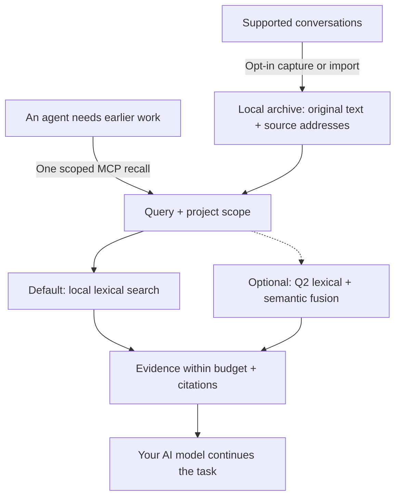

# AI-Memory-Book

**Give your AI agents a shared local memory, with original evidence they can cite.**

Projects become books, tasks become chapters, and earlier decisions stay available across sessions and clients. One MCP call returns relevant evidence within a context budget so the agent can continue your work.

[简体中文](README.zh-CN.md) · [Quick start](#quick-start) · [Measured results](#measured-results) · [Documentation](#documentation) · [v0.3.1 release](https://github.com/Afloat16/AI-Memory-Book/releases/tag/v0.3.1)

**v0.3.1 · Experimental · MIT · Python 3.10+ · Local SQLite**

## How it works



Capture updates the archive independently of retrieval. The agent can recall directly, then open an exact source page when it needs more detail; browsing the book hierarchy is optional. [Agent workflow](docs/agent-guide.md).

## Why use it?

- **Lightweight by default.** Memory writing and lexical retrieval use zero model calls. The core needs Python and SQLite, with no embedding download, database server, or memory-service API key.
- **Evidence you can inspect.** Preserve original text, project/session/turn references and exact source spans. Character limits are built in; optional named-tokenizer limits also count citations and separators.
- **One archive across clients.** MCP configuration profiles cover Claude Code/Desktop, Codex, Gemini, Cursor and more. Explicitly enabled background capture keeps supported transcripts current; the worker is headless by default.
- **Measured efficiency.** The current core returns identical evidence faster; optional indexed references reduce repeated source metadata. The results and their scope are below.

## Quick start

You need **Python 3.10+ with SQLite FTS5**. The installer downloads the release wheel into an isolated environment with MCP/client dependencies. No Git checkout or Node.js is needed.

**macOS / Linux**

```bash
curl -fsSLo install-memory-book.sh https://raw.githubusercontent.com/Afloat16/AI-Memory-Book/v0.3.1/scripts/install.sh
bash install-memory-book.sh
```

**Windows PowerShell**

```powershell
Invoke-WebRequest https://raw.githubusercontent.com/Afloat16/AI-Memory-Book/v0.3.1/scripts/install.py -OutFile install-memory-book.py
py -3 .\install-memory-book.py
```

**Connect your agent**

```bash
memory-book setup --client claude-code --capture --background
memory-book doctor
```

Use the launcher's full path printed by the installer if `memory-book` is not yet on your PATH. Restart the client, then ask: **“Recall our earlier decision about this task, cite the source, and continue.”**

Replace `claude-code` with your [client profile](docs/integrations.md#supported-profiles), or repeat `--client` to share the archive across clients. `--capture` opts in to existing and future supported text transcripts; omit it for MCP access alone. Native capture covers Claude Code, Codex, Gemini and legacy Python Kimi; other profiles use explicit imports or enabled MCP writing. Host permissions and model tool selection still apply.

**Upgrading?** Re-run the installer, then your `setup` command with the same clients and capture options so MCP and any background service use the new environment. Existing memory and the previous environment are retained. [Upgrade details](docs/deployment.md#upgrading).

## Measured results

These results describe the **v0.3.1 implementation**. It narrows project-scoped FTS work when a guarded rowid range helps, preserving the original ranking and full evidence payload. Full protocols, source hashes, per-question losses and historical experiments remain in the [benchmark index](benchmarks/README.md).

### Efficiency highlights

| Verified improvement | Result | Measurement |
|---|---|---|
| **Faster default recall, identical output** | Public native p95 **−26.05%**; actual MCP p95 **−19.87%** | v0.3.0 → v0.3.1, 4,000 characters. Four balanced rounds, 47,320 calls and ten configurations in the complete study. [Independent review](docs/round3-performance-review.md) |
| **Improvement across the registered matrix** | Geometric mean pooled p95 improvement **11.36%** | Native/MCP and 512/1,024/2,048-token settings on two regression corpora; no pooled p50/p95 regression above 5%. All individual results retained. [Original results](benchmarks/reports/round3-performance-43246417515-1/report.summary.json) |
| **Smaller MCP responses, optional** | Response-text tokens **−19.63%**; first-call reference total **−8.15%** | Separate earlier frozen measurement: 1,015 public-conversation questions, 4,000 characters, compact responses, `o200k_base`. This format remains available. [Report](docs/indexed-references.md) |

The speed result has limits: synthetic 512-token p95 increases **0.12%**, and original public empty-database startup mean increases **34.46 → 39.29 ms (+14.04%)**. The original automatic acceptance flag remains false; the independent resource review accepts the query optimization with that startup result disclosed. Neither the supplemental startup diagnostic nor this release replaces the original timings.

Indexed references preserve the same context and reconstruct every source field. The first-call count includes the full tool schema, initialization instructions and arguments; these reference-token counts are not provider bills. Sparse references can cost more. This is a size option: displayed p95 is **7.126 ms → 7.131 ms**, with no speedup claim.

### Current open-source component comparison

**Same host, 256 HotpotQA multi-hop questions, identical source pages, top-five limit and common whole-page packing within 1,024 `cl100k_base` tokens.** Higher is better for evidence recall, completeness and MRR; lower is better for latency.

| Retrieval component | Evidence recall ↑ | Complete evidence ↑ | MRR ↑ | Mean context tokens | Search p50 / p95 ms |
|---|---:|---:|---:|---:|---:|
| **Book — default lexical** | 76.28% | 52.34% | 0.8132 | 719.8 | **1.766 / 2.784** |
| **Book — optional Q2 semantics** | 76.77% | 54.69% | 0.8239 | 739.0 | 7.415 / 11.226 |
| [claude-mem 15.18.1](https://github.com/thedotmack/claude-mem) — native FTS | 70.68% | 45.31% | 0.7674 | 715.8 | 11.494 / 22.484 |
| [ai-memory v3.4.5](https://github.com/akitaonrails/ai-memory) — local hybrid | 77.27% | 55.86% | 0.8182 | 716.8 | 21.168 / 27.545 |
| [billion-context 9674cfa](https://github.com/ranxianglei/billion-context) — search kernel | **78.91%** | **58.20%** | **0.8277** | 762.3 | **0.189 / 0.793** |

Book's default path finds complete evidence **7.03 percentage points more often than claude-mem FTS**, with zero-model operation and lower measured search p95 than claude-mem and ai-memory. Q2 adds **2.34 points** over Book's default and **9.38 points** over claude-mem. **ai-memory has higher completeness than both Book modes; billion-context leads recall, completeness, MRR and search latency in this view.**

Quality uses the first result per question; latency uses all three actual repetitions and the recorded `native_search_latency` boundary. Interfaces differ: Book Python/native context assembly, claude-mem Bun/SQLite, ai-memory HTTP/MCP and billion-context's Node kernel. These are **retrieval-component measurements**, not final-answer accuracy or whole-product speed ratios. Preparation, bridge overhead and additional reads are separate; ai-memory's first-search-plus-all-reads p95 is **30.532 ms**. The [full comparison](docs/comparison.md#v031-comparison) includes all budgets/tokenizers, response/read tokens, indexing, downloads, RSS and storage. Book's **2.784 ms component result is distinct from its actual MCP measurement above**.


**Choose optional modes for your workload.** Q2 adds local model/index costs and can lose evidence at small budgets: at 512 `o200k_base` tokens / 8,000 characters, native completeness is **35.55% lexical → 33.20% Q2**. The newly selected questions exclude both earlier selections but come from the same HotpotQA source; after scoring they are regression data. They do not establish cross-domain generalization. A separate project-local FTS-statistics candidate failed its registered quality gate and is **not shipped**. Earlier [generated-answer](benchmarks/RESULTS-local-answers.md) and [full-workflow](benchmarks/RESULTS-full-workflow.md) diagnostics retain their own source/model settings; they are not v0.3.1 answer-quality scores.

The [deployment and architecture comparison](docs/comparison.md#popular-projects-and-the-workload-they-address) also covers **Mem0, Graphiti, PageIndex and Letta**, clearly separated from executed benchmarks. ai-memory also supports a zero-LLM default; claude-mem supports local model providers.

## Documentation

| What you want to do | Guide |
|---|---|
| Connect another client or import conversations | [Client profiles and formats](docs/integrations.md) |
| Install, upgrade, run Docker or manage background capture | [Deployment](docs/deployment.md) |
| Learn when to recall, use citations and resolve missing evidence | [Agent guide](docs/agent-guide.md) |
| Enable exact token caps, Q2 semantics or indexed references | [Token budgets](docs/token-budget.md) · [Semantic retrieval](docs/semantic-retrieval.md) · [Indexed references](docs/indexed-references.md) |
| Inspect the archive in a browser | Run `memory-book serve`, then open [127.0.0.1:8765](http://127.0.0.1:8765) |
| Review full measurements or contribute | [Benchmarks](benchmarks/README.md) · [Validation](docs/validation.md) · [Contributing](CONTRIBUTING.md) · [Changelog](CHANGELOG.md) |

The archive is local, unencrypted data. Evidence returned to an AI client enters that client's model context. The optional reader is for inspection; normal MCP and capture need no HTTP listener. [Data and configuration](docs/deployment.md#data-and-configuration-paths).

[CI](https://github.com/Afloat16/AI-Memory-Book/actions/workflows/ci.yml) covers Python 3.10/3.12/3.13, actual MCP stdio, the browser reader, Linux/macOS/Windows installers and container persistence. Client configuration fixtures do not certify interactive behavior in every vendor app. Independently implemented under the [MIT License](LICENSE).
