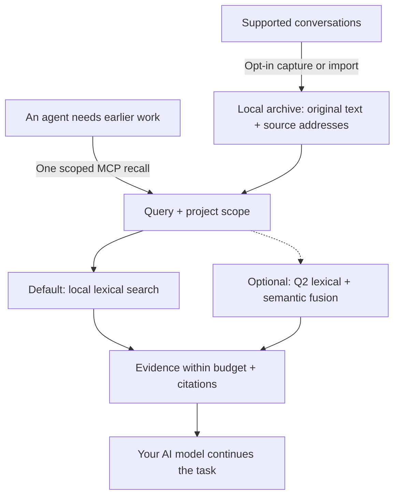

# AI-Memory-Book

**Give your AI agents a shared local memory, with original evidence they can cite.**

Projects become books, tasks become chapters, and earlier decisions stay available across sessions and clients. One MCP call returns relevant evidence within a context budget so the agent can continue your work.

[简体中文](README.zh-CN.md) · [Quick start](#quick-start) · [Measured results](#measured-results) · [Documentation](#documentation) · [v0.3.1 candidate notes](docs/releases/v0.3.1.md)

**v0.3.1 candidate · Experimental · MIT · Python 3.10+ · Local SQLite**

## How it works



Capture updates the archive independently of retrieval. The agent can recall directly, then open an exact source page when it needs more detail; browsing the book hierarchy is optional. [Agent workflow](docs/agent-guide.md).

## Why use it?

- **Lightweight by default.** Memory writing and lexical retrieval use zero model calls. The core needs Python and SQLite, with no embedding download, database server, or memory-service API key.
- **Evidence you can inspect.** Preserve original text, project/session/turn references and exact source spans. Character limits are built in; optional named-tokenizer limits also count citations and separators.
- **One archive across clients.** MCP configuration profiles cover Claude Code/Desktop, Codex, Gemini, Cursor and more. Explicitly enabled background capture keeps supported transcripts current; the worker is headless by default.
- **Measured efficiency.** The current core returns identical evidence faster; optional indexed references reduce repeated source metadata. The results and their scope are below.

## Quick start

### Try the v0.3.1 candidate

Download the artifact from a successful [v0.3.1 package preparation run](https://github.com/Afloat16/AI-Memory-Book/actions/workflows/release-prepare.yml). Extract it, open the directory containing both `install.py` and the wheel, then run:

```bash
python3 install.py --source ./ai_memory_book-0.3.1-py3-none-any.whl
```

On Windows use `py -3` in place of `python3`. The artifact includes SHA-256 checksums and a release manifest with the exact source commit; its wheel and source archive are installed and checked before upload. Confirm `memory-book --version` prints `0.3.1`, then connect your agent below. An [exact-source installation](docs/deployment.md#try-the-v031-candidate-before-publication) is also documented. Preparation does not publish a tag or release.

### Install the currently published v0.3.0 release

You need **Python 3.10+ with SQLite FTS5**. The installer downloads the release wheel into an isolated environment with MCP/client dependencies. No Git checkout or Node.js is needed.

**macOS / Linux**

```bash
curl -fsSLo install-memory-book.sh https://raw.githubusercontent.com/Afloat16/AI-Memory-Book/v0.3.0/scripts/install.sh
bash install-memory-book.sh
```

**Windows PowerShell**

```powershell
Invoke-WebRequest https://raw.githubusercontent.com/Afloat16/AI-Memory-Book/v0.3.0/scripts/install.py -OutFile install-memory-book.py
py -3 .\install-memory-book.py
```

**Connect your agent**

```bash
memory-book setup --client claude-code --capture --background
memory-book doctor
```

Use the launcher's full path printed by the installer if `memory-book` is not yet on your PATH. Restart the client, then ask: **“Recall our earlier decision about this task, cite the source, and continue.”**

Replace `claude-code` with your [client profile](docs/integrations.md#supported-profiles), or repeat `--client` to share the archive across clients. `--capture` opts in to existing and future supported text transcripts; omit it for MCP access alone. Native capture covers Claude Code, Codex, Gemini and legacy Python Kimi; other profiles use explicit imports or enabled MCP writing. Host permissions and model tool selection still apply.

**Upgrading?** Re-run the installer, then your `setup` command with the same clients and capture options so MCP and any background service use the new environment. Existing memory and the previous environment are retained. [Upgrade details](docs/deployment.md#upgrading).

## Measured results

These results describe the **v0.3.1 candidate**, whose runtime is byte-identical
to the frozen measured source. The [round-three report](docs/optimization-round3.md)
records the original gate, resource review and rejected experiments; the
[benchmark index](benchmarks/README.md) preserves earlier releases separately.

### Efficiency highlights

| Verified improvement | Result | Measurement |
|---|---|---|
| **Faster default recall, identical output** | Public-corpus actual MCP p95 **7.409 → 5.937 ms (−19.87%)**; native p95 **5.054 → 3.737 ms (−26.05%)** | Four balanced ABBA rounds, 47,320 calls, 16 workers, ten corpus/configuration cells. [Report](docs/optimization-round3.md) |
| **Improvement across the registered matrix** | Geometric-mean pooled p95 improvement **11.36%** | Equal weighting of ten cell ratios; this is not one pooled global percentile. No pooled p50/p95 cell regresses by more than 5%. [All ten cells](docs/optimization-round3.md) |
| **Inherited v0.3.0 ingestion improvements** | Fresh ingestion **−46.45%**; unchanged-session replay **−61.38%** | Historical paired core optimization on the public1015 corpus, not new v0.3.1 gains. [Report](docs/default-recall-performance.md) |
| **Optional indexed references, unchanged** | Response-text tokens **−19.63%**; first-call reference total **−8.15%** | Historical 1,015-question public corpus, 4,000 characters, compact responses, `o200k_base`. [Report](docs/indexed-references.md) |

The new query planner narrows FTS work to a safe project rowid envelope while
retaining global ranking statistics, scope predicates, candidate limits and
complete evidence payloads. It introduces no schema migration or new core
dependency. The synthetic 512-token cell has a **0.125% p95 regression**, which
remains in the report.

Original empty-database opening measured **34.456 → 39.294 ms (+14.04%, +4.838 ms)**,
so the original automatic report remains `accepted=false`. A separate
[documented resource review](docs/round3-startup-resource-review.md) accepts that
disclosed cost after inspecting unchanged startup code and 80 fresh diagnostic
samples. Those diagnostics are not replacement retrieval measurements or a
startup speedup claim. Indexed references remain a size option, with no latency
improvement claim; reference token counts are not provider bills.

### Current open-source component comparison

**Same host, a newly frozen selection of 256 HotpotQA questions, 607 supporting
evidence annotations, identical source pages, top five, and common whole-page
packing within 1,024 `cl100k_base` tokens.** Higher is better for evidence recall,
completeness and packed-context MRR; lower is better for latency.

| Retrieval component | Evidence recall ↑ | Complete evidence ↑ | Packed-context MRR ↑ | Mean context tokens | Search roundtrip p50 / p95 ms |
|---|---:|---:|---:|---:|---:|
| **Book — default lexical** | 76.28% | 52.34% | 0.8132 | 719.8 | **1.766 / 2.784** |
| **Book — optional Q2 semantics** | 76.77% | 54.69% | 0.8239 | 739.0 | 7.415 / 11.226 |
| [claude-mem 15.18.1](https://github.com/thedotmack/claude-mem) — native FTS | 70.68% | 45.31% | 0.7674 | 715.8 | 11.781 / 22.826 |
| [ai-memory v3.4.5](https://github.com/akitaonrails/ai-memory) — local hybrid | 77.27% | 55.86% | 0.8182 | 716.8 | 21.168 / 27.545 |
| [billion-context 9674cfa](https://github.com/ranxianglei/billion-context) — search kernel | **78.91%** | **58.20%** | **0.8277** | 762.3 | **0.285 / 1.010** |

Book's default path returns complete evidence for **134/256 questions versus
116/256 for claude-mem FTS: +7.03 percentage points**, with lower measured search
roundtrip latency. It keeps zero-model operation and lower measured latency
than ai-memory, while **ai-memory has higher completeness**. **billion-context
leads the displayed quality and latency metrics**. At 512 tokens the ranking
changes; the [complete comparison](docs/round3-comparison.md) retains every
budget, tokenizer, subgroup and loss rather than selecting a single winner.

Quality uses the first result for each of 256 questions. Latency uses three
search repetitions; six offline budget/tokenizer projections are not six new
searches. Packed-context MRR measures evidence order after packing, not native
top-five rank. Interfaces differ: Book Python recall includes context assembly,
claude-mem uses Bun/SQLite, ai-memory uses HTTP/MCP, and billion-context is an
in-memory Node search kernel. These are **retrieval-component measurements**,
not whole-product speed ratios or generated-answer accuracy. Extra page reads,
packing and setup are separate: ai-memory performs five reads per question,
with first-search-plus-all-reads p95 **30.532 ms**.

The [completed assessment](benchmarks/results/round3-comparison-43267797247-1/assessment.json)
verifies ten stages, **4,608 native calls plus 4,608 component searches**, all
source/budget invariants, and **1,536 native plus 768 component full-payload
pairs identical to v0.3.0 after removing timing only**. The separate performance
gate above uses balanced rounds; the new cohort's one-pass native timings do
not replace it.

**Choose optional modes for your workload.** Q2 requires a local model
(**127.5 MB** of pinned files) and an index; building this 3,896-page semantic
index took about **110 seconds**. At native 512-token caps, Q2 has a net loss of six complete
questions under each tokenizer (for example, `cl100k_base` **35.94% → 33.59%**);
at 1,024/2,048 it has a net gain of six (**52.34% → 54.69%**). The separate project-statistics
experiment was rejected after recovery of its original 8,082 calls and is
excluded from this version. Public/reused questions are regression data.
This same-source, all-answerable cohort does not establish cross-domain
generalization, abstention or hallucination rates.

The [architecture comparison](docs/comparison.md#popular-projects-and-the-workload-they-address)
also discusses **Mem0, Graphiti, PageIndex and Letta** separately from executed
benchmarks. Earlier [generated-answer](benchmarks/RESULTS-local-answers.md)
and [full-workflow](benchmarks/RESULTS-full-workflow.md) diagnostics retain
their original source/model settings; they are not v0.3.1 answer-quality scores.

## Documentation

| What you want to do | Guide |
|---|---|
| Connect another client or import conversations | [Client profiles and formats](docs/integrations.md) |
| Install, upgrade, run Docker or manage background capture | [Deployment](docs/deployment.md) |
| Learn when to recall, use citations and resolve missing evidence | [Agent guide](docs/agent-guide.md) |
| Enable exact token caps, Q2 semantics or indexed references | [Token budgets](docs/token-budget.md) · [Semantic retrieval](docs/semantic-retrieval.md) · [Indexed references](docs/indexed-references.md) |
| Inspect the archive in a browser | Run `memory-book serve`, then open [127.0.0.1:8765](http://127.0.0.1:8765) |
| Review full measurements or contribute | [Benchmarks](benchmarks/README.md) · [Validation](docs/validation.md) · [Contributing](CONTRIBUTING.md) · [Changelog](CHANGELOG.md) |

The archive is local, unencrypted data. Evidence returned to an AI client enters that client's model context. The optional reader is for inspection; normal MCP and capture need no HTTP listener. [Data and configuration](docs/deployment.md#data-and-configuration-paths).

[CI](https://github.com/Afloat16/AI-Memory-Book/actions/workflows/ci.yml) covers Python 3.10/3.12/3.13, actual MCP stdio, the browser reader, Linux/macOS/Windows installers and container persistence. Client configuration fixtures do not certify interactive behavior in every vendor app. Independently implemented under the [MIT License](LICENSE).
