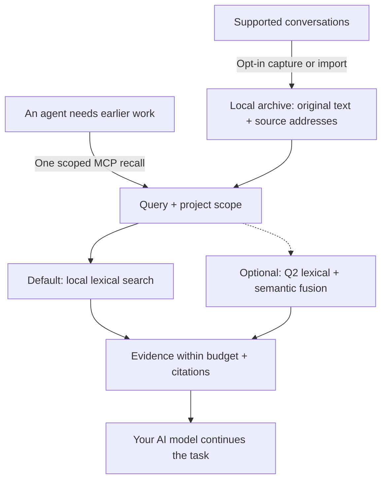

# AI-Memory-Book

**Give your AI agents a shared local memory, with original evidence they can cite.**

Projects become books, tasks become chapters, and earlier decisions stay available across sessions and clients. One MCP call returns relevant evidence within a context budget so the agent can continue your work.

[简体中文](README.zh-CN.md) · [Quick start](#quick-start) · [Measured results](#measured-results) · [Documentation](#documentation) · [v0.3.4 release](https://github.com/Afloat16/AI-Memory-Book/releases/tag/v0.3.4)

**v0.3.4 · Faster initialization and CLI startup · MIT · Python 3.10+ · Local SQLite**

## How it works



Capture updates the archive independently of retrieval. The agent can recall directly, then open an exact source page when it needs more detail; browsing the book hierarchy is optional. [Agent workflow](docs/agent-guide.md).

## Why use it?

- **Lightweight by default.** Memory writing and lexical retrieval use zero model calls. The core needs Python and SQLite, with no embedding download, database server, or memory-service API key.
- **Evidence you can inspect.** Preserve original text, project/session/turn references and exact source spans. Character limits are built in; optional named-tokenizer limits also count citations and separators.
- **One archive across clients.** MCP configuration profiles cover Claude Code/Desktop, Codex, Gemini, Cursor and more. Explicitly enabled background capture keeps supported transcripts current; the worker is headless by default.
- **Measured startup improvements.** v0.3.4 reduces fresh-archive initialization and CLI help/version startup time while preserving complete retrieval outputs. Import and retrieval costs remain disclosed below; optional indexed references retain their separate historical token-format results.

## Quick start

You need **Python 3.10+ with SQLite FTS5**. The installer downloads the release wheel into an isolated environment with MCP/client dependencies. No Git checkout or Node.js is needed.

**macOS / Linux**

```bash
curl -fsSLo install-memory-book.sh https://raw.githubusercontent.com/Afloat16/AI-Memory-Book/v0.3.4/scripts/install.sh
bash install-memory-book.sh
```

**Windows PowerShell**

```powershell
Invoke-WebRequest https://raw.githubusercontent.com/Afloat16/AI-Memory-Book/v0.3.4/scripts/install.py -OutFile install-memory-book.py
py -3 .\install-memory-book.py
```

**Connect your agent**

```bash
memory-book setup --client claude-code --capture --background
memory-book doctor
```

Use the launcher's full path printed by the installer if `memory-book` is not yet on your PATH. Restart the client, then ask: **“Recall our earlier decision about this task, cite the source, and continue.”**

Replace `claude-code` with your [client profile](docs/integrations.md#supported-profiles), or repeat `--client` to share the archive across clients. `--capture` opts in to existing and future supported text transcripts; omit it for MCP access alone. Native capture covers Claude Code, Codex, Gemini and legacy Python Kimi; other profiles use explicit imports or enabled MCP writing. Host permissions and model tool selection still apply.

**Upgrading?** Re-run the installer, then your `setup` command with the same clients and capture options so MCP and any background service use the new environment. Existing memory and the previous environment are retained. [Upgrade details](docs/deployment.md#upgrading).

## Measured results

### v0.3.4: faster initialization and CLI startup

**v0.3.4 creates an empty archive much faster and halves CLI help/version startup time against v0.3.3.** The single prospective confirmation completed **480 fresh samples**, with **40 per version and boundary**, in four balanced AB/BA/BA/AB rounds on Ubuntu 24.04 / Python 3.12. All fixed numerical startup gates pass. A [separate explicit decision](benchmarks/experiments/round6-startup-decision.json) accepts the one disclosed resource cost under the original review policy; the saved automatic result remains `accepted:false` and the original workflow remains `failure`. [Registered plan](benchmarks/experiments/round6-startup-plan.json) · [Original report](benchmarks/reports/round6-startup-43598913606-1/report.json.gz) · [Independent saved-result review](benchmarks/reports/round6-startup-43598913606-1-local-audit/review.md).

All times are milliseconds. Each arrow is **v0.3.3 → v0.3.4**; negative changes are improvements.

| Measured boundary | Median | Median change | p95 | p95 change |
|---|---:|---:|---:|---:|
| **Construct a new empty archive** | **24.518 → 4.164** | **−83.02%** | **27.374 → 6.358** | **−76.77%** |
| **Actual CLI `--help` process** | **102.903 → 48.750** | **−52.63%** | **104.104 → 49.547** | **−52.41%** |
| **Actual CLI `--version` process** | **101.346 → 47.479** | **−53.15%** | **103.116 → 48.259** | **−53.20%** |
| Complete API import, including `MemoryBook` | 33.506 → 33.920 | **+1.24%** | 33.822 → 34.433 | **+1.81%** |
| Construct a connection to an existing empty archive | 0.640 → 0.632 | −1.23% | 0.668 → 0.666 | −0.30% |
| Official SDK MCP startup through initialization | 627.601 → 620.104 | −1.19% | 632.233 → 624.837 | −1.17% |

New-archive construction saves **20.354 ms** at the median; CLI help and version save **54.153 ms** and **53.867 ms**. The API constructor timers exclude Python/import and helper validation; CLI values include the actual fresh process and captured output. MCP values start before transport/server creation and end at successful initialization. They are different boundaries, not interchangeable whole-product startup times. No first sample or outlier was removed. All **960 intent/completion events** and original source/evaluator identities passed independent offline verification.

The implementation puts **initial schema and FTS setup in one transaction**, with rollback if that setup fails. Subsequent covering-index and connection-setting steps retain their existing boundaries. Command metadata is loaded without importing archive/client machinery; requesting the public `MemoryBook` class still performs the full API import. Existing archives, schema 3, class identity and complete retrieval output are preserved.

**The costs remain visible.** Full API import is slower by **0.414 ms median / 0.611 ms p95**. Existing-archive whole-helper system CPU rises **18.646 → 21.121 ms (+2.474 ms, +13.2703%)**, the sole pooled resource-review trigger; whole-helper wall time rises **138.762 → 139.996 ms (+0.8891%)** even though its constructor interval improves slightly. The increase occurs in all four rounds. Saved data cannot quantify how much belongs to imports, validation, serialization or other phases. Two independent reviews assessed the disclosed cost and its attribution limits. The [explicit startup decision](benchmarks/experiments/round6-startup-decision.json) accepts it under the original resource policy, with no repeated timing or changed raw verdict. [Resource assessment](docs/round6-startup-resource-review.md). Publication has separate final-CI, package and public-installer gates; their evidence belongs in the [release record](docs/releases/v0.3.4.md).

<details>
<summary>All pooled resource increases and retained adverse observations</summary>

CPU and wall values below are means in milliseconds; RSS values are mean kernel records in KiB. The review also retains every positive and negative per-round cell.

| Boundary and resource | v0.3.3 → v0.3.4 | Increase |
|---|---:|---:|
| API import: whole-helper system CPU | 18.727 → 19.576 ms | +4.5343% |
| API import: kernel maximum-RSS record | 49,221.4 → 49,243.8 KiB | +0.0455% |
| New archive: whole-helper user CPU | 120.770 → 121.288 ms | +0.4289% |
| New archive: kernel maximum-RSS record | 49,460.1 → 49,496.3 KiB | +0.0732% |
| Existing archive: whole-helper wall time | 138.762 → 139.996 ms | +0.8891% |
| Existing archive: whole-helper system CPU | 18.646 → 21.121 ms | **+13.2703%** |
| Existing archive: kernel maximum-RSS record | 52,993.8 → 53,012.9 KiB | +0.0360% |
| MCP helper: system CPU | 101.166 → 102.880 ms | +1.6940% |
| MCP live server: sampled system CPU | 40.500 → 42.750 ms | +5.5556% |

The complete record contains **6 pooled timing increases, 26 round timing increases, 9 pooled resource increases and 27 round resource increases**. Beyond the import median/p95 above, import mean/minimum/maximum rise **1.4785% / 1.3192% / 4.2380%**; the existing-archive constructor maximum rises **0.672010 → 0.703721 ms (+4.7188%)**. Round-level increases include API-import system CPU **+13.8606%** and sampled MCP-server system CPU **+15.00%**. The original review rule applies to pooled resource means; none of these observations was discarded. [Every adverse cell](benchmarks/reports/round6-startup-43598913606-1-local-audit/review.json).

Both sources' new/existing logical archives are **159,744 bytes**. Kernel `wait4` RSS records include the measurement process and can include inherited/reaped-descendant effects; they do not establish equal or lower isolated product memory. MCP RSS/HWM and CPU are live samples after initialization, not unobserved lifetime maxima or totals.

</details>

### Retrieval compatibility and release scope

v0.3.4 covers **startup performance and initialization correctness**. Candidate A's two-round development recall gains were approximately **1%**, insufficient to advance to the original **10% aggregate / 15% public native-token / 10% actual-MCP p95** goals. That four-round formal recall matrix was **not run or accepted**. Candidate B's dense-project ranking regressed public native p95 by roughly **19–29%** and actual-MCP p95 by **23.9246%**; it is excluded. v0.3.4 uses A's exact runtime, and all failed experiments remain available. [Development outcomes and source selection](docs/optimization-round6.md).

A preserves **2,304 / 2,304** complete historical Hotpot256 default outputs against v0.3.3: **1,536 native** calls across two tokenizers and three caps, plus **768 component** calls. Its independent saved-ledger audit checks **4,608 events**. This is compatibility evidence, not a new evidence-quality or recall-speed claim. [Historical compatibility](benchmarks/reports/round6-hotpot-compatibility.summary.json) · [Saved-output audit](benchmarks/reports/round6-hotpot-compatibility.audit.json).

**Historical results remain historical.** v0.3.3's accepted C7 comparison against v0.3.2 recorded **14.80% aggregate p95** and **12.17% actual-MCP token p95** improvements, with separately reviewed startup costs. Those values are not v0.3.4 gains and are not added to the new startup percentages. [Original v0.3.3 performance and costs](docs/round5-c7-performance-review.md) · [Resource decision](benchmarks/experiments/round5-c7-resource-decision.json) · [Earlier rejected candidates](docs/optimization-round5.md). Optional indexed references retain their separate, unremeasured [historical token-format results](docs/indexed-references.md).

### Fresh open-source component comparison

The completed comparison uses **256 fresh HotpotQA questions**, excluding all **896 historical IDs** with zero overlap, and **619 required evidence annotations**. It retains **42 quality cells**, **6,912 retrieval/search calls** (3,072 native and 3,840 component searches), plus **1,280 separately counted ai-memory page reads**. All **1,536 native and 768 component complete-output pairs** match between v0.3.3 and v0.3.4 after removing the measured `latency_ms` field. Retrieval quality is unchanged between these Book versions. Q2 and project-statistics ranking are excluded. [Original full report](benchmarks/results/round6-comparison-43601518020-1/report.md) · [Machine-readable assessment](benchmarks/results/round6-comparison-43601518020-1/assessment.json) · [Saved-ledger and identity audit](benchmarks/reports/round6-comparison-43601518020-1-local-audit.json) · [Independent review and every adverse observation](benchmarks/reports/round6-comparison-43601518020-1-independent-review.json).

**Two legacy sentences in the saved report need this provenance context.** The original v1 source/evaluator freeze preceded selection. The fixture-only v2 recovery was frozen **after the same 256 IDs were fixed, before their first scoring**, with no reselection or scored rerun. Its sentence assigning the release gate to an old-data ABBA recall experiment does **not** describe v0.3.4 acceptance: the original **10% / 15% / 10% recall formal matrix was not run or accepted**. The separate prospective startup experiment above supplies this version's confirmed performance improvement. The original report remains unchanged. [Recovery registration](benchmarks/experiments/round6-comparison-fixture-recovery-addendum.json) · [Exact recovery binding](benchmarks/experiments/round6-comparison-recovery-binding.json).

The table uses the same supplied pages, top five results and common whole-block packing at **1,024 `cl100k_base` tokens**. External components are the locked revisions shown, not a claim about their latest releases.

| Measured component (pinned version) | Evidence recall | Complete evidence | Packed MRR | Mean context tokens | Search adapter p95 |
|---|---:|---:|---:|---:|---:|
| Book v0.3.3 · default lexical | 75.93% | 53.12% | 0.8556 | 715.5 | 3.518 ms |
| **Book v0.3.4 · default lexical** | 75.93% | 53.12% | 0.8556 | 715.5 | 3.582 ms |
| claude-mem 15.18.1 · native FTS | 70.60% | 48.05% | 0.8060 | 710.6 | 42.840 ms |
| ai-memory v3.4.5 · local hybrid | 77.87% | 57.42% | 0.8279 | 715.3 | 40.409 ms |
| billion-context `9674cfa` · search kernel | 80.94% | 60.55% | 0.8481 | 760.4 | 1.399 ms |

Book has **5.0781 percentage points higher complete-evidence rate than claude-mem** here, with **24 question gains and 11 losses**, and the highest packed MRR, tied across the two Book versions. Its search-adapter p95 is lower than claude-mem's and ai-memory's. **ai-memory exceeds Book's recall and completeness; billion-context leads recall, completeness and measured search latency.** Book trails their completeness by **4.2969** and **7.4219 percentage points**, respectively. These results establish specific component advantages and disadvantages, without an overall winner.

Search p95 pools all three searches per question and excludes offline common packing and additional page reads. Book uses in-process Python recall and context assembly; claude-mem uses SQLite/Bun, ai-memory local hybrid HTTP/MCP, and billion-context its supplied-source search kernel/Node. These different boundaries do not establish whole-product speed ratios. ai-memory's first search plus all five reads has p95 **46.338 ms**, compared with its search-only **40.409 ms**. Packed MRR measures evidence order after the common packer omits metadata or oversized blocks; native positions are also retained.

**Fresh descriptive timing includes regressions against v0.3.3.** Book's component search p50/p95 rises **2.351 → 2.374 / 3.518 → 3.582 ms (+0.99% / +1.83%)**; first-search-plus-all-reads p95 rises **3.535 → 3.573 ms (+1.06%)**, and repeat-search p95 rises **3.501 → 3.576 ms (+2.14%)**. Five of six native p50/p95 cells rise; all six native mean latencies rise **0.1360–3.4936%**. These stages run sequentially and provide descriptive measurements, not a balanced recall-performance acceptance test.

<details>
<summary>All native latency cells and all 18 competitor completeness comparisons</summary>

The six native settings each contain 256 calls per Book version, use 8,000 characters and top five results, and disable the result cache. Positive changes below are slower.

| Tokenizer / cap | p50: v0.3.3 → v0.3.4, ms | Change | p95: v0.3.3 → v0.3.4, ms | Change |
|---|---:|---:|---:|---:|
| `cl100k_base` / 512 | 2.994 → 3.091 | +3.23% | 4.289 → 4.415 | +2.92% |
| `cl100k_base` / 1024 | 2.865 → 2.885 | +0.70% | 3.987 → 4.087 | +2.49% |
| `cl100k_base` / 2048 | 2.694 → 2.702 | +0.31% | 3.899 → 3.923 | +0.60% |
| `o200k_base` / 512 | 3.374 → 3.345 | −0.84% | 4.988 → 4.819 | −3.39% |
| `o200k_base` / 1024 | 2.977 → 3.010 | +1.11% | 4.245 → 4.334 | +2.11% |
| `o200k_base` / 2048 | 2.729 → 2.782 | +1.92% | 3.990 → 4.000 | +0.23% |

Each comparator cell below gives Book minus comparator complete-evidence rate in percentage points, followed by **question gains / losses**. Every budget and tokenizer is retained, including adverse cells. The full assessment also preserves all annotation gains/losses and group results.

| Tokenizer / cap | Book − claude-mem | Book − ai-memory | Book − billion-context |
|---|---:|---:|---:|
| `cl100k_base` / 512 | +7.4219 pp (28 / 9) | −1.1719 pp (27 / 30) | +1.1719 pp (43 / 40) |
| `cl100k_base` / 1024 | +5.0781 pp (24 / 11) | −4.2969 pp (16 / 27) | −7.4219 pp (28 / 47) |
| `cl100k_base` / 2048 | +5.0781 pp (24 / 11) | −4.2969 pp (16 / 27) | −7.4219 pp (28 / 47) |
| `o200k_base` / 512 | +7.4219 pp (29 / 10) | −0.7812 pp (27 / 29) | +0.3906 pp (40 / 39) |
| `o200k_base` / 1024 | +5.0781 pp (24 / 11) | −4.2969 pp (16 / 27) | −7.4219 pp (28 / 47) |
| `o200k_base` / 2048 | +5.0781 pp (24 / 11) | −4.2969 pp (16 / 27) | −7.4219 pp (28 / 47) |

The **seven-question low-overlap group** at 512 `cl100k_base` tokens exposes another limit: Book's complete-evidence rate is **0%** in both its native and component paths, versus **14.29%** for claude-mem and **28.57%** for each of ai-memory and billion-context. The group is too small to support a broad generalization.

</details>

<details>
<summary>Setup, storage, memory and native-payload costs</summary>

| Measured stage | Setup wall ms | Setup RSS MiB | Query RSS MiB | Native state bytes |
|---|---:|---:|---:|---:|
| Book v0.3.3 native | 3916.344 | 547.41 | 533.12 | 39,037,696 |
| Book v0.3.4 native | 3890.425 | 551.45 | 537.18 | 39,037,696 |
| Book v0.3.3 component | 840.940 | 531.80 | 511.84 | 34,340,864 |
| Book v0.3.4 component | 843.362 | 525.79 | 504.87 | 34,340,864 |
| claude-mem FTS | 2444.687 | 682.05 | 594.81 | 20,659,514 |
| ai-memory hybrid | 845167.166 | 706.79 | 710.69 | 74,208,780 |
| billion-context kernel | 225.397 | 532.91 | 650.98 | 0 |

Native Book setup includes new ingestion and initialization; component Book setup copies one canonical archive. The setup boundaries are different. Against v0.3.3, component setup increases **840.940 → 843.362 ms (+0.2881%)**. Native setup decreases **0.6618%**, while its separately recorded runtime import rises **48.455 → 51.401 ms (+6.0803%)**. Native sampled setup/query/finalization RSS increases **0.7378% / 0.7613% / 0.7596%**; component RSS decreases in all three phases. Book's native and component file sizes remain equal between versions; its component state is larger than claude-mem's and smaller than ai-memory's.

RSS samples cover the worker and live descendants every 20 ms, include evaluator/data memory, can count shared mappings twice, and are observed lower bounds. They do not measure isolated product RAM. State bytes exclude symlinked model caches; billion-context's zero records no generated native-state files at this boundary, not zero total storage. Full finalization, main/WAL/SHM and live-statistics values remain in the stage reports and [independent review](benchmarks/reports/round6-comparison-43601518020-1-independent-review.json).

Common packed context and native response payload are different costs. At this 1,024-token projection Book averages **715.5 packed tokens**, slightly more than claude-mem's **710.6** and ai-memory's **715.3**. Its native search payload averages **3,992.9 `cl100k_base` tokens**, versus **1,634.7** for claude-mem, **1,019.3** for ai-memory and **585.0** for billion-context. ai-memory additionally returns **1,836.3** read-payload tokens per query. Book's native payload mean increases by **0.0078125 token** in each tokenizer versus v0.3.3 because the measured `latency_ms` field is retained in that payload accounting; the complete payloads excluding that timing field remain identical. No new token-saving claim follows from this comparison.

</details>

All selected questions are answerable and come from the same public HotpotQA source; disjoint IDs do not establish new-domain generalization. These scored IDs are now regression data. This evaluates returned evidence, not answer generation, hallucination rates or private-conversation transfer. No generative model is called. The previous v0.3.2 comparison, optional Q2 gains/losses and their costs remain available in the [historical report](benchmarks/results/round4-comparison-43363060062-1/report.md); they are not v0.3.4 measurements.

The [deployment and architecture comparison](docs/comparison.md#popular-projects-and-the-workload-they-address) also covers **Mem0, Graphiti, PageIndex and Letta**, clearly separated from executed benchmarks. ai-memory also supports a zero-LLM default; claude-mem supports local model providers.

## Documentation

| What you want to do | Guide |
|---|---|
| Connect another client or import conversations | [Client profiles and formats](docs/integrations.md) |
| Install, upgrade, run Docker or manage background capture | [Deployment](docs/deployment.md) |
| Learn when to recall, use citations and resolve missing evidence | [Agent guide](docs/agent-guide.md) |
| Enable exact token caps, Q2 semantics or indexed references | [Token budgets](docs/token-budget.md) · [Semantic retrieval](docs/semantic-retrieval.md) · [Indexed references](docs/indexed-references.md) |
| Inspect the archive in a browser | Run `memory-book serve`, then open [127.0.0.1:8765](http://127.0.0.1:8765) |
| Review full measurements or contribute | [Benchmarks](benchmarks/README.md) · [Validation](docs/validation.md) · [Contributing](CONTRIBUTING.md) · [Changelog](CHANGELOG.md) |

The optional Q2 runtime opts out of ONNX Runtime telemetry. The archive is local, unencrypted data. Evidence returned to an AI client enters that client's model context. The optional reader is for inspection; normal MCP and capture need no HTTP listener. [Data and configuration](docs/deployment.md#data-and-configuration-paths).

[CI](https://github.com/Afloat16/AI-Memory-Book/actions/workflows/ci.yml) covers Python 3.10/3.12/3.13, actual MCP stdio, the browser reader, Linux/macOS/Windows installers and container persistence. Client configuration fixtures do not certify interactive behavior in every vendor app. Independently implemented under the [MIT License](LICENSE).
