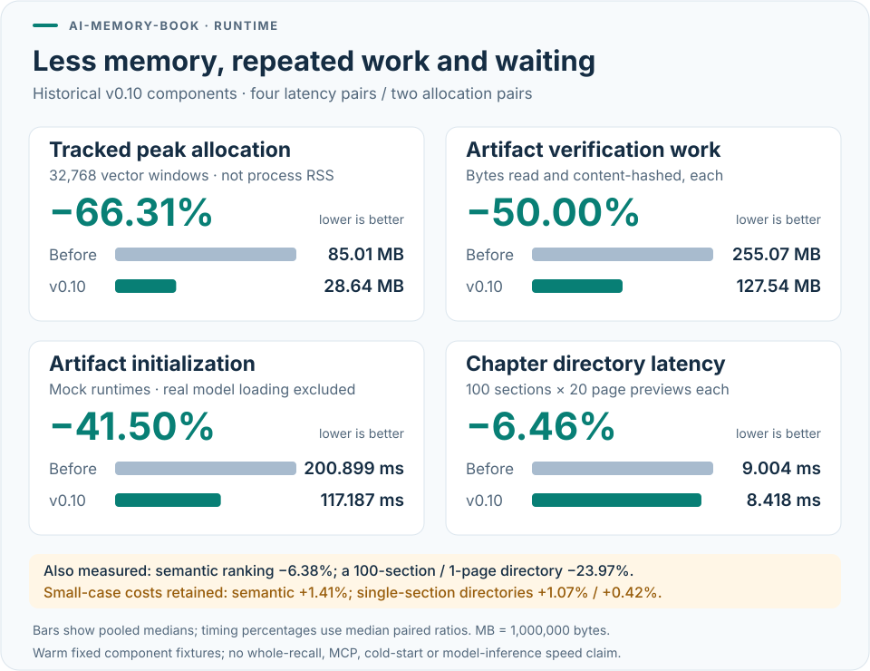

# AI-Memory-Book

**Give AI an addressable book of engineering memory, with a separate book for each project.**

Preserve conversations as project books, task chapters, question sections and original evidence pages. Find a chapter from its title or question, then follow its addresses to the source. Similar codebases can reuse task names and parameters while keeping their records in explicit project namespaces. Recover decisions, corrections, constraints and failed attempts when a session ends or a client changes.

**v0.12.0 · MIT · Python 3.10+ · SQLite / FTS5 · Optional native C acceleration**

**v0.12.0 is published.** Exact-source CI, native-wheel installation checks and the real public-URL installer have passed. The quick start below installs this release. [Source and delivery evidence](docs/v0.12.0-validation.md#delivery-status-and-practical-limits).

[简体中文](README.zh-CN.md) · [Results](#evidence-coverage) · [Performance](#performance) · [Quick start](#quick-start) · [How it works](#how-it-works) · [Documentation](#documentation)

## At a glance

| Complete evidence | Directory contracts | Less context than recent history | Original sources |
|:---:|:---:|:---:|:---:|
| **72 / 72** answerable cases | **119 / 119** checks | **20.4% fewer** characters | **161** page reads verified |
| Fixed engineering workload, both 1,200 and 2,400 characters | Per backend: authored navigation, pagination and scope fixture | 1,798.9 vs 2,260.9 mean characters at 2,400 | Per backend: 80 distinct pages in the directory fixture |

These are measured development-fixture results, not coding-model answer accuracy or independent real-world validation. [Results, source identities and limits](docs/current-results.md).

| What you need | What the source implementation provides |
|---|---|
| Resume an engineering task | Original decisions, later corrections, constraints and failed attempts with source references |
| Keep similar projects separate | Exact project IDs and project-bound MCP connections, including follow-up page reads |
| Locate a task from its heading | Indexed title/question/directory search, unique chapter results and scoped follow-up addresses |
| Recover a brief later correction | Current-state ordering checks source-local comparable declarations; short evidence pages can use otherwise unused character allowance |
| Search code and conversations | Chinese/English lexical retrieval plus acronym, camel-case and snake-case aliases |
| Control the returned context | A default 2,400-character budget and up to five results; optional exact token caps |
| Switch clients | One archive shared across supported Claude Code, Codex, Gemini and other integrations |
| Operate locally | SQLite / FTS5; default ingestion and lexical recall make no model calls |
| Recover safely | Verified online backups, transactional source replacement and snapshot-based export |

## Quick start

Requires **Python 3.10+ with SQLite FTS5**. The installer selects a compatible prebuilt native wheel or the portable Python fallback and creates an isolated environment with MCP/client dependencies.

**macOS / Linux**

```bash
curl -fsSLo install-memory-book.sh https://raw.githubusercontent.com/Afloat16/AI-Memory-Book/v0.12.0/scripts/install.sh
bash install-memory-book.sh
```

**Windows PowerShell**

```powershell
Invoke-WebRequest https://raw.githubusercontent.com/Afloat16/AI-Memory-Book/v0.12.0/scripts/install.py -OutFile install-memory-book.py
py -3 -I -X utf8 .\install-memory-book.py
```

**Connect and check**

```bash
memory-book setup --client claude-code
memory-book --version
memory-book doctor
```

Choose your [supported client profile](docs/integrations.md#supported-profiles). Use the full launcher path printed by the installer if it is not on PATH, then restart the client.

| Optional setup | Meaning |
|---|---|
| `--mcp-project YOUR_PROJECT_ID` | Bind that MCP connection to an exact stored project ID |
| `--capture` | Opt in to existing and future supported text transcripts |
| `--capture --background` | Also install and start background capture for a supported profile |

MCP configuration and native capture have separate support matrices. Tool invocation remains controlled by the host/model. Existing schema-4 archives need no new migration; preserve custom installation paths, refresh setup and restart existing processes when upgrading. [Upgrade guide](docs/deployment.md#upgrading).

## Evidence coverage


**Fixed workload:** 8 projects · 4 algorithm families · 6 chronological checkpoints · 80 questions, including 72 answerable cases and 8 missing-evidence queries. The v0.11 baseline and frozen v0.12 source each completed **800 scored responses**. Independent source, budget and score checks found **zero per-case regressions**. At both 1,200 and 2,400 characters, Book now recovers **80/80 required spans, 72/72 complete cases and 48/48 fixed-policy checks** in both its native-excerpt and shared whole-block tracks. These are source results on an authored development fixture. [Exact source identities, every score and limits](docs/current-results.md).

### Compared with practical retrieval strategies

At 2,400 characters, using each strategy's native context assembly:

| Strategy | Required spans | Complete evidence | Fixed-policy checks | Mean context characters |
|---|---:|---:|---:|---:|
| **AI-Memory-Book** | **80 / 80** | **72 / 72** | **48 / 48** | **1,798.9** |
| Scoped flat FTS | 60 / 80 | 52 / 72 | 28 / 48 | 1,801.3 |
| Recent history within budget | 64 / 80 | 56 / 72 | 32 / 48 | 2,260.9 |
| No memory | 0 / 80 | 0 / 72 | 0 / 48 | 0 |

**20 more complete-evidence cases than flat FTS; 16 more than recent history, using 20.4% fewer context characters.** Recent history uses shorter citation headings and has no top-five candidate limit. These are repository strategies, not additional external products. [Protocol and current results](docs/current-results.md).

### Compared with pinned open-source components

Same 80 questions, six chronological checkpoints, original supplied-page hashes, exact project scope, at most five candidates and a shared **2,400-character whole-block packer**. Book is replayed on frozen v0.12 source. The external rows retain their own pinned executions, with matching workload and supplied-page digests; they are not described as fresh executions of every upstream release.

| Component / tested mode | Required spans | Complete evidence | Fixed-policy checks | Stale-only cases | Mean packed characters |
|---|---:|---:|---:|---:|---:|
| **AI-Memory-Book** | **80 / 80** | **72 / 72 · 100%** | **48 / 48** | **0** | **1,798.9** |
| BM25S 0.3.16 · retrieval library, native defaults | 80 / 80 | 72 / 72 · 100% | 48 / 48 | 0 | 1,846.7 |
| Whoosh 2.7.4 · BM25F, configured OR parser | 80 / 80 | 72 / 72 · 100% | 48 / 48 | 0 | 1,457.8 |
| Haystack 3.5.0 · InMemoryBM25Retriever | 74 / 80 | 66 / 72 · 91.67% | 42 / 48 | 0 | 1,884.7 |
| LanceDB 0.41.0 · native FTS | 72 / 80 | 64 / 72 · 88.89% | 40 / 48 | 4 | 1,876.7 |
| billion-context · pinned search kernel | 72 / 80 | 64 / 72 · 88.89% | 40 / 48 | 0 | 1,955.0 |
| claude-mem · raw-observation FTS | 72 / 80 | 64 / 72 · 88.89% | 40 / 48 | 0 | 1,488.5 |
| Basic Memory · explicit FTS | 72 / 80 | 64 / 72 · 88.89% | 40 / 48 | 0 | 1,333.1 |
| Mem0 / Chroma / LangGraph · shared MiniLM configurations | 55 / 80 | 47 / 72 · 65.28% | 25 / 48 | 4 | 1,963.1 |

**Book, BM25S and configured Whoosh tie on complete evidence and fixed-policy checks at both budgets. Whoosh uses fewer mean packed characters than Book at both budgets.** At 2,400 characters Book finds six more complete cases than Haystack, eight more than LanceDB and each of the three historical lexical modes, and 25 more than each shared-MiniLM configuration. This does not establish universal superiority.

Mem0 uses `infer=False`; claude-mem's observer and Basic Memory's full default hybrid workflow are not run. The three MiniLM interfaces execute separately but share a representation and have correlated scores. Whoosh uses an explicitly configured **OR** parser, not its default AND parser. Haystack, BM25S, LanceDB and Whoosh are framework/store/retrieval components. These are configured component comparisons, not full-product rankings. [Modes, pins and source audit](docs/current-results.md) · [LanceDB/Whoosh execution and original records](benchmarks/reports/v0.12-search-components/README.md).

**Memvid SDK 2.0.160, lexical mode, was also executed:** every original natural-language question returned an empty native hit list. A separate 14-call diagnosis recovered indexed pages for original-text keyword controls, while the full question still returned no hits with or without project scope. The formal responses are retained as a configured-query limitation, not a zero-score product victory or an abstention result. No rewritten query replaces a scored question. [Complete extension, audit and diagnosis](docs/v0.11.0-validation.md#additional-real-upstream-components).

The architecture review covers **26 external project families**, including six store/retrieval libraries or frameworks. **Eleven external configurations have been executed:** ten are represented in the scored table, while Memvid's query limitation is separate. The remaining families, including Hindsight, MemSearch, MCP Memory Service, Letta, Graphiti, MemOS, Memori, Cognee, OpenViking, Serena, EverOS, SimpleMem, Supermemory, LongMemory and the official MCP memory server, receive official-source feature coverage without invented numerical results. [Architecture, deployment and upstream references](docs/open-source-memory-comparison.md).

### The 1,200-character improvement

The unchanged fixture and common packer retain the v0.11 result alongside the new source replay:

| Book version / packing | Required spans | Complete evidence | Fixed-policy checks | Stale-only cases | Mean characters |
|---|---:|---:|---:|---:|---:|
| v0.11 · native excerpts | 76 / 80 | 68 / 72 | 48 / 48 | 0 | 1,195.9 |
| **v0.12 · native excerpts** | **80 / 80** | **72 / 72** | **48 / 48** | **0** | **1,196.6** |
| v0.11 · shared whole-block packer | 76 / 80 | 68 / 72 | 44 / 48 | 4 | 1,048.1 |
| **v0.12 · shared whole-block packer** | **80 / 80** | **72 / 72** | **48 / 48** | **0** | **1,041.5** |

At the same 1,200-character common-block boundary, **BM25S and configured Whoosh also have 80/80 spans, 72/72 complete cases, 48/48 policy checks and zero stale-only cases**. Their mean packed lengths are 1,045.3 and 884.5 characters respectively. Book closes its earlier four-case complete-evidence deficit here; it does not exceed those two components' evidence scores.

The two packing tracks remain separate. Zero stale-only means that no case contains a registered stale span while lacking every required span; old and current text can still coexist. Book and all ten scored external configurations return related context for the eight missing-evidence queries. This workload has repeated maintenance text, no independent holdout and no coding LLM; it does not measure task success, general factual authority or calibrated abstention. [Full results and remaining failures](docs/current-results.md).

## Performance

### Retained frozen performance experiments

The figures below were measured on the named **v0.10.0 or earlier source snapshots**. v0.11 changed current-state recall and directory-read transactions; v0.12 also changes declaration ordering and character/token assembly. These experiments were not rerun on the new runtime and do not establish a v0.12 end-to-end speedup. Unchanged C source establishes component continuity only; gains from separate experiments are not combined.



| Historically measured component | Reference → measured implementation | Paired change |
|---|---:|---:|
| Semantic ranking · 32,768 windows | 188.620 → 176.934 ms | **−6.38% latency** |
| Tracked peak allocation · same fixture | 85,005,064 → 28,637,125 bytes | **−66.31% allocation** |
| Model-artifact reads and content-hash bytes | 255,070,776 → 127,535,388 each | **−50% byte work** |
| Artifact initialization · mocked runtimes | 200.899 → 117.187 ms | **−41.50% latency** |
| Directory · 20 sections × 20 preview pages | 1.858 → 1.757 ms | **−5.31% latency** |
| Directory · 100 sections × 20 preview pages | 9.004 → 8.418 ms | **−6.46% latency** |
| Directory · 20 / 100 sections × 1 preview page | Same original preview/query semantics | **−20.48% / −23.97% latency** |
| Directory · 20 / 100 sections × 100 preview pages | Same returned bounds | **−1.86% / −1.98% latency** |

In that frozen v0.10 experiment, **all six multi-section configurations improved in every paired round; all 1,440 timed directory calls retained exact outputs.** Query counts fell from 6 / 63 / 303 to 5 / 24 / 104 for 1 / 20 / 100 sections. [Frozen results and acceptance](docs/comprehensive-v010-validation.md).

| Retained small-fixture cost | Observed change |
|---|---|
| Semantic ranking · 4,096 windows | **+1.41%** latency; about **+0.329 ms** between pooled medians |
| Directory · one section, 20 / 100 previews | **+1.07% / +0.42%**; about **+2 / +4 microseconds** |

Latency percentages use the median of four paired ratios; displayed times are pooled medians. Tracked allocations are not total RSS. Mock initialization excludes real tokenizer parsing, model loading and inference. These component results are not whole-recall or MCP speedups.

### Retained native core

The **22-entry C backend** handles measured text, scoring, selection, source-mapping and segmentation work, with a complete Python reference fallback. Its C/header source is unchanged from the retained native-core measurement below, which compares it with the preceding native implementation. The Python recall orchestration and budget assembly have changed since that measurement; these old timings are not measurements of that complete pipeline. [Source continuity and benchmark conditions](docs/current-results.md).


| Workload / budget | Direct recall p95 reduction | Real stdio MCP p95 reduction |
|---|---:|---:|
| Synthetic · 2,400 characters | **1.82%** | **2.64%** |
| Public regression data · 2,400 characters | **5.79%** | **3.51%** |
| Synthetic · 1,024-token cap | **8.03%** | **8.23%** |
| Public regression data · 1,024-token cap | **4.80%** | **1.12%** |

| Ingestion workload | Fresh ingestion time | Unchanged reingestion time |
|---|---:|---:|
| Synthetic | **−9.28%** | **−2.97%** |
| Public regression data | **−10.39%** | **−3.94%** |

The frozen native-core experiment checks **113,568 timed calls / 56,784 paired outputs** and retains all rounds. It excludes model generation, has no result-cache hits, and does not clear SQLite/OS caches. It has not been rerun for this README; gains from separate experiments are not added together. [Complete native-core evidence](docs/native-core-validation.md).

<details>
<summary>Startup costs and individual native-core regressions</summary>

| Recorded cost or exception | Result |
|---|---|
| Default-budget paired p95 rounds | 15 / 16 improve; one synthetic direct round is **0.89% slower** |
| Public token-budget MCP, first round | **+0.78% p50 / +3.18% p95** |
| API import | **+2.04–2.20 ms** |
| Ending worker RSS | **+0.02–0.23 MiB** |
| Public default-budget MCP initialization | **+7.35 ms**; other startup observations are mixed |
| Measured host extension size | **+519,480 bytes**; not a wheel download-size claim |

</details>

## How it works


| Step | Behavior | Agent interface |
|---|---|---|
| Archive | Keep original turns and coordinates; group by project/task/session | Import, capture, `remember_session` when enabled |
| Locate | Search indexed headings and questions, group by chapter, and retain project scope | `search_directory` |
| Find evidence | Apply project scope before candidate truncation; search original pages and identifier aliases | `recall_memory` |
| Inspect | Browse only when helpful; follow citations to original pages | `browse_book`, `browse_chapter`, `browse_section`, `read_page` |
| Continue | Verify constraints, corrections and failed attempts before editing | Your existing coding client |

The default budget includes citation headings and separators inside `context`; it does not cap the complete JSON response or model tokens. `temporal=auto/current/relevance` controls evidence ordering; source inspection remains necessary when judging authority.

### Find the chapter, then inspect the evidence

```bash
# Use an exact stored project ID and a phrase from a task or question heading.
memory-book locate "gradient accumulation" --project service-alpha --limit 10
```

The locator searches metadata even when the original body does not repeat the heading. It returns unique chapters, each with at most five matching section previews, and explicit `result_type="directory", evidence=false`. Follow returned IDs with `browse_chapter`, `browse_section` or `read_page`; titles and summaries are navigation hints, not answer citations. Any analyzed metadata term can match, so a partial heading match may be returned.

The authored eight-project directory workload was rerun on each of the Python and native backends. Each passed **119 contracts**, with **130 locator calls** and **161 original-page reads** covering **80 distinct pages**. The original protocol correction and all attempts remain recorded. This is a navigation/scope result, not answer accuracy or a speed benchmark. [Current validation](docs/v0.12.0-validation.md#directory-and-project-scope).

### Current declarations and brief evidence pages

Current-state temporal ordering now checks authenticated comparable declarations throughout the comparison pool, including candidates already reached by relevance search. A production qualifier must belong to the declaration itself; a staging sentence, another field, a question or a directory title cannot provide that evidence. Bounded numeric prose and complete Chinese old-value withdrawal statements have explicit parsing rules. Time alone does not establish a decision's authority.

A separately registered **38-question development diagnostic** contains 32 answerable questions. In every tested auto-mode budget/limit configuration, the expected first source improved from **22/32 to 30/32**, on both Python and native. With a one-result limit, complete evidence improved by the same counts; with five results, it remained **32/32**. Each backend/arm has 304 saved responses, not 304 independent questions. **Two complex Chinese-prose questions still fail the expected-first-source check**, and a high original BM25 relevance score can still rank an agenda first. Equal-time conflicts and calibrated abstention remain unresolved. [All responses, failed candidates and limits](docs/v0.12.0-validation.md#declaration-diagnosis).

For character budgets, pages of at most 240 characters can finish by using allowance above the existing minimum in longer truncated pages. Candidate order, citation framing and already complete pages are preserved; authenticated current-turn spans are protected. Exact-token assembly starts from those actual character blocks and preserves each whole block accepted by first fit before supplementing text. Across **482 authored configurations per backend**, none of the 434 previously observed current-evidence presences was lost; the original unprotected candidate's 34 regressions remain in the record. The original crowding probe stays **18/18 before and after** per backend. These are correctness checks, not new speed measurements. [Allocation checks and retained controls](docs/v0.12.0-validation.md#short-page-and-token-preservation).

### One project per MCP connection

```bash
memory-book projects
# Replace service-alpha with an exact ID returned above.
memory-book setup --client codex --mcp-project service-alpha
memory-book recall "current gradient accumulation steps" --project service-alpha --budget 2400 --limit 5
```

| Scope rule | Behavior |
|---|---|
| Bound connection, omitted project | Inherits the configured project |
| Conflicting project or foreign page ID | Rejected; cannot silently switch books |
| Ordinary client setup | Preserves an existing managed binding |
| `--mcp-project` / `--clear-mcp-project` | Explicitly change / remove the connection binding |
| `setup --project` | Capture mapping; requires `--capture` |

Unbound requests may search across books. A binding follows the configured connection, not the terminal's current directory; it protects against scope mistakes and is not multi-user authentication. [Scope and source semantics](docs/agent-guide.md#bound-project-connections).

## Source acceptance and published delivery

The v0.12 source checkpoint passed the recorded local suite: **1,657 discovered tests, 1,655 passed, two Windows-only skips, zero failures/errors**. The published release at `62508a1ce681111ec5702c88e3aa42f67b9fc9c0` retains the accepted runtime bytes and has separately completed its CI, native-wheel and public-installer gates. [Source acceptance](benchmarks/experiments/v012-source-acceptance.json) · [Published delivery proof](benchmarks/reports/v0.12-publication/README.md).

The following delivery checks cover the same published **v0.12.0** source. The 30 native cells and public installer belong to release run `44275753685`, attempt `1`; the independent exact-source CI is run `44275753683`, attempt `1`.

| v0.12 release check | Verified result |
|---|---|
| Exact-source CI | **11 / 11 jobs passed** |
| Native build / installation matrix | **30 / 30 cells** · CPython 3.10–3.15 |
| Targets | Linux x86_64 / ARM64 · macOS Intel / ARM64 · Windows AMD64 |
| Native test outcomes | **4,245 passed + 75 explicitly permitted optional skips; zero failures** |
| Public assets | **67 files**, independently downloaded and hash-verified |
| Published installer | Real public-URL install verifies v0.12.0, native backend and default MCP/client dependencies |
| Archive compatibility | **Schema 4**; source/page IDs and Unicode coordinates retained |

[Published v0.12 release](https://github.com/Afloat16/AI-Memory-Book/releases/tag/v0.12.0) · [Successful release workflow](https://github.com/Afloat16/AI-Memory-Book/actions/runs/44275753685) · [Exact-source CI](https://github.com/Afloat16/AI-Memory-Book/actions/runs/44275753683) · [Original artifacts, logs, assets and independent audit](benchmarks/reports/v0.12-publication/README.md).

<details>
<summary>Historical v0.11 delivery</summary>

The earlier **v0.11.0** publication retains its own evidence and is not counted as a v0.12 execution:

| v0.11 release check | Recorded result |
|---|---|
| Exact-source CI | **11 / 11 jobs passed** |
| Native build / installation matrix | **30 / 30 cells** · CPython 3.10–3.15 |
| Targets | Linux x86_64 / ARM64 · macOS Intel / ARM64 · Windows AMD64 |
| Native test outcomes | **4,245 passed + 75 explicitly permitted optional skips; zero failures** |
| Public assets | **67 files**, independently downloaded and hash-verified |
| Published installer | Real public-URL install verifies version, native backend and default MCP/client dependencies |
| Archive compatibility | **Schema 4**; source/page IDs and Unicode coordinates retained |

[Published v0.11 release](https://github.com/Afloat16/AI-Memory-Book/releases/tag/v0.11.0) · [Original release workflow](https://github.com/Afloat16/AI-Memory-Book/actions/runs/44233642151) · [Recovered and audited publication proof](benchmarks/reports/v0.11-publication/README.md).

</details>

Use the Python interpreter printed by the installer in place of `python` to inspect the installed backend:

```bash
python -I -X utf8 -c "import memory_book; from memory_book._text_backend import BACKEND_NAME; print(memory_book.__version__, BACKEND_NAME)"
```

A compatible native installation from the published quick start prints `0.12.0 native`. `MEMORY_BOOK_TEXT_BACKEND=auto` is the default; `python` selects the reference, and `native` requires the extension. [Backend and source-build options](docs/deployment.md#native-backend-and-source-builds).

## Documentation

| Task | Guide |
|---|---|
| Install, upgrade or run a service | [Deployment](docs/deployment.md) |
| Connect a client or enable capture | [Integration support matrix](docs/integrations.md#supported-profiles) |
| Use citations, budgets and project scope | [Agent guide](docs/agent-guide.md) |
| Try engineering retrieval and backup | [Engineering workflow](docs/engineering-workflows.md) · [Runnable example](examples/engineering-workflow.json) |
| Inspect every score and measurement boundary | [Current results](docs/current-results.md) · [v0.12 validation](docs/v0.12.0-validation.md) · [Validation index](docs/validation.md) |
| Compare architectures and deployment needs | [Open-source comparison](docs/open-source-memory-comparison.md) |
| Develop or release the project | [Contributing](CONTRIBUTING.md) · [Release runbook](docs/releasing.md) |

Run `memory-book serve` to browse the archive at [127.0.0.1:8765](http://127.0.0.1:8765). Archives are local and unencrypted; recalled evidence enters the selected client's model context. [Data locations and maintenance](docs/deployment.md#data-and-configuration-paths).

Independently implemented under the [MIT License](LICENSE).
