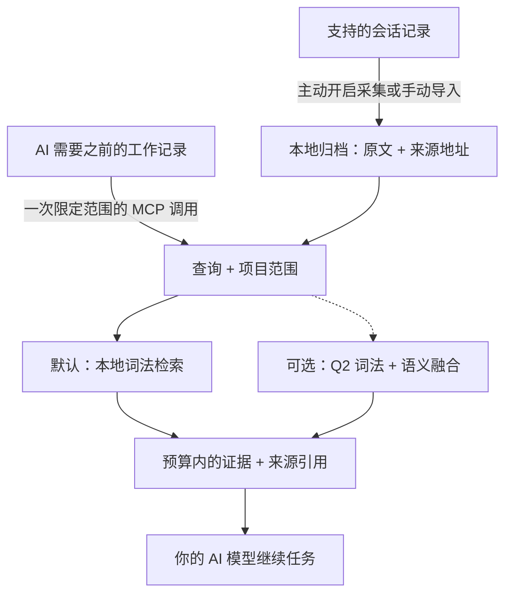

# AI-Memory-Book

**让 AI 共享一份本地记忆，找回原始证据，带着出处继续工作。**

项目是书，任务是章，之前的决定可以跨会话、跨客户端保留。AI 通过一次 MCP 调用，取得预算范围内的相关原文，用来继续当前任务。

[English](README.md) · [快速开始](#快速开始) · [实测结果](#实测结果) · [文档导航](#文档导航) · [v0.3.3 发布版](https://github.com/Afloat16/AI-Memory-Book/releases/tag/v0.3.3)

**v0.3.3 · 正式发布 · MIT · Python 3.10+ · 本地 SQLite**

## 如何运作



后台采集独立更新归档；AI 可以直接检索，在需要更多细节时再读取原始页面。书架和章节提供可选导航，不必每次先遍历目录。[AI 使用指南](docs/agent-guide.md)。

## 核心亮点

- **默认轻量运行。** 记忆写入和词法检索零模型调用，核心只需 Python 与 SQLite，无需下载嵌入模型、启动数据库服务器或配置记忆服务 API Key。
- **原文可追溯。** 保留项目、会话、轮次和精确来源区间；内置字符预算，可选精确 tokenizer 上限，连同上下文中的引用和分隔符一起计数。
- **多个客户端共用记忆。** 支持 Claude Code/Desktop、Codex、Gemini、Cursor 等 MCP 配置；主动开启后可后台采集支持的会话，默认不启动网页服务。
- **效率有实测依据。** 当前核心在输出相同证据的同时降低延迟；可选精简引用减少重复来源元数据，具体结果与适用范围见下文。

## 快速开始

准备 **Python 3.10+，且 SQLite 支持 FTS5**。安装器将发布版 wheel 装入独立环境，并包含 MCP 和客户端配置依赖；无需克隆仓库或安装 Node.js。

**macOS / Linux**

```bash
curl -fsSLo install-memory-book.sh https://raw.githubusercontent.com/Afloat16/AI-Memory-Book/v0.3.3/scripts/install.sh
bash install-memory-book.sh
```

**Windows PowerShell**

```powershell
Invoke-WebRequest https://raw.githubusercontent.com/Afloat16/AI-Memory-Book/v0.3.3/scripts/install.py -OutFile install-memory-book.py
py -3 .\install-memory-book.py
```

**接入 AI**

```bash
memory-book setup --client claude-code --capture --background
memory-book doctor
```

若终端还找不到 `memory-book`，使用安装器输出的完整启动路径。重启客户端后，可以让 AI：**“找回我们之前对这个任务的决定，引用来源，然后继续完成。”**

把 `claude-code` 换成你的[客户端配置名](docs/integrations.md#supported-profiles)，或重复 `--client` 接入多个客户端。`--capture` 主动开启对既有和未来受支持文本会话的采集；省略它则仅配置 MCP。原生采集支持 Claude Code、Codex、Gemini 和旧版 Python Kimi；其他配置通过显式导入或开启 MCP 写入积累记忆。工具是否调用仍由宿主权限与模型决定。

**升级已有安装：**重新运行安装器，再以原来的客户端和采集选项执行 `setup`，使 MCP 和已有后台服务指向新环境。已有记忆和旧环境会保留。[升级说明](docs/deployment.md#upgrading)。

## 实测结果

### v0.3.4 启动专项已验收，发布检查仍在进行

**新候选版相对已发布 v0.3.3，显著缩短了空库创建时间，CLI 帮助与版本命令的启动耗时约减半。** 唯一一次预先登记的确认实验完成 **480 个全新样本**，在 Ubuntu 24.04 / Python 3.12 上执行四轮 AB/BA/BA/AB 平衡顺序，**每个版本、每个边界各 40 个样本**。全部固定启动数值门槛通过。[单独的明确决定](benchmarks/experiments/round6-startup-decision.json)已按原复核规则接受下方披露的一项资源成本；原始自动结果仍保留 `accepted:false`，原工作流也保留 `failure`。v0.3.4 尚未发布。[注册计划](benchmarks/experiments/round6-startup-plan.json) · [原始报告](benchmarks/reports/round6-startup-43598913606-1/report.json.gz) · [独立保存结果复核](benchmarks/reports/round6-startup-43598913606-1-local-audit/review.md)。

时间单位均为毫秒。箭头表示 **v0.3.3 → v0.3.4 候选版**；负值表示耗时降低。

| 测量边界 | 中位数 | 中位数变化 | p95 | p95 变化 |
|---|---:|---:|---:|---:|
| **创建全新空归档** | **24.518 → 4.164** | **−83.02%** | **27.374 → 6.358** | **−76.77%** |
| **真实 CLI `--help` 进程** | **102.903 → 48.750** | **−52.63%** | **104.104 → 49.547** | **−52.41%** |
| **真实 CLI `--version` 进程** | **101.346 → 47.479** | **−53.15%** | **103.116 → 48.259** | **−53.20%** |
| 完整 API 导入，包含 `MemoryBook` | 33.506 → 33.920 | **+1.24%** | 33.822 → 34.433 | **+1.81%** |
| 建立已有空归档的连接 | 0.640 → 0.632 | −1.23% | 0.668 → 0.666 | −0.30% |
| 官方 SDK MCP 启动至初始化完成 | 627.601 → 620.104 | −1.19% | 632.233 → 624.837 | −1.17% |

新库创建的中位数减少 **20.354 ms**，CLI 帮助与版本命令分别减少 **54.153 ms** 和 **53.867 ms**。API 构造器计时不包含 Python 启动、模块导入和辅助验证；CLI 计时包含真实全新进程及输出捕获。MCP 从创建传输与服务器前开始计时，到初始化成功结束。这些是不同的边界，不能互换为整个产品的启动时间。没有排除首个样本或异常值；全部 **960 条开始/完成事件**及原始源码、评测器身份已通过独立离线核验。

实现将**初始 schema 与 FTS 设置放入同一事务**，这部分设置失败时一起回滚；后续 covering index 和连接设置保留原有执行边界。命令元数据可以在不导入归档和客户端模块的情况下加载；显式获取公开的 `MemoryBook` 类仍执行完整 API 导入。已有归档、schema 3、类身份和完整检索输出保持兼容。

**成本同样保留。** 完整 API 导入的中位数变慢 **0.414 ms**，p95 变慢 **0.611 ms**。已有归档场景的整个辅助进程系统 CPU 均值从 **18.646 升至 21.121 ms（+2.474 ms，+13.2703%）**，是唯一触发复核的合并资源项；整个辅助进程的 wall time 均值也从 **138.762 升至 139.996 ms（+0.8891%）**，尽管其中的构造器区间略有改善。四轮都出现系统 CPU 增幅，不能当作被丢弃的异常值。保存的数据不能量化导入、验证、序列化等各阶段分别贡献了多少成本。两份独立复核评估了该成本及归因限制，[明确的启动验收决定](benchmarks/experiments/round6-startup-decision.json)已按原资源政策接受这一代价，没有重跑计时或改写原始结论。[资源复核](docs/round6-startup-resource-review.md)。新竞品对比、最终 CI、打包和公开安装器检查仍须在发布前完成。

<details>
<summary>全部合并资源增幅与保留的不利观测</summary>

下方 CPU 和 wall time 是毫秒均值；RSS 是内核记录的 KiB 均值。完整复核还保留每一轮的正负结果。

| 边界与资源 | v0.3.3 → 候选版 | 增幅 |
|---|---:|---:|
| API 导入：整个辅助进程系统 CPU | 18.727 → 19.576 ms | +4.5343% |
| API 导入：内核最大 RSS 记录 | 49,221.4 → 49,243.8 KiB | +0.0455% |
| 新库：整个辅助进程用户 CPU | 120.770 → 121.288 ms | +0.4289% |
| 新库：内核最大 RSS 记录 | 49,460.1 → 49,496.3 KiB | +0.0732% |
| 已有归档：整个辅助进程 wall time | 138.762 → 139.996 ms | +0.8891% |
| 已有归档：整个辅助进程系统 CPU | 18.646 → 21.121 ms | **+13.2703%** |
| 已有归档：内核最大 RSS 记录 | 52,993.8 → 53,012.9 KiB | +0.0360% |
| MCP 辅助进程：系统 CPU | 101.166 → 102.880 ms | +1.6940% |
| MCP 存活服务器：采样系统 CPU | 40.500 → 42.750 ms | +5.5556% |

完整记录包含 **6 项合并计时增幅、26 项逐轮计时增幅、9 项合并资源增幅及 27 项逐轮资源增幅**。除表中的导入中位数与 p95 外，导入均值、最小值和最大值分别增加 **1.4785% / 1.3192% / 4.2380%**；已有归档构造器最大值从 **0.672010 升至 0.703721 ms（+4.7188%）**。逐轮观测还包括 API 导入系统 CPU **+13.8606%**、MCP 服务器采样系统 CPU **+15.00%**。原复核规则针对合并资源均值，没有删去这些逐轮结果。[每一项不利观测](benchmarks/reports/round6-startup-43598913606-1-local-audit/review.json)。

两个版本的新库及已有库逻辑存储量均为 **159,744 字节**。内核 `wait4` RSS 记录包含测量进程，可能受到继承状态或已回收后代进程的影响，不能据此断言产品独立运行时的内存相同或更低。MCP RSS/HWM 和 CPU 是初始化后的存活进程采样，不代表未观测的整个生命周期峰值或总量。

</details>

### 检索兼容性与发布范围

本次发布范围是**启动性能与初始化正确性**。候选 A 的两轮开发测量中，检索改善约为 **1%**，不足以推进原先登记的 **综合 p95 10% / 公开语料原生 token p95 15% / 真实 MCP p95 10%** 目标；对应四轮正式检索矩阵**没有运行，也没有通过验收**。候选 B 的稠密项目排序使公开语料原生 p95 回退约 **19–29%**、真实 MCP p95 回退 **23.9246%**，已排除。发布候选采用 A 的精确运行时代码，所有失败实验继续保留。[开发结果与源码选择](docs/optimization-round6.md)。

A 相对 v0.3.3 重现了历史 Hotpot256 的 **2,304 / 2,304** 个完整默认输出：两种 tokenizer、三档预算下的 **1,536 次原生调用**，以及 **768 次组件调用**。独立保存日志审计核对了 **4,608 条事件**。这是兼容性证据，不构成新的证据质量或检索提速声明。[历史兼容检查](benchmarks/reports/round6-hotpot-compatibility.summary.json) · [保存输出审计](benchmarks/reports/round6-hotpot-compatibility.audit.json)。

**旧版结果保持历史归属。** v0.3.3 的 C7 相对 v0.3.2 曾取得 **综合 p95 降低 14.80%**、**真实 MCP token p95 降低 12.17%**，并单独复核接受了启动成本。这些不是 v0.3.4 的收益，也不与新启动百分比相加。[原 v0.3.3 性能与成本](docs/round5-c7-performance-review.md) · [资源决定](benchmarks/experiments/round5-c7-resource-decision.json) · [此前拒绝的候选](docs/optimization-round5.md)。可选精简引用继续保留未在本轮重测的[历史 token 格式结果](docs/indexed-references.md)。

### 历史开源组件对比

**下表保留原来的 v0.3.2 测量身份。** v0.3.3 在同一批问题上重现了全部 1,536 次原生及 768 次组件默认输出哈希，保留原默认模式的证据质量结果。这不是新的竞品计时，也不是本轮 Q2 评估。

冻结的 **256 道 HotpotQA 问题**排除了全部 **640 个历史问题 ID**，重叠数为零。源码、评估器、依赖和模型在选题前完成绑定，题目清单在首次评分前发布。完整对比保留 **9,216 次实测调用，其中原生调用和组件搜索各 4,608 次**，对应 **635 条必需证据标注**。下表采用相同原始页面、前五条结果及统一的完整块打包器，预算为 **1,024 个 `cl100k_base` token**，测量返回的来源证据。[完整报告](benchmarks/results/round4-comparison-43363060062-1/report.md)保留所有预算、原生调用及逐题得失。

| 实测组件 | 证据召回率 | 完整证据率 | 打包后 MRR | 平均上下文 token | 搜索适配器 p95 |
|---|---:|---:|---:|---:|---:|
| **Book v0.3.2 · 默认词法** | 75.75% | 53.91% | 0.8578 | 714.8 | 3.488 ms |
| **Book v0.3.2 · 可选 Q2** | 76.69% | 55.08% | **0.8663** | 730.0 | 20.406 ms |
| claude-mem 15.18.1 · 原生 FTS | 70.39% | 44.53% | 0.8280 | 709.4 | 34.655 ms |
| ai-memory v3.4.5 · 本地混合检索 | 77.48% | 55.86% | 0.8400 | 709.9 | 39.925 ms |
| billion-context `9674cfa` · 搜索内核 | **80.94%** | **60.55%** | 0.8606 | 757.4 | **1.449 ms** |

在这个切片上，Book 默认词法的完整证据率比 claude-mem FTS **高 9.375 个百分点**，其已测搜索适配器 p95 相对 claude-mem **低 89.94%**、相对 ai-memory **低 91.26%**；Q2 的 p95 也低于两者，且在这五个组件中具有最高的打包后 MRR。**ai-memory 的证据召回率和完整率高于 Book 的两种模式；billion-context 的召回率、完整率和搜索延迟领先。** 这些优势具有明确的测量范围，不据此宣称总体胜出。

搜索 p95 合并每题三次搜索，不包含离线统一打包及额外原文读取。适配器分别跨越 Python 检索与组装、SQLite/Bun、HTTP/MCP 和 Node 等不同边界，因此不能据此推导整套产品的倍数优势。ai-memory 首次搜索加全部五次原文读取的 p95 为 **45.897 ms**；读取响应、原始命中位置与初始化成本另行记录。打包后 MRR 衡量统一打包器省略元数据或超大块之后的证据排序。

这个预算下，Q2 相对默认词法的完整率提高 **1.171875 个百分点**：**26 道题获得完整证据、23 道题失去完整证据**，净增加三道。在原生 API 的 512-token 预算下，`cl100k_base` 完整率从 **39.45% 降至 36.33%**（19 题改善、27 题退步），`o200k_base` 从 **39.45% 降至 36.72%**（19 题改善、26 题退步）。Q2 组件初始化耗时 **277.60 秒**，其中索引构建为 **275.43 秒**；查询阶段采样得到的进程树峰值 RSS 为 **1,247.69 MiB**。其搜索 p95 为 20.406 ms，也高于默认词法的 3.488 ms，因此保持主动开启。[完整得失与成本](benchmarks/results/round4-comparison-43363060062-1/report.md)

**历史第四轮对比也保留了相对 v0.3.1 的退步。** 组件排序器使用 100,000 字符上限时，默认 Book 的 p95 从 **3.304 升至 3.488 ms（+5.56%）**，p50 从 **2.239 升至 2.353 ms（+5.12%）**。初始化阶段采样得到的进程树峰值 RSS 从 **548.65 升至 943.53 MiB**，查询阶段峰值则从 **529.77 降至 524.91 MiB**。这些是按顺序执行、未经平衡排列的组件描述性观测，与上方预先登记的 ABBA 性能门槛分别报告。RSS 包含评估器、语料和子进程内存，共享映射可能被重复计算；这些数据没有确立初始化内存增加的原因。[详细证据与限制](docs/optimization-round4.md)


图表使用与表格相同的已保存测量。完整评估验证了 Book 两个版本间 **1,536 对原生调用和 768 对组件调用**的完整输出相同。[离线审计](benchmarks/reports/round4-comparison-independent-audit.json) · [完整对比与原始结果](benchmarks/results/round4-comparison-43363060062-1/report.md) · [已归档的 v0.3.1 对比及限制](docs/round3-continuation.md#published-release-and-supplemental-audit)。

所有题目都有答案，且来自同一公开 HotpotQA 数据源；ID 不重叠不能证明跨数据域泛化。这些已评分的 ID 现已成为回归数据。这些结果衡量返回的证据，不衡量答案生成、幻觉或私人会话迁移能力。本次对比没有调用生成式模型。

[部署与架构对比](docs/comparison.md#popular-projects-and-the-workload-they-address)还包括 **Mem0、Graphiti、PageIndex 和 Letta**，与实跑基准明确区分。ai-memory 也支持默认零 LLM 路径；claude-mem 支持本地模型供应端。

## 文档导航

| 你想做什么 | 入口 |
|---|---|
| 接入其他客户端、导入会话 | [客户端与导入格式](docs/integrations.md) |
| 安装、升级、Docker、管理后台采集 | [部署指南](docs/deployment.md) |
| 了解何时检索、引用原文、处理缺失证据 | [AI 使用指南](docs/agent-guide.md) |
| 开启精确 token 上限、Q2 语义或精简引用 | [Token 预算](docs/token-budget.md) · [语义检索](docs/semantic-retrieval.md) · [精简引用](docs/indexed-references.md) |
| 在浏览器检查归档 | 运行 `memory-book serve`，打开 [127.0.0.1:8765](http://127.0.0.1:8765) |
| 查看完整实验或参与开发 | [基准索引](benchmarks/README.md) · [验证记录](docs/validation.md) · [贡献指南](CONTRIBUTING.md) · [更新日志](CHANGELOG.md) |

可选 Q2 运行时会主动退出 ONNX Runtime 遥测。归档是本地未加密数据；返回给 AI 客户端的证据会进入该客户端的模型上下文。网页阅读器用于检查归档，正常 MCP 和采集无需 HTTP 端口。[数据与配置位置](docs/deployment.md#data-and-configuration-paths)。

[CI](https://github.com/Afloat16/AI-Memory-Book/actions/workflows/ci.yml)覆盖 Python 3.10/3.12/3.13、真实 MCP stdio、网页阅读器、Linux/macOS/Windows 安装器和容器持久化。配置样本测试不代表每款厂商应用都完成交互认证。项目独立实现，采用 [MIT 许可证](LICENSE)。
