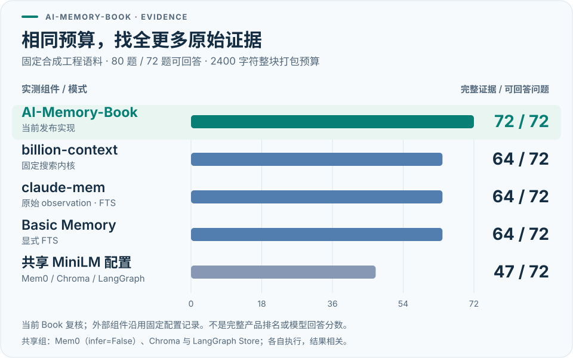
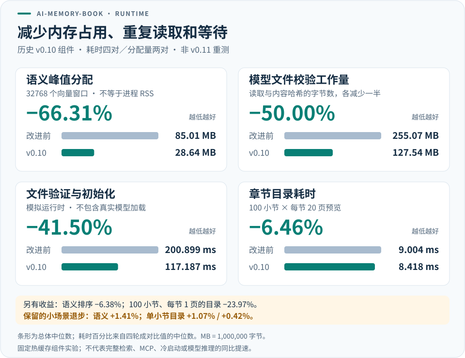
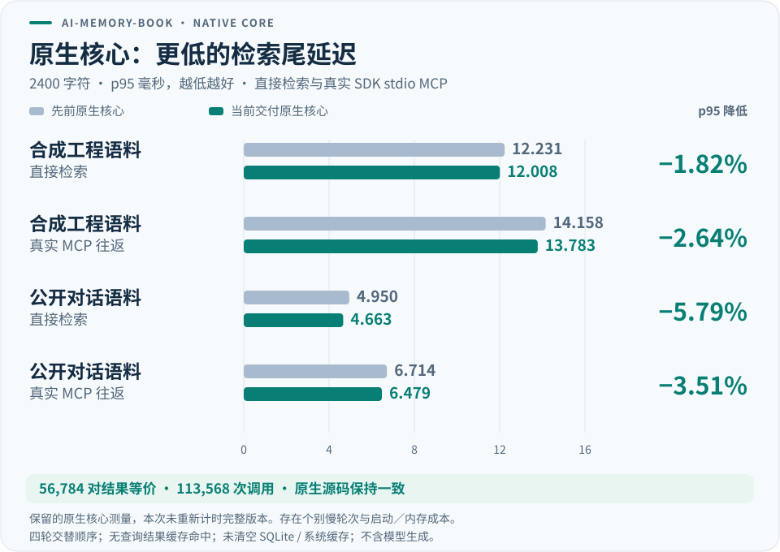
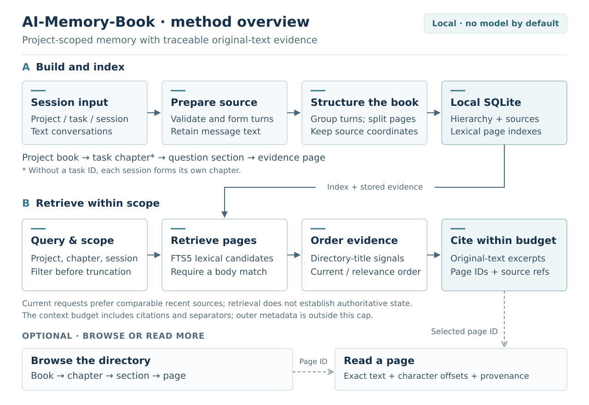

# AI-Memory-Book

**给 AI 一本有目录、能追读原文的工程记忆书；每个项目各自成书。**

项目是书，任务是章，问题组是节，原始证据是页。AI 可以从标题或问题线索定位章节，再沿地址读取原文。多个相似工程即使复用任务名、代码标识符和参数，也通过明确的项目 ID 分开归档；换会话、换客户端后，继续找回工程约束、后续修正和失败尝试。

[English](README.md) · [快速开始](#快速开始) · [检索效果](#检索效果) · [性能](#性能) · [工作方式](#工作方式) · [文档](#文档)

**v0.12.0 · MIT · Python 3.10+ · 本地 SQLite / FTS5**

**v0.12.0 已正式发布。** 最终源码 CI、原生包安装矩阵和真实公开 URL 安装均已通过；下方快速开始安装此版本。[源码与交付证据](docs/v0.12.0-validation.md#delivery-status-and-practical-limits)

**v0.13 开发验证：**首轮冻结的长期实验已完成七阶段、13,608 次 API 测量，达到 788 个项目、100,000 页。实验发现每阶段仍有 8 个多来源问题遗漏证据（可回答 recall 完整性为 48/56），同时记录了目录提速与召回的剩余成本。原始响应和失败候选均已保留，进一步修正正在验证。[完整开发结果与边界](docs/v0.13.0-validation.md)

## 当前版本一览

| 找回完整证据 | 目录契约检查 | 减少上下文 | 核对原始来源 |
|---|---|---|---|
| **72 / 72 个可回答案例** | **119 / 119 项通过** | **平均少 20.4% 字符** | **161 次原文读取** |
| 固定工程题集，1200／2400 两种预算均达到 | 每后端：自编定位、分页与范围检查 | 2400 预算，1798.9 对 2260.9 字符 | 每后端：目录题集中的 80 个不同页面 |

| 日常使用 | 当前能力 |
|---|---|
| 查询成本 | 默认写入与词法检索 **不调用模型**，无需嵌入模型或记忆服务 API Key |
| 上下文控制 | 默认 **2400 字符、最多 5 条**；可选精确 token 上限 |
| 执行效率 | **22 个 C 加速入口**，保留完整 Python 参考实现与可移植回退 |
| 客户端接续 | Claude Code、Codex、Gemini 等受支持客户端共享本地归档 |
| 目录定位 | 根据标题、问题和任务目录找到章节，保留项目范围与后续读取地址 |
| 新修正恢复 | 整个时序比较池核对声明局部限定词；简短证据页可利用较长截断页的剩余额度补全 |

上表是明确条件下的开发题集结果；完整证据率不是 LLM 回答准确率，目录检查不是实际工程任务成功率，也不是独立留出集验证。[当前结果与证据](docs/current-results.md)

## 快速开始

需要 **Python 3.10+ 与 SQLite FTS5**。安装器创建隔离环境并安装 MCP／客户端依赖，无需克隆仓库或安装 Node.js。

**macOS / Linux**

~~~bash
curl -fsSLo install-memory-book.sh https://raw.githubusercontent.com/Afloat16/AI-Memory-Book/v0.12.0/scripts/install.sh
bash install-memory-book.sh
~~~

**Windows PowerShell**

~~~powershell
Invoke-WebRequest https://raw.githubusercontent.com/Afloat16/AI-Memory-Book/v0.12.0/scripts/install.py -OutFile install-memory-book.py
py -3 -I -X utf8 .\install-memory-book.py
~~~

**接入客户端并检查**

~~~bash
memory-book setup --client claude-code
memory-book --version
memory-book doctor
~~~

| 需要的行为 | 操作 |
|---|---|
| 接入其他客户端 | 将 `claude-code` 替换为[支持的配置名](docs/integrations.md#supported-profiles)，可重复 `--client` |
| 开启会话采集与后台服务 | 对支持原生采集的客户端，在 `setup` 后加入 `--capture --background` |
| 升级已有安装 | 沿用原安装路径参数，重新执行原有 `setup` 并重启客户端／后台服务；schema 4 归档无需新增迁移 |
| 命令不在 PATH | 使用安装器输出的完整启动器路径 |

采集需主动启用：`--capture` 包含既有及未来受支持文本会话，`--background` 安装并启动用户服务。MCP 接入后，何时调用记忆工具仍由客户端和模型决定。[部署与升级](docs/deployment.md#upgrading)

## 检索效果

**固定合成开发题集：8 个项目、4 类算法、6 个时间检查点、80 道问题。** 其中 72 题可回答，包含 80 段必需证据和 48 个固定策略检查；每个检查点只摄取当时已出现的历史。

v0.11 基线与冻结的 v0.12 源码各完成 **800 条响应**：640 条原生策略响应＋160 条 Book 整块输出。独立评分、来源和预算检查均通过，逐题 **0 退步**。Book 在 **1200 和 2400 字符两种预算、原生摘录与公共整块两条轨道**上，均达到 **80/80 必需证据、72/72 完整证据、48/48 固定策略检查**。这是自编开发题集上的源码结果。[准确身份、逐题记录与边界](docs/current-results.md)

### 与原生检索策略对比

同一题集、2400 字符预算，使用各策略的原生上下文组装方式：

| 策略 | 必需证据 | 完整证据 | 固定策略通过 | 平均字符 |
|---|---:|---:|---:|---:|
| **AI-Memory-Book** | **80/80** | **72/72** | **48/48** | **1798.9** |
| 项目范围内平铺 FTS | 60/80 | 52/72 | 28/48 | 1801.3 |
| 预算内最近历史 | 64/80 | 56/72 | 32/48 | 2260.9 |
| 无记忆 | 0/80 | 0/72 | 0/48 | 0.0 |

相对平铺 FTS，Book **多找全 20 题**；相对最近历史，**多找全 16 题，同时平均少用 20.4% 字符**。最近历史使用更短引用头且不限制前五条。这些是仓库内策略，不额外计为外部开源产品。[协议与当前结果](docs/current-results.md)

### 与已测开源组件对比

下表统一使用 **2400 字符整块协议、最多 5 条候选**。Book 使用冻结的 v0.12 源码回放；外部行保留各自固定版本的实际执行，已核对相同的 80 题、6 个时间检查点、原始供给页摘要和项目范围，并非宣称本轮重新运行了全部上游最新版本。

| 组件与测试模式 | 必需证据 | 完整证据 | 固定策略通过 | 仅旧证据 | 平均字符 |
|---|---:|---:|---:|---:|---:|
| **AI-Memory-Book** | **80/80** | **72/72 · 100.00%** | **48/48** | **0** | **1798.9** |
| BM25S 0.3.16 · 检索库默认配置 | 80/80 | 72/72 · 100.00% | 48/48 | 0 | 1846.7 |
| Whoosh 2.7.4 · BM25F、配置 OR 解析器 | 80/80 | 72/72 · 100.00% | 48/48 | 0 | 1457.8 |
| Haystack 3.5.0 · InMemoryBM25Retriever | 74/80 | 66/72 · 91.67% | 42/48 | 0 | 1884.7 |
| LanceDB 0.41.0 · 原生 FTS | 72/80 | 64/72 · 88.89% | 40/48 | 4 | 1876.7 |
| billion-context · 固定搜索内核 | 72/80 | 64/72 · 88.89% | 40/48 | 0 | 1955.0 |
| claude-mem · 原始 observation FTS | 72/80 | 64/72 · 88.89% | 40/48 | 0 | 1488.5 |
| Basic Memory · 显式 FTS | 72/80 | 64/72 · 88.89% | 40/48 | 0 | 1333.1 |
| 共享 MiniLM 配置¹ | 55/80 | 47/72 · 65.28% | 25/48 | 4 | 1963.1 |

**Book、BM25S 与配置后的 Whoosh，在两种预算下的完整证据和固定策略结果均持平；Whoosh 在两种预算下都使用更少平均字符。** 2400 字符时，Book 比 Haystack 多找全 6 题，比 LanceDB 及三个历史词法模式各多找全 8 题，比共享 MiniLM 各配置多找全 25 题。这些结果不能推出全面领先。

¹ Mem0（`infer=False`、Chroma 后端）、Chroma、LangGraph Store 分别执行，使用同一 MiniLM 表示；分数相同属于相关结果。claude-mem 未运行 observer，Mem0 未运行事实抽取，Basic Memory 未运行完整默认混合流程。Whoosh 明确配置 **OR**，并非默认 AND 解析器；Haystack、BM25S、LanceDB 与 Whoosh 属于框架／存储／检索组件。表格比较固定组件配置，不给完整产品默认流程排名。[模式、固定版本与来源审计](docs/current-results.md) · [LanceDB／Whoosh 原始记录](benchmarks/reports/v0.12-search-components/README.md)

**Memvid SDK 2.0.160 的 lex 模式也已实际执行：**全部原始自然语言问题均返回空的原生命中列表。另存的 14 次诊断中，原文关键词正控能读到索引页面，但完整问题在有／无项目范围时仍为空。这些结果作为该固定查询配置的限制保留，不用零分宣称产品胜出，也不当作拒答能力；诊断改写不替换原评分问题。[完整执行、审计与诊断](docs/v0.11.0-validation.md#additional-real-upstream-components)

架构对比已覆盖 **26 个外部项目家族**，其中 6 个是存储／检索库或框架。**11 个外部配置已有实际执行**：10 个在上表体现，Memvid 查询限制单列。Hindsight、MemSearch、MCP Memory Service、Letta、Graphiti、MemOS、Memori、Cognee、OpenViking、Serena、EverOS、SimpleMem、Supermemory、LongMemory 和官方 MCP memory server 等其他家族，仅列官方来源支持的功能与边界，没有填入未测分数。[架构、部署与官方来源](docs/open-source-memory-comparison.md)

### 1200 字符预算的实际改进

题集、公共整块打包器和评分均未更改，旧版结果与新源码回放并列保留：

| Book 版本／组装方式 | 必需证据 | 完整证据 | 固定策略通过 | 仅旧证据 | 平均字符 |
|---|---:|---:|---:|---:|---:|
| v0.11 · 原生摘录 | 76/80 | 68/72 | 48/48 | 0 | 1195.9 |
| **v0.12 · 原生摘录** | **80/80** | **72/72** | **48/48** | **0** | **1196.6** |
| v0.11 · 公共整块协议 | 76/80 | 68/72 | 44/48 | 4 | 1048.1 |
| **v0.12 · 公共整块协议** | **80/80** | **72/72** | **48/48** | **0** | **1041.5** |

同一 1200 字符整块协议下，**BM25S 与配置后的 Whoosh 也都是 80/80 必需证据、72/72 完整证据、48/48 固定策略、0 仅旧证据**；平均字符分别为 1045.3 和 884.5。Book 补齐了旧版落后的 4 个完整证据案例，但证据分数没有超过这两个组件。

原生摘录和整块协议仍是不同轨道。“0 仅旧证据”指没有案例命中已标注旧片段却缺失全部必需片段，不代表输出中不再同时出现新旧记录。Book 与上表 10 个外部配置对 8 个缺证据问题仍返回相关上下文。题集使用重复维护文本、参与过开发，没有独立留出集或代码 LLM；这些结果不代表实际任务成功率、普遍事实权威判断或校准后的拒答能力。[完整结果与剩余失败](docs/current-results.md)

## 性能

### 历史固定性能实验

以下保留 **v0.10.0 及更早固定源码**上的测量、原环境和退步项。v0.11 修改了当前状态召回与目录读取事务，v0.12 又修改了声明排序及字符／token 组装；这些数字没有在新运行时重新测量，不能用来宣称 v0.12 端到端提速，也不能与本轮结果叠加。C 源码字节相同只证明组件连续性。

| 工作负载 | 对比结果 | 测量边界 |
|---|---|---|
| 32,768 个语义窗口 | **耗时降低 6.38%**；峰值分配 **85,005,064 → 28,637,125 字节（−66.31%）** | 分配量含可跟踪的 NumPy 缓冲区，不是总 RSS |
| 模型文件初始化 | 文件读取与内容哈希字节数**各减半**；模拟初始化**耗时降低 41.50%** | 不含真实 ONNX 加载、分词器解析或推理 |
| 20 节 × 每节 20 页 | **耗时降低 5.31%**；SELECT **63 → 24 次** | 相同固定目录、相同输出 |
| 100 节 × 每节 20 页 | **耗时降低 6.46%**；SELECT **303 → 104 次** | 相同固定目录、相同输出 |
| 20／100 节 × 每节 1 页 | **耗时降低 20.48%／23.97%** | 所有四轮成对测量均改善 |
| 20／100 节 × 每节 100 页 | **耗时降低 1.86%／1.98%** | 只按当前小节保留有界预览记录 |

**该历史实验保留的成本：**4,096 个语义窗口耗时 **+1.41%**；单节目录预览 20／100 页分别 **+1.07%／+0.42%**，总体中位数约增加 2／4 微秒。耗时百分比取四轮成对比值的中位数；完整目录测量 **1,440 次调用全部输出一致**。这些是热缓存组件测量，不代表完整 MCP 或模型回答加速。[v0.10 固定实现的全部测量与验收](docs/comprehensive-v010-validation.md)

### 当前沿用的原生核心

原生核心覆盖词法循环、摘录窗口、候选选择、预算分配、来源投影与分段。以下保留该实现的固定实验记录，**没有重新计时，也不与上表百分比叠加**。

| 数据与预算 | 直接 recall p95 耗时降低 | 真实 stdio MCP p95 耗时降低 |
|---|---:|---:|
| 合成数据 · 2400 字符 | **1.82%** | **2.64%** |
| 公开回归数据 · 2400 字符 | **5.79%** | **3.51%** |
| 合成数据 · 1024-token 上限 | **8.03%** | **8.23%** |
| 公开回归数据 · 1024-token 上限 | **4.80%** | **1.12%** |

| 完整成对导入批次 | 首次导入耗时降低 | 未变数据再次导入耗时降低 |
|---|---:|---:|
| 合成数据 | **9.28%** | **2.97%** |
| 公开回归数据 | **10.39%** | **3.94%** |

保留实验的 **113,568 次调用／56,784 对结果**通过输出、索引与来源坐标核对。默认配置 16 个成对 p95 轮次中有 15 个改善；另一个为 **+0.89%**，token 预算 MCP 也保留 **+3.18%** 的单轮 p95 退步。

**资源代价：**API 导入增加 2.04–2.20 ms，结束时 RSS 增加约 0.02–0.23 MiB；公开集默认 MCP 初始化增加 7.35 ms，测量主机上的扩展文件增加 519,480 字节。单台 Ubuntu／CPython 主机、无结果缓存命中、未清空 SQLite／系统缓存，不含模型生成。[全部配置、成本与原始记录](docs/native-core-validation.md)

## 工作方式

| 结构与机制 | 工程用途 | 入口 |
|---|---|---|
| 项目书 | 将相似工程的记录分开 | `browse_projects`／`browse_book` |
| 目录定位 | 根据标题、问题与目录字段定位章节，按章去重分页 | `search_directory`／CLI `locate` |
| 任务章与问题节 | 组织同一任务的多次会话，按需查看脉络 | `browse_chapter`／`browse_section` |
| 原始证据页 | 核对决定、参数、错误信息和失败原因 | `read_page` |
| 标识符别名 | 查询缩写、驼峰、下划线形式，保留原文与坐标 | `http_parser`、`JSONLReader`、`kv_cache` |
| 时序选择 | 区分当前证据与历史回查 | `temporal=auto/current/relevance` |
| 可恢复归档 | 验证备份、只读检查、同快照导出 | `backup`／`check-database`／`export-book` |

### 从目录定位到原文

~~~bash
# 使用已经存储的实际项目 ID，以及任务或问题标题中的词。
memory-book locate "gradient accumulation" --project service-alpha --limit 10
~~~

定位复用 title、question、directory 索引，即使原文正文没有重复标题词，也可以找到章节。结果按章节去重后分页，每章最多预览 5 个匹配小节，明确标记 `result_type="directory", evidence=false`。沿返回的项目、章节、小节 ID 追读原文；标题和摘要是导航提示，不能直接当作回答证据。分词后采用 OR 匹配，因此部分词命中也可能返回目录。

自编的 8 项目目录工作负载在 Python 和 native 两个后端分别复测：每后端通过 **119 项契约检查**，实际执行 **130 次定位、161 次原文页读取**，覆盖 **80 个不同页面**。原协议修正与所有尝试均保留；这不是回答准确率或速度测量。[当前目录验证与范围边界](docs/v0.12.0-validation.md#directory-and-project-scope)

### 当前声明与简短证据页

时序排序现在对整个比较池核验来源可靠、可以比较的声明，包括原本已被相关性搜索找到的候选。`production` 等限定词必须属于该条声明本身；另一句 staging 描述、其他字段、用户提问或目录标题不能替它提供限定证据。有限的数字自然语言声明与完整的中文旧值撤回语句有明确解析规则；时间先后本身不能证明决策权威性。

另行预先登记的 **38 题开发诊断**含 32 个可回答问题。在每个已测 auto 模式预算／返回上限配置上，Python 与 native 的预期首证据命中都由 **22/32 → 30/32**；返回上限为 1 时完整证据同样改善，为 5 时保持 **32/32**。每后端、每版本臂记录 304 条响应，并非 304 道独立题。**仍有 2 个复杂中文自然语言问题未命中预期首证据**；较高的原始 BM25 分数也仍可能让议程排在决定之前。等时冲突和校准拒答尚未解决。[全部响应、失败候选与限制](docs/v0.12.0-validation.md#declaration-diagnosis)

字符预算内，不超过 240 字符的简短页面可以利用较长截断页面高于既有下限的额度补全。候选顺序、引用头、已经完整的页面保持；已核验的当前 turn 证据受保护。精确 token 模式从实际字符响应的块开始，保留 first-fit 能接纳的每个完整块，再补充文本。**每后端 482 个自编配置**中，先前观察到的 434 个当前证据存在结果无一丢失；早期未保护方案的 34 个退步仍保留原始记录。原有拥挤历史探针在两后端均保持 **18/18 → 18/18**。这些是正确性检查，不是新提速测量。[分配保护与对照记录](docs/v0.12.0-validation.md#short-page-and-token-preservation)

### 固定项目范围

~~~bash
memory-book projects
# 用上一步返回的实际项目 ID 替换 service-alpha。
memory-book setup --client codex --mcp-project service-alpha
memory-book recall "当前梯度累积步数" --project service-alpha --budget 2400 --limit 5
~~~

| 范围设置 | 行为 |
|---|---|
| 已绑定连接省略项目参数 | 召回与后续读取继承绑定的项目 |
| 显式冲突项目或其他项目的页 ID | 拒绝读取，不会默默切换工程 |
| 普通 `setup` | 保留已有托管绑定 |
| `--mcp-project`／`--clear-mcp-project` | 明确换绑／解除 MCP 连接绑定 |
| `setup --project` | 控制采集归属，需配合 `--capture` |

绑定作用于配置的连接，不随终端当前目录自动切换。未绑定且省略项目的请求仍可跨书查询。项目范围不是多用户认证，也不约束直接数据库访问。[项目绑定](docs/agent-guide.md#bound-project-connections)

**默认预算覆盖 `context` 内的引用头与分隔符，不是完整 JSON 或模型 token 上限。** 证据不足时再读具体页面；目录浏览是可选步骤，证据排序也不等于事实权威裁定。[可运行工程示例](examples/engineering-workflow.json) · [开发工作流](docs/engineering-workflows.md)

## 源码验收与已发布交付

v0.12 源码检查点的完整本地测试记录为：**发现 1657 项、通过 1655 项、2 项仅限 Windows 的跳过、0 失败／错误**。正式发布源码 `62508a1ce681111ec5702c88e3aa42f67b9fc9c0` 保留已验收运行时字节，另行完成了最终 CI、原生包与公开安装门禁。[源码验收记录](benchmarks/experiments/v012-source-acceptance.json) · [发布交付证明](benchmarks/reports/v0.12-publication/README.md)

以下交付检查对应同一份 **v0.12.0** 发布源码。30 个原生组合与公开安装来自发布运行 `44275753685` 的 attempt `1`；最终源码 CI 则由独立运行 `44275753683` 的 attempt `1` 验证。

| 项目 | v0.12 已核验发布结果 |
|---|---|
| 最终源码 CI | **11 / 11 项通过** |
| 原生构建与安装 | **30 / 30 个组合通过**：CPython 3.10–3.15 × 5 个平台目标 |
| 平台目标 | Linux x86_64／ARM64、macOS Intel／ARM64、Windows AMD64 |
| 原生测试记录 | **4245 项通过、75 项指定可选跳过、0 失败** |
| 公开发布文件 | **67 个**均独立下载并核对大小与 SHA-256 |
| 公开安装 | 确认 v0.12.0、原生后端与默认 MCP／客户端依赖 |
| 行为与档案 | schema 4、页面／来源 ID 与 Unicode 坐标保持 |

[已发布 v0.12](https://github.com/Afloat16/AI-Memory-Book/releases/tag/v0.12.0) · [成功发布工作流](https://github.com/Afloat16/AI-Memory-Book/actions/runs/44275753685) · [最终源码 CI](https://github.com/Afloat16/AI-Memory-Book/actions/runs/44275753683) · [原始构建产物、日志、发布文件与独立审计](benchmarks/reports/v0.12-publication/README.md)

历史 v0.11 交付记录

此前 **v0.11.0** 发布保留独立证据，不计入 v0.12 的执行次数：

| 项目 | v0.11 已记录发布结果 |
|---|---|
| 最终源码 CI | **11 / 11 项通过** |
| 原生构建与安装 | **30 / 30 个组合通过**：CPython 3.10–3.15 × 5 个平台目标 |
| 平台目标 | Linux x86_64／ARM64、macOS Intel／ARM64、Windows AMD64 |
| 原生测试记录 | **4245 项通过、75 项指定可选跳过、0 失败** |
| 公开发布文件 | **67 个**均重新下载并核对大小与 SHA-256 |
| 公开安装 | 确认版本、原生后端与默认 MCP／客户端依赖 |
| 行为与档案 | schema 4、页面／来源 ID 与 Unicode 坐标保持 |

[已发布 v0.11](https://github.com/Afloat16/AI-Memory-Book/releases/tag/v0.11.0) · [原始发布工作流](https://github.com/Afloat16/AI-Memory-Book/actions/runs/44233642151) · [已恢复并审计的发布证明](benchmarks/reports/v0.11-publication/README.md)

用安装器输出的 Python 解释器路径替换下方 `python`，即可检查实际版本与后端：

~~~bash
python -I -X utf8 -c "import memory_book; from memory_book._text_backend import BACKEND_NAME; print(memory_book.__version__, BACKEND_NAME)"
~~~

使用上述已发布安装命令，兼容平台打印 `0.12.0 native`。`MEMORY_BOOK_TEXT_BACKEND=auto` 为默认值，`python` 选择参考实现，`native` 要求扩展存在。[后端选择与源码构建](docs/deployment.md#native-backend-and-source-builds)

## 文档

| 想做什么 | 文档 |
|---|---|
| 核对本文图表、固定配置与原始数据 | [当前结果](docs/current-results.md) · [v0.12 验证](docs/v0.12.0-validation.md) · [完整验证索引](docs/validation.md) |
| 接入现有客户端、开启采集 | [集成指南](docs/integrations.md) · [部署与升级](docs/deployment.md) |
| 让 AI 按需使用记忆、核对来源 | [使用指南](docs/agent-guide.md) · [工程示例](docs/engineering-workflows.md) |
| 控制 token 或启用本地语义候选 | [Token 预算](docs/token-budget.md) · [语义检索](docs/semantic-retrieval.md) |
| 比较更多开源项目的架构与用途 | [开源方案对比](docs/open-source-memory-comparison.md) |
| 参与开发 | [贡献指南](CONTRIBUTING.md) |

运行 `memory-book serve` 可在 [127.0.0.1:8765](http://127.0.0.1:8765) 查看归档。数据保存在本地且未加密；召回的证据会进入所用客户端的模型上下文。[数据位置与维护](docs/deployment.md#data-and-configuration-paths)

独立实现，采用 [MIT 许可证](LICENSE)。[当前发布版](https://github.com/Afloat16/AI-Memory-Book/releases/tag/v0.12.0) · [CI](https://github.com/Afloat16/AI-Memory-Book/actions/workflows/ci.yml)
