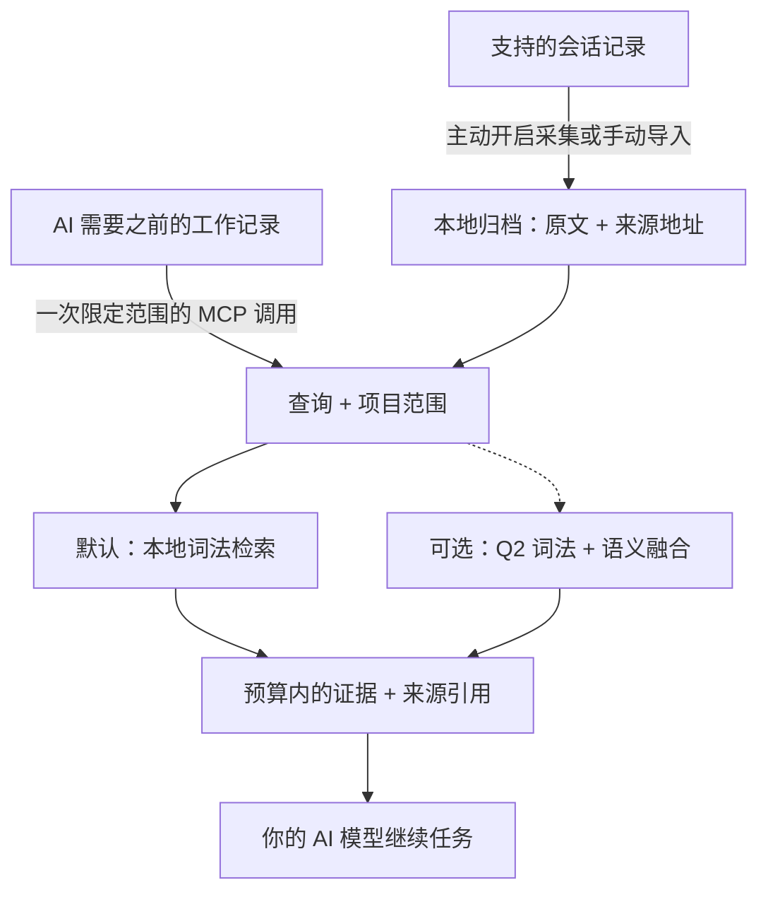

# AI-Memory-Book

**让 AI 共享一份本地记忆，找回原始证据，带着出处继续工作。**

项目是书，任务是章，之前的决定可以跨会话、跨客户端保留。AI 通过一次 MCP 调用，取得预算范围内的相关原文，用来继续当前任务。

[English](README.md) · [快速开始](#快速开始) · [实测结果](#实测结果) · [文档导航](#文档导航) · [v0.3.4 发布版](https://github.com/Afloat16/AI-Memory-Book/releases/tag/v0.3.4)

**v0.3.4 · 更快的新库初始化与 CLI 启动 · MIT · Python 3.10+ · 本地 SQLite**

## 如何运作



后台采集独立更新归档；AI 可以直接检索，在需要更多细节时再读取原始页面。书架和章节提供可选导航，不必每次先遍历目录。[AI 使用指南](docs/agent-guide.md)。

## 核心亮点

- **默认轻量运行。** 记忆写入和词法检索零模型调用，核心只需 Python 与 SQLite，无需下载嵌入模型、启动数据库服务器或配置记忆服务 API Key。
- **原文可追溯。** 保留项目、会话、轮次和精确来源区间；内置字符预算，可选精确 tokenizer 上限，连同上下文中的引用和分隔符一起计数。
- **多个客户端共用记忆。** 支持 Claude Code/Desktop、Codex、Gemini、Cursor 等 MCP 配置；主动开启后可后台采集支持的会话，默认不启动网页服务。
- **启动改善有实测依据。** v0.3.4 缩短新库初始化及 CLI 帮助、版本命令的启动时间，完整检索输出保持一致。导入与检索成本同样在下文披露；可选精简引用的 token 格式收益保留其独立历史归属。

## 快速开始

准备 **Python 3.10+，且 SQLite 支持 FTS5**。安装器将发布版 wheel 装入独立环境，并包含 MCP 和客户端配置依赖；无需克隆仓库或安装 Node.js。

**macOS / Linux**

```bash
curl -fsSLo install-memory-book.sh https://raw.githubusercontent.com/Afloat16/AI-Memory-Book/v0.3.4/scripts/install.sh
bash install-memory-book.sh
```

**Windows PowerShell**

```powershell
Invoke-WebRequest https://raw.githubusercontent.com/Afloat16/AI-Memory-Book/v0.3.4/scripts/install.py -OutFile install-memory-book.py
py -3 .\install-memory-book.py
```

**接入 AI**

```bash
memory-book setup --client claude-code --capture --background
memory-book doctor
```

若终端还找不到 `memory-book`，使用安装器输出的完整启动路径。重启客户端后，可以让 AI：**“找回我们之前对这个任务的决定，引用来源，然后继续完成。”**

把 `claude-code` 换成你的[客户端配置名](docs/integrations.md#supported-profiles)，或重复 `--client` 接入多个客户端。`--capture` 主动开启对既有和未来受支持文本会话的采集；省略它则仅配置 MCP。原生采集支持 Claude Code、Codex、Gemini 和旧版 Python Kimi；其他配置通过显式导入或开启 MCP 写入积累记忆。工具是否调用仍由宿主权限与模型决定。

**升级已有安装：**重新运行安装器，再以原来的客户端和采集选项执行 `setup`，使 MCP 和已有后台服务指向新环境。已有记忆和旧环境会保留。[升级说明](docs/deployment.md#upgrading)。

## 实测结果

### v0.3.4：更快的新库初始化与 CLI 启动

**v0.3.4 相对 v0.3.3 显著缩短了空库创建时间，CLI 帮助与版本命令的启动耗时约减半。** 唯一一次预先登记的确认实验完成 **480 个全新样本**，在 Ubuntu 24.04 / Python 3.12 上执行四轮 AB/BA/BA/AB 平衡顺序，**每个版本、每个边界各 40 个样本**。全部固定启动数值门槛通过。[单独的明确决定](benchmarks/experiments/round6-startup-decision.json)已按原复核规则接受下方披露的一项资源成本；原始自动结果仍保留 `accepted:false`，原工作流也保留 `failure`。[注册计划](benchmarks/experiments/round6-startup-plan.json) · [原始报告](benchmarks/reports/round6-startup-43598913606-1/report.json.gz) · [独立保存结果复核](benchmarks/reports/round6-startup-43598913606-1-local-audit/review.md)。

时间单位均为毫秒。箭头表示 **v0.3.3 → v0.3.4**；负值表示耗时降低。

| 测量边界 | 中位数 | 中位数变化 | p95 | p95 变化 |
|---|---:|---:|---:|---:|
| **创建全新空归档** | **24.518 → 4.164** | **−83.02%** | **27.374 → 6.358** | **−76.77%** |
| **真实 CLI `--help` 进程** | **102.903 → 48.750** | **−52.63%** | **104.104 → 49.547** | **−52.41%** |
| **真实 CLI `--version` 进程** | **101.346 → 47.479** | **−53.15%** | **103.116 → 48.259** | **−53.20%** |
| 完整 API 导入，包含 `MemoryBook` | 33.506 → 33.920 | **+1.24%** | 33.822 → 34.433 | **+1.81%** |
| 建立已有空归档的连接 | 0.640 → 0.632 | −1.23% | 0.668 → 0.666 | −0.30% |
| 官方 SDK MCP 启动至初始化完成 | 627.601 → 620.104 | −1.19% | 632.233 → 624.837 | −1.17% |

新库创建的中位数减少 **20.354 ms**，CLI 帮助与版本命令分别减少 **54.153 ms** 和 **53.867 ms**。API 构造器计时不包含 Python 启动、模块导入和辅助验证；CLI 计时包含真实全新进程及输出捕获。MCP 从创建传输与服务器前开始计时，到初始化成功结束。这些是不同的边界，不能互换为整个产品的启动时间。没有排除首个样本或异常值；全部 **960 条开始/完成事件**及原始源码、评测器身份已通过独立离线核验。

实现将**初始 schema 与 FTS 设置放入同一事务**，这部分设置失败时一起回滚；后续 covering index 和连接设置保留原有执行边界。命令元数据可以在不导入归档和客户端模块的情况下加载；显式获取公开的 `MemoryBook` 类仍执行完整 API 导入。已有归档、schema 3、类身份和完整检索输出保持兼容。

**成本同样保留。** 完整 API 导入的中位数变慢 **0.414 ms**，p95 变慢 **0.611 ms**。已有归档场景的整个辅助进程系统 CPU 均值从 **18.646 升至 21.121 ms（+2.474 ms，+13.2703%）**，是唯一触发复核的合并资源项；整个辅助进程的 wall time 均值也从 **138.762 升至 139.996 ms（+0.8891%）**，尽管其中的构造器区间略有改善。四轮都出现系统 CPU 增幅，不能当作被丢弃的异常值。保存的数据不能量化导入、验证、序列化等各阶段分别贡献了多少成本。两份独立复核评估了该成本及归因限制，[明确的启动验收决定](benchmarks/experiments/round6-startup-decision.json)已按原资源政策接受这一代价，没有重跑计时或改写原始结论。[资源复核](docs/round6-startup-resource-review.md)。正式发布还设有独立的最终 CI、打包与公网安装器门槛，对应证据归入[发布记录](docs/releases/v0.3.4.md)。

<details>
<summary>全部合并资源增幅与保留的不利观测</summary>

下方 CPU 和 wall time 是毫秒均值；RSS 是内核记录的 KiB 均值。完整复核还保留每一轮的正负结果。

| 边界与资源 | v0.3.3 → v0.3.4 | 增幅 |
|---|---:|---:|
| API 导入：整个辅助进程系统 CPU | 18.727 → 19.576 ms | +4.5343% |
| API 导入：内核最大 RSS 记录 | 49,221.4 → 49,243.8 KiB | +0.0455% |
| 新库：整个辅助进程用户 CPU | 120.770 → 121.288 ms | +0.4289% |
| 新库：内核最大 RSS 记录 | 49,460.1 → 49,496.3 KiB | +0.0732% |
| 已有归档：整个辅助进程 wall time | 138.762 → 139.996 ms | +0.8891% |
| 已有归档：整个辅助进程系统 CPU | 18.646 → 21.121 ms | **+13.2703%** |
| 已有归档：内核最大 RSS 记录 | 52,993.8 → 53,012.9 KiB | +0.0360% |
| MCP 辅助进程：系统 CPU | 101.166 → 102.880 ms | +1.6940% |
| MCP 存活服务器：采样系统 CPU | 40.500 → 42.750 ms | +5.5556% |

完整记录包含 **6 项合并计时增幅、26 项逐轮计时增幅、9 项合并资源增幅及 27 项逐轮资源增幅**。除表中的导入中位数与 p95 外，导入均值、最小值和最大值分别增加 **1.4785% / 1.3192% / 4.2380%**；已有归档构造器最大值从 **0.672010 升至 0.703721 ms（+4.7188%）**。逐轮观测还包括 API 导入系统 CPU **+13.8606%**、MCP 服务器采样系统 CPU **+15.00%**。原复核规则针对合并资源均值，没有删去这些逐轮结果。[每一项不利观测](benchmarks/reports/round6-startup-43598913606-1-local-audit/review.json)。

两个版本的新库及已有库逻辑存储量均为 **159,744 字节**。内核 `wait4` RSS 记录包含测量进程，可能受到继承状态或已回收后代进程的影响，不能据此断言产品独立运行时的内存相同或更低。MCP RSS/HWM 和 CPU 是初始化后的存活进程采样，不代表未观测的整个生命周期峰值或总量。

</details>

### 检索兼容性与发布范围

v0.3.4 的发布范围是**启动性能与初始化正确性**。候选 A 的两轮开发测量中，检索改善约为 **1%**，不足以推进原先登记的 **综合 p95 10% / 公开语料原生 token p95 15% / 真实 MCP p95 10%** 目标；对应四轮正式检索矩阵**没有运行，也没有通过验收**。候选 B 的稠密项目排序使公开语料原生 p95 回退约 **19–29%**、真实 MCP p95 回退 **23.9246%**，已排除。v0.3.4 采用 A 的精确运行时代码，所有失败实验继续保留。[开发结果与源码选择](docs/optimization-round6.md)。

A 相对 v0.3.3 重现了历史 Hotpot256 的 **2,304 / 2,304** 个完整默认输出：两种 tokenizer、三档预算下的 **1,536 次原生调用**，以及 **768 次组件调用**。独立保存日志审计核对了 **4,608 条事件**。这是兼容性证据，不构成新的证据质量或检索提速声明。[历史兼容检查](benchmarks/reports/round6-hotpot-compatibility.summary.json) · [保存输出审计](benchmarks/reports/round6-hotpot-compatibility.audit.json)。

**旧版结果保持历史归属。** v0.3.3 的 C7 相对 v0.3.2 曾取得 **综合 p95 降低 14.80%**、**真实 MCP token p95 降低 12.17%**，并单独复核接受了启动成本。这些不是 v0.3.4 的收益，也不与新启动百分比相加。[原 v0.3.3 性能与成本](docs/round5-c7-performance-review.md) · [资源决定](benchmarks/experiments/round5-c7-resource-decision.json) · [此前拒绝的候选](docs/optimization-round5.md)。可选精简引用继续保留未在本轮重测的[历史 token 格式结果](docs/indexed-references.md)。

### 新样本开源组件对比

本次完整对比使用 **256 道新 HotpotQA 问题**，排除全部 **896 个历史 ID**，交集为零，共有 **619 条必需证据标注**。保存的矩阵包含 **42 个质量结果单元**、**6,912 次检索/搜索调用**（3,072 次原生调用、3,840 次组件搜索），以及单独计数的 **1,280 次 ai-memory 页面读取**。移除实测 `latency_ms` 字段后，v0.3.3 与 v0.3.4 的 **1,536 对原生输出和 768 对组件完整输出全部一致**，两版 Book 的检索质量相同。本轮不含 Q2 或项目统计排序。[原始完整报告](benchmarks/results/round6-comparison-43601518020-1/report.md) · [机器可读评估](benchmarks/results/round6-comparison-43601518020-1/assessment.json) · [保存日志与身份审计](benchmarks/reports/round6-comparison-43601518020-1-local-audit.json) · [独立复核与全部不利观测](benchmarks/reports/round6-comparison-43601518020-1-independent-review.json)。

**阅读原报告时，需要结合两处历史模板句的实际来源。** 原 v1 源码与评测器在选样前冻结；仅修复测试 fixture 的 v2 恢复版本是在**同一批 256 个 ID 固定后、首次评分前**冻结，没有重新选样或评分重跑。原报告把发布门槛归于旧数据 ABBA 检索实验的句子**不适用于 v0.3.4 验收**：原 **10% / 15% / 10% 正式检索矩阵没有运行，也没有通过验收**。本版确认的性能改善来自上方单独预先登记的启动实验。原报告保持不变。[恢复登记](benchmarks/experiments/round6-comparison-fixture-recovery-addendum.json) · [精确恢复绑定](benchmarks/experiments/round6-comparison-recovery-binding.json)。

下表使用相同的给定页面、前五项结果和共同的完整块打包规则，预算为 **1,024 个 `cl100k_base` token**。外部组件使用表中固定版本，不代表其最新发布版本的表现。

| 实测组件（固定版本） | 证据召回率 | 完整证据率 | 打包后 MRR | 平均上下文 token | 搜索适配器 p95 |
|---|---:|---:|---:|---:|---:|
| Book v0.3.3 · 默认词法 | 75.93% | 53.12% | 0.8556 | 715.5 | 3.518 ms |
| **Book v0.3.4 · 默认词法** | 75.93% | 53.12% | 0.8556 | 715.5 | 3.582 ms |
| claude-mem 15.18.1 · 原生 FTS | 70.60% | 48.05% | 0.8060 | 710.6 | 42.840 ms |
| ai-memory v3.4.5 · 本地混合检索 | 77.87% | 57.42% | 0.8279 | 715.3 | 40.409 ms |
| billion-context `9674cfa` · 搜索内核 | 80.94% | 60.55% | 0.8481 | 760.4 | 1.399 ms |

Book 的完整证据率比 claude-mem 高 **5.0781 个百分点**，对应 **24 道问题获得完整证据、11 道失去完整证据**；打包后 MRR 最高，两版 Book 并列。Book 的搜索适配器 p95 低于 claude-mem 和 ai-memory。**ai-memory 的证据召回率、完整率均高于 Book；billion-context 在召回、完整率和实测搜索延迟上领先。** Book 的完整率分别低于后两者 **4.2969** 和 **7.4219 个百分点**。这些结果体现具体组件维度上的优势与不足，不构成全面领先。

搜索 p95 合并每道问题的三次搜索，不含离线共同打包与额外页面读取。Book 使用进程内 Python 检索及上下文组装；claude-mem 使用 SQLite/Bun，ai-memory 使用本地混合 HTTP/MCP，billion-context 使用给定源码的搜索内核/Node。接口边界不同，不能据此换算整个产品的提速倍数。ai-memory 首次搜索加全部五次读取的 p95 是 **46.338 ms**，而仅搜索 p95 为 **40.409 ms**。打包后 MRR 衡量共同打包器移除元数据或过大块后的证据顺序，原始结果位置也完整保留。

**新样本的描述性计时包含相对 v0.3.3 的回退。** Book 组件搜索的 p50/p95 从 **2.351 → 2.374 / 3.518 → 3.582 ms（+0.99% / +1.83%）**；首次搜索加全部读取的 p95 从 **3.535 → 3.573 ms（+1.06%）**，重复搜索 p95 从 **3.501 → 3.576 ms（+2.14%）**。六档原生设置中，有五档的 p50/p95 增加；六档平均延迟全部增加 **0.1360–3.4936%**。这些阶段按顺序执行，属于描述性测量，不是平衡顺序的正式检索性能验收。

<details>
<summary>全部原生延迟单元与 18 项竞品完整率对照</summary>

六档原生设置每版各有 256 次调用，统一使用 8,000 字符、前五项结果，关闭结果缓存。下方变化为正表示变慢。

| Tokenizer / 预算 | p50：v0.3.3 → v0.3.4，ms | 变化 | p95：v0.3.3 → v0.3.4，ms | 变化 |
|---|---:|---:|---:|---:|
| `cl100k_base` / 512 | 2.994 → 3.091 | +3.23% | 4.289 → 4.415 | +2.92% |
| `cl100k_base` / 1024 | 2.865 → 2.885 | +0.70% | 3.987 → 4.087 | +2.49% |
| `cl100k_base` / 2048 | 2.694 → 2.702 | +0.31% | 3.899 → 3.923 | +0.60% |
| `o200k_base` / 512 | 3.374 → 3.345 | −0.84% | 4.988 → 4.819 | −3.39% |
| `o200k_base` / 1024 | 2.977 → 3.010 | +1.11% | 4.245 → 4.334 | +2.11% |
| `o200k_base` / 2048 | 2.729 → 2.782 | +1.92% | 3.990 → 4.000 | +0.23% |

每个竞品单元表示 Book 减去该组件的完整证据率，单位为百分点；括号内是**获得完整证据 / 失去完整证据的问题数**。每种预算与 tokenizer 均保留，包括负向结果。完整评估另保留全部标注级得失及分组结果。

| Tokenizer / 预算 | Book − claude-mem | Book − ai-memory | Book − billion-context |
|---|---:|---:|---:|
| `cl100k_base` / 512 | +7.4219 pp (28 / 9) | −1.1719 pp (27 / 30) | +1.1719 pp (43 / 40) |
| `cl100k_base` / 1024 | +5.0781 pp (24 / 11) | −4.2969 pp (16 / 27) | −7.4219 pp (28 / 47) |
| `cl100k_base` / 2048 | +5.0781 pp (24 / 11) | −4.2969 pp (16 / 27) | −7.4219 pp (28 / 47) |
| `o200k_base` / 512 | +7.4219 pp (29 / 10) | −0.7812 pp (27 / 29) | +0.3906 pp (40 / 39) |
| `o200k_base` / 1024 | +5.0781 pp (24 / 11) | −4.2969 pp (16 / 27) | −7.4219 pp (28 / 47) |
| `o200k_base` / 2048 | +5.0781 pp (24 / 11) | −4.2969 pp (16 / 27) | −7.4219 pp (28 / 47) |

**仅含 7 道问题的低词面重叠组**还显示了另一项限制：在 512 个 `cl100k_base` token 下，Book 原生及组件路径的完整证据率均为 **0%**；claude-mem 为 **14.29%**，ai-memory 和 billion-context 各为 **28.57%**。该组样本很少，不能据此作宽泛泛化。

</details>

<details>
<summary>设置、存储、内存及原生响应负载成本</summary>

| 实测阶段 | 设置耗时 ms | 设置 RSS MiB | 查询 RSS MiB | 原生状态文件字节 |
|---|---:|---:|---:|---:|
| Book v0.3.3 原生 | 3916.344 | 547.41 | 533.12 | 39,037,696 |
| Book v0.3.4 原生 | 3890.425 | 551.45 | 537.18 | 39,037,696 |
| Book v0.3.3 组件 | 840.940 | 531.80 | 511.84 | 34,340,864 |
| Book v0.3.4 组件 | 843.362 | 525.79 | 504.87 | 34,340,864 |
| claude-mem FTS | 2444.687 | 682.05 | 594.81 | 20,659,514 |
| ai-memory hybrid | 845167.166 | 706.79 | 710.69 | 74,208,780 |
| billion-context kernel | 225.397 | 532.91 | 650.98 | 0 |

Book 原生阶段的设置包含新数据摄取和初始化，组件阶段则复制同一份规范归档，二者的设置边界不同。相对 v0.3.3，组件设置时间从 **840.940 → 843.362 ms（+0.2881%）**；原生设置时间减少 **0.6618%**，但其中单独记录的运行时导入从 **48.455 → 51.401 ms（+6.0803%）**。原生阶段采样的设置/查询/收尾 RSS 分别增加 **0.7378% / 0.7613% / 0.7596%**；组件 RSS 在这三个阶段均下降。两版 Book 的原生及组件状态文件大小分别保持相同；Book 组件状态文件大于 claude-mem、小于 ai-memory。

RSS 每 20 ms 采样工作进程及存活后代，包含评测器和语料内存，可能重复计入共享页面，只代表观测到的下界，不能当作产品独立运行的 RAM。状态字节不含符号链接指向的模型缓存；billion-context 的零值表示这一边界没有生成原生状态文件，并非整个产品不占存储。全部收尾、main/WAL/SHM 与存活统计保存在阶段报告及[独立复核](benchmarks/reports/round6-comparison-43601518020-1-independent-review.json)中。

共同打包后的上下文与原生响应负载是不同的成本。在此 1,024-token 投影中，Book 平均使用 **715.5 个打包后 token**，略高于 claude-mem 的 **710.6** 和 ai-memory 的 **715.3**。Book 原生搜索响应平均为 **3,992.9 个 `cl100k_base` token**；claude-mem、ai-memory、billion-context 分别为 **1,634.7、1,019.3、585.0**，ai-memory 另有每题 **1,836.3 个页面读取负载 token**。相对 v0.3.3，Book 原生负载均值在两种 tokenizer 下各增加 **0.0078125 token**，因为这项计数保留实测 `latency_ms` 字段；去掉该计时字段后的完整负载仍完全一致。本轮不构成新的 token 节省声明。

</details>

全部问题都有答案，且来自同一公开 HotpotQA 来源；ID 不重叠不能证明跨新领域泛化。首次评分后，这些 ID 已成为回归数据。评测对象是返回的证据，不是生成答案、幻觉率或私人对话迁移，没有调用生成模型。旧 v0.3.2 对比、可选 Q2 的得失与成本保留在[历史报告](benchmarks/results/round4-comparison-43363060062-1/report.md)，不计为 v0.3.4 的新测量。

[部署与架构对比](docs/comparison.md#popular-projects-and-the-workload-they-address)还覆盖 **Mem0、Graphiti、PageIndex 和 Letta**，并与已执行的基准明确区分。ai-memory 同样提供零 LLM 默认路径；claude-mem 支持本地模型提供方。

## 文档导航

| 你想做什么 | 入口 |
|---|---|
| 接入其他客户端、导入会话 | [客户端与导入格式](docs/integrations.md) |
| 安装、升级、Docker、管理后台采集 | [部署指南](docs/deployment.md) |
| 了解何时检索、引用原文、处理缺失证据 | [AI 使用指南](docs/agent-guide.md) |
| 开启精确 token 上限、Q2 语义或精简引用 | [Token 预算](docs/token-budget.md) · [语义检索](docs/semantic-retrieval.md) · [精简引用](docs/indexed-references.md) |
| 在浏览器检查归档 | 运行 `memory-book serve`，打开 [127.0.0.1:8765](http://127.0.0.1:8765) |
| 查看完整实验或参与开发 | [基准索引](benchmarks/README.md) · [验证记录](docs/validation.md) · [贡献指南](CONTRIBUTING.md) · [更新日志](CHANGELOG.md) |

可选 Q2 运行时会主动退出 ONNX Runtime 遥测。归档是本地未加密数据；返回给 AI 客户端的证据会进入该客户端的模型上下文。网页阅读器用于检查归档，正常 MCP 和采集无需 HTTP 端口。[数据与配置位置](docs/deployment.md#data-and-configuration-paths)。

[CI](https://github.com/Afloat16/AI-Memory-Book/actions/workflows/ci.yml)覆盖 Python 3.10/3.12/3.13、真实 MCP stdio、网页阅读器、Linux/macOS/Windows 安装器和容器持久化。配置样本测试不代表每款厂商应用都完成交互认证。项目独立实现，采用 [MIT 许可证](LICENSE)。
