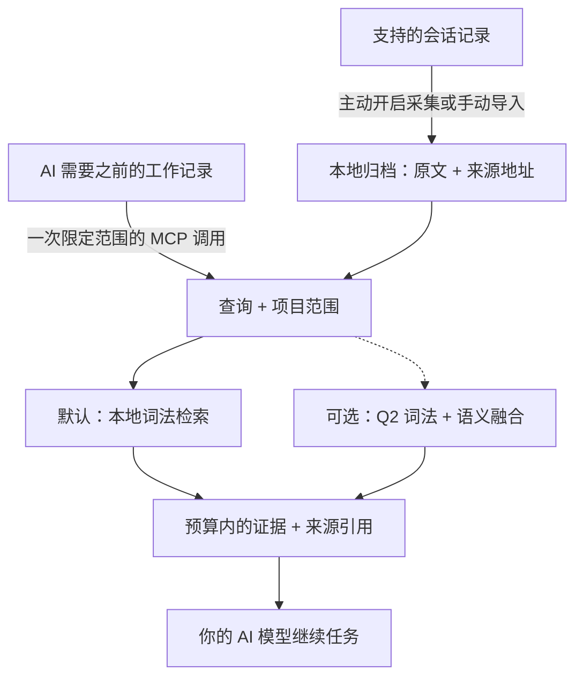

# AI-Memory-Book

**让 AI 共享一份本地记忆，找回原始证据，带着出处继续工作。**

项目是书，任务是章，之前的决定可以跨会话、跨客户端保留。AI 通过一次 MCP 调用，取得预算范围内的相关原文，用来继续当前任务。

[English](README.md) · [快速开始](#快速开始) · [实测结果](#实测结果) · [文档导航](#文档导航) · [v0.3.1 发布页](https://github.com/Afloat16/AI-Memory-Book/releases/tag/v0.3.1)

**v0.3.1 · 实验性版本 · MIT · Python 3.10+ · 本地 SQLite**

## 如何运作



后台采集独立更新归档；AI 可以直接检索，在需要更多细节时再读取原始页面。书架和章节提供可选导航，不必每次先遍历目录。[AI 使用指南](docs/agent-guide.md)。

## 核心亮点

- **默认轻量运行。** 记忆写入和词法检索零模型调用，核心只需 Python 与 SQLite，无需下载嵌入模型、启动数据库服务器或配置记忆服务 API Key。
- **原文可追溯。** 保留项目、会话、轮次和精确来源区间；内置字符预算，可选精确 tokenizer 上限，连同上下文中的引用和分隔符一起计数。
- **多个客户端共用记忆。** 支持 Claude Code/Desktop、Codex、Gemini、Cursor 等 MCP 配置；主动开启后可后台采集支持的会话，默认不启动网页服务。
- **效率有实测依据。** 当前核心在输出相同证据的同时降低延迟；可选精简引用减少重复来源元数据，具体结果与适用范围见下文。

## 快速开始

准备 **Python 3.10+，且 SQLite 支持 FTS5**。安装器将发布版 wheel 装入独立环境，并包含 MCP 和客户端配置依赖；无需克隆仓库或安装 Node.js。

**macOS / Linux**

```bash
curl -fsSLo install-memory-book.sh https://raw.githubusercontent.com/Afloat16/AI-Memory-Book/v0.3.1/scripts/install.sh
bash install-memory-book.sh
```

**Windows PowerShell**

```powershell
Invoke-WebRequest https://raw.githubusercontent.com/Afloat16/AI-Memory-Book/v0.3.1/scripts/install.py -OutFile install-memory-book.py
py -3 .\install-memory-book.py
```

**接入 AI**

```bash
memory-book setup --client claude-code --capture --background
memory-book doctor
```

若终端还找不到 `memory-book`，使用安装器输出的完整启动路径。重启客户端后，可以让 AI：**“找回我们之前对这个任务的决定，引用来源，然后继续完成。”**

把 `claude-code` 换成你的[客户端配置名](docs/integrations.md#supported-profiles)，或重复 `--client` 接入多个客户端。`--capture` 主动开启对既有和未来受支持文本会话的采集；省略它则仅配置 MCP。原生采集支持 Claude Code、Codex、Gemini 和旧版 Python Kimi；其他配置通过显式导入或开启 MCP 写入积累记忆。工具是否调用仍由宿主权限与模型决定。

**升级已有安装：**重新运行安装器，再以原来的客户端和采集选项执行 `setup`，使 MCP 和已有后台服务指向新环境。已有记忆和旧环境会保留。[升级说明](docs/deployment.md#upgrading)。

## 实测结果

**v0.3.2 候选版本已通过预先登记的效率测试，在完整默认检索输出不变的前提下，相比已发布的 v0.3.1 降低延迟。** 新样本组件对比和发布工作仍在进行。源码身份、完整测量及未通过的实验保留在[基准索引](benchmarks/README.md)和[第四轮记录](docs/optimization-round4.md)。

### 效率优势

| 已验证改进 | 结果 | 测量范围 |
|---|---|---|
| **非计时输出相同，尾部延迟降低** | 十二组设置的合并 p95 几何均值**降低 10.13%** | **56,784 次调用**，两组旧语料，原生与真实 SDK MCP，字符与 token 预算，四轮平衡测试。[正式复核](docs/round4-performance-review.md) |
| **公开会话原生 token 检索更快** | 512 / 1,024 / 2,048 token 下，p95 分别**降低 19.07% / 18.41% / 18.20%** | 1,015 道公开会话问题，`cl100k_base`，完整无结果缓存检索；每个版本、每组设置各 4,060 次调用。[已保存测量](benchmarks/reports/round4-performance-43361086255-1/report.summary.json) |
| **真实 MCP token 检索更快** | 1,024 token 下，p95 **4.358 → 3.887 ms（−10.80%）** | 同一公开语料，官方 SDK stdio 调用，包含正常的服务端缓存写入和往返开销。[报告与计时边界](docs/round4-performance-review.md) |
| **可选精简引用的历史测量** | 响应文本 token **减少 19.63%**；首次调用参考总量**减少 8.15%** | 之前的 1,015 题测量，4,000 字符、compact 响应、`o200k_base`；此选项未改变，v0.3.2 未重新测量。[报告](docs/indexed-references.md) |

全部 **28,392 对观测**的完整非计时输出相同，十二组的合并 p50 均降低。公开语料的 4,000 字符 MCP 设置 **p95 增加 1.44%**。登记的资源均值中，最大增幅为 **6.02%**，对应公开语料 MCP token 模式从启动到完成初始化的耗时；所有资源均值均未超过 10% 复核阈值。**全部自动门槛通过，没有使用例外或豁免。**[独立数值审计](benchmarks/reports/round4-performance-independent-audit.json)、[严格逐次调用记录审计](benchmarks/reports/round4-performance-local-audit.json)与[完整报告](benchmarks/reports/round4-performance-43361086255-1/report.json.gz)保留每一轮、不利结果和资源成本。

总体改进为 **10.1294%**，仅高于预先登记的 10% 门槛 **0.1294 个百分点**。这是同一机器上重复查询得到的窄幅通过结果，不宣称统计显著性或普遍提速。成对测试比较的是 Book 的两个版本，不能据此推导对其他仓库的整套产品速度优势。

精简引用保留相同上下文，并可还原全部来源字段。首次调用计数包含 schema、初始化说明和参数；参考 tokenizer 计数不等于服务商账单。引用稀少时可能增加 token。之前的格式对比测得 **p95 为 7.126 → 7.131 ms**，不宣称此选项提速。

**v0.3.1 对比 v0.3.0 的历史结果：**独立的 47,320 次调用记录了总体 p95 **降低 11.36%**、公开语料原生字符模式 p95 **降低 26.05%**、真实 MCP 字符模式 p95 **降低 19.87%**。合成语料 token512 的 p95 **增加 0.125%**，以及公开语料空数据库打开耗时**增加 4.838 ms（+14.04%）**、经复核明确接受的代价，均原样保留在[第三轮报告](docs/round3-performance-review.md)。这些历史测量不属于 v0.3.2 结果。

### 当前开源组件对比

冻结的 **256 道 HotpotQA 问题**排除了前两轮使用的 384 道题。下表采用相同原始页面、前五条结果及统一的完整块打包器，预算为 **1,024 个 `cl100k_base` token**，测量返回的来源证据。[完整报告](benchmarks/results/round3-comparison-43267797247-1/report.md)保留所有预算、原生调用及逐题得失。

| 实测组件 | 证据召回率 | 完整证据率 | 打包后 MRR | 平均上下文 token | 搜索适配器 p95 |
|---|---:|---:|---:|---:|---:|
| **Book v0.3.1 · 默认词法** | 76.28% | 52.34% | 0.8132 | 719.8 | 2.784 ms |
| **Book v0.3.1 · 可选 Q2** | 76.77% | 54.69% | 0.8239 | 739.0 | 11.226 ms |
| claude-mem 15.18.1 · 原生 FTS | 70.68% | 45.31% | 0.7674 | 715.8 | 22.826 ms |
| ai-memory v3.4.5 · 本地混合检索 | 77.27% | 55.86% | 0.8182 | 716.8 | 27.545 ms |
| billion-context `9674cfa` · 搜索内核 | **78.91%** | **58.20%** | **0.8277** | 762.3 | **1.010 ms** |

在这个切片上，Book 默认词法的完整证据率比 claude-mem FTS **高 7.03 个百分点**，默认 Book 的已测搜索适配器 p95 相对 claude-mem **低 87.80%**、相对 ai-memory **低 89.89%**；Q2 的 p95 也低于两者。**ai-memory 的召回率和完整率仍然更高；billion-context 在这三个质量指标及搜索延迟上领先。** 适配器分别跨越 Python、SQLite/Bun、HTTP/MCP 和 Node 等不同边界，因此不能据此推导整套产品的倍数优势。ai-memory 首次搜索加全部原文读取的 p95 为 **30.532 ms**；读取响应与初始化成本另行记录。

这个预算下，Q2 相对 Book 默认词法的完整率提高 **2.34 个百分点**，同时需要模型、索引初始化、内存和查询成本。在原生 API 的 512-token 预算下，完整率反而从 **35.94% 降至 33.59%**（`cl100k_base`）、从 **35.55% 降至 33.20%**（`o200k_base`），所以保持主动开启。所有题目都有答案，且来自同一公开数据域；结果不衡量答案生成、幻觉或私人会话迁移能力。


图表使用与表格相同的已保存测量。新增的[离线复核](benchmarks/reports/round3-recovery/comparison-cross-verification.json)检查全部 32 个结果文件，并逐字节复现原始评估与报告，没有执行新检索。[审计与发布来源](docs/round3-continuation.md#published-release-and-supplemental-audit)。

[部署与架构对比](docs/comparison.md#popular-projects-and-the-workload-they-address)还包括 **Mem0、Graphiti、PageIndex 和 Letta**，与实跑基准明确区分。ai-memory 也支持默认零 LLM 路径；claude-mem 支持本地模型供应端。

## 文档导航

| 你想做什么 | 入口 |
|---|---|
| 接入其他客户端、导入会话 | [客户端与导入格式](docs/integrations.md) |
| 安装、升级、Docker、管理后台采集 | [部署指南](docs/deployment.md) |
| 了解何时检索、引用原文、处理缺失证据 | [AI 使用指南](docs/agent-guide.md) |
| 开启精确 token 上限、Q2 语义或精简引用 | [Token 预算](docs/token-budget.md) · [语义检索](docs/semantic-retrieval.md) · [精简引用](docs/indexed-references.md) |
| 在浏览器检查归档 | 运行 `memory-book serve`，打开 [127.0.0.1:8765](http://127.0.0.1:8765) |
| 查看完整实验或参与开发 | [基准索引](benchmarks/README.md) · [验证记录](docs/validation.md) · [贡献指南](CONTRIBUTING.md) · [更新日志](CHANGELOG.md) |

可选 Q2 运行时会主动退出 ONNX Runtime 遥测。归档是本地未加密数据；返回给 AI 客户端的证据会进入该客户端的模型上下文。网页阅读器用于检查归档，正常 MCP 和采集无需 HTTP 端口。[数据与配置位置](docs/deployment.md#data-and-configuration-paths)。

[CI](https://github.com/Afloat16/AI-Memory-Book/actions/workflows/ci.yml)覆盖 Python 3.10/3.12/3.13、真实 MCP stdio、网页阅读器、Linux/macOS/Windows 安装器和容器持久化。配置样本测试不代表每款厂商应用都完成交互认证。项目独立实现，采用 [MIT 许可证](LICENSE)。
