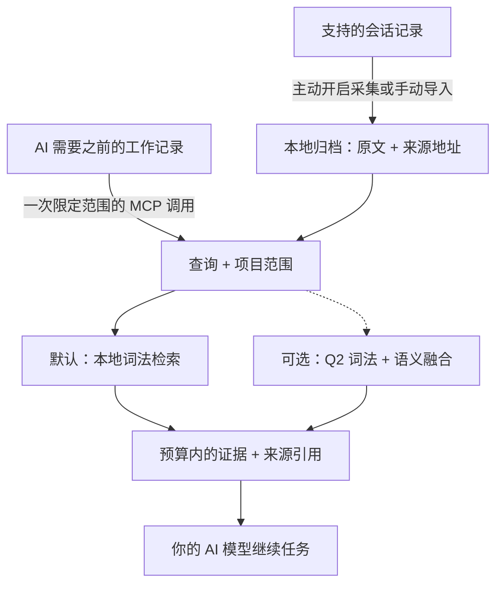

# AI-Memory-Book

**让 AI 共享一份本地记忆，找回原始证据，带着出处继续工作。**

项目是书，任务是章，之前的决定可以跨会话、跨客户端保留。AI 通过一次 MCP 调用，取得预算范围内的相关原文，用来继续当前任务。

[English](README.md) · [快速开始](#快速开始) · [实测结果](#实测结果) · [文档导航](#文档导航) · [v0.3.1 候选版说明](docs/releases/v0.3.1.md)

**v0.3.1 候选版 · 实验性版本 · MIT · Python 3.10+ · 本地 SQLite**

## 如何运作



后台采集独立更新归档；AI 可以直接检索，在需要更多细节时再读取原始页面。书架和章节提供可选导航，不必每次先遍历目录。[AI 使用指南](docs/agent-guide.md)。

## 核心亮点

- **默认轻量运行。** 记忆写入和词法检索零模型调用，核心只需 Python 与 SQLite，无需下载嵌入模型、启动数据库服务器或配置记忆服务 API Key。
- **原文可追溯。** 保留项目、会话、轮次和精确来源区间；内置字符预算，可选精确 tokenizer 上限，连同上下文中的引用和分隔符一起计数。
- **多个客户端共用记忆。** 支持 Claude Code/Desktop、Codex、Gemini、Cursor 等 MCP 配置；主动开启后可后台采集支持的会话，默认不启动网页服务。
- **效率有实测依据。** 当前核心在输出相同证据的同时降低延迟；可选精简引用减少重复来源元数据，具体结果与适用范围见下文。

## 快速开始

### 体验 v0.3.1 候选版

从成功的 [v0.3.1 安装包构建](https://github.com/Afloat16/AI-Memory-Book/actions/workflows/release-prepare.yml)下载 artifact，解压后进入同时包含 `install.py` 和 wheel 的目录，运行：

```bash
python3 install.py --source ./ai_memory_book-0.3.1-py3-none-any.whl
```

Windows 将 `python3` 换为 `py -3`。包内包含 SHA-256 校验和及记录精确源码提交的发布清单；wheel 与源码包会先分别安装验证，再上传。确认 `memory-book --version` 输出 `0.3.1` 后，按下文接入 AI。也可按[精确源码方式安装](docs/deployment.md#try-the-v031-candidate-before-publication)。构建候选包不会创建标签或公开发布。

### 安装当前已发布的 v0.3.0

准备 **Python 3.10+，且 SQLite 支持 FTS5**。安装器将发布版 wheel 装入独立环境，并包含 MCP 和客户端配置依赖；无需克隆仓库或安装 Node.js。

**macOS / Linux**

```bash
curl -fsSLo install-memory-book.sh https://raw.githubusercontent.com/Afloat16/AI-Memory-Book/v0.3.0/scripts/install.sh
bash install-memory-book.sh
```

**Windows PowerShell**

```powershell
Invoke-WebRequest https://raw.githubusercontent.com/Afloat16/AI-Memory-Book/v0.3.0/scripts/install.py -OutFile install-memory-book.py
py -3 .\install-memory-book.py
```

**接入 AI**

```bash
memory-book setup --client claude-code --capture --background
memory-book doctor
```

若终端还找不到 `memory-book`，使用安装器输出的完整启动路径。重启客户端后，可以让 AI：**“找回我们之前对这个任务的决定，引用来源，然后继续完成。”**

把 `claude-code` 换成你的[客户端配置名](docs/integrations.md#supported-profiles)，或重复 `--client` 接入多个客户端。`--capture` 主动开启对既有和未来受支持文本会话的采集；省略它则仅配置 MCP。原生采集支持 Claude Code、Codex、Gemini 和旧版 Python Kimi；其他配置通过显式导入或开启 MCP 写入积累记忆。工具是否调用仍由宿主权限与模型决定。

**升级已有安装：**重新运行安装器，再以原来的客户端和采集选项执行 `setup`，使 MCP 和已有后台服务指向新环境。已有记忆和旧环境会保留。[升级说明](docs/deployment.md#upgrading)。

## 实测结果

以下对应 **v0.3.1 候选版**，运行时代码与冻结实测源码逐字节一致。
[第三轮优化报告](docs/optimization-round3.md)保留原始门槛、资源复核和被拒绝的实验；
[基准索引](benchmarks/README.md)另列历史版本。

### 效率优势

| 已验证改进 | 结果 | 测量范围 |
|---|---|---|
| **相同输出，默认检索更快** | 公开语料实际 MCP p95 **7.409 → 5.937 ms，降低 19.87%**；原生 p95 **5.054 → 3.737 ms，降低 26.05%** | 四轮 ABBA 平衡测试，47,320 次调用、16 个 worker、十组语料/配置。[报告](docs/optimization-round3.md) |
| **整个登记矩阵的改善** | 各组 p95 改善的几何均值为 **11.36%** | 十组延迟比等权计算，不是合并全部调用后的单个 p95；没有一组的合并 p50/p95 退化超过 5%。[全部十组](docs/optimization-round3.md) |
| **继承 v0.3.0 的导入优化** | 首次导入**降低 46.45%**；未变化会话重放**降低 61.38%** | 历史成对测量，不作为本轮新增收益。[报告](docs/default-recall-performance.md) |
| **原有可选精简引用** | 响应文本 token **减少 19.63%**；首次调用参考总量**减少 8.15%** | 历史 1,015 道公开会话题、4,000 字符、compact 响应、`o200k_base`。[报告](docs/indexed-references.md) |

本轮利用安全的项目 rowid 范围减少 FTS 查询工作量，保留全局排序统计、范围过滤、
候选数量及完整证据输出；没有新增数据库迁移或核心依赖。合成语料的 512-token
配置仍有 **0.13% 的 p95 退化**，报告完整保留。

原始空数据库打开耗时为 **34.456 → 39.294 ms，增加 14.04%（4.838 ms）**，
因此原自动报告继续保留 `accepted=false`。独立的[启动资源复核](docs/round3-startup-resource-review.md)
检查了未变化的启动代码和 80 次新诊断样本，并接受这个已披露的成本；
新诊断没有替换原检索测量，也不构成启动提速结论。精简引用属于体积选项，
不宣称延迟改善；参考 tokenizer 计数不等于服务商账单。

### 当前开源组件对比

**同一机器，新冻结的 256 道 HotpotQA 多跳题、607 条支持证据，相同原始页面、
top-5 与整页打包器，上限为 1,024 个 `cl100k_base` token。**
证据召回、完整证据率和打包后 MRR 越高越好，延迟越低越好。

| 检索组件 | 证据召回 ↑ | 完整证据 ↑ | 打包后 MRR ↑ | 平均上下文 token | 搜索往返 p50 / p95 ms |
|---|---:|---:|---:|---:|---:|
| **Book：默认词法** | 76.28% | 52.34% | 0.8132 | 719.8 | **1.766 / 2.784** |
| **Book：可选 Q2 语义** | 76.77% | 54.69% | 0.8239 | 739.0 | 7.415 / 11.226 |
| [claude-mem 15.18.1](https://github.com/thedotmack/claude-mem)：原生 FTS | 70.68% | 45.31% | 0.7674 | 715.8 | 11.781 / 22.826 |
| [ai-memory v3.4.5](https://github.com/akitaonrails/ai-memory)：本地混合检索 | 77.27% | 55.86% | 0.8182 | 716.8 | 21.168 / 27.545 |
| [billion-context 9674cfa](https://github.com/ranxianglei/billion-context)：搜索内核 | **78.91%** | **58.20%** | **0.8277** | 762.3 | **0.285 / 1.010** |

Book 默认路径完整找回证据的题数为 **134/256，claude-mem FTS 为 116/256，
高 7.03 个百分点**，同时测得搜索往返延迟更低。相对 ai-memory，Book 保持
零模型运行和较低测量延迟，但 **ai-memory 的完整证据率更高**。
**billion-context 在上表质量和延迟指标上领先。** 512-token 下排序会变化；
[完整对比](docs/round3-comparison.md)保留所有预算、tokenizer、分组和失分。

质量只计每题首个结果，共 256 个问题；延迟来自三次实际搜索重复，六种离线预算/
tokenizer 投影不算新增搜索。MRR 衡量打包后的证据顺序，不是原生 top-5 排名。
接口分别是含上下文组装的 Book Python recall、claude-mem Bun/SQLite、
ai-memory HTTP/MCP 和 billion-context 内存 Node 内核。因此这些是**检索组件测量**，
不等于完整产品速度倍数或最终回答准确率。额外读页、打包与准备成本另计：
ai-memory 每题读取五页，首次搜索加全部读页的 p95 为 **30.532 ms**。

[完成的评估](benchmarks/results/round3-comparison-43267797247-1/assessment.json)
核验了十个阶段、**4,608 次原生调用与 4,608 次组件搜索**，来源和预算约束全部通过。
与 v0.3.0 比较的 **1,536 对原生、768 对组件完整返回值**在仅去除计时字段后完全相同。
上面的正式性能门槛使用平衡轮次；新题集原生接口的一次测量不替代该门槛。

**按任务选择可选模式。** Q2 需要本地模型（固定文件共 **127.5 MB**）和索引，
本次 3,896 页的语义索引构建约 **110 秒**。原生 512-token 配置下，两种 tokenizer
均净少六道完整证据题，例如 `cl100k_base` 从 **35.94% 降至 33.59%**；
1,024/2,048-token 下则净多六题，从 **52.34% 升至 54.69%**。
另一个项目统计实验恢复原来的 8,082 次调用后被拒绝，没有进入本版。
这些公开题目在评估后属于回归数据；同一来源且全部可回答的题集，不能证明
跨领域泛化、拒答能力或幻觉率。

[部署与架构对比](docs/comparison.md#popular-projects-and-the-workload-they-address)
另列 **Mem0、Graphiti、PageIndex 和 Letta**，与实跑基准区分。
之前的[生成回答](benchmarks/RESULTS-local-answers.md)和
[完整工作流](benchmarks/RESULTS-full-workflow.md)诊断保留原源码与模型设置，
不作为本版回答质量得分。

## 文档导航

| 你想做什么 | 入口 |
|---|---|
| 接入其他客户端、导入会话 | [客户端与导入格式](docs/integrations.md) |
| 安装、升级、Docker、管理后台采集 | [部署指南](docs/deployment.md) |
| 了解何时检索、引用原文、处理缺失证据 | [AI 使用指南](docs/agent-guide.md) |
| 开启精确 token 上限、Q2 语义或精简引用 | [Token 预算](docs/token-budget.md) · [语义检索](docs/semantic-retrieval.md) · [精简引用](docs/indexed-references.md) |
| 在浏览器检查归档 | 运行 `memory-book serve`，打开 [127.0.0.1:8765](http://127.0.0.1:8765) |
| 查看完整实验或参与开发 | [基准索引](benchmarks/README.md) · [验证记录](docs/validation.md) · [贡献指南](CONTRIBUTING.md) · [更新日志](CHANGELOG.md) |

归档是本地未加密数据；返回给 AI 客户端的证据会进入该客户端的模型上下文。网页阅读器用于检查归档，正常 MCP 和采集无需 HTTP 端口。[数据与配置位置](docs/deployment.md#data-and-configuration-paths)。

[CI](https://github.com/Afloat16/AI-Memory-Book/actions/workflows/ci.yml)覆盖 Python 3.10/3.12/3.13、真实 MCP stdio、网页阅读器、Linux/macOS/Windows 安装器和容器持久化。配置样本测试不代表每款厂商应用都完成交互认证。项目独立实现，采用 [MIT 许可证](LICENSE)。
