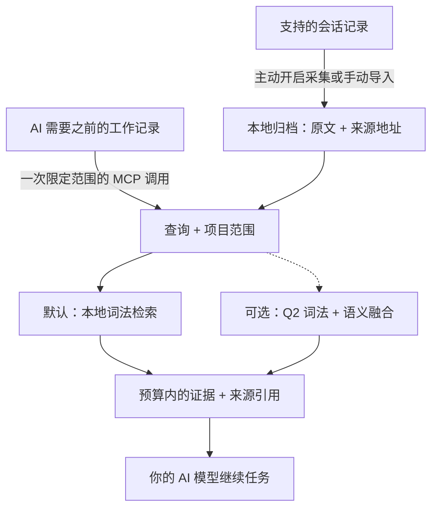
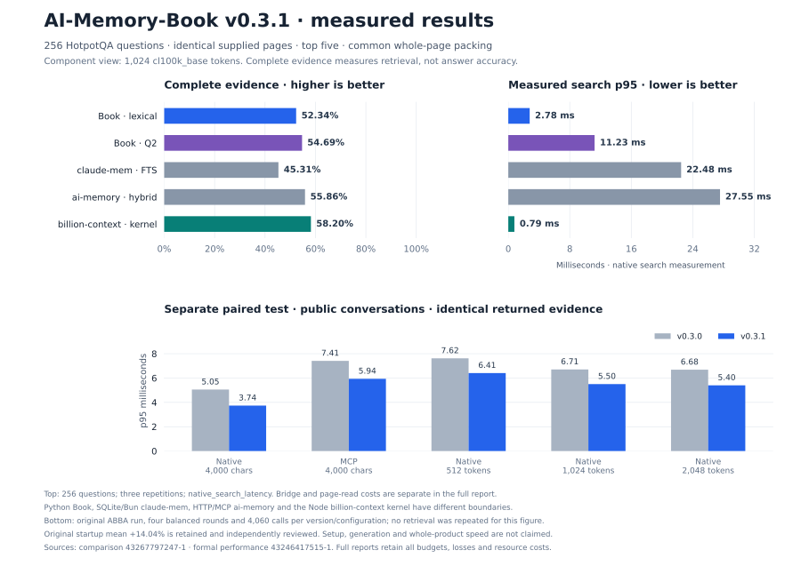

# AI-Memory-Book

**让 AI 共享一份本地记忆，找回原始证据，带着出处继续工作。**

项目是书，任务是章，之前的决定可以跨会话、跨客户端保留。AI 通过一次 MCP 调用，取得预算范围内的相关原文，用来继续当前任务。

[English](README.md) · [快速开始](#快速开始) · [实测结果](#实测结果) · [文档导航](#文档导航) · [v0.3.1 发布页](https://github.com/Afloat16/AI-Memory-Book/releases/tag/v0.3.1)

**v0.3.1 · 实验性版本 · MIT · Python 3.10+ · 本地 SQLite**

## 如何运作



后台采集独立更新归档；AI 可以直接检索，在需要更多细节时再读取原始页面。书架和章节提供可选导航，不必每次先遍历目录。[AI 使用指南](docs/agent-guide.md)。

## 核心亮点

- **默认轻量运行。** 记忆写入和词法检索零模型调用，核心只需 Python 与 SQLite，无需下载嵌入模型、启动数据库服务器或配置记忆服务 API Key。
- **原文可追溯。** 保留项目、会话、轮次和精确来源区间；内置字符预算，可选精确 tokenizer 上限，连同上下文中的引用和分隔符一起计数。
- **多个客户端共用记忆。** 支持 Claude Code/Desktop、Codex、Gemini、Cursor 等 MCP 配置；主动开启后可后台采集支持的会话，默认不启动网页服务。
- **效率有实测依据。** 当前核心在输出相同证据的同时降低延迟；可选精简引用减少重复来源元数据，具体结果与适用范围见下文。

## 快速开始

准备 **Python 3.10+，且 SQLite 支持 FTS5**。安装器将发布版 wheel 装入独立环境，并包含 MCP 和客户端配置依赖；无需克隆仓库或安装 Node.js。

**macOS / Linux**

```bash
curl -fsSLo install-memory-book.sh https://raw.githubusercontent.com/Afloat16/AI-Memory-Book/v0.3.1/scripts/install.sh
bash install-memory-book.sh
```

**Windows PowerShell**

```powershell
Invoke-WebRequest https://raw.githubusercontent.com/Afloat16/AI-Memory-Book/v0.3.1/scripts/install.py -OutFile install-memory-book.py
py -3 .\install-memory-book.py
```

**接入 AI**

```bash
memory-book setup --client claude-code --capture --background
memory-book doctor
```

若终端还找不到 `memory-book`，使用安装器输出的完整启动路径。重启客户端后，可以让 AI：**“找回我们之前对这个任务的决定，引用来源，然后继续完成。”**

把 `claude-code` 换成你的[客户端配置名](docs/integrations.md#supported-profiles)，或重复 `--client` 接入多个客户端。`--capture` 主动开启对既有和未来受支持文本会话的采集；省略它则仅配置 MCP。原生采集支持 Claude Code、Codex、Gemini 和旧版 Python Kimi；其他配置通过显式导入或开启 MCP 写入积累记忆。工具是否调用仍由宿主权限与模型决定。

**升级已有安装：**重新运行安装器，再以原来的客户端和采集选项执行 `setup`，使 MCP 和已有后台服务指向新环境。已有记忆和旧环境会保留。[升级说明](docs/deployment.md#upgrading)。

## 实测结果

以下展示 **v0.3.1 实现**的已验证结果。默认优化对符合条件的项目查询缩小 FTS 扫描范围，保留原排序和完整返回结果。完整协议、源码哈希、逐题得失和历史实验保留在[基准索引](benchmarks/README.md)。

### 效率优势

| 已验证改进 | 结果 | 测量范围 |
|---|---|---|
| **相同输出，默认检索更快** | 公开会话语料原生 p95 **降低 26.05%**；实际 MCP p95 **降低 19.87%** | v0.3.0 → v0.3.1，4,000 字符。完整实验共四轮平衡成对测试、47,320 次调用，覆盖两组语料 × 五种配置，共十个单元。[独立复核](docs/round3-performance-review.md) |
| **完整注册矩阵中的改进** | 各单元合并 p95 的几何平均**改善 11.36%** | 覆盖原生/MCP 和 512/1,024/2,048-token 设置；四轮顺序为 AB、BA、BA、AB，任何单元合并后的 p50/p95 回退均未超过 5%。全部逐轮结果保留。[原始结果](benchmarks/reports/round3-performance-43246417515-1/report.summary.json) |
| **可选精简 MCP 引用** | 响应文本 token **减少 19.63%**；首次调用参考总量**减少 8.15%** | 此前单独冻结的测量：1,015 道公开会话问题、4,000 字符、compact 响应、`o200k_base`。该格式仍可使用。[报告](docs/indexed-references.md) |

提速结果也有边界：合成语料的 512-token 配置 p95 **增加 0.12%**；原始公开语料测试中新建空数据库的启动均值为 **34.46 → 39.29 ms（增加 14.04%）**。原始自动验收标记仍为 false；[独立资源复核](docs/round3-startup-resource-review.md)在披露这一启动结果的前提下接受查询优化。补充启动诊断和本次发布均未替换原始计时。

精简引用保留相同上下文，并可还原全部来源字段。首次调用计数包含完整工具 schema、初始化说明和参数；参考 tokenizer 计数不等于服务商账单。引用稀少时可能增加 token。这是体积优化：该设置的 p95 为 **7.126 ms → 7.131 ms**，不宣称提速。

### 当前开源组件对比

**同一机器，256 道 HotpotQA 多跳题，相同原始页面、top-5 和整页打包器，上限为 1,024 个 `cl100k_base` token。** 证据召回、完整证据率和 MRR 越高越好，延迟越低越好。本轮已完成完整验证，状态为 `complete-verified`；[完整结果](benchmarks/results/round3-comparison-43267797247-1/report.md)保留全部配置和测量边界。

| 检索组件 | 证据召回 ↑ | 完整证据 ↑ | MRR ↑ | 平均上下文 token | 搜索 p50 / p95 ms |
|---|---:|---:|---:|---:|---:|
| **Book：默认词法** | 76.28% | 52.34% | 0.8132 | 719.8 | **1.766 / 2.784** |
| **Book：可选 Q2 语义** | 76.77% | 54.69% | 0.8239 | 739.0 | 7.415 / 11.226 |
| [claude-mem 15.18.1](https://github.com/thedotmack/claude-mem)：原生 FTS | 70.68% | 45.31% | 0.7674 | 715.8 | 11.494 / 22.484 |
| [ai-memory v3.4.5](https://github.com/akitaonrails/ai-memory)：本地混合检索 | 77.27% | 55.86% | 0.8182 | 716.8 | 21.168 / 27.545 |
| [billion-context 9674cfa](https://github.com/ranxianglei/billion-context)：搜索内核 | **78.91%** | **58.20%** | **0.8277** | 762.3 | **0.189 / 0.793** |

此设置下，Book 默认路径的完整证据率比 claude-mem FTS **高 7.03 个百分点**，保持零模型调用，实测搜索 p95 低于 claude-mem 和 ai-memory。Q2 的完整证据率比 Book 默认路径**高 2.34 个百分点**、比 claude-mem **高 9.38 个百分点**。**ai-memory 的完整证据率高于两种 Book 模式；billion-context 在该设置的证据召回、完整证据率、MRR 和搜索延迟上均领先。**

质量按每题第一次返回的结果计，延迟使用全部三次实际重复，并采用记录中的 `native_search_latency` 边界。接口分别是 Book Python/原生上下文组装、claude-mem Bun/SQLite、ai-memory HTTP/MCP、billion-context Node 内核。这些是**检索组件指标**，不等于最终回答准确率或完整产品速度倍数。准备、桥接开销和额外读页另计；ai-memory 首次搜索加全部读页的 p95 为 **30.532 ms**。[完整对比](docs/comparison.md#v031-comparison)保留所有预算/tokenizer、响应/读页 token、索引、下载、RSS 和存储指标。Book 的 **2.784 ms 属于此处的组件搜索测量**；实际 MCP 延迟见上面的独立成对测试。



**按任务选择可选模式。** Q2 增加本地模型与索引成本，小预算下可能丢失证据：512 个 `o200k_base` token / 8,000 字符时，原生完整证据率为**词法 35.55% → Q2 33.20%**。本轮新选题目排除了前两轮样本，但仍来自同一 HotpotQA 来源；评分后即成为回归数据，不构成跨领域泛化证明。另一个项目内 FTS 统计候选未通过预注册质量门槛，**本版不发布该候选**。之前的[生成回答](benchmarks/RESULTS-local-answers.md)和[完整工作流](benchmarks/RESULTS-full-workflow.md)诊断保留各自源码与模型设置，不作为 v0.3.1 回答质量得分。

[部署与架构对比](docs/comparison.md#popular-projects-and-the-workload-they-address)还包括 **Mem0、Graphiti、PageIndex 和 Letta**，与实跑基准明确区分。ai-memory 也支持默认零 LLM 路径；claude-mem 支持本地模型供应端。

## 文档导航

| 你想做什么 | 入口 |
|---|---|
| 接入其他客户端、导入会话 | [客户端与导入格式](docs/integrations.md) |
| 安装、升级、Docker、管理后台采集 | [部署指南](docs/deployment.md) |
| 了解何时检索、引用原文、处理缺失证据 | [AI 使用指南](docs/agent-guide.md) |
| 开启精确 token 上限、Q2 语义或精简引用 | [Token 预算](docs/token-budget.md) · [语义检索](docs/semantic-retrieval.md) · [精简引用](docs/indexed-references.md) |
| 在浏览器检查归档 | 运行 `memory-book serve`，打开 [127.0.0.1:8765](http://127.0.0.1:8765) |
| 查看完整实验或参与开发 | [基准索引](benchmarks/README.md) · [验证记录](docs/validation.md) · [贡献指南](CONTRIBUTING.md) · [更新日志](CHANGELOG.md) |

归档是本地未加密数据；返回给 AI 客户端的证据会进入该客户端的模型上下文。网页阅读器用于检查归档，正常 MCP 和采集无需 HTTP 端口。[数据与配置位置](docs/deployment.md#data-and-configuration-paths)。

[CI](https://github.com/Afloat16/AI-Memory-Book/actions/workflows/ci.yml)覆盖 Python 3.10/3.12/3.13、真实 MCP stdio、网页阅读器、Linux/macOS/Windows 安装器和容器持久化。配置样本测试不代表每款厂商应用都完成交互认证。项目独立实现，采用 [MIT 许可证](LICENSE)。
