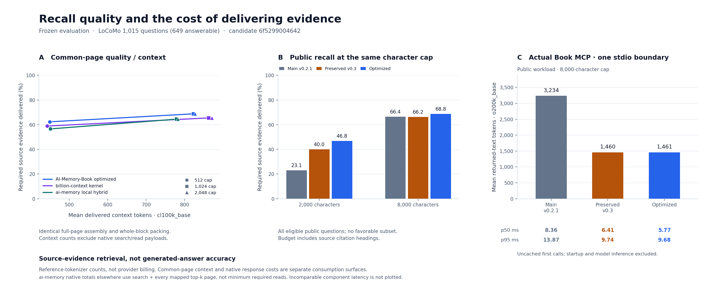

# Recall quality continuation — first frozen round (`6f52990`)

This report completes the measurements missing from the recovered optimization task. **It describes the first frozen round, not the latest development source or a proof that the overall product goal has been reached.** A subsequent score-aware retrieval experiment passed its development gate and is being evaluated separately. Its results must not be attributed to the runtime measured here.

The first round delivers more public source evidence and retains the substantial response-token savings already introduced on the preserved performance branch. Against the older `main` baseline, the full public MCP workload uses **54.8% fewer response tokens** with lower measured p50 and p95. Against the already optimized **preserved v0.3 branch**, response tokens are essentially unchanged, public MCP p50 improves, and synthetic latency and complete-evidence regressions remain.

On identical public pages and common token budgets, this candidate delivers more required evidence and completes more answerable questions than both measured native competitor components in **all 12 competitor × tokenizer × cap comparisons**. It uses fewer mean common-context tokens in only **5 of those 12 comparisons**. The billion-context kernel remains faster in its measured boundary. Generated-answer accuracy, universal lower latency and tokens, and superiority over complete memory products are not established.

The authoritative derived results are in [the first-round assessment](results/recall-final-assessment.json), backed by [the completed execution checkpoint](reports/recall-final-run-checkpoint.json) and the complete archives linked below. Filenames beginning `recall-final-` identify this completed first frozen batch; they are retained rather than overwritten by subsequent experiments.



[Editable SVG](../docs/assets/recall-quality-costs.svg). Source-evidence retrieval is not generated-answer accuracy. Common-page context and native tool responses are distinct consumption surfaces.

## 1. What was recovered and measured

The interrupted [draft PR #1](https://github.com/Afloat16/AI-Memory-Book/pull/1) already preserved the compact MCP and v0.3 performance work and the next retrieval/migration implementation. This continuation recovered those commits, evaluated development alternatives, corrected the measurement workflow, and completed all **13 sequential stages**.

| Role | Immutable commit | Meaning |
|---|---|---|
| Older main baseline | [`a05f88a79ce20be3fd5912c62fc020f8b11ba4a9`](https://github.com/Afloat16/AI-Memory-Book/commit/a05f88a79ce20be3fd5912c62fc020f8b11ba4a9) | `main-v0.2.1`; before the preserved compact-response optimization |
| Primary preserved baseline | [`3ee40946c5407e65fd375a8d47472066a82ae472`](https://github.com/Afloat16/AI-Memory-Book/commit/3ee40946c5407e65fd375a8d47472066a82ae472) | `preserved-v0.3`; includes the earlier token/cost improvements |
| Recovered interrupted implementation | [`7ffb5ee17a35118dd104e52484e917f48326a34e`](https://github.com/Afloat16/AI-Memory-Book/commit/7ffb5ee17a35118dd104e52484e917f48326a34e) | Bounded local word-form candidates, intact evidence and schema-3 migration |
| First-round measured runtime | [`6f5299004642618e606d001b4c574e1bae572a7e`](https://github.com/Afloat16/AI-Memory-Book/commit/6f5299004642618e606d001b4c574e1bae572a7e) | `optimized-recall` in every first-round final artifact |
| First-round measurement harness | [`51f452e4d03e7ce7094efa5976cc355a6a2dc794`](https://github.com/Afloat16/AI-Memory-Book/commit/51f452e4d03e7ce7094efa5976cc355a6a2dc794) | Explicit corpus plans, failure gates, duplicate-query MCP handling and resumable execution |

The measured runtime's package-source SHA-256 is:

```text
191d0bf023fa3589c4832440cde86482563e223bec8a79a25b2b4fe020f2fb85
```

The preserved and candidate packages both identify as `0.3.0`; the commit, source hash and explicit comparison label distinguish them. Report generation can make the checkout dirty without changing the measured Python source. The recorded source hashes and `source_dirty: false` identify the actual runtime bytes. The source and evaluation inputs stayed unchanged throughout the first frozen batch.

The measurements ran on Linux x86-64 with Python 3.12.14, SQLite 3.53.1, MCP SDK 1.29.0, `tiktoken==0.12.0`, and Node v24.22.1. These are observations from one shared machine with warm filesystem/SQLite caches, not hardware-independent guarantees or confidence intervals.

## 2. Implementation changes and development choices

The recovered code keeps exact FTS5 retrieval and adds a bounded SQLite Porter route for ordinary English word forms. Fixed reciprocal-rank fusion weights the exact route twice the stem route. Scope restrictions apply before candidate limits, and the identical-route case retains the original BM25 behavior. This adds no mandatory model, embedding package, network request or provider key to the core.

The continuation changes how bounded context is delivered. Distinct query-term coverage and intact source units take priority over repeated occurrences of one term. Citation space is reserved before distributing body budgets, and unused room on short selected pages is available to other selected pages. Original source coordinates remain authoritative. This avoids selecting a keyword-heavy fragment when an equally covered intact fact fits; it is not semantic paraphrase retrieval.

Performance work reuses bounded directory-token state, precompiles lexical regular expressions, and keeps a lazy SQLite connection within an MCP transport lifespan. Owner-thread checks, file-replacement detection, cleanup and temporary-connection fallback protect the retained resource. External writes still invalidate recalled results through database revisions. The native compact/detailed response contract and source content do not change merely because the connection is reused.

Schema 2 upgrades to schema 3 by adding the derived stem index while retaining source rows and page addresses. Schema-1 support and rollback are covered by tests. An already-open older writer is detected through the revision guard so its subsequent write cannot silently leave the newer derived index stale. Retrieval-cache version changes invalidate contexts created under old excerpt semantics.

### Choices were made on development data

The registered development populations were synthetic seed 61 and the two-conversation, 128-question public development selection. Seeds 211 and 509 were reserved before viewing their first-round results. The [evaluation plan](recall_quality_plan.json) and [exact corpus list](recall_quality_corpora.json) record this separation.

| Development implementation | Synthetic 2,000-char recall / complete | Public 2,000-char recall / complete | Public 8,000-char complete |
|---|---:|---:|---:|
| Recovered `7ffb5ee` | 91.48% / 90.13% | 45.79% / 45.78% | 78.31% |
| Intact-unit preference | 92.61% / 91.45% | 52.34% / 54.22% | 78.31% |
| Trial exact:stem weight 4:1 | 93.18% / 92.11% | 49.53% / 50.60% | 77.11% |

The intact-unit change was retained. The 4:1 trial was **rejected**: its small synthetic gain came with worse public development evidence and complete-evidence coverage. The first frozen runtime retains the 2:1 fusion weight. Its synthetic 8,000-character development result still loses one complete query against preserved v0.3; the final report retains that loss.

The development trial timings were exploratory, including unfavorable values. They are not substituted for the sequential frozen timing tables. Evidence: [recovered synthetic](results/recall-recovered-synthetic-development.md), [recovered public](results/recall-recovered-locomo-development.md), [intact synthetic](results/recall-excerpt-synthetic-development.md), [intact public](results/recall-excerpt-public-development.md), [4:1 synthetic](results/recall-fusion-synthetic-development.md), [4:1 public](results/recall-fusion-public-development.md). Each has a matching complete `.json.gz` and summary.

## 3. Evaluation populations and scoring

Every synthetic seed contains eight projects, 112 sessions, 1,408 user turns, 168 queries and 176 required evidence spans. Of the 168 queries, 152 are answerable and 16 are unsupported. Different seeds and wording are useful regression tests, but their shared authored templates do not constitute independent natural conversation histories.

The public corpus is the pinned [LoCoMo source](https://github.com/snap-research/locomo/tree/3eb6f2c585f5e1699204e3c3bdf7adc5c28cb376). It consists of persona-agent-generated conversations with evaluation annotations. The text-only adaptation does not index answer labels, summaries, image captions or the evaluation questions. The raw corpus remains separately downloaded under CC BY-NC 4.0, outside the MIT source/report artifacts.

The public verification population contains eight conversations, 216 sessions, 4,684 utterances and 1,339 canonical pages. Of 1,600 original QA records, 576 are excluded for image-bearing required evidence, five for invalid evidence IDs and four for missing evidence. All 1,015 eligible records are retained, including unsupported questions and repeated question text.

| Public population | Query IDs | Answerable | Unsupported | Required evidence utterances |
|---|---:|---:|---:|---:|
| Previously published regression selection | 256 | 176 | 80 | 191 |
| Additional eligible questions | 759 | 473 | 286 | 597 |
| Full verification population | 1,015 | 649 | 366 | 788 |

The additional 759 questions **share conversations with the earlier 256**. The whole 1,015-question population is not a wholly new heldout corpus. Selection follows the frozen hash order in [the public manifest](locomo_split.json); the report separates the earlier and additional cohorts instead of hiding their overlap.

Evidence recall means the fraction of annotated evidence delivered with the complete required text, correct project/session/turn and a matching original source interval. Complete-evidence rate means every required annotation is delivered for an answerable query. Returning a page ID or a preview that omits the evidence does not count. Unsupported questions returning context are tracked separately, not scored as hallucinated answers.

The [preflight](results/recall-final-preflight.json) checks six exact populations against both source versions: **12 source/corpus checks, zero unattainable labels**. The evaluator does not union one annotation across several pages, so verifying that each annotation fits a canonical page is material. It does not remove difficult labels to obtain a clean result. Character, token and size-accounting failures now fail the run while retaining diagnostic output.

## 4. Paired retrieval: preserved v0.3 to first-round optimized runtime

This is the primary comparison for work completed in this continuation. Both versions run independently on identical records, queries, scope, page settings, top-five limit and budgets. Core recall uses `use_cache=False`. Timings exclude ingestion, token counting, MCP transport, process startup and model inference; SQLite and OS caches are not flushed. Citation headings count toward the character cap.

All arrows in the following table mean **preserved `3ee4094` → optimized `6f52990`**. Mean context tokens use `o200k_base` and include all selected query IDs, while evidence/complete rates use answerable questions.

| Population | Char cap | Evidence recall | Complete evidence | Mean context tokens | Core p50 ms | Core p95 ms |
| --- | --- | --- | --- | --- | --- | --- |
| Synthetic development 61 | 2,000 | 90.34% → 92.61% | 90.13% → 91.45% | 780.9 → 782.0 | 3.688 → 4.447 | 8.160 → 12.234 |
| Synthetic development 61 | 8,000 | 93.18% → 92.61% | 92.11% → 91.45% | 1,235.3 → 1,234.6 | 3.379 → 3.629 | 6.125 → 10.080 |
| Synthetic reserved 211 | 2,000 | 77.84% → 78.98% | 79.61% → 78.95% | 770.1 → 769.4 | 3.409 → 4.423 | 8.173 → 12.960 |
| Synthetic reserved 211 | 8,000 | 81.82% → 81.25% | 84.21% → 81.58% | 1,218.4 → 1,219.9 | 3.269 → 3.707 | 6.842 → 9.778 |
| Synthetic reserved 509 | 2,000 | 78.41% → 78.98% | 80.26% → 78.95% | 772.9 → 772.3 | 3.745 → 4.427 | 9.461 → 13.042 |
| Synthetic reserved 509 | 8,000 | 81.82% → 81.25% | 84.21% → 81.58% | 1,222.6 → 1,224.4 | 3.677 → 4.311 | 9.213 → 12.542 |
| Public development 128 | 2,000 | 42.06% → 52.34% | 40.96% → 54.22% | 592.1 → 595.4 | 2.374 → 3.403 | 3.099 → 5.136 |
| Public development 128 | 8,000 | 75.70% → 75.70% | 77.11% → 78.31% | 822.3 → 825.1 | 2.429 → 2.635 | 3.661 → 3.335 |
| Public full 1,015 | 2,000 | 39.97% → 46.83% | 42.37% → 49.46% | 593.7 → 595.1 | 2.802 → 3.594 | 3.921 → 5.723 |
| Public full 1,015 | 8,000 | 66.24% → 68.78% | 70.11% → 71.96% | 838.8 → 840.3 | 2.754 → 3.184 | 4.012 → 5.305 |

The first-round public gains require slightly more context and more core retrieval work than preserved v0.3. At 8,000 characters, public evidence recall rises from 66.24% to 68.78%, but mean context rises from 838.8 to 840.3 tokens and core p50/p95 are higher. Connection reuse reduces the real public MCP boundary later in this report; it does not erase the core-only regression.

### Public gains and losses by cohort

These counts are derived by matching every query ID in the full paired archive. A gain in the total does not imply every individual question improved. Latencies are not shown per cohort: the cohorts were scored separately after the full population was measured, not timed independently.

| Cohort | Char cap | Evidence recall | Complete evidence | Evidence gains / losses | Complete-query gains / losses |
| --- | --- | --- | --- | --- | --- |
| Previous 256 | 2,000 | 45.03% → 53.40% | 46.59% → 54.55% | +23 / −7 | +21 / −7 |
| Additional 759 | 2,000 | 38.36% → 44.72% | 40.80% → 47.57% | +60 / −22 | +51 / −19 |
| All 1,015 | 2,000 | 39.97% → 46.83% | 42.37% → 49.46% | +83 / −29 | +72 / −26 |
| Previous 256 | 8,000 | 72.77% → 75.92% | 75.00% → 77.27% | +6 / −0 | +4 / −0 |
| Additional 759 | 8,000 | 64.15% → 66.50% | 68.29% → 69.98% | +18 / −4 | +11 / −3 |
| All 1,015 | 8,000 | 66.24% → 68.78% | 70.11% → 71.96% | +24 / −4 | +15 / −3 |

At 8,000 characters, the old 256-question sample gains six evidence utterances without losing one against preserved v0.3. The additional cohort gains 18 and loses four. At 2,000 characters, the full population gains 83 evidence utterances but loses 29; both sides of that tradeoff remain in the archives.

### Separate comparison with the older main branch

These arrows mean **main `a05f88a` → optimized `6f52990`**, not preserved v0.3. The main baseline predates most response compaction and earlier excerpt optimizations. Its larger reductions must not be presented as gains newly created after recovering `7ffb5ee`.

| Population | Char cap | Evidence recall | Complete evidence | Mean context tokens | Core p50 ms | Core p95 ms |
| --- | --- | --- | --- | --- | --- | --- |
| Public full 1,015 | 2,000 | 23.10% → 46.83% | 23.88% → 49.46% | 599.7 → 595.1 | 4.977 → 3.740 | 7.452 → 6.005 |
| Public full 1,015 | 8,000 | 66.37% → 68.78% | 70.42% → 71.96% | 922.2 → 840.3 | 3.859 → 3.055 | 5.696 → 4.591 |

The same frozen candidate is measured in separate processes for the main and preserved comparisons; their observed timings differ slightly. Quality and token counts agree. On the old 256-question sample at 8,000 characters, main-to-candidate evidence gains/losses are +5/0. The full public population still has +22/−3 evidence changes, so this is not a claim of zero regressions on every question.

The paired harness also publishes identical whole-evidence-block packing at 512, 1,024 and 2,048 tokens for both reference encodings. That is an additional evaluation policy applied to one retrieval at the maximum character cap, with separately measured packing cost. It is not a production token-budget API or another recall pass. Every configuration and category remains in the full/summary artifacts.

## 5. Actual MCP response tokens and latency

The official SDK launches actual stdio subprocesses and calls `recall_memory`. Returned-text counts include JSON metadata and use `o200k_base`; they are not provider billing or the host's private prompt wrapper. Tool declarations, initialization instructions, request arguments, full response-envelope JSON and `cl100k_base` counts are retained separately. Process startup and fixture indexing are outside the timed calls.

The synthetic MCP workload is development seed 61 with **two projects and 42 queries**, not the eight-project 168-query core table. The public workload is all **1,015 query IDs** at 8,000 characters. Three repetitions are measured for each version.

| Workload | Char cap | Version | Mean response tokens | Uncached-call p50 ms | Uncached-call p95 ms |
| --- | --- | --- | --- | --- | --- |
| Synthetic 42 | 2,000 | main-v0.2.1 | 2,186.7 | 9.213 | 15.932 |
| Synthetic 42 | 2,000 | preserved-v0.3 | 1,177.3 | 5.412 | 9.599 |
| Synthetic 42 | 2,000 | optimized-recall | 1,178.0 | 5.791 | 14.098 |
| Public 1,015 | 8,000 | main-v0.2.1 | 3,233.5 | 8.356 | 13.873 |
| Public 1,015 | 8,000 | preserved-v0.3 | 1,459.6 | 6.413 | 9.737 |
| Public 1,015 | 8,000 | optimized-recall | 1,460.9 | 5.767 | 9.678 |

Against **main**, optimized public MCP response tokens are 54.8% lower, p50 is 31.0% lower and p95 is 30.2% lower. Synthetic response tokens are 46.1% lower, p50 is 37.1% lower and p95 is 11.5% lower. These are bounded workload observations under one common stdio boundary.

Against **preserved v0.3**, public MCP p50 is 10.1% lower; p95 differs by only 0.6%, which should not be treated as a statistically established tail improvement. Mean response tokens rise by 0.09%. Synthetic p50 rises by 7.0% and p95 by 46.9%, while tokens rise by 0.05%. The first round therefore does not achieve a universal speed or token improvement over the interrupted work it preserved.

The full public dataset has 1,015 query IDs but only **1,010 distinct `(query, project)` pairs**. None of the five additional rows is dropped. Each repeated pair clears `recall_cache` through a separate committed SQLite connection **before** timing its first call. This produces 15 duplicate-pair clears per engine across three repetitions. The following immediate repeat remains a cache-hit diagnostic. Counts and per-row reset flags are stored, and a real-stdio regression verifies miss/hit behavior with duplicate annotations and distinct project scopes.

For the optimized engine, all **1,057 query IDs** across the two workloads also pass an actual `details: true` context/page-ID equivalence check. On the public population, compact versus detailed returned text is **1,460.9 versus 2,358.2 tokens** for identical evidence. This metadata comparison is separate from version-to-version changes in evidence selection. Startup samples are retained, but with only three starts per version/workload no general startup guarantee is claimed. Immediate repeats are not substituted for first-call figures.

Evidence: [synthetic summary](reports/recall-final-mcp-synthetic.summary.json), [synthetic full archive](reports/recall-final-mcp-synthetic.json.gz), [public summary](reports/recall-final-mcp-public.summary.json), [public full archive](reports/recall-final-mcp-public.json.gz).

## 6. Pinned native components on identical public pages

The comparison executes actual pinned implementations:

- **billion-context**, commit `dc041dd1ab1a014efa352ba47a6f31fc47f55284`: unchanged upstream `searchBlocks`, shipped BM25/fuzzy hybrid, through a persistent Node bridge. Syntax-only TypeScript erasure does not replace its algorithm.
- **ai-memory v3.4.5**, commit `ee73c04c542fa41ca629b046deb4ac108518f407`: hash-verified official Linux binary, native MCP `memory_query`, its default local MiniLM embeddings, and real native page reads.

Both receive the same 1,339 adaptive pages exported from preserved v0.3 and the same 1,015 scoped questions, top-five limit, common full-page assembler and whole-block packer. Book retains its hierarchy/index metadata; equal page granularity does not imply identical searchable features. No question, expected answer or evidence label enters a retrieval index.

ai-memory indexes all 1,339 supplied pages during native ingestion. Its backfill check finds them already embedded (`skipped: 1339`, `failed: 0`), and the post-measurement diagnostic confirms the vector stream is active alongside its native streams. No paid provider calls or replacement embeddings are used. Its setup is 164.5 seconds, including 162.2 seconds of native ingestion/indexing; downloads are excluded because artifacts were cached.

### Complete common-context curves

All rows measure delivered evidence after the **same full-page assembly policy**. Mean tokens include every query. Evidence and complete rates apply to the 649 answerable questions and 788 required utterances. These are not each product's unmodified preview payload sizes.

### `cl100k_base`

| Token cap | Component | Evidence recall | Complete evidence | Mean context tokens |
| --- | --- | --- | --- | --- |
| 512 | Book optimized | 62.31% | 66.72% | 449.2 |
| 512 | billion-context | 58.88% | 62.71% | 442.8 |
| 512 | ai-memory local hybrid | 56.60% | 58.86% | 451.1 |
| 1,024 | Book optimized | 68.78% | 71.96% | 823.2 |
| 1,024 | billion-context | 65.48% | 68.72% | 862.6 |
| 1,024 | ai-memory local hybrid | 64.47% | 66.72% | 779.3 |
| 2,048 | Book optimized | 68.78% | 71.96% | 827.2 |
| 2,048 | billion-context | 65.48% | 68.72% | 871.0 |
| 2,048 | ai-memory local hybrid | 64.59% | 66.87% | 782.4 |

### `o200k_base`

| Token cap | Component | Evidence recall | Complete evidence | Mean context tokens |
| --- | --- | --- | --- | --- |
| 512 | Book optimized | 62.69% | 67.03% | 452.7 |
| 512 | billion-context | 59.39% | 63.02% | 445.8 |
| 512 | ai-memory local hybrid | 56.98% | 59.17% | 451.8 |
| 1,024 | Book optimized | 68.78% | 71.96% | 804.3 |
| 1,024 | billion-context | 65.48% | 68.72% | 844.6 |
| 1,024 | ai-memory local hybrid | 64.47% | 66.72% | 760.4 |
| 2,048 | Book optimized | 68.78% | 71.96% | 805.4 |
| 2,048 | billion-context | 65.48% | 68.72% | 848.5 |
| 2,048 | ai-memory local hybrid | 64.59% | 66.87% | 762.4 |

At 1,024 `cl100k_base` tokens, the candidate reaches **68.78% recall / 71.96% complete evidence / 823.2 mean context tokens**. The preserved Book component is **66.24% / 70.11% / 821.4**. Billion is **65.48% / 68.72% / 862.6**, and ai-memory is **64.47% / 66.72% / 779.3**.

Candidate evidence recall and complete-evidence rate exceed both competitors in all six cap/encoding settings, making 12 quality comparisons. Token results differ: it uses less common context than billion-context at the 1,024/2,048 caps for both encodings, but more at 512; it uses less than ai-memory only at the 512 `cl100k_base` cap. That is **five lower-token comparisons out of 12**, not uniform token superiority. The figures are deterministic coverage observations on this population, without an independent answer judge or statistical equivalence claim.

### Timing boundaries stay separate

| Measured operation | p50 ms | p95 ms | Boundary |
| --- | --- | --- | --- |
| preserved-v0.3 | 2.702 | 3.878 | In-process recall and native context assembly |
| optimized-recall | 2.983 | 5.444 | In-process recall and native context assembly |
| billion-context | 1.225 | 2.317 | Search kernel + JSON bridge; no native decompression/read |
| ai-memory-hybrid | 30.108 | 41.657 | Persistent HTTP/MCP query; full-page reads are additional |
| Optimized Book MCP | 5.767 | 9.678 | Actual stdio call at 8,000 characters, including serialization/transport |

Billion's kernel-only median is **1.027 ms**; its kernel and bridge are faster in this component experiment. The adapter does not run Billion's complete proxy/summarization/decompression workflow. Its common full-page expansion is a harness lookup, not a measured native fetch. Comparing that timing directly with Book's complete MCP response would not establish product-level speed superiority.

For ai-memory, the explicitly measured native policy is **search and then read every mapped top-five page once**, even if a preview already contains evidence. Exact returned content averages **877.4 search tokens + 1,698.9 read tokens = 2,576.3 `o200k_base` tokens**. Native page reads add **6.404 ms mean** separately from query latency. Book's one public MCP recall averages 1,460.9 response tokens, 43.3% fewer under these stated policies. This is not ai-memory's minimum required-read cost, an equal-cap native agent policy or an end-to-end answer comparison. An agent can stop at an adequate preview or choose fewer reads.

Billion's search-result payload alone averages **569.2 `o200k_base` tokens**, but it is a preview/reference payload without its native follow-up decompression. It must not receive full-evidence credit merely because the common assembler can look up omitted text. Common context, native returned content, and canonical full-result JSON are retained as separate costs; duplicate representations are not added together.

The external result does not evaluate capture, observers, summaries, consolidation, memory editing, every global-search mode or model reasoning. **claude-mem is unmeasured.** Pins, integrity checks and license/attribution details are in [the adapter guide](competitors/README.md), [billion lock](competitors/billion-lock.json), [ai-memory lock](competitors/ai-memory-lock.json), and [the comparison protocol](../docs/comparison-protocol.md). Full results: [component report](results/recall-final-components-public.md), [summary](results/recall-final-components-public.summary.json), [complete archive](results/recall-final-components-public.json.gz).

## 7. Regressions and unresolved failure modes

The first-round report keeps losses visible:

- **Synthetic reserved seeds 211 and 509:** at 8,000 characters, preserved-to-candidate evidence recall is 81.82% → 81.25%, and complete evidence is 84.21% → 81.58%. Each seed gains three evidence hits but loses four complete worker-concurrency lookups. At 2,000 characters, aggregate recall improves but complete-evidence rate still declines. These outcomes were not used to rewrite the already frozen first-round source.
- **Low-overlap paraphrases:** all eight cases per synthetic seed still have zero evidence recall. Porter word forms do not provide general semantic equivalence.
- **Distant multi-section questions:** on each reserved seed, 11 of 32 required spans are delivered (34.38% recall), but none of the 16 two-evidence questions is complete. Partial coverage is not a solved multi-hop task.
- **Public complexity:** at 8,000 characters, upstream category 1 has 38.22% evidence recall and 18.46% complete evidence across 65 questions; category 3 has 42.11% and 33.33% across 24. The higher aggregate result does not hide these weak categories.
- **Unsupported questions:** all 366 unsupported public queries and all 16 unsupported queries on each reserved synthetic seed return nonempty context. This is a **100% unanswerable-nonempty diagnostic**, not an abstention or hallucination rate. Synthetic development has a 75% nonempty rate; that narrower development observation does not generalize to the verification populations.
- **Current facts:** the eight explicit current-decision questions per reserved seed retain full evidence coverage and zero stale-before-current/stale-only cases. This small controlled check is not authoritative conflict resolution.
- **Cost:** schema storage increases, native core retrieval is slower than preserved v0.3 in several rows, and synthetic MCP p95 worsens. Reduced response formatting and a reused connection do not make all operations cheaper.

No fixed answering model, model-generated responses, semantic answer judge, hallucination measurement or provider-billing experiment was used. Demonstrating equal-or-better answer quality at lower total latency/tokens requires that separate paired evaluation, including necessary follow-up reads and inference. Passing source and budget invariants is necessary for a valid report; it is not evidence that the user's complete goal has been reached.

## 8. Source-preserving upgrade and indexing costs

Each migration trial starts from a new byte-for-byte copy of one checkpointed schema-2 database, with a real valid recall-cache entry. Three independent candidate processes upgrade the copy and then reopen it. Six complete source-table fingerprints and page-ID/text/source-reference fingerprints remain identical. The valid cache is invalidated, every source page is present in the stem index, and the recorded database state is unchanged on reopen.

| Corpus | Schema | Logical bytes before | Logical bytes after | Growth | Migration p50 / p95 ms | Reopen p50 / p95 ms |
| --- | --- | --- | --- | --- | --- | --- |
| Synthetic development 61 | 2 → 3 | 14,225,408 | 19,894,272 | +5,668,864 (39.9%) | 62.706 / 68.000 | 0.613 / 0.749 |
| Public full 1,015 | 2 → 3 | 10,252,288 | 12,541,952 | +2,289,664 (22.3%) | 30.013 / 30.384 | 0.599 / 0.850 |

Logical bytes are SQLite page count × page size, not peak resident memory, temporary disk usage or WAL write volume. The three p95 values are small-sample summaries, with warm OS caches. Migration time is one-time database opening/index materialization, not query latency.

Fresh ingestion is a separate operation. In the paired development-seed-61 run, ingest calls took 780.5 ms preserved versus 819.0 ms optimized; the full public paired run recorded 1,131.9 versus 895.8 ms. These single ingest observations are retained alongside the query results, not presented as a universal ingestion speedup. A fresh schema-3 database can have a different page allocation from an in-place upgrade.

Evidence: [synthetic upgrade](reports/recall-final-upgrade-synthetic.json), [public upgrade](reports/recall-final-upgrade-public.json). Source-preservation, schema rollback, concurrent migration and older-writer compatibility also have focused tests.

## 9. Validation and execution continuity

The first-round local suite passes **241 tests**. It includes source/budget correctness, migration preservation and rollback, older writers, scoped recall, actual MCP lifecycle behavior, external updates, database replacement, compact/detailed equivalence, and duplicate-annotation miss/hit semantics. Benchmark tests exercise explicit corpus identity, invalid-output preservation and resumable-runner failures without requiring a favorable recall score.

After the CI font-install correction at [`bfb09d46f41a6a734bb8e434688f196fe8723c9d`](https://github.com/Afloat16/AI-Memory-Book/commit/bfb09d46f41a6a734bb8e434688f196fe8723c9d), both [push CI](https://github.com/Afloat16/AI-Memory-Book/actions/runs/43041835462) and [PR CI](https://github.com/Afloat16/AI-Memory-Book/actions/runs/43041847121) are **9/9 successful**. They cover three core Python versions, MCP/extras, browser, Linux/macOS/Windows installers and container operation. The actual browser job passes **13 checks**. These runs validate that first-round code/CI state; they are not a claim about subsequently changed runtime source or every vendor client application.

The [13-stage manifest](recall_quality_manifest.json) runs one timed job at a time: source preflight; three synthetic paired comparisons; public development, regression and expansion; main comparison; two upgrade measurements; two MCP workloads; and native components. Stage source/data/command/runtime identity is frozen. The runner verifies output files and their hashes before skipping completed stages, invalidates a missing/damaged stage and its successors, serializes access with a process lock, and cleans worker processes on failure. Checkpoints are written atomically.

The final assessor verifies every completed output against the checkpoint SHA-256 before deriving the cohort/goal tables. It saves the exact completed checkpoint in [the durable report artifact](reports/recall-final-run-checkpoint.json). A checkpoint belongs to its recorded paths, interpreter and environment; moving to a different environment requires a new checkpoint rather than pretending its old timings were rerun. Neither the runner nor the report promises that a machine can never be interrupted; completed evidence is retained and resumption is explicit.

## 10. Reproduction

Use an isolated checkout of the **first-round harness commit `51f452e`**, whose runtime matches `6f52990`, to reproduce these numbers. Later runtime code belongs in another experiment with new output names and checkpoint. The complete native comparison requires Linux x86-64 and Node 24 or newer. Downloads and dependency installation must finish before timed execution.

Create adjacent immutable baseline checkouts, prepare the optional benchmark dependencies and pinned data, then warm only the tokenizer/artifact caches:

```bash
git worktree add --detach ../baseline-v0.2 a05f88a79ce20be3fd5912c62fc020f8b11ba4a9
git worktree add --detach ../baseline-v0.3 3ee40946c5407e65fd375a8d47472066a82ae472
python3.12 -m venv .venv
.venv/bin/python -m pip install '.[mcp,clients,benchmark]' matplotlib
mkdir -p .artifacts/data .artifacts/tiktoken .artifacts/competitors
curl --fail --location \
  https://raw.githubusercontent.com/snap-research/locomo/3eb6f2c585f5e1699204e3c3bdf7adc5c28cb376/data/locomo10.json \
  --output .artifacts/data/locomo10.json
export TIKTOKEN_CACHE_DIR="$PWD/.artifacts/tiktoken"
.venv/bin/python - <<'PYCODE'
from pathlib import Path
import tiktoken
from benchmarks.competitors.billion import prepare as prepare_billion
from benchmarks.competitors.ai_memory import prepare as prepare_ai_memory, prepare_models
for name in ('cl100k_base', 'o200k_base'):
    tiktoken.get_encoding(name)
cache = Path('.artifacts/competitors')
prepare_billion(cache / 'billion-context')
prepare_ai_memory(cache)
prepare_models(cache)
PYCODE
```

The corpus loader verifies SHA-256 and byte size; competitor adapters verify source/binary/model hashes. The timed native stage uses `--offline`. Install all intended packages before the first checkpoint, because installed distribution versions form part of its identity.

Run or resume the exact manifest with the same command:

```bash
.venv/bin/python -m benchmarks.resume \
  --manifest benchmarks/recall_quality_manifest.json \
  --checkpoint .artifacts/recall-quality-checkpoint.json
```

Once all 13 stages finish, the report scripts in this continuation derive and visualize the results without running another benchmark. The assessment and plotting scripts were added after the measured harness freeze; copy those two files from the continuation into the isolated checkout if they are not present at `51f452e`. They are outside the benchmark input glob and do not change the measured runtime:

```bash
PYTHONPATH=. .venv/bin/python scripts/assess_recall_quality.py
.venv/bin/python scripts/plot_recall_quality.py
```

The full logs and source paths are environment-specific; the committed summaries, archives and completed output hashes are the transferable evidence. The [benchmark guide](README.md) documents the lower-level paired, MCP and component runners; [the comparison protocol](../docs/comparison-protocol.md) defines the allowed interpretation of their costs.

## 11. Artifact index

| Measurement | Human-readable | Aggregate/category metrics | Per-query evidence |
| --- | --- | --- | --- |
| Synthetic development 61 | [report](results/recall-final-synthetic-61.md) | [summary](results/recall-final-synthetic-61.summary.json) | [complete archive](results/recall-final-synthetic-61.json.gz) |
| Synthetic reserved 211 | [report](results/recall-final-synthetic-211.md) | [summary](results/recall-final-synthetic-211.summary.json) | [complete archive](results/recall-final-synthetic-211.json.gz) |
| Synthetic reserved 509 | [report](results/recall-final-synthetic-509.md) | [summary](results/recall-final-synthetic-509.summary.json) | [complete archive](results/recall-final-synthetic-509.json.gz) |
| Public development 128 | [report](results/recall-final-public-development.md) | [summary](results/recall-final-public-development.summary.json) | [complete archive](results/recall-final-public-development.json.gz) |
| Public regression 256 | [report](results/recall-final-public-regression.md) | [summary](results/recall-final-public-regression.summary.json) | [complete archive](results/recall-final-public-regression.json.gz) |
| Public full 1,015 vs preserved | [report](results/recall-final-public-expanded.md) | [summary](results/recall-final-public-expanded.summary.json) | [complete archive](results/recall-final-public-expanded.json.gz) |
| Public full 1,015 vs main | [report](results/recall-final-main-expanded.md) | [summary](results/recall-final-main-expanded.summary.json) | [complete archive](results/recall-final-main-expanded.json.gz) |
| Pinned native components | [report](results/recall-final-components-public.md) | [summary](results/recall-final-components-public.summary.json) | [complete archive](results/recall-final-components-public.json.gz) |

- [First-round derived assessment](results/recall-final-assessment.json), including every public cohort, matched gains/losses, component tradeoff flags and source identities.
- [Exact completed run checkpoint](reports/recall-final-run-checkpoint.json), [manifest](recall_quality_manifest.json), [corpus plan](recall_quality_corpora.json), and [pre-registered evaluation choices](recall_quality_plan.json).
- [Structural preflight](results/recall-final-preflight.json); [synthetic migration](reports/recall-final-upgrade-synthetic.json); [public migration](reports/recall-final-upgrade-public.json).
- [Synthetic MCP summary](reports/recall-final-mcp-synthetic.summary.json) and [full archive](reports/recall-final-mcp-synthetic.json.gz); [public MCP summary](reports/recall-final-mcp-public.summary.json) and [full archive](reports/recall-final-mcp-public.json.gz).
- [Prior v0.3 report](RESULTS-v0.3.0.md), retained under its original interpretation and source identity.

## 12. Subsequent development is a separate round

After these 13 frozen stages completed, an isolated score-aware fusion alternative passed its [recorded development gate](experiments/score-aware-fusion-selection.json). On synthetic development seed 61, both caps changed from 92.61% to 93.18% evidence recall and 91.45% to 92.11% complete evidence, with one additional complete question and no losses. Public development at 2,000 characters was unchanged; at 8,000 characters, recall changed from 75.70% to 77.57% and complete evidence from 78.31% to 79.52%, again with one additional complete question and no losses. Three independent fixtures passed.

That development outcome supports a separate adoption/evaluation decision; it does **not** alter the source, scores or cost tables in this report. It is not a final quality guarantee, and later experiments must distinguish already inspected populations from newly reserved verification seeds. The first-round regressions and every original result artifact remain available rather than being replaced with the later variant's output.
