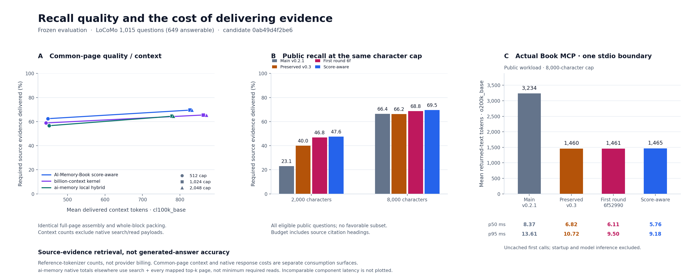

# Score-aware recall — second frozen evaluation (`0ab49d4`)

**Completed: all 16 intended stage results are verified across the preserved eleven-stage prefix and corrected five-stage continuation.** The original configuration failure and both exact checkpoint snapshots are retained; the runtime and Python evaluator stayed unchanged through recovery.

The measured source in this report is `0ab49d4`, which adds one development-selected score-aware fusion formula to the recovered and completed first-round implementation. The primary baseline is the first frozen runtime `6f52990`. The older preserved v0.3 and main versions are reported separately, so gains already achieved before this continuation are not credited to the new formula.

On all 1,015 eligible public questions, source-evidence recall rises from **46.83% to 47.59%** at 2,000 characters and **68.78% to 69.54%** at 8,000 characters against the first round. Complete evidence rises from **49.46% to 50.23%** and **71.96% to 72.88%**, respectively. The two newly reserved synthetic seeds restore complete lookup evidence relative to the first-round source, while distant multi-section coverage and low-overlap paraphrases remain weak. These are retrieval results, not generated-answer accuracy.

The real public MCP boundary still delivers much smaller responses than older main. Compared with the already compact first-round version, the new candidate uses slightly more response tokens and has lower observed p50/p95 in this one-machine run. The score formula is not proven to cause the entire latency difference. Universal lower tokens and latency with equal-or-better generated answers is not established.

On identical public pages and common token caps, the candidate exceeds both measured native competitors on evidence recall and complete coverage in **12/12 comparisons**, while mean context tokens are lower in **6/12**. Billion's measured kernel remains faster. Complete coverage at the 512-token cap also regresses slightly against the first-round Book runtime. These limits prevent a uniform cost/quality-success claim.

The [first-round report](RESULTS-recall-quality.md), its 13 stages and original artifacts remain available. This report describes the later candidate and its separately recorded evaluation; it does not replace those measurements.



[Editable SVG](../docs/assets/recall-score-quality-costs.svg). Source-evidence retrieval is not generated-answer accuracy. The common-context, native response, and latency boundaries are stated separately in the figure and tables.

## 1. Runtime identities and the development decision

| Role | Immutable runtime commit | Meaning |
|---|---|---|
| Older main | [`a05f88a79ce20be3fd5912c62fc020f8b11ba4a9`](https://github.com/Afloat16/AI-Memory-Book/commit/a05f88a79ce20be3fd5912c62fc020f8b11ba4a9) | `main-v0.2.1`; before the preserved response compaction |
| Preserved performance branch | [`3ee40946c5407e65fd375a8d47472066a82ae472`](https://github.com/Afloat16/AI-Memory-Book/commit/3ee40946c5407e65fd375a8d47472066a82ae472) | `preserved-v0.3`; separate historical baseline and schema-2 migration source |
| Primary first-round baseline | [`6f5299004642618e606d001b4c574e1bae572a7e`](https://github.com/Afloat16/AI-Memory-Book/commit/6f5299004642618e606d001b4c574e1bae572a7e) | `first-round-recall`; all primary arrows below start here |
| Current measured candidate | [`0ab49d4f2be6aabe5e51c3314bb9369041af5369`](https://github.com/Afloat16/AI-Memory-Book/commit/0ab49d4f2be6aabe5e51c3314bb9369041af5369) | `score-aware-recall`; normalized relevance fusion and recall-cache version 7 |

The candidate package-source SHA-256 is:

```text
c8f684da97bc104a392e3884390e9f4b0eca850ed26d36394b150f469aea2b46
```

The primary baseline's source SHA-256 is `191d0bf023fa3589c4832440cde86482563e223bec8a79a25b2b4fe020f2fb85`. Package version strings alone do not distinguish these v0.3 development states. Each report records the actual imported path, before/after source hashes and Git provenance. Documentation changes may make the checkout dirty while the measured Python source remains clean.

### What changed

For a page, let `E = max(0, -BM25_exact)` and `S = max(0, -BM25_stem)`. When the ordered exact and Porter candidate routes differ, the new relevance is:

```text
2 × E / max(E) + S / max(S)
```

An absent route contributes zero; an empty or zero-score route uses denominator one. This retains the 2:1 exact-route preference while preserving score margins that ordinal reciprocal-rank fusion discarded. When both routes return the same order, the existing exact-BM25 path remains. Scope filters, candidate caps, hierarchy weighting, novelty selection, original source spans, excerpt selection, response format and character budgets are unchanged. Cache version 7 prevents reuse of rankings from the previous formula. The core still requires no embedding model, provider key or external inference call.

This is one predeclared formula, not a weight sweep. Three independent fixtures cover exact multi-term evidence under Porter collisions, valid inflected recall with original spans, and project isolation under stronger foreign matches. Adoption required all fixtures, no individual development complete-query loss, no aggregate development recall decrease at either cap, and all budget/source invariants.

| Development population | Char cap | Evidence recall, first → variant | Complete evidence, first → variant | Complete-query gains / losses |
|---|---:|---:|---:|---:|
| Synthetic seed 61 | 2,000 | 92.61% → 93.18% | 91.45% → 92.11% | +1 / 0 |
| Synthetic seed 61 | 8,000 | 92.61% → 93.18% | 91.45% → 92.11% | +1 / 0 |
| Public development 128 | 2,000 | 52.34% → 52.34% | 54.22% → 54.22% | 0 / 0 |
| Public development 128 | 8,000 | 75.70% → 77.57% | 78.31% → 79.52% | +1 / 0 |

The gate passed. The development timings were exploratory one-repeat runs and are not substituted for frozen performance evidence. The earlier first-round 4:1 ordinal-fusion trial remains rejected because it regressed public development quality; the new formula is a different, explicitly recorded experiment. See [selection rationale](experiments/score-aware-fusion.md), [the predeclared selection record](experiments/score-aware-fusion-selection.json), and [the isolated patch](experiments/score-aware-fusion.patch).

## 2. Populations, prior exposure and metric definitions

The [registered plan](recall_score_quality_plan.json) and [exact corpus list](recall_score_quality_corpora.json) distinguish what was available for selection from what was newly reserved:

| Population | Queries | Status in this second round |
|---|---:|---|
| Synthetic seed 61, eight projects | 168 | Development; used for the one acceptance decision |
| Synthetic seeds 211 and 509, eight projects each | 168 each | Previously inspected first-round regression populations |
| Synthetic seeds 883 and 1297, eight projects each | 168 each | Reserved before any second-round verification results |
| Public development, two conversations | 128 | Development; used for the acceptance decision |
| Earlier public regression selection | 256 | Previously measured; part of the full public regression population |
| Additional eligible public questions | 759 | Also measured in round one; same eight conversations as the 256 |
| Full public verification | 1,015 | Entirely observed first-round regression data in this round |

Every synthetic population has 152 answerable questions, 16 unsupported questions and 176 required spans. New seeds vary authored scenarios, but share templates; they are not independent natural conversation histories. The public verification population has 649 answerable and 366 unsupported questions, with 788 required annotations, 216 sessions, 4,684 utterances and 1,339 canonical pages. The previously published 256 and additional 759 are reported separately, but neither is newly unseen public data here.

The pinned LoCoMo text adaptation is unchanged: complete original text and source identity must reach the returned context to earn credit. Image-bearing, invalid and missing required evidence are excluded by the frozen eligibility rules, not by observed system performance. No answer labels, evaluation questions or source summaries enter an index. The raw corpus is separately downloaded under CC BY-NC 4.0; published reports retain IDs and metrics without public question text, answers or source quotes.

**Evidence recall** is the fraction of required annotated source utterances delivered intact with matching source spans. **Complete evidence** means all required annotations for an answerable query are delivered. Unsupported queries returning nonempty context are a retrieval diagnostic, not an abstention or hallucination rate. Neither metric is generated-answer accuracy.

The source preflight covers eight exact populations against both primary sources: **16 checks and zero unattainable labels**. Context-size mismatches, source changes and character/token budget violations fail measurement while preserving diagnostics. These correctness gates do not define success on the user's overall quality/cost goal.

## 3. Primary paired retrieval: first round → score-aware

Both sources run on the same records, project scopes, page settings, top-five limit and budgets. Core recall explicitly disables its result cache. The measured call excludes ingestion, startup, token counting, MCP transport and model inference; SQLite and operating-system caches are not flushed. Character caps include citation headings. Mean context tokens below use `o200k_base` across all selected queries; quality rates use answerable questions.

Every arrow in this table is **`6f52990` → `0ab49d4`**. Timings are observations on one shared Linux x86-64 machine, with Python 3.12.14, SQLite 3.53.1, MCP 1.29.0, tiktoken 0.12.0 and Node v24.22.1. They are not hardware-independent guarantees, confidence intervals, or a causal decomposition of the ranking change.


| Population | Char cap | Evidence recall | Complete evidence | Mean context tokens | Core p50 ms | Core p95 ms |
| --- | --- | --- | --- | --- | --- | --- |
| Synthetic development 61 | 2,000 | 92.61% → 93.18% | 91.45% → 92.11% | 782.0 → 781.3 | 4.132 → 4.730 | 11.600 → 13.035 |
| Synthetic development 61 | 8,000 | 92.61% → 93.18% | 91.45% → 92.11% | 1,234.6 → 1,235.9 | 3.434 → 4.044 | 7.800 → 9.318 |
| Synthetic observed 211 | 2,000 | 78.98% → 79.55% | 78.95% → 81.58% | 769.4 → 770.5 | 4.709 → 4.435 | 15.880 → 13.284 |
| Synthetic observed 211 | 8,000 | 81.25% → 81.82% | 81.58% → 84.21% | 1,219.9 → 1,219.7 | 3.657 → 3.691 | 9.219 → 8.752 |
| Synthetic observed 509 | 2,000 | 78.98% → 79.55% | 78.95% → 81.58% | 772.3 → 773.1 | 4.404 → 4.196 | 12.938 → 12.607 |
| Synthetic observed 509 | 8,000 | 81.25% → 81.82% | 81.58% → 84.21% | 1,224.4 → 1,224.0 | 3.443 → 4.090 | 8.511 → 11.065 |
| Synthetic new reserved 883 | 2,000 | 78.98% → 79.55% | 78.95% → 81.58% | 774.0 → 774.9 | 4.229 → 4.497 | 12.736 → 13.998 |
| Synthetic new reserved 883 | 8,000 | 81.25% → 81.82% | 81.58% → 84.21% | 1,229.9 → 1,229.5 | 3.371 → 3.751 | 8.511 → 9.719 |
| Synthetic new reserved 1297 | 2,000 | 78.98% → 79.55% | 78.95% → 81.58% | 769.2 → 770.1 | 4.299 → 4.775 | 12.569 → 14.334 |
| Synthetic new reserved 1297 | 8,000 | 81.25% → 81.82% | 81.58% → 84.21% | 1,218.5 → 1,218.2 | 3.389 → 3.644 | 8.564 → 8.807 |
| Public development 128 | 2,000 | 52.34% → 52.34% | 54.22% → 54.22% | 595.4 → 595.3 | 3.290 → 3.236 | 5.383 → 4.178 |
| Public development 128 | 8,000 | 75.70% → 77.57% | 78.31% → 79.52% | 825.1 → 826.8 | 2.598 → 2.696 | 3.589 → 4.004 |
| Public regression all 1,015 | 2,000 | 46.83% → 47.59% | 49.46% → 50.23% | 595.1 → 594.9 | 3.689 → 3.905 | 5.866 → 6.801 |
| Public regression all 1,015 | 8,000 | 68.78% → 69.54% | 71.96% → 72.88% | 840.3 → 845.0 | 3.096 → 3.205 | 4.837 → 4.981 |

### Exact gains and losses

Each verification synthetic seed (211, 509, 883 and 1297) gains four complete lookup questions without losing a complete question at either character cap. It gains four source annotations but loses three other annotations, yielding only one net evidence hit. Development seed 61 gains one annotation and one complete question at both caps. That distinction matters: a recovered lookup can improve the complete-question metric while another, already incomplete multi-section query loses partial evidence.

The public table below matches every ID and annotation position in the complete paired records. Its annotation gains/losses include exchanges inside a question even when the number of matched spans stays unchanged.

| Public cohort | Char cap | Evidence recall | Complete evidence | Annotation gains / losses | Complete-query gains / losses |
| --- | --- | --- | --- | --- | --- |
| Previous 256 | 2,000 | 53.40% → 53.93% | 54.55% → 55.68% | +2 / −1 | +2 / −0 |
| Additional 759 | 2,000 | 44.72% → 45.56% | 47.57% → 48.20% | +8 / −3 | +4 / −1 |
| All 1,015 | 2,000 | 46.83% → 47.59% | 49.46% → 50.23% | +10 / −4 | +6 / −1 |
| Previous 256 | 8,000 | 75.92% → 76.44% | 77.27% → 78.41% | +2 / −1 | +2 / −0 |
| Additional 759 | 8,000 | 66.50% → 67.34% | 69.98% → 70.82% | +10 / −5 | +6 / −2 |
| All 1,015 | 8,000 | 68.78% → 69.54% | 71.96% → 72.88% | +12 / −6 | +8 / −2 |

At 8,000 characters, the full public population gains 12 annotations and loses six, and gains eight complete questions while losing two. At 2,000 characters, it gains ten annotations and loses four, with six complete-query gains and one loss. The two caps improve the aggregate without providing per-query dominance.

The assessment also retains the earlier report's per-query positive/negative matched-count deltas. At 8,000 characters these are +11/−5, rather than annotation transitions +12/−6, because one query exchanges an individual annotation without changing its matched count. Complete gain/loss IDs and all category metrics remain available. Cohort timings are not measured separately; the table above uses the full measured population's latency.


## 4. Separate historical-baseline comparisons

These comparisons start from the preserved v0.3 branch or older main, rather than the primary first-round runtime. Most main-to-current response-format savings predate score-aware fusion. The current candidate is measured separately for each baseline; deterministic quality and context counts agree, while timing observations differ.


| Comparison, all public 1,015 | Char cap | Evidence recall | Complete evidence | Mean context tokens | Core p50 ms | Core p95 ms |
| --- | --- | --- | --- | --- | --- | --- |
| Preserved v0.3 → score-aware | 2,000 | 39.97% → 47.59% | 42.37% → 50.23% | 593.7 → 594.9 | 2.776 → 3.758 | 4.284 → 6.224 |
| Preserved v0.3 → score-aware | 8,000 | 66.24% → 69.54% | 70.11% → 72.88% | 838.8 → 845.0 | 2.898 → 2.952 | 4.961 → 4.369 |
| Main v0.2.1 → score-aware | 2,000 | 23.10% → 47.59% | 23.88% → 50.23% | 599.7 → 594.9 | 4.942 → 3.730 | 6.777 → 6.099 |
| Main v0.2.1 → score-aware | 8,000 | 66.37% → 69.54% | 70.42% → 72.88% | 922.2 → 845.0 | 4.006 → 3.073 | 5.893 → 4.603 |

## 5. Actual MCP response costs under one stdio boundary

The official MCP SDK starts real stdio subprocesses and calls `recall_memory`. Returned-text counts include the tool response JSON metadata, measured with `o200k_base`; provider billing and the host's private prompt wrapper are not measured. Tool declarations, initialization instructions, request arguments, complete response-envelope counts, `cl100k_base`, startup and immediate repeats are retained separately.

There are three repetitions per version. The synthetic MCP workload is seed 61 with **two projects and 42 queries**, at 2,000 characters; it is not the eight-project 168-query core table. Public MCP retains all **1,015 query IDs** at 8,000 characters. Startup and fixture indexing are outside first-call timings.


| Workload | Version | Mean response tokens | Uncached-call p50 ms | Uncached-call p95 ms |
| --- | --- | --- | --- | --- |
| Synthetic 42 | main-v0.2.1 | 2,186.7 | 8.411 | 12.850 |
| Synthetic 42 | preserved-v0.3 | 1,177.3 | 5.432 | 9.474 |
| Synthetic 42 | first-round-recall | 1,178.0 | 5.211 | 10.671 |
| Synthetic 42 | score-aware-recall | 1,176.8 | 5.484 | 11.523 |
| Public 1,015 | main-v0.2.1 | 3,233.5 | 8.371 | 13.610 |
| Public 1,015 | preserved-v0.3 | 1,459.6 | 6.823 | 10.722 |
| Public 1,015 | first-round-recall | 1,460.9 | 6.112 | 9.501 |
| Public 1,015 | score-aware-recall | 1,465.1 | 5.764 | 9.181 |

On the public workload, first-round-to-score-aware changes are **+0.29% response tokens**, **-5.7% p50**, and **-3.4% p95**. Relative to older main, response tokens change by -54.7%, p50 by -31.1%, and p95 by -32.5%.

On the synthetic workload, first-round-to-score-aware changes are **-0.10% response tokens**, **+5.2% p50**, and **+8.0% p95**. Relative to older main, response tokens change by -46.2%, p50 by -34.8%, and p95 by -10.3%.

These recorded differences do not prove that every timing gain is caused by score-aware fusion; source selection, execution order and ordinary run variation remain relevant. Token counts are deterministic for the measured responses. The slightly larger current responses do not satisfy a universal lower-token condition against the first-round or preserved branch.

Public input contains 1,015 IDs but only 1,010 distinct `(query, project)` pairs. Every ID is kept. Each repeated pair clears the recall cache through a separate committed SQLite connection before timing its first call; all four engines record 15 such resets over three repetitions. The immediate repeat stays hot and is not substituted for an uncached call. A real-stdio regression covers this lifecycle.

All three compact-capable Book versions verify `details: true` against compact output on all 1,057 IDs across both workloads, with identical context and page IDs. Older main has no such compact/detailed mode. Startup is separately recorded from three processes per workload; those few samples do not support a general startup guarantee. See [public MCP summary](reports/recall-score-final-mcp-public.summary.json) and [synthetic MCP summary](reports/recall-score-final-mcp-synthetic.summary.json).

## 6. Native components, common context and their cost boundaries

The benchmark runs actual pinned components on identical 1,339 source pages, the same 1,015 scoped queries, top-five candidate limit, full-page assembler and rank-order whole-block token packing. The pages are exported once from the first-round baseline. Book retains its hierarchy and native FTS fields; the external components receive page title/body/project. Equal page granularity does not mean identical indexed features or complete product workflows.

The common assembler expands selected IDs to original pages and adds identical citations before reference-token packing. These scores describe this shared policy, not a competitor's native previews or a production Book token-budget API. Native response costs and native follow-up reads are accounted for separately. The 2,000-character native excerpt results and common-page token curves are different delivery policies.

- **billion-context:** pinned commit `dc041dd1ab1a014efa352ba47a6f31fc47f55284`, unchanged upstream `searchBlocks` with its BM25/fuzzy hybrid, run through syntax-only TypeScript erasure and a persistent Node bridge.
- **ai-memory:** official v3.4.5 binary, commit `ee73c04c542fa41ca629b046deb4ac108518f407`, with native MCP query/read operations and its local `all-MiniLM-L6-v2` model. The backfill check skips all 1,339 already embedded pages, with zero failures; the post-measurement diagnostic confirms the vector stream alongside fts/entity/graph/observation streams. No replacement embeddings or paid provider calls are used.

The [2026-11-11 upstream pin check](reports/recall-upstream-pin-status.json) records ai-memory v3.4.5 as the release current at that check. Billion's then-current head `c26c31ace45a88f42a2ed0ba23df2217d9c1ce99` has identical bytes for all 12 checked search implementation files relative to the pinned commit. That check covers those search files, not the complete newer product. Version pins, hashes and attribution remain in [the adapter guide](competitors/README.md), [Billion lock](competitors/billion-lock.json) and [ai-memory lock](competitors/ai-memory-lock.json).

### `cl100k_base` common-context curve

| Token cap | Component | Evidence recall | Complete evidence | Mean context tokens |
| --- | --- | --- | --- | --- |
| 512 | Book score-aware | 62.44% | 66.26% | 447.6 |
| 512 | billion-context | 58.88% | 62.71% | 442.8 |
| 512 | ai-memory local hybrid | 56.60% | 58.86% | 451.1 |
| 1,024 | Book score-aware | 69.54% | 72.88% | 827.2 |
| 1,024 | billion-context | 65.48% | 68.72% | 862.6 |
| 1,024 | ai-memory local hybrid | 64.47% | 66.72% | 779.3 |
| 2,048 | Book score-aware | 69.54% | 72.88% | 832.1 |
| 2,048 | billion-context | 65.48% | 68.72% | 871.0 |
| 2,048 | ai-memory local hybrid | 64.59% | 66.87% | 782.4 |

### `o200k_base` common-context curve

| Token cap | Component | Evidence recall | Complete evidence | Mean context tokens |
| --- | --- | --- | --- | --- |
| 512 | Book score-aware | 62.94% | 66.72% | 451.5 |
| 512 | billion-context | 59.39% | 63.02% | 445.8 |
| 512 | ai-memory local hybrid | 56.98% | 59.17% | 451.8 |
| 1,024 | Book score-aware | 69.54% | 72.88% | 809.2 |
| 1,024 | billion-context | 65.48% | 68.72% | 844.6 |
| 1,024 | ai-memory local hybrid | 64.47% | 66.72% | 760.4 |
| 2,048 | Book score-aware | 69.54% | 72.88% | 810.0 |
| 2,048 | billion-context | 65.48% | 68.72% | 848.5 |
| 2,048 | ai-memory local hybrid | 64.59% | 66.87% | 762.4 |

The candidate exceeds both competitors in evidence recall and complete-evidence rate in **all 12 competitor × encoding × cap comparisons**. It uses fewer mean common-context tokens in **six of those 12**: versus Billion at 1,024 and 2,048 tokens for both encodings, and versus ai-memory at 512 tokens for both encodings. It uses more than Billion at 512, and more than ai-memory at 1,024/2,048. This is a quality gain with mixed token costs, not uniform token superiority.

Against the first-round Book component, quality also has a retained tradeoff. At the **512-token cap**, complete evidence declines from **66.72% to 66.26%** with `cl100k_base` (+9 complete questions/−12) and from **67.03% to 66.72%** with `o200k_base` (+10/−12), even though evidence recall rises slightly and mean context shrinks. At 1,024/2,048, the source gains complete coverage but uses more mean context. The complete per-setting first-round comparison is retained in `native_baseline_comparisons` in the assessment.

### Native response cost and latency are separate boundaries

| Measured operation | p50 ms | p95 ms | Boundary |
| --- | --- | --- | --- |
| first-round-recall | 3.110 | 5.849 | In-process recall including native context assembly; no IPC |
| score-aware-recall | 2.945 | 4.555 | In-process recall including native context assembly; no IPC |
| billion-context | 1.298 | 2.413 | Search kernel + persistent JSON bridge; no native full read |
| ai-memory-hybrid | 29.720 | 37.315 | Persistent loopback HTTP/MCP query through decoded response; full reads additional |
| Score-aware Book MCP | 5.764 | 9.181 | Actual complete stdio recall call at 8,000 characters, including serialization and transport |

Billion's kernel-only median is **1.088 ms**; its measured kernel/bridge boundary remains faster than Book's in-process component. It does not include Billion's full proxy/summarization/decompression workflow or a native full-page retrieval. A common-assembler lookup cannot be counted as a free native full read.

For ai-memory, the measured native policy is **one search plus a full read of every mapped top-five page**, even if the preview is already adequate. Exact returned content averages **876.6 search tokens + 1,698.1 full-read tokens = 2,574.6 `o200k_base` tokens**. Five native reads add **5.468 ms mean** separately from query timing. Score-aware Book's one actual public MCP recall returns 1,465.1 tokens, **43.1% fewer under these stated policies**. This does not establish ai-memory's minimum necessary read cost, equal-cap native-agent quality, or end-to-end answer cost. An agent may read fewer pages or stop at a sufficient preview.

Billion's native search-result payload averages **569.2 `o200k_base` tokens**, but is a preview/reference response without measured native decompression. It cannot receive the shared full-page evidence score as though that text were already in the payload. Book's component-level full JSON is likewise separate from its compact MCP response. Different representations are retained separately and are not summed as if all were consumed.

### Recorded setup and indexing work

Native ai-memory adapter setup is **143.797 seconds**, including **141.637 seconds** of native HTTP page writes/indexing for 1,339 pages and **2.138 seconds** to prepared server readiness. Local model assets are cached (`downloaded_bytes: 0`); their cache verification/preparation is included in startup. The embedding backfill check takes 20.691 ms and confirms that native writes already embedded every page. These are separately recorded setup costs, excluded from query p50/p95.

Billion records **0.340 seconds** for adapter/cache preparation, Node bridge initialization and supplying the harness document list. This is not full persistent memory ingestion, summarization or consolidation. Book's component receives a prepared SQLite database, so no equivalent new-ingestion measurement is reported for that component setup.

Book's own paired runs separately time fresh ingest calls on source conversations:

| Book paired corpus | Resulting pages | First-round ingest ms | Score-aware ingest ms |
| --- | --- | --- | --- |
| Synthetic development 61 | 1912 | 1041.826 | 792.326 |
| Public all 1,015 | 1339 | 963.461 | 1166.016 |

These Book rows are separate single ingest observations, not the same operation as native ai-memory HTTP writes with embeddings or Billion's harness-list initialization. No cross-product ingestion speed ratio or unrecorded throughput is inferred. Public Book ingestion is slower in this observation; the synthetic observation goes the other direction.


## 7. Remaining failures and interpretation limits


At 8,000 characters, all four synthetic verification seeds (observed 211/509 and newly reserved 883/1297) show the same tradeoff: lookup evidence rises from **83.33% to 100%**, but multi-section evidence declines from **34.38% to 25%**. None of the 16 multi-section questions per seed is complete. All eight low-overlap paraphrase queries per seed still have **zero evidence recall**.

Restoring lookups does not solve multi-evidence retrieval. The score-aware formula trades some partial distant-section coverage for exact lookup success; the totals and per-query losses remain in the assessment. Porter word-form expansion is not semantic paraphrase retrieval.

All 366 unsupported public questions, and all 16 unsupported questions on each observed/reserved synthetic verification seed, still return nonempty context. This is a **100% unanswerable-nonempty diagnostic**, not a 100% hallucination or abstention rate. The eight controlled current-decision queries per verification seed retain complete evidence and zero stale-only/stale-before-current cases; that limited check does not establish authoritative contradiction handling.

Public complexity remains uneven at 8,000 characters:

| Upstream category | Answerable queries | Evidence recall | Complete evidence |
| --- | --- | --- | --- |
| locomo_category_1 | 65 | 38.85% | 20.00% |
| locomo_category_2 | 126 | 72.46% | 76.19% |
| locomo_category_3 | 24 | 42.11% | 33.33% |
| locomo_category_4 | 434 | 81.54% | 82.03% |

The overall improvement does not resolve the weak category-1/category-3 results, the complete-query losses at either character cap, the 512-token complete-rate regression, or the synthetic latency increases shown above.

No fixed answering model, generated response set, semantic answer judge, provider-billing experiment or complete competitor capture/consolidation workflow was measured. Equal-or-better generated answers at lower total latency/tokens requires a separate paired answering evaluation, including required follow-up reads and inference. claude-mem remains unmeasured. These gaps remain part of the result rather than being reclassified as successful checks.

### Full-workflow evaluation prerequisites

The prepared model inventory for these measurements contains MiniLM embedding assets. It does not include an actual served generative model or an authentic claude-mem observations database and worker runtime. This is a statement about the available evaluation inputs, not a claim that every such workflow requires a commercial API key.

At the pinned Billion commit, [the compression tool contract](https://github.com/ranxianglei/billion-context/blob/dc041dd1ab1a014efa352ba47a6f31fc47f55284/kernel/src/compress-tools.ts) delegates summary content and tool decisions to a real model. Its [proxy smoke test](https://github.com/ranxianglei/billion-context/blob/dc041dd1ab1a014efa352ba47a6f31fc47f55284/tests/e2e-proxy-smoke.test.ts) emits a hard-coded summary, which checks transport/state behavior rather than summary or final-answer quality. Reusing that fixture as a model-quality result would not close the gap.

At claude-mem commit `6b779c06796138aeb4b0ee2fa7dbd25912e4f7fb`, [the OpenAI-compatible provider documentation](https://github.com/thedotmack/claude-mem/blob/6b779c06796138aeb4b0ee2fa7dbd25912e4f7fb/docs/public/usage/openai-compatible-provider.mdx) permits local serving, including a keyless local endpoint. Its [provider implementation](https://github.com/thedotmack/claude-mem/blob/6b779c06796138aeb4b0ee2fa7dbd25912e4f7fb/src/services/worker/OpenAICompatProvider.ts) still requires an actual endpoint and served model identifier. Native SQLite search could be evaluated without generation if a genuine observations database and working native runtime were supplied; neither was prepared here, and fabricated observations were not substituted.

A full answer/cost evaluation therefore still needs an actual generative endpoint/model, the same history processed through each native observer/capture workflow with authentic traces, and a fixed answering/scoring procedure that counts all relevant generation, search and follow-up reads. The current retrieval and component results remain useful within their stated boundaries; they do not stand in for that missing experiment.

## 8. Source-preserving schema migration

The corrected migration stages start from **preserved v0.3/schema 2**, not the primary first-round/schema-3 comparison. Each of three trials copies the same checkpointed old database, including a real valid recall-cache entry, then opens it under the score-aware candidate. Six complete source-table fingerprints and an additional page-ID/text/source-reference fingerprint are preserved. The cache is invalidated, the derived stem index covers every page, and a subsequent reopen leaves the recorded database state unchanged.


| Corpus | Schema | Logical bytes before | Logical bytes after | Growth | Migration p50 / p95 ms | Reopen p50 / p95 ms |
| --- | --- | --- | --- | --- | --- | --- |
| Synthetic development 61 | 2 → 3 | 14,225,408 | 19,894,272 | +39.9% | 71.596 / 73.212 | 0.655 / 0.665 |
| Public all 1,015 | 2 → 3 | 10,252,288 | 12,541,952 | +22.3% | 40.502 / 44.295 | 0.729 / 0.798 |

Logical storage is SQLite page count × page size; it is not peak temporary disk usage, WAL volume or resident memory. Migration is one-time construction/index work, not query latency. Three warm-cache copies provide small-sample timing observations. Fresh ingestion is recorded separately in each paired/component archive. The earlier schema-3-to-3 attempt produced a configuration failure and no successful measurement; it is not reported as same-schema timing.

## 9. Verified recovery without weakening the harness

The original second-round manifest completed **11 paired/preflight stages**, then correctly failed `upgrade-synthetic`: its baseline was already schema 3, and the migration evaluator requires a real schema increase. This was a benchmark configuration error, not a failed source-preservation upgrade or a reason to remove the evaluator's guard.

The original manifest, failed checkpoint and [error log](reports/recall-score-initial-failure.txt) are retained. The [corrected full manifest](recall_score_quality_manifest_v2.json) changes only the two migration stages' baseline source and label to preserved v0.3/schema 2. The [five-stage cost continuation](recall_score_cost_manifest.json) runs the two migrations, both MCP workloads and native components under a separate checkpoint. Runtime, evaluator code, data, Python/distribution/SQLite/Node identity and other frozen inputs remain unchanged. The first 11 stage commands and measurements are reused after hash verification.

The completed evidence chain contains **16 successful stage results across two checkpoints**, with **40 published output hashes verified**: eleven retained stages and five completed continuation stages. The original checkpoint itself still records the failed upgrade attempt. The assessor saves exact bytes of both checkpoint snapshots and a separate [verified execution index](reports/recall-score-final-run-checkpoint.json). The index explicitly identifies itself as **not a resumable runner checkpoint**.

The [recovery record](reports/recall-score-recovery.json) now records successful completion of this verified chain, including the original failure, snapshot links/digests and unchanged source/runtime identity. The exact [original checkpoint](reports/recall-score-final-original-run-checkpoint.json) and [cost-continuation checkpoint](reports/recall-score-final-cost-run-checkpoint.json) remain distinct. The [derived assessment](results/recall-score-final-assessment.json) records the runtime/source pins, every public cohort, category rates, per-query gains/losses, native comparisons and boundary limits.

The runner keeps source/runtime/manifest identity, output hashes, process locks and atomic checkpoints. An incomplete, changed or damaged stage invalidates its required suffix rather than silently appearing complete. The assessor verifies every selected completed command and output against the corrected full plan, compares both recorded runtime/input identities, checks exact source hashes and cohorts, and preserves the original failure record. This is an explicit recovery chain, not a claim that the original 16-stage checkpoint completed uninterrupted.

## 10. Current validation

At runtime commit `0ab49d4`, the full local suite passes **244 tests in 26.498 seconds**, with no failures or skips. The three score-fusion fixtures are in addition to source-budget, migration/rollback, older-writer compatibility, compact/detailed equality, external database updates, replacement/reopen, MCP connection lifecycle and resumable-runner tests. A passing suite is a correctness gate, not proof of universal retrieval or answer superiority.

Both the exact-head [push CI](https://github.com/Afloat16/AI-Memory-Book/actions/runs/43044441657) and [PR CI](https://github.com/Afloat16/AI-Memory-Book/actions/runs/43044450305) complete **9/9 jobs**. They cover core Python 3.10/3.12/3.13, MCP, Linux/macOS/Windows installers, Docker and the browser reader. Both actual browser logs pass **13 checks**, including scoped Chinese search, English/Chinese source preservation, confirmation, focus, mobile layout and absence of browser errors. Their screenshots/reports and fixed font verification are linked in [release validation](../docs/validation.md).

The first-round 241-test result and its separate CI runs remain historical evidence for `6f52990` and the first-round CI state. They are not substituted for the current 244-test run.

## 11. Reproduction and artifact index

For a fresh evaluation, use the **corrected full v2 manifest**, the frozen `0ab49d4` runtime bytes and unchanged benchmark Python harness. The v2/recovery/report files were added after the runtime freeze, so use this continuation's versions of those files. Create adjacent worktrees for the three required baselines:

```bash
git worktree add --detach ../baseline-v0.2 a05f88a79ce20be3fd5912c62fc020f8b11ba4a9
git worktree add --detach ../baseline-v0.3 3ee40946c5407e65fd375a8d47472066a82ae472
git worktree add --detach ../baseline-recall 6f5299004642618e606d001b4c574e1bae572a7e
```

Prepare the pinned LoCoMo file, tokenizer/model caches, Node and `.[mcp,clients,benchmark]` plus matplotlib **before** creating a checkpoint, following [the first-round preparation commands](RESULTS-recall-quality.md#10-reproduction). Keep `TIKTOKEN_CACHE_DIR` set to the prepared cache. The native stage runs offline. Source, binary, model and corpus hashes are checked; no private model API credentials are needed.

A fresh corrected run and derived report use:

```bash
.venv/bin/python -m benchmarks.resume \
  --manifest benchmarks/recall_score_quality_manifest_v2.json \
  --checkpoint .artifacts/score-quality-reproduction.json
PYTHONPATH=. .venv/bin/python scripts/assess_score_quality.py \
  --full-checkpoint .artifacts/score-quality-reproduction.json
.venv/bin/python scripts/plot_recall_quality.py \
  --assessment benchmarks/results/recall-score-final-assessment.json
```

For the recorded interrupted configuration, the continuation command is:

```bash
.venv/bin/python -m benchmarks.resume \
  --manifest benchmarks/recall_score_cost_manifest.json \
  --checkpoint .artifacts/score-cost-checkpoint.json
PYTHONPATH=. .venv/bin/python scripts/assess_score_quality.py
```

The default assessor verifies the original eleven completed stages and corrected five-stage continuation together. Its `--full-checkpoint` mode instead verifies a genuinely complete fresh v2 run. Checkpoints retain environment-specific paths and interpreter identity; another machine needs a new checkpoint, not a fabricated reuse of these timings. The plot chooses its explicitly named four versions and new output prefix from the assessment, keeping the first-round figure separate.

| Measurement | Human-readable | Aggregate/category metrics | Per-query evidence |
| --- | --- | --- | --- |
| Synthetic development 61 | [report](results/recall-score-final-synthetic-61.md) | [summary](results/recall-score-final-synthetic-61.summary.json) | [complete archive](results/recall-score-final-synthetic-61.json.gz) |
| Observed synthetic regression 211 | [report](results/recall-score-final-synthetic-211.md) | [summary](results/recall-score-final-synthetic-211.summary.json) | [complete archive](results/recall-score-final-synthetic-211.json.gz) |
| Observed synthetic regression 509 | [report](results/recall-score-final-synthetic-509.md) | [summary](results/recall-score-final-synthetic-509.summary.json) | [complete archive](results/recall-score-final-synthetic-509.json.gz) |
| New reserved synthetic 883 | [report](results/recall-score-final-synthetic-883.md) | [summary](results/recall-score-final-synthetic-883.summary.json) | [complete archive](results/recall-score-final-synthetic-883.json.gz) |
| New reserved synthetic 1297 | [report](results/recall-score-final-synthetic-1297.md) | [summary](results/recall-score-final-synthetic-1297.summary.json) | [complete archive](results/recall-score-final-synthetic-1297.json.gz) |
| Public development 128 | [report](results/recall-score-final-public-development.md) | [summary](results/recall-score-final-public-development.summary.json) | [complete archive](results/recall-score-final-public-development.json.gz) |
| Previous public 256 | [report](results/recall-score-final-public-regression.md) | [summary](results/recall-score-final-public-regression.summary.json) | [complete archive](results/recall-score-final-public-regression.json.gz) |
| All public 1,015 vs first round | [report](results/recall-score-final-public-expanded.md) | [summary](results/recall-score-final-public-expanded.summary.json) | [complete archive](results/recall-score-final-public-expanded.json.gz) |
| All public 1,015 vs preserved v0.3 | [report](results/recall-score-final-preserved-expanded.md) | [summary](results/recall-score-final-preserved-expanded.summary.json) | [complete archive](results/recall-score-final-preserved-expanded.json.gz) |
| All public 1,015 vs main | [report](results/recall-score-final-main-expanded.md) | [summary](results/recall-score-final-main-expanded.summary.json) | [complete archive](results/recall-score-final-main-expanded.json.gz) |
| Pinned native components | [report](results/recall-score-final-components-public.md) | [summary](results/recall-score-final-components-public.summary.json) | [complete archive](results/recall-score-final-components-public.json.gz) |

- [Derived assessment](results/recall-score-final-assessment.json), [structural preflight](results/recall-score-final-preflight.json), [corrected full manifest](recall_score_quality_manifest_v2.json), and [registered corpus plan](recall_score_quality_corpora.json).
- [Public MCP summary](reports/recall-score-final-mcp-public.summary.json) and [full archive](reports/recall-score-final-mcp-public.json.gz); [synthetic MCP summary](reports/recall-score-final-mcp-synthetic.summary.json) and [full archive](reports/recall-score-final-mcp-synthetic.json.gz).
- [Public migration](reports/recall-score-final-upgrade-public.json) and [synthetic migration](reports/recall-score-final-upgrade-synthetic.json).
- [Verified execution index](reports/recall-score-final-run-checkpoint.json), [original checkpoint snapshot](reports/recall-score-final-original-run-checkpoint.json), [continuation checkpoint snapshot](reports/recall-score-final-cost-run-checkpoint.json), [recovery record](reports/recall-score-recovery.json), and [original failure log](reports/recall-score-initial-failure.txt).
- [First frozen round](RESULTS-recall-quality.md) and [earlier preserved v0.3 results](RESULTS-v0.3.0.md).


All original `recall-final-*` artifacts remain the first frozen round. All `recall-score-final-*` artifacts belong to this score-aware round. See [the comparison protocol](../docs/comparison-protocol.md) for the distinction between delivered source evidence, native tool-response cost, component timing and generated answers.

