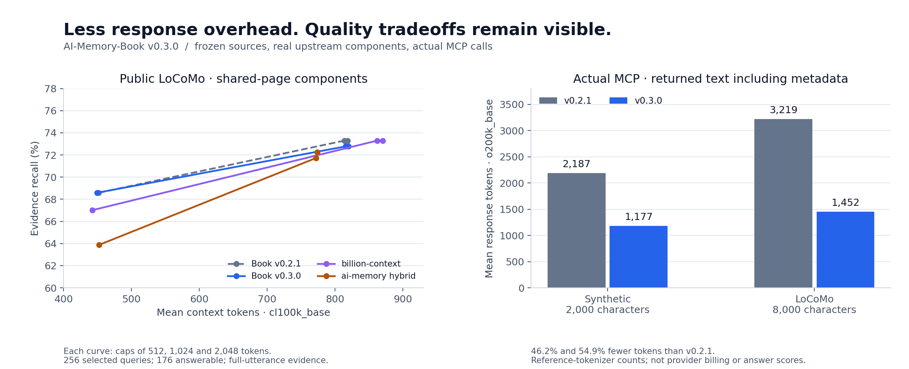

# v0.3.0: measured retrieval and MCP costs

v0.3.0 reduces agent-facing response overhead and improves evidence delivery at
small character budgets. It does **not** establish universal latency, token, or
answer-quality superiority over other memory projects. The public shared-page
comparison is close, billion-context's measured kernel is faster, and several
retrieval failures remain.

All measurements below were made on the frozen implementation. The full reports
retain individual query outcomes, both reference tokenizers, all tested budgets,
source fingerprints, category failures, and timing distributions.



## What changed

- Compact MCP JSON and default source references remove routine diagnostics,
  verbose coordinates, and whitespace from the normal response. `details: true`
  restores the rich reference fields; `read_page` keeps full provenance.
- Shorter context headers preserve page/project/session/date identity. Hierarchy
  titles remain available through metadata and directory tools.
- Reused query preparation, offset-preserving normalization fast paths, and
  batched page fetches reduce retrieval work.
- Excerpt placement leaves room after matching terms; bounded query-term
  novelty selection promotes complementary pages when similar hits compete.
- Explicit current-state queries receive conservative timestamp preference
  within one chapter and identical matched query-term sets. This is not authoritative
  fact-version resolution.

The core still uses SQLite FTS5 and the standard library. There is no mandatory
embedding download, provider API key, paid model call, or browser service.
Tokenizers are an optional **benchmark** dependency.

## Evaluation population and boundaries

| Evaluation | Population | Purpose |
|---|---|---|
| Synthetic heldout 113 and 307 | Each: 8 projects, 112 sessions, 1,408 turns, 168 queries | Bilingual engineering-history regression, using new seeds and heldout phrasing |
| Public LoCoMo heldout | 8 conversations, 216 sessions, 4,684 utterances, 1,339 pages; 256 selected queries | Independently published long-conversation wording |
| Actual MCP, synthetic | Development seed 61, 2 projects, 42 queries, 3 repetitions | Process/stdio response costs at 2,000 characters |
| Actual MCP, LoCoMo | The same public 256-query heldout selection, 3 repetitions | Process/stdio response costs at 8,000 characters |

LoCoMo is a public conversational-memory benchmark generated with persona agents
and annotated for evaluation, not a collection of this user's private histories.
We froze a two-conversation development/eight-conversation heldout split before
inspecting retrieval outcomes. Bounded query selection hashes IDs, independent
of question text or scores. The selected public sample has **176 answerable
queries, 191 required evidence utterances, and 80 unanswerable queries**.

The text-only adaptation excludes questions with missing/invalid evidence IDs or
image-bearing required evidence and records all exclusion counts. In the full
eight-conversation split, 1,015 of 1,600 QA records are eligible; 256 are selected.
Evidence recall requires the **complete annotated utterance and correct source
coordinates in delivered context**. Complete evidence is the proportion of
answerable queries for which every required utterance is delivered. These are
neither LLM answer scores nor semantic-equivalence judgments. Very small category
samples, especially the six category-1 and three category-3 public questions,
limit conclusions about those categories.

The [structural preflight](results/evidence-preflight.json) checks both versions
on all five evaluated corpus selections. Every evidence label fits one canonical
page and source interval; none was dropped for being difficult. This matters
because the scorer does not union an utterance split across continuation pages.

Primary data: [LoCoMo repository and paper](https://github.com/snap-research/locomo).
The pinned file and split are in [locomo_split.json](locomo_split.json). Data is
downloaded separately under CC BY-NC 4.0; the MIT repository contains no raw
dataset questions, answers, or conversation quotes in its public reports.

## 1. Paired retrieval: v0.2.1 versus v0.3.0

These are the actual native **character-budgeted** retrieval calls, with result
caching disabled. Citation headers count toward the cap. Latency excludes
startup, MCP, token counting, model inference, and background capture; SQLite
and OS caches remain warm.

| Corpus / character cap | Evidence recall, old → new | Complete evidence, old → new | Core p50 ms, old → new | Core p95 ms, old → new |
|---|---:|---:|---:|---:|
| Synthetic 113 / 2,000 | 71.02% → **78.41%** | 71.71% → **80.26%** | 5.755 → **3.479** | 11.609 → **8.256** |
| Synthetic 307 / 2,000 | 72.16% → **77.84%** | 73.03% → **79.61%** | 5.906 → **3.844** | 10.505 → **8.982** |
| Synthetic 113 / 8,000 | 77.27% → **81.82%** | 78.95% → **84.21%** | 4.716 → **3.123** | 7.749 → **6.290** |
| Synthetic 307 / 8,000 | 77.27% → **81.82%** | 78.95% → **84.21%** | 4.705 → **3.177** | 9.050 → **6.485** |
| LoCoMo / 2,000 | 26.18% → **45.03%** | 27.27% → **46.59%** | 4.623 → **2.777** | 7.285 → **4.280** |
| LoCoMo / 8,000 | **73.30% → 72.77%** | **75.57% → 75.00%** | 3.594 → **2.770** | 7.849 → **4.438** |

The public 8,000-character row has **one lost evidence utterance and one lost
complete answerable query** (`conv-50-q0118`). We did not tune on this failure.
At that cap, mean `o200k_base` context tokens decrease from **915.2 to 832.8**.
At 2,000 characters, they decrease from 599.5 to 592.4 while evidence coverage
improves. A smaller response is therefore not being credited as an improvement
without also reporting the evidence outcome.

Additional common whole-block packing curves at **512, 1,024, and 2,048 tokens**
are in the paired reports. This packer is an evaluation policy applied once to
each engine's 8,000-character result; it is not a native token-budget option and
its cost is reported separately.

Reports: [seed 113](results/paired-heldout-113.md),
[seed 307](results/paired-heldout-307.md),
[public heldout](results/paired-locomo-heldout.md).

## 2. Actual MCP response tokens and latency

The official MCP SDK launches real stdio subprocesses and calls `recall_memory`.
The numbers count **returned text**, including JSON metadata, using
`tiktoken==0.12.0` with `o200k_base`. They are exact for that reference encoding,
not provider billing or a host's private prompt serialization. Full MCP-result
JSON, `cl100k_base`, arguments, tool declarations, and initialization instructions
are also recorded separately.

| Workload | Mean response tokens, old → new | Reduction | Uncached-call p50 ms, old → new | Uncached-call p95 ms, old → new |
|---|---:|---:|---:|---:|
| Synthetic, 2,000 characters | 2,186.7 → **1,177.3** | **46.2%** | 8.006 → 7.642 | **13.406 → 15.491** |
| LoCoMo, 8,000 characters | 3,219.4 → **1,451.9** | **54.9%** | 9.061 → **7.668** | 14.541 → **13.582** |

The result cache is cleared once per repetition; every query/scope pair is unique,
and each first call is followed by a separately recorded immediate cache repeat.
These are warm-process calls, not process-startup measurements.

The synthetic p95 regressed; this release does not promise uniformly lower
transport tails. The public first-query median improves by 15.4%, less than the
core-only improvement because SDK, SQLite connection, serialization, and
transport costs remain. Repeated queries, outliers, and process startup are
preserved in the raw reports. Initialization takes roughly 0.37–1.04 seconds in
these small three-startup samples; no startup improvement is claimed.

For all **298 distinct queries** across these two workloads, a separate actual
`details: true` call returned **identical context and page IDs**. On the public
set, the same v0.3.0 evidence costs 2,347.0 tokens with detailed fields versus
1,451.9 in compact mode. That **38.1% metadata-only reduction** is separate from
the version-to-version changes in citation headers and selected evidence.
Compact references still identify project, session, and turn; exact coordinates
remain available on demand.

Initialization instructions decrease from 291 to 167 `o200k_base` tokens; the
six-tool declaration grows slightly from 742 to 746. Hosts determine how often
these fixed costs enter a model prompt, so they are not charged arbitrarily to
each query in the table.

Raw/summary: [synthetic JSON.gz](reports/mcp-v0.3.0-synthetic.json.gz),
[synthetic summary](reports/mcp-v0.3.0-synthetic.summary.json),
[LoCoMo JSON.gz](reports/mcp-v0.3.0-locomo.json.gz),
[LoCoMo summary](reports/mcp-v0.3.0-locomo.summary.json).

## 3. Actual external retrieval components

We executed the pinned **billion-context `searchBlocks` kernel**, with its default
BM25/fuzzy hybrid, and the official **ai-memory v3.4.5** binary using native MCP
`memory_query`, its default local MiniLM embeddings, and native page reads.
All 1,339 pages were indexed; the embedding check reported zero failures, and
the vector stream was verified active. Neither competitor was replaced by a
handwritten imitation. **claude-mem was not measured.**

All components receive the frozen v0.2.1 adaptive pages and the same 256 queries,
project scope, top-five limit, full-page assembler, and whole-block token packer.
The book retains native hierarchy/index metadata; identical pages do not imply
identical indexing features or an evaluation of full product workflows.

At a **1,024 `cl100k_base` token cap**:

| Component | Evidence recall | Complete evidence | Mean context tokens |
|---|---:|---:|---:|
| AI-Memory-Book v0.2.1 | 73.30% | 75.57% | 813.6 |
| AI-Memory-Book v0.3.0 | 72.77% | 75.00% | 815.7 |
| billion-context | 73.30% | 73.86% | 862.3 |
| ai-memory, native local hybrid | 71.73% | 72.16% | **772.0** |

These results are close and the sample is limited. v0.3.0 does not use the fewest
context tokens in this common assembly view. At the 2,048-token cap, ai-memory
reaches 72.25% evidence recall; v0.3.0 and billion-context retain their values.
The [complete comparison](results/components-locomo-heldout.md) retains both
tokenizers and all three caps, including less favorable rows.

### Native cost and transport boundaries

| Measured operation on the public selection | p50 | p95 | Boundary |
|---|---:|---:|---|
| AI-Memory-Book v0.3.0 core | 2.758 ms | 4.601 ms | In-process recall, including native context assembly |
| AI-Memory-Book v0.3.0 MCP | 7.668 ms | 13.582 ms | Actual stdio client/server, first-query pass, 8,000-character cap |
| billion-context | 1.367 ms | 2.952 ms | Search kernel plus local JSON bridge; no native decompression/fetch |
| ai-memory local hybrid | 29.972 ms | 66.727 ms | Native persistent loopback HTTP/MCP query; page reads are additional |

The billion-context kernel alone has a 1.130 ms median. It is faster in this
experiment; its full proxy workflow was not run. Because these operations and
transports differ, the table is not an isolated algorithm speedup ratio.

For an explicit **search + full read of all five returned pages** policy,
ai-memory's actual agent-visible response text averages **2,568.6 `o200k_base`
tokens**: 878.9 for search and 1,689.7 for reads. The reads add 8.139 ms mean
latency. AI-Memory-Book's one public MCP recall averages 1,451.9 response tokens,
43.5% fewer under those stated policies. This is **not** ai-memory's minimum
necessary-read cost: previews may already suffice, and an adaptive agent could
choose fewer pages. It is also not an equal-cap native workflow or a model-answer
evaluation. The common evidence-budget table above answers a different question.

ai-memory setup for this supplied-page experiment took 195.1 seconds, including
193.2 seconds of sequential native page ingestion and local embedding work.
Model files were already cached; downloads are excluded from that setup timing.
All setup, native payload, full-read, and packing costs are retained separately.
See [the protocol](../docs/comparison-protocol.md) and
[adapter pins/licenses](competitors/README.md).

## Remaining failures and interpretation limits

- Both synthetic heldouts still have **zero low-overlap paraphrase recall**.
  Distant multi-section queries have 25% evidence recall and zero complete
  evidence at 8,000 characters. Development improvements in that category did
  not generalize to the heldout phrasing.
- On both synthetic heldouts, the old-before-current rate falls from 50% to 0%
  for the eight explicit current-decision queries, while current and historical
  evidence recall stay at 100%. This limited result does not establish general
  contradiction resolution.
- Every unanswerable public query returns some context, as do the synthetic
  unanswerable cases. This is a retrieval diagnostic, not proof that an answering
  model hallucinates. Abstention and factual answer quality remain unmeasured.
- Results do not test background capture, observer-generated summaries, memory
  consolidation, every vendor application, multimodal evidence, or arbitrary
  personal archives. No fixed answering model or paid provider call was used.
- Timings describe one shared Linux environment, Python 3.12.14 and SQLite
  3.53.1, with warm filesystem caches. There are no confidence intervals or
  performance guarantees for other devices.

## Reproduce

See [the benchmark README](README.md) for paired and external-component commands.
For actual MCP costs, install `.[mcp,benchmark]`, create a frozen checkout of
commit `a05f88a79ce20be3fd5912c62fc020f8b11ba4a9`, and run:

```bash
python -m benchmarks.mcp_costs \
  --engine v0.2.1=/absolute/frozen-v0.2.1 \
  --engine v0.3.0=/absolute/AI-Memory-Book \
  --seed 61 --projects 2 --repeats 3 --budget-chars 2000 \
  --work-dir /absolute/temporary-directory \
  --output benchmarks/reports/mcp-v0.3.0-synthetic.json.gz

python -m benchmarks.mcp_costs \
  --engine v0.3.0=/absolute/AI-Memory-Book \
  --engine v0.2.1=/absolute/frozen-v0.2.1 \
  --corpus locomo --locomo-path /absolute/locomo10.json \
  --split heldout --max-queries 256 --repeats 3 --budget-chars 8000 \
  --work-dir /absolute/temporary-directory \
  --output benchmarks/reports/mcp-v0.3.0-locomo.json.gz
```

Run timed jobs sequentially on otherwise idle hardware. One initial synthetic
MCP run overlapped report compression and was discarded before analysis; the
published run was restarted after that work ended. The synthetic and public MCP
workloads use opposite version order, but do not constitute a randomized
multi-machine study. Full reports, including regressions, are retained.

The figure can be regenerated from the published summaries with
`python -m benchmarks.plot_results` after installing the optional plotting tool
`matplotlib`. Plotting is not a product runtime dependency.
