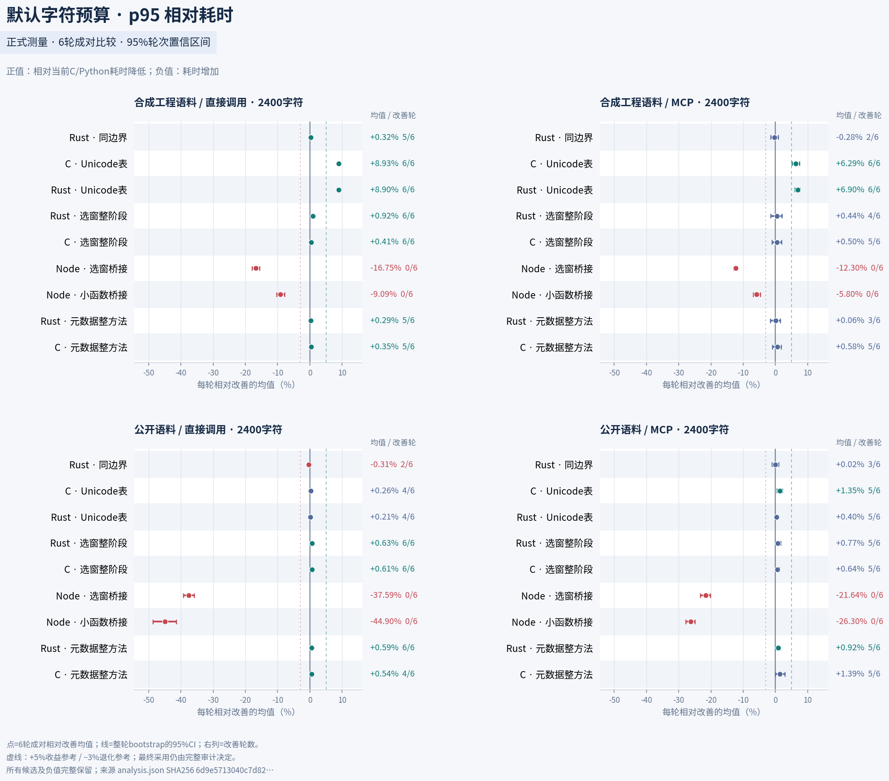
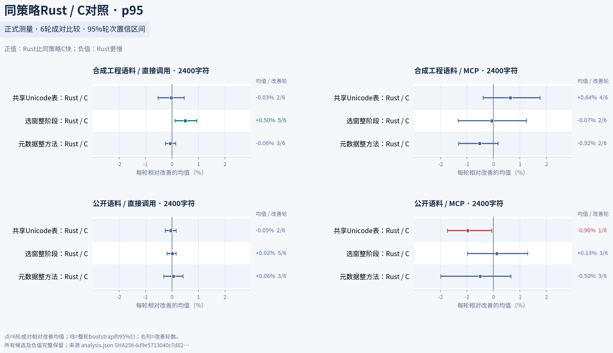

# AI-Memory-Book：Rust 重构试验续接与最终判断

复核日期：2026-11-17（Asia/Shanghai）

范围：恢复中断的语言实现对照实验、核查正式证据、完成报告与决策；本次不改变生产实现。

## 决定

**当前没有必要启动全项目 Rust 重构，继续保留 Python + C 架构。共享 Unicode 表值得作为独立的局部优化保留，但没有证据要求用 Rust 实现它。**

这个决定依据端到端性能和完整输出等价性，不以开发工作量或维护成本作为拒绝理由。四类 Rust 候选中，`rust_table` 确实通过了相对当前实现的普通场景收益门槛；同策略的 `c_table` 同样通过。其余三类 Rust 候选没有通过。99 项同策略 Rust/C 配对比较中，没有一项达到预注册的实质收益判据。因此，“查表策略有效”和“需要换成 Rust”是两个不同的判断。

完整独立 Rust 服务尚未实现或测量。本结论不等于 Rust 永远不会更快，也不声称所有候选无收益；它说明本轮证据不足以支持现在开始全项目语言迁移。

主要证据：[原始正式分析](https://github.com/Afloat16/AI-Memory-Book/blob/351770ce9950ba60f77e04847a1de386c44dac2c/benchmarks/reports/language-selection/44061948774/analysis.json)、[本次复算核验](recovery-verification.json)、[独立统计审查](independent-statistical-review.json)、[实验解释范围](../../experiments/language_selection/SCOPE.zh.md)。

## 1. 中断发生在哪里，本次完成了什么

上一次状态文件停留在“正式六轮测试 active”，实际正式运行已经成功完成，并将原始证据提交到了独立结果分支。本次直接恢复这份证据，没有重启计时工作、修改候选或挑选新的有利样本。

| 项目 | 精确位置 |
| --- | --- |
| 生产基线 | `234891619d7bed88ddf3fae37e7f3e1b14a808b6` |
| 正式冻结源 | `40a8ce42b4131b511dcacd446d175b878b74a6f8` |
| 正式源分支 | `validation/language-selection-formal-1` |
| GitHub Actions | [44061948774，attempt 1](https://github.com/Afloat16/AI-Memory-Book/actions/runs/44061948774) |
| 正式运行时间 | 2026-11-17 18:07:57—19:20:24，Asia/Shanghai |
| 原始结果提交 | `351770ce9950ba60f77e04847a1de386c44dac2c` |
| 原始结果分支 | `validation/language-selection-results-44061948774` |
| 本次续接起点 | 研究分支 `validation/language-selection-20261117`，提交 `f755b034bbc1d02aff75fd7081489c35ea9b0af0` |

本次实际执行的工作：

1. 重新执行冻结分析器的 18 类自测，包括缺失/失败 worker、完整输出篡改、ledger 篡改、查询顺序、真实 native dispatch 和 A/A 噪声拒绝检查。
2. 下载正式证据，对 186 个 worker 的压缩报告、ledger 和 dispatch probes 重新审计，并重新计算所有统计和采用条件。
3. 将离线输出与原始 `analysis.json` 作完整结构比较。除“是否读取原运行器绝对路径”和“读取数量”两个本机字节核验字段外，结果完全一致。
4. 从固定 Git 提交重新读取 192 项源码绑定，全部 SHA-256 一致；检查正式候选的 `src/`、`pyproject.toml`、`setup.py` 与生产基线没有变化。
5. 进行独立算术、门槛和实现范围审查，生成中文完整报告、11 份 CSV、两张主图及 16 张附图，并更新续接状态。

这里的 192 项是源路径绑定数，对应 165 个不同的“提交+路径”；包含 current/rust-same 构建目录里的重复源文件。正式 runner 原先检查了全部 209 个冻结输入。另 17 项原主机的二进制、运行时或数据文件没有在本机重新读取，不能将两者混称为本次重新核验了全部 209 个原始字节。详见 [recovery-verification.json](recovery-verification.json)。

## 2. 正式测试是否完整可信

| 核验项 | 正式运行与本次离线复核结果 |
| --- | ---: |
| 计划 / 实际完成 worker | 186 / 186 |
| 计时调用 | 626,100 |
| 完整输出配对比较 | 558,618 |
| ledger 事件 | 1,252,200 |
| 输出不一致 | 0 |
| 审计错误 | 0 |
| 原始与复算采用判断 | 完全一致 |
| 独立复算统计记录 | 403 项，0 算术或门槛错误 |
| A/A 查询噪声阻断 | 未触发 |

完整输出比较覆盖 payload、MCP envelope、上下文、源坐标、不变量、索引和归档身份；只排除已登记的耗时诊断字段。审计比较的是已保存完整输出的哈希身份，不是本次再次运行所有候选生成新的输出。

采用标准在正式测量前登记：代表性目标端到端改善至少 **5%**，轮次配对 95% 置信区间为正，**6 轮中至少 5 轮改善**；关键场景超过 **3%** 的可重复退化需要明确处理。统计单位是完整轮次，不把同一轮相关查询当成独立样本。原分析使用 10,000 次整轮 bootstrap。

独立审查另做了事后敏感性核验：对每个六轮比较穷举全部 46,656 种有放回重采样，A/A 三轮穷举 27 种，403 项收益/退化判定均未改变。这不替代原先冻结的分析，也不消除单平台、少轮次或多目标比较的限制。[独立统计方法与结果](independent-statistical-review.json)

## 3. 实际比较了什么

当前生产版本已经是 **Python 主体 + 22 个 C 原生入口 + SQLite**。纯 Python 仅作为正确性参考，不能将相对纯 Python 的历史收益当作本次新增收益。

| 候选 | 实际迁移边界 | 普通场景收益门槛 |
| --- | --- | --- |
| `rust_same` | 将现有六个 C 函数换成同接口 Rust 实现 | 未通过 |
| `rust_table` | Rust 共享 Unicode 映射表及两遍分配 | 通过；需结合 C 对照 |
| `c_table` | 同一张 Unicode 表、相同守卫和分配策略的 C 实现 | 通过 |
| `rust_window` | Rust 数据结构持有完整普通选窗计算阶段 | 未通过 |
| `c_window` | 相同完整选窗边界的 C 实现 | 未通过 |
| `rust_metadata` | 完整有界候选元数据方法，保留 SQL、回调与原地更新语义 | 未通过 |
| `c_metadata` | 相同有界候选元数据边界的 C 实现 | 未通过 |
| `node_window` | 常驻 Node 的完整选窗桥接 | 未通过；12 项关键可重复退化 |
| `node_small` | 常驻 Node 的小函数桥接 | 未通过；33 项关键可重复退化 |

Rust 候选确实被执行：完整选窗在合成/公开/Unicode 语料的 probes 中分别完成 553/4,109/448 次；元数据候选分别完成 120/1,009/96 次，入口回退均为 0。因此，未出现实质收益不是“只加载了扩展却没有调用”造成的。正确性检查还覆盖全部 Unicode 码点、孤立 surrogate、精确源坐标、稳定决胜、SQL callback 与动态自定义行为。[独立正确性审查](independent-correctness-review.json)

三类语料分别是合成工程数据 `synthetic61`（61 是随机种子，实际 168 个查询）、公开 `public1015`（1,015 查询）、单列的 Unicode 压力组（96 查询）。每类同时覆盖直接调用与真实官方 SDK stdio MCP，2400 字符和 1024 token 预算，并记录首次/无变更/变更导入、启动和进程资源。

## 4. 决定重构必要性的关键数据

下面的“改善”是每轮 `100 × (1 − 候选耗时 / 基线耗时)` 的六轮均值。正值表示耗时降低，负值表示变慢。p95 是尾延迟指标；这些比例不是把所有调用合并后的 p95 直接相除。

### 4.1 Unicode 表有效，但 C 也能获得相同级别的收益

基线均为当前 C/Python；预算为 2400 字符。

| 场景 | C 表方案 p95 改善 | Rust 表方案 p95 改善 |
| --- | ---: | ---: |
| 合成工程，直接调用 | **+8.930%**，95% CI [8.516%, 9.343%] | **+8.902%**，95% CI [8.483%, 9.285%] |
| 合成工程，MCP | **+6.292%**，95% CI [5.100%, 7.443%] | **+6.903%**，95% CI [6.074%, 7.534%] |
| 公开语料，直接调用 | +0.262% | +0.213% |
| 公开语料，MCP | +1.346% | +0.404% |

前两行两种实现均 6/6 轮改善，达到既定门槛；公开语料的改善没有达到 5%。完整区间和每轮结果在 [完整报告](full-report/report.zh.md) 与 [comparisons.csv](full-report/comparisons.csv)。不能将工程合成数据的约 9% 收益写成所有查询统一加速 9%。



### 4.2 把 Rust 与相同策略 C 直接比较，缺乏实质语言收益

下表基线改为 `c_table`，只回答 Rust 表实现比同策略 C 是否更快。

| 场景 | Rust 相对 C 的 p95 改善 | 95% 轮次配对区间 |
| --- | ---: | --- |
| 合成工程，直接调用 | −0.033% | [−0.527%, +0.462%] |
| 合成工程，MCP | +0.636% | [−0.396%, +1.762%] |
| 公开语料，直接调用 | −0.049% | [−0.252%, +0.153%] |
| 公开语料，MCP | −0.964% | [−1.744%, −0.061%] |
| Unicode 压力，直接调用 | +0.510% | [+0.333%, +0.707%] |
| Unicode 压力，MCP | +2.158% | [+0.754%, +3.663%] |

整个实验的表、选窗、元数据三组同策略控制合计 99 项比较，**没有一项满足 ≥5% 的登记实质收益条件**。这里仍保留了 Rust 在压力组的小幅优势与在公开 MCP 中的小幅劣势；不能宣称两种实现绝对相同，或 C 在每项都更快。[controls.csv](full-report/controls.csv)



### 4.3 扩大 Rust 执行阶段也没有达到门槛

以下范围限于两个普通语料、直接/MCP 的 2400 字符 p95 四个场景。

| Rust 方案 | 相对当前实现的 p95 改善范围 | 判断 |
| --- | ---: | --- |
| 同接口六函数替换 | −0.313% 至 +0.321% | 没有实质收益 |
| 完整选窗阶段 | +0.440% 至 +0.918% | 存在小改善，远低于 5% |
| 完整候选元数据 | +0.058% 至 +0.920% | 存在小改善，远低于 5% |

因此，本轮并非仅测试几个很小的函数。两个更大的完整处理阶段也已经纳入真实 recall 和 MCP 请求，不过完整检索、数据库驱动及服务层仍保留 Python。

所有 Rust 候选及 C 对照在普通语料的 1024 token 配置、首次/重复/变更导入也没有通过登记的实质收益门槛。Rust 表在 Unicode 压力组的 direct p50/p95 分别改善 5.179%/5.077%，达到该压力场景判据；同策略 C 已有 4.475%/4.591% 改善，所以不能据此推导普通应用必须迁移 Rust。[完整报告与各类附图](full-report/report.zh.md)

## 5. 噪声、启动与资源

同一二进制的三组 A/A 配对中，直接 p95 表观改善 −0.272%，MCP p95 +0.084%，均未触发预注册噪声阻断。首次导入 A/A 的区间较宽：均值 −4.295%，95% 区间 [−12.895%, +0.867%]；没有触发阻断不等于这项数据很精确。因此，本决策没有利用导入时间的细小变化宣称重构收益。[A/A 明细](full-report/aa.csv)

18 个对应 worker 的描述均值显示，C 表方案的 MCP 字符模式启动时间相对当前实现约 −1.305 ms、服务端 RSS +0.287 MiB；Rust 表方案约 +3.645 ms、RSS +0.316 MiB。Rust 元数据方案的实验 MCP 启动约 +31.941 ms，包含共享适配器初始化，不能当作 Rust 语言固有的启动代价。这些资源值用于保留完整取舍，不替代主要查询收益门槛。[独立资源汇总](independent-statistical-review.json)

RSS 是采样进程值；父进程与 Node 子进程高水位不能相加当作同时峰值。直接查询禁用结果缓存，MCP 每次查询前清空结果缓存，但 SQLite 和操作系统缓存保留；新数据库不代表每条查询都是冷缓存。具体计时边界见 [完整报告](full-report/report.zh.md)。

## 6. 应如何结束这次试验

| 决策项 | 结论 |
| --- | --- |
| 现在把整个 AI-Memory-Book 改写成 Rust | **不启动**；本轮没有建立必要的性能依据 |
| 将现有 C 内核直接翻译成 Rust | **不采用**；收益未达到门槛 |
| 将已测试选窗或元数据阶段替换为 Rust | **不采用**；端到端收益未达到门槛 |
| Unicode 查表 | **保留为独立局部优化候选**；C 与 Rust 都有证据，语言迁移没有实质新增收益 |
| 生产路径选择 | 保留 Python + C；若另行推进查表优化，现有 C 架构已能承载被验证策略 |
| 完整 Rust 服务的可能性 | 保留为未测问题；需要独立原型与新的具体性能目标后才能判断 |

本轮采用判断仍有明确边界：一组固定 Linux x86-64 主机、六轮配对、有限语料，区间没有做跨场景多重比较校正；Rust 扩展大量使用 unsafe CPython FFI，仍持有 GIL，没有测试完整 Rust SQLite、MCP、并发服务或全平台发行。没有把这些未测事项伪装为 Rust 的已证实缺点，也没有把试验通过等同于生产发布批准。[SCOPE.zh.md](../../experiments/language_selection/SCOPE.zh.md)

已完成的工作足以关闭这次中断的研究任务。后续如推进查表生产集成，应作为独立变更验证跨平台、Unicode 版本兼容与发行加载；本次研究分支只保存复核、图表、结论和续接状态。

## 7. 复现与文件索引

运行以下命令前，在独立工作树中取出正式结果提交 `351770ce...`，并让研究源码中的分析器保持原冻结 SHA256 `27274b91c025477cd639646a11fc40724e61f75dc438672552484145a0310ac0`。示例从仓库根目录执行，证据工作树位于相邻 `language-selection-evidence`；输出目录需为新目录。已有结果不应被覆盖。

```bash
python benchmarks/experiments/language_selection/analyze.py --self-test --output review-new/analyzer-self-test.json
python benchmarks/experiments/language_selection/analyze.py --run ../language-selection-evidence/benchmarks/reports/language-selection/44061948774/run.json --output review-new/reanalysis.json
python benchmarks/experiments/language_selection/reviews/verify_recovery.py --evidence ../language-selection-evidence/benchmarks/reports/language-selection/44061948774 --review review-new --repository .
python benchmarks/experiments/language_selection/render_report.py --analysis ../language-selection-evidence/benchmarks/reports/language-selection/44061948774/analysis.json --diagnostics ../language-selection-evidence/benchmarks/reports/language-selection/44061948774/diagnostics --output review-new/full-report --evidence-url https://github.com/Afloat16/AI-Memory-Book/blob/351770ce9950ba60f77e04847a1de386c44dac2c/benchmarks/reports/language-selection/44061948774
python benchmarks/experiments/language_selection/plot_report.py --analysis ../language-selection-evidence/benchmarks/reports/language-selection/44061948774/analysis.json --output review-new/figures --appendix
```

报告绘图需要 matplotlib 和支持中文的字体；分析与审计本身使用 Python 标准库。离线复核不传 `--verify-local-files`，因为原运行器绝对路径在此环境不存在；独立恢复核验脚本另从固定 Git 提交核对可恢复的源码，保留其余输入的审计边界。

| 文件 | 用途 |
| --- | --- |
| [full-report/report.zh.md](full-report/report.zh.md) | 全部场景、内核/Node/Shell诊断、资源、遗漏和来源 |
| [full-report/comparisons.csv](full-report/comparisons.csv) | 297 项相对当前实现比较及逐轮数据 |
| [full-report/controls.csv](full-report/controls.csv) | 99 项 Rust/C 同策略比较 |
| [reanalysis.json](reanalysis.json) | 本次从原始 worker/ledger 重新计算的完整结果 |
| [recovery-verification.json](recovery-verification.json) | 原始/复算一致性、192 源绑定、生产路径无变化 |
| [analyzer-self-test.json](analyzer-self-test.json) | 本次 18 类分析器自测结果 |
| [independent-statistical-review.json](independent-statistical-review.json) | 独立算术、门槛、A/A、资源与精确 bootstrap 敏感性核验 |
| [independent_statistical_review.py](independent_statistical_review.py) | 独立统计复核脚本 |
| [independent-correctness-review.json](independent-correctness-review.json) | 源码、完整性与实现范围读审 |
| [figures/plot-manifest.json](figures/plot-manifest.json) | 18 图、396 图示记录、0 缺失及输出哈希 |
| [full-report/render-manifest.json](full-report/render-manifest.json) | 中文报告与 11 CSV 的输入/输出哈希 |

原始正式分析 SHA256：`6d9e5713040c7d82cc7aa32f157fa07973ce605889c6875d9845b97aa04cf705`。原始 run.json SHA256：`51c66aecf32f95b50e07432e9ad4f2aabc0ea13bf87b47a78f27f9db629b5d69`。
