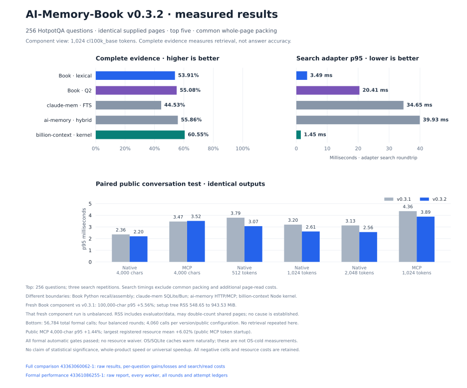

# Comparison guide: evidence quality, cost and deployment

AI-Memory-Book keeps original conversations in a local Python/SQLite archive and
returns a bounded evidence context with exact source addresses. Default retrieval
needs no generative model, embedding download or separate database service.
Optional Q2 semantic fusion adds a local model and index.

## v0.3.2: measured advantages and remaining costs

**The fixed C2 candidate passes the formal performance gate and the complete
fresh-comparison integrity checks.** Final release verification and publication
remain separate. The accepted source is
[`2d7b5e3`](https://github.com/Afloat16/AI-Memory-Book/commit/2d7b5e38839fb21724ad3beec6b6ebabbda45636).
Its source projection and token-counting changes preserve default ranking,
source coordinates, budgets and complete non-timing outputs. Q2's model and
fusion are unchanged. [Implementation and decision history](optimization-round4.md)

The [formal review][formal-review] verifies **56,784 calls, 16 workers and four
balanced rounds**. Geometric-mean pooled p95 improves **10.1294%** across twelve
cells, with **10.8021%** lower public actual-MCP token-1024 p95. All automatic
gates pass without a resource exception. The aggregate clears its 10% threshold
by only **0.1294 percentage points**; it does not establish statistical
significance or a universal speedup.

In the fresh common 1,024-token comparison, Book lexical completes **53.91%** of
questions versus claude-mem FTS **44.53%**, a **9.38-point** advantage. Optional
Q2 reaches **55.08%** and has the highest packed MRR, **0.8663**. ai-memory's
completeness is higher at **55.86%**. Billion-context leads annotation recall,
completeness (**60.55%**) and search latency in the measured kernel boundary.
Book therefore has measured advantages over particular components, with clear
remaining gaps. [All 54 quality cells][comparison-report]

Adverse costs remain part of the result. Formal public MCP character p95 rises
**1.4445%**, and the largest formal resource mean increase is **6.0231%**. In the
separate fresh 100,000-character component test, C2 lexical p95 rises **5.56%**
against v0.3.1, while sampled setup RSS rises **548.65 → 943.53 MiB**. These
fresh observations and their different measurement boundary are retained below;
no cause is inferred. No output-token saving is claimed.

The previous guide is preserved byte for byte as
[comparison-v0.3.1.md](comparison-v0.3.1.md). Its scores belong to the earlier
selection. [The round-three report](round3-comparison.md) and
[v0.3.0 archive](comparison-v0.3.0.md) preserve older experiments and limitations.

The figure keeps the component adapter-search boundary separate from the formal
version comparison. The full baseline component row, read costs and all resource
phases appear below. Figure generation reads only completed saved reports.

## Version performance and resource costs

The sole hosted formal run is
[43361086255-1](https://github.com/Afloat16/AI-Memory-Book/actions/runs/43361086255),
with immutable results at
[`1bd76f3`](https://github.com/Afloat16/AI-Memory-Book/commit/1bd76f3b70eb60ead444f05c5a94148e9e384bba).
It compares published v0.3.1 at `7b7a5d7336b9350a128f5e0a888811b1b3015e68`
with C2 on 168 synthetic and 1,015 previously used public-conversation queries.
Each cohort runs source orders **AB, BA, BA, AB** in fresh workers. Every public
source/configuration contributes **4,060 calls**; every synthetic one contributes
672. These repetitions do not create new independent questions. [Plan][plan] ·
[Completed summary][formal-summary]

| Public-conversation configuration | v0.3.1 p95, ms | C2 p95, ms | Change |
|---|---:|---:|---:|
| Native, 4,000 characters | 2.361452 | 2.198754 | −6.8897% |
| Actual SDK MCP, 4,000 characters | 3.467968 | 3.518062 | **+1.4445%** |
| Native, 512 tokens | 3.793969 | 3.070323 | −19.0736% |
| Native, 1,024 tokens | 3.199822 | 2.610729 | −18.4102% |
| Native, 2,048 tokens | 3.129763 | 2.560117 | −18.2009% |
| Actual SDK MCP, 1,024 tokens | 4.357927 | 3.887177 | −10.8021% |

Token configurations use `cl100k_base`, an 8,000-character ceiling and limit 5.
Native timing covers the complete uncached recall. MCP timing covers the actual
SDK stdio call through its returned result, including normal server cache writes;
cache deletion/commit happens before timing. Validation and reference token
counting happen outside the timer. OS/SQLite caches warm naturally. These are
not OS-cold measurements or estimates derived from native calls. [Timing boundary][formal-review]

Acceptance uses the equal-weight geometric mean of all **twelve pooled p95
ratios**. It requires at least 10% overall improvement, 15% in at least one
public native token cell, 10% in public actual MCP token-1024, and no pooled
p50/p95 regression above 5%. All pass. The synthetic native character p95
improvement is just **0.0391%**. Round-specific aggregate improvements are
**7.9998%, 9.6256%, 10.6865% and 11.1748%**; the registered gate uses all rounds
pooled. [All twelve cells and every adverse round][formal-review]

Individual round metrics can exceed 5%: synthetic MCP character round 1 has
**+5.8158% p50** and **+5.3981% mean** latency. The 5% gate applies to pooled
p50/p95. All 19 positive per-round metric changes remain in the review.

The independent review retains all **28 resource comparisons** and their raw
four-sample inputs. Public MCP token-session startup changes
**345.683341 → 366.504056 ms (+6.0231%)**. No registered resource mean crosses
its 10% review threshold, so no waiver is needed. Individual samples can still
regress: synthetic round-1 ingestion rises **13.4300%**, while its four-round
mean changes **−0.0786%**. These observations support neither a general startup
improvement nor a population-tail claim. [Resource samples][formal-audit]

Complete native payloads, actual MCP text/envelopes, source references, response
bytes and both reference encoders' token-cost summaries match. The strict ledger
audit and independent arithmetic review performed no new retrieval or timing.
All original rows, first/repeat partitions and negative metrics remain available.
This formal comparison concerns Book versions; it supplies no whole-product
speed ratio against another repository. [Strict audit][formal-local-audit] ·
[Raw report][formal-raw]

## Current frozen 256-question comparison

[Run 43363060062-1](https://github.com/Afloat16/AI-Memory-Book/actions/runs/43363060062)
completed all **ten stages**, **4,608 native calls**, **4,608 component searches**
and **1,280 first-pass ai-memory page reads**. Its result commit is
[`eff3941`](https://github.com/Afloat16/AI-Memory-Book/commit/eff394119105d59186c730e2480d86d1436401a6).
The [assessment][comparison-assessment] is `complete-verified`, with no validation
failures. All **1,536 native and 768 component baseline/C2 pairs** have identical
complete payloads after removing only `latency_ms`. This version changes
execution work, not the measured default retrieval quality.

The unchanged strict verifier passed locally without new queries. The separate
[independent arithmetic audit][comparison-audit] verifies all 32 result artifacts
plus the checkpoint against the result commit, **18,432 ledger events**, all
**54 quality cells / 13,824 saved score rows**, 378 group cells, costs and all
12 Q2 delta groups. It reaggregates saved ranks, hashes, coordinates and metric
fields; omitted response/source text is not independently rescored or
re-tokenized. Recorded resource summaries are retained rather than reconstructed
from unavailable process traces. Neither verification repeats measurement.

The [registered plan][plan] and [runtime/evaluator binding][comparison-binding]
were committed before ID selection; the resulting
[selection manifest][comparison-manifest] was committed before scoring. The ID-only
selection excludes all **640** earlier Hotpot IDs. Its **256 questions and 635
required annotations** have zero previous-ID overlap. This is another selection
from the same public HotpotQA source, not a new domain. After scoring, these IDs
are regression data.

| Frozen item | Identity |
|---|---|
| Baseline / candidate | v0.3.1 `7b7a5d7336b9350a128f5e0a888811b1b3015e68` / C2 `2d7b5e38839fb21724ad3beec6b6ebabbda45636` |
| Comparison evaluator commit | `d6aa80c7df80f017d301dd93102210b4c968231c` |
| Selection / execution source | `f812acac42e7c4d777c8b1d279cb121c3dc3e366` |
| Binding SHA-256 | `84dbe28c068a3067f9706c6439d42301eaddfef95c44ae2633398346c66a8c79` |
| Selection manifest SHA-256 | `b0485b3a089c9b04fc4453fd9f129364e123ce1b9f25b593edf4f6ee6df4a20b` |
| Dataset SHA-256 | `fb3cd70ea58fafa5bd9cef0f04dba7399aaafba76f5f92605eee9e516f115e1b` |
| Canonical supplied-pages SHA-256 | `998b2247f7e326715f26c6cff1d35ba18d8f94946dbc52ae51305664946f8876` |
| Source revision | HotpotQA dev distractor `1908d6afbbead072334abe2965f91bd2709910ab` |
| claude-mem / ai-memory / billion-context | 15.18.1 `c4a9f5725f420bf9c6e866cdd3b94bd36498af09` / v3.4.5 `ee73c04c542fa41ca629b046deb4ac108518f407` / `9674cfafbc78c50245ae0d887483d3d6ce880c15` |

The **54 quality cells** comprise 18 native cells (three Book modes × two
encoders × three budgets) and 36 common-packing cells (six components × the
same six settings). Common packing reuses the first response; it adds no search
calls. The component baseline is retained for output equivalence and adverse
performance comparisons. The [complete report][comparison-report] retains every
cell, including both tokenizers at 512/1,024/2,048 tokens.

All selected questions are answerable. The experiment measures returned source
evidence, not generated-answer accuracy, hallucination/abstention or a complete
capture/summarize/retrieve/answer workflow. No generative model calls are
configured. Integrity checks establish correct execution of the registered
experiment; they do not themselves establish a quality advantage.

### Common supplied-page quality

This reference view uses identical supplied pages, project scope, top five and
citation-inclusive whole-page packing at **1,024 `cl100k_base` tokens**. Evidence
recall uses the 635 required annotations; complete evidence requires every
annotation for a question. MRR measures the first evidence position in the packed
context after omitted metadata or oversized pages. [Full metrics][comparison-report]

| Component | Evidence recall | Complete evidence | Packed-context MRR | Mean context tokens |
|---|---:|---:|---:|---:|
| v0.3.1 lexical | 75.75% | 53.91% | 0.8578 | 714.8 |
| C2 lexical | 75.75% | 53.91% | 0.8578 | 714.8 |
| C2 Q2 | 76.69% | 55.08% | 0.8663 | 730.0 |
| claude-mem 15.18.1 FTS | 70.39% | 44.53% | 0.8280 | 709.4 |
| ai-memory v3.4.5 hybrid | 77.48% | 55.86% | 0.8400 | 709.9 |
| billion-context 9674cfa kernel | 80.94% | 60.55% | 0.8606 | 757.4 |

Default Book exceeds claude-mem by **5.35 points of annotation recall and 9.38
points of complete evidence** here. Both Book modes exceed that FTS component's
recall and completeness in every registered budget/tokenizer cell. ai-memory
exceeds default Book by **1.73 recall points and 1.95 complete-evidence points**
at 1,024/2,048 tokens; it also exceeds Q2 by **0.79 and 0.78 points**. Billion's
advantage over default Book is **5.20 recall points and 6.64 completeness points**.
Q2's higher packed MRR does not imply the highest complete-evidence rate.
[Exact counts and per-query outcomes][comparison-assessment]

At 1,024 and 2,048 tokens the quality values are identical across both encoders
in this run; context-token counts still differ. The smaller-budget ordering
contains additional tradeoffs:

| Component at 512 tokens | cl100k recall / complete | o200k recall / complete |
|---|---:|---:|
| v0.3.1 lexical | 68.66% / 41.02% | 68.98% / 41.41% |
| C2 lexical | 68.66% / 41.02% | 68.98% / 41.41% |
| C2 Q2 | 68.19% / 39.84% | 68.35% / 40.62% |
| claude-mem 15.18.1 FTS | 62.36% / 31.25% | 62.68% / 31.64% |
| ai-memory v3.4.5 hybrid | 66.30% / 36.72% | 67.09% / 38.28% |
| billion-context 9674cfa kernel | 68.82% / 41.80% | 69.13% / 42.19% |

At 512 tokens, lexical Book exceeds ai-memory's recall and completeness under
both encoders, while billion-context remains higher on those two metrics. Q2
reduces Book's recall and complete evidence at this budget in both native and
common packing. A single large-budget or MRR headline would hide that loss.

### Native Book API and optional Q2 tradeoffs

Native calls use an 8,000-character ceiling, top five, no result cache and one
call per query/configuration. Native source-unit packing differs from the common
whole-page projection. All 18 native cells follow; these sequential stage timings
are descriptive and do not replace the separate formal ABBA experiment.
[Native rows and scopes][comparison-report]

| Native mode | Tokenizer | Cap | Evidence recall | Complete evidence | Mean context tokens | p50 / p95 ms |
|---|---:|---:|---:|---:|---:|---:|
| v0.3.1 native lexical | cl100k | 512 | 67.87% | 39.45% | 478.6 | 4.690 / 6.118 |
| C2 native lexical | cl100k | 512 | 67.87% | 39.45% | 478.6 | 3.313 / 4.411 |
| C2 native Q2 | cl100k | 512 | 66.14% | 36.33% | 479.8 | 14.474 / 21.161 |
| v0.3.1 native lexical | cl100k | 1,024 | 75.75% | 53.91% | 803.6 | 3.907 / 5.182 |
| C2 native lexical | cl100k | 1,024 | 75.75% | 53.91% | 803.6 | 2.918 / 4.105 |
| C2 native Q2 | cl100k | 1,024 | 76.69% | 55.08% | 818.1 | 13.998 / 21.022 |
| v0.3.1 native lexical | cl100k | 2,048 | 75.75% | 53.91% | 805.4 | 3.884 / 5.257 |
| C2 native lexical | cl100k | 2,048 | 75.75% | 53.91% | 805.4 | 2.917 / 4.235 |
| C2 native Q2 | cl100k | 2,048 | 76.69% | 55.08% | 820.6 | 13.927 / 20.882 |
| v0.3.1 native lexical | o200k | 512 | 67.87% | 39.45% | 478.1 | 6.001 / 7.659 |
| C2 native lexical | o200k | 512 | 67.87% | 39.45% | 478.1 | 3.774 / 4.946 |
| C2 native Q2 | o200k | 512 | 66.30% | 36.72% | 479.4 | 14.825 / 21.970 |
| v0.3.1 native lexical | o200k | 1,024 | 75.75% | 53.91% | 802.6 | 4.705 / 6.079 |
| C2 native lexical | o200k | 1,024 | 75.75% | 53.91% | 802.6 | 3.195 / 4.364 |
| C2 native Q2 | o200k | 1,024 | 76.69% | 55.08% | 816.5 | 14.122 / 21.465 |
| v0.3.1 native lexical | o200k | 2,048 | 75.75% | 53.91% | 804.1 | 4.789 / 6.160 |
| C2 native lexical | o200k | 2,048 | 75.75% | 53.91% | 804.1 | 3.073 / 4.199 |
| C2 native Q2 | o200k | 2,048 | 76.69% | 55.08% | 819.2 | 14.195 / 21.840 |

At 512 tokens, native Q2 completeness drops **39.45% → 36.33%** with `cl100k_base`
and **39.45% → 36.72%** with `o200k_base`. At 1,024/2,048 tokens it increases
**53.91% → 55.08%**, but still loses complete evidence on 23 individual questions
while gaining it on 26. The full paired changes retain those losses:

| Q2 versus lexical: tokenizer / cap | Native annotation gains / losses | Native complete-question gains / losses | Common annotation gains / losses | Common complete-question gains / losses |
|---|---:|---:|---:|---:|
| cl100k / 512 | 29 / 40 | 19 / 27 | 36 / 39 | 21 / 24 |
| cl100k / 1,024 | 40 / 34 | 26 / 23 | 40 / 34 | 26 / 23 |
| cl100k / 2,048 | 40 / 34 | 26 / 23 | 40 / 34 | 26 / 23 |
| o200k / 512 | 29 / 39 | 19 / 26 | 35 / 39 | 22 / 24 |
| o200k / 1,024 | 40 / 34 | 26 / 23 | 40 / 34 | 26 / 23 |
| o200k / 2,048 | 40 / 34 | 26 / 23 | 40 / 34 | 26 / 23 |

Each row is one budget/tokenizer comparison of the same 256 questions; gains are
not independent across repeated settings. Q2 stays optional and incurs the model,
index and query costs below. Its separate [old-data compatibility audit](../benchmarks/reports/round4-compatibility-final/paired-audit.json)
verified 1,968 calls and 984 complete non-latency payload pairs against v0.3.1
using identical saved vectors. That older check establishes compatibility, not
fresh quality improvement.

The low lexical-overlap group has only **four questions and eight annotations**.
At native 512 `cl100k` tokens, lexical Book completes **1/4** and Q2 **0/4**;
both recall 3/8 annotations. In common packing every measured component completes
1/4; Book, Q2, claude-mem and ai-memory recall 4/8 annotations, versus billion's
3/8. This group is too small for a broad low-overlap claim. All 256 questions
have multiple required annotations mapped across supplied paragraph sessions and
chapters; those labels do not demonstrate private conversational transfer.
[Group rows][comparison-report] · [Group arithmetic][comparison-audit]

### Search, reads and actual payload costs

Search-adapter timing pools **768 calls per component** across three actual
repetitions. Six offline projections reuse the first response. Search-plus-reads
uses 256 first-pass queries and adds each query's actual roundtrips before taking
percentiles; it does not add separate p95 values. Search timing excludes the
common packer and subsequent page reads. [Cost audit][comparison-audit]

| Component | Native search p50 / p95 ms | Adapter search p50 / p95 ms | First search + all reads p50 / p95 ms |
|---|---:|---:|---:|
| v0.3.1 lexical | 2.239 / 3.304 | 2.239 / 3.304 | 2.258 / 3.366 |
| C2 lexical | 2.353 / 3.488 | 2.353 / 3.488 | 2.359 / 3.498 |
| C2 Q2 | 12.832 / 20.406 | 12.832 / 20.406 | 12.841 / 20.318 |
| claude-mem 15.18.1 FTS | 17.818 / 33.883 | 18.379 / 34.655 | 18.579 / 35.139 |
| ai-memory v3.4.5 hybrid | 31.712 / 39.925 | 31.712 / 39.925 | 37.748 / 45.897 |
| billion-context 9674cfa kernel | 0.260 / 1.162 | 0.462 / 1.449 | 1.056 / 2.080 |

**C2's lexical component is slower than its v0.3.1 counterpart in this fresh
100,000-character setting:** p50 rises **5.1239%**, p95 **5.5585%** and mean
**4.0410%**, with identical complete outputs. This is an ordered, unbalanced
component-stage observation with a different cap from the formal performance
matrix. It remains an adverse result; the formal pass neither removes it nor
establishes its cause. [Baseline summary][baseline-component] · [C2 summary][candidate-component]

C2's adapter p95 is **89.94% lower than claude-mem FTS** and **91.26% lower than
ai-memory** within these measured interfaces. Billion's native kernel p95 is
**1.162 ms**, and its adapter p95 **1.449 ms**, both lower than Book's. Book is
in-process Python including recall assembly; claude-mem is SQLite/Bun; ai-memory
is local hybrid HTTP/MCP; billion-context is a supplied-source Node search
kernel. These component boundaries do not yield whole-product speed multipliers.

The following are **mean tokens, `cl100k_base` / `o200k_base`**, measured on the
actual first responses and reads. Native JSON payload, exposed content text and
capped common context are different surfaces:

| Component | Search payload tokens | Search content tokens | Read payload tokens | Read content tokens | Reads/query |
|---|---:|---:|---:|---:|---:|
| v0.3.1 lexical | 3972.6 / 3992.3 | 805.4 / 804.1 | 0.0 / 0.0 | 0.0 / 0.0 | 0.00 |
| C2 lexical | 3972.6 / 3992.3 | 805.4 / 804.1 | 0.0 / 0.0 | 0.0 / 0.0 | 0.00 |
| C2 Q2 | 4079.4 / 4098.5 | 820.6 / 819.2 | 0.0 / 0.0 | 0.0 / 0.0 | 0.00 |
| claude-mem 15.18.1 FTS | 1634.3 / 1620.3 | Not separately exposed | 0.0 / 0.0 | 0.0 / 0.0 | 0.00 |
| ai-memory v3.4.5 hybrid | 1016.2 / 1014.4 | 951.8 / 948.0 | 1830.3 / 1823.9 | 1612.2 / 1600.8 | 5.00 |
| billion-context 9674cfa kernel | 583.8 / 577.7 | Not separately exposed | 0.0 / 0.0 | 0.0 / 0.0 | 0.00 |

Book's full Python object uses a **100,000-character ranking cap** before common
packing; it is not its compact MCP response or optional
[indexed-reference format](indexed-references.md). Its full payload is much
larger than its approximately 715-token common context. No smaller response
format is substituted to make this table favorable.

ai-memory reads every mapped top-five page on the first pass: **five reads per
question, 1,280 total**, adding **5.964 ms mean read time**. The combined first-pass
p95 is **45.897 ms**, versus **39.925 ms** for the three-pass search pool. An agent
could read fewer pages. The fixed policy keeps metadata in its native top-five
slot with payload cost and zero evidence credit, performs no read for an unmapped
slot and makes no replacement search. **This run recorded zero first-pass
unmapped hits**, so that policy removed no slot here. Recorded hit-list repeat
changes are zero for all components. Separate population sizes explain why a
first-pass statistic can differ even for an engine with no extra reads.
[ai-memory summary][ai-summary] · [Recorded cost rows][comparison-audit]

### Setup, memory and persistent state

The frozen corpus has **3,953 canonical pages**, representing 2,548 source
paragraph sessions. Native Book stages ingest originals; component Book stages
copy the canonical archive. Q2 separately loads a model and builds an index.
The setup paths perform different work and are not a common ingestion-speed
race. Values below preserve all nine measured modes and all recorded RSS phases.
[Resource records][comparison-audit]

| Mode | Setup s | Setup RSS MiB | Query RSS MiB | Finalization RSS MiB | Live native state bytes |
|---|---:|---:|---:|---:|---:|
| v0.3.1 native lexical | 3.899 | 552.54 | 535.88 | 655.16 | 39,045,752 |
| C2 native lexical | 3.796 | 558.42 | 541.79 | 1107.09 | 39,045,752 |
| C2 native Q2 | 282.970 | 1294.50 | 1278.19 | 1313.59 | 55,994,000 |
| v0.3.1 component lexical | 0.839 | 548.65 | 529.77 | 1067.34 | 33,955,840 |
| C2 component lexical | 0.835 | 943.53 | 524.91 | 1061.41 | 33,955,840 |
| C2 component Q2 | 277.600 | 1247.69 | 1247.69 | 1301.83 | 53,913,400 |
| claude-mem 15.18.1 FTS | 2.443 | 703.64 | 618.37 | 636.81 | 20,832,050 |
| ai-memory v3.4.5 hybrid | 853.967 | 755.09 | 750.41 | 750.61 | 74,580,855 |
| billion-context 9674cfa kernel | 0.231 | 542.07 | 661.25 | 975.40 | 0 |

**The C2 component's sampled setup peak rises 71.97%, from 548.65 to 943.53 MiB,
while its query peak falls from 529.77 to 524.91 MiB.** Native lexical finalization
RSS also rises **655.16 → 1,107.09 MiB (+68.98%)**. These phase peaks include the
evaluator and descendants; the retained summaries do not provide a process trace
that establishes a cause. They remain adverse observations alongside the separate
four-round formal resource results. [Explicit adverse records][comparison-audit]

RSS is sampled every **20 ms** across the worker/process tree. It includes data,
reference encoders and evaluation work, may double-count shared pages and can
miss peaks. It is not isolated product RAM. The table reports observed phase
peaks, not population tails or formal four-sample means. The model caches are
symlinked and excluded from native state sizes. [Sampling boundary][comparison-audit]

C2 native ingestion takes **3.769 s**, versus baseline **3.876 s**, in these
individual stages. Native Q2 loads its model in **1.220 s** and builds **4,810
windows in 277.876 s**; component Q2 builds its index in **275.426 s**. Their
persisted vector digests match; separately measured query-embedding identity is
not inferred. Book's pinned model files add **127,535,388 bytes** outside the
state table. [Native Q2 summary][q2-native] · [Component Q2 summary][q2-component]

claude-mem records **1.494 s** preparation, **0.068 s** process startup,
**0.050 s** schema initialization and **0.732 s** supplied-page/FTS loading.
ai-memory's **851.129 s** sequential native write/index/embed phase dominates its
**853.967 s** measured engine setup. Its separate **1.571 s** backfill reports
**zero newly embedded, 3,954 skipped and zero failed** entries; it is not another
full embedding pass. The native supplied-page count is 3,953, while the recorded
backfill inventory is 3,954; those denominators remain distinct. Its three local
model files total **91,335,235 bytes**, with no model bytes downloaded during this
stage because the verified cache was prepared beforehand.
[claude-mem summary][claude-summary] · [ai-memory summary][ai-summary]

Live native state uses regular-file content lengths, not filesystem allocated
blocks. Book lexical native state is **33,636,352 main + 5,376,632 WAL + 32,768
SHM bytes** for both versions; component state is **33,923,072 main + 0 WAL +
32,768 SHM**. Q2 native/component main files are both 43,724,800 bytes; their live
WAL files differ (12,236,432 / 10,155,832 bytes). claude-mem falls from **20,832,050
to 8,925,218 bytes** after close, with WAL reported as zero. ai-memory's **74,580,855
bytes in 28,228 files** includes its native source/Git/log state; its after-close
zero reflects temporary-directory cleanup. Billion's zero describes an in-memory
search kernel, not its full proxy. Attempt ledgers and symlinked model caches are
excluded from the state figures. [Full phase/storage records][comparison-audit]

## Popular projects and the workload they address

Popularity is a dated selection aid, not a quality score. The star counts below
come from the [official metadata snapshot](../benchmarks/reports/upstream-landscape-2026-11-12.json)
on **2026-11-12**; implementations are linked to the inspected source version.

| Project | Stars at snapshot | Main memory representation and retrieval | Operational/model boundary | What Book emphasizes |
|---|---:|---|---|---|
| **AI-Memory-Book** | — | Original sessions organized as projects, chapters and addressable pages; lexical recall plus optional local semantic candidates | Default Python + SQLite; no generative write or embedding stage; optional exact tokenizer and local semantic model | Direct original evidence, scope filters, exact context caps, local inspectability |
| [claude-mem](https://github.com/thedotmack/claude-mem/tree/a2eb8c56bfa530fb1079b2abfa60085f57a62a11) | 116,332 | Model-derived observations and session summaries; SQLite FTS and Chroma; progressive search/timeline/detail tools | Bun worker and a selected observer model; a local OpenAI-compatible provider is supported | Original transcript spans and a complete bounded recall context without an observer phase in the default path |
| [Mem0](https://github.com/mem0ai/mem0/tree/f1791daa86d469249c9b002f62644d58a1eb96a0) | 68,842 | Extracted facts and configurable memory infrastructure; semantic, keyword and entity signals | Standard extraction/embedding pipeline depends on chosen model and storage providers; managed platform is a separate product | A small local source archive for project continuation, with no mandatory model-generated memory |
| [PageIndex](https://github.com/VectifyAI/PageIndex/tree/2ac8694bf8fe89a3840dda9bdb88db5119b77fc4) | 40,385 | Hierarchical document tree and model-directed retrieval | Indexing/query model usage depends on configuration; vectorless does not mean model-free | Conversation source addresses and low-cost local recall rather than document-tree reasoning |
| [Graphiti](https://github.com/getzep/graphiti/tree/ebef986a0b2360211b65751c111cacb4a7d790eb) | 32,767 | Temporal entities and relationships; semantic, keyword and graph traversal | Model-assisted ingestion, embeddings and a graph backend; retrieval need not invoke an LLM every time | Inspectable source text with SQLite deployment instead of constructing a knowledge graph |
| [ai-memory](https://github.com/akitaonrails/ai-memory/tree/57dac7348e739dbb552c059a55c103e4ca5cfd27) | 15,694 | Git-backed Markdown wiki plus derived SQLite; FTS/entity/link and optional vector fusion | **Its default path also supports zero LLM calls.** Generative consolidation and local embeddings are configuration choices | Exact transcript spans, chapter/session scope and citation-inclusive native context budgets |
| [billion-context](https://github.com/ranxianglei/billion-context/tree/9674cfafbc78c50245ae0d887483d3d6ce880c15) | 6,924 | Request proxy with model-directed hierarchical compression and retrieval/decompression | Compression and reconstruction are separate from the measured search kernel | Direct bounded source delivery without adopting a model-request proxy |

The [Letta repository](https://github.com/letta-ai/letta/blob/8816d3a8516893bfdc0fa14bfb1235226012e295/README.md)
had 25,420 stars in the snapshot, but its current implementation moved to
letta-ai/letta-code and the older server lives on an archive branch. Those
implementations and star counts must not be mixed into one measured runtime.

The [claude-mem local-provider documentation](https://github.com/thedotmack/claude-mem/blob/2cfed7620c1b44db87c7f04cbf073ec37efca38d/docs/public/usage/openai-compatible-provider.mdx)
explicitly supports loopback endpoints without a commercial API key. Book's
advantage is the combination of its default architecture and measured source
delivery, not a claim that competitors universally require paid keys.

## Historical and unmeasured boundaries

The [preserved v0.3.1 comparison](comparison-v0.3.1.md) retains its completed
607-annotation selection, Q2 losses, competitor strengths, full cost tables and
separate startup-review decision. The [round-three report](round3-comparison.md)
provides its detailed six-cell results and fixed source identities. Its
project-local statistics experiment remains rejected; no later timing result
reopens that quality candidate.

The [preserved v0.3.0 comparison](comparison-v0.3.0.md) contains the historical
LoCoMo matrix, earlier Hotpot selection, generated-answer experiment and
small-model consolidation workflow. Each keeps its original source, host,
failure records and denominator. Those results are not fresh v0.3.2 answer
measurements and are not pooled with this run.

Mem0, Graphiti, PageIndex and Letta are architectural comparisons here, not
executed performance victories. The current work does not measure production
concurrency, adaptive agent policies, provider billing, energy, private-user
data, unanswerable-query abstention, or every competitor's native observation,
compression and generation workflow. Unknown costs stay unknown. Final release
verification and publication remain separate from benchmark acceptance.

[plan]: ../benchmarks/experiments/round4-plan.json
[formal-review]: round4-performance-review.md
[formal-audit]: ../benchmarks/reports/round4-performance-independent-audit.json
[formal-summary]: ../benchmarks/reports/round4-performance-43361086255-1/report.summary.json
[formal-local-audit]: ../benchmarks/reports/round4-performance-local-audit.json
[formal-raw]: ../benchmarks/reports/round4-performance-43361086255-1/report.json.gz
[comparison-binding]: ../benchmarks/experiments/round4-validation-binding.json
[comparison-manifest]: ../benchmarks/experiments/round4-hotpot256-manifest.json
[comparison-report]: ../benchmarks/results/round4-comparison-43363060062-1/report.md
[comparison-assessment]: ../benchmarks/results/round4-comparison-43363060062-1/assessment.json
[comparison-audit]: ../benchmarks/reports/round4-comparison-independent-audit.json
[baseline-component]: ../benchmarks/results/round4-comparison-43363060062-1/baseline-component.summary.json
[candidate-component]: ../benchmarks/results/round4-comparison-43363060062-1/candidate-component.summary.json
[q2-native]: ../benchmarks/results/round4-comparison-43363060062-1/candidate-semantic-native.summary.json
[q2-component]: ../benchmarks/results/round4-comparison-43363060062-1/candidate-semantic-component.summary.json
[claude-summary]: ../benchmarks/results/round4-comparison-43363060062-1/claude-mem-fts.summary.json
[ai-summary]: ../benchmarks/results/round4-comparison-43363060062-1/ai-memory-hybrid.summary.json
